# Mark Schemes — Halogen Compounds
**31. Halogen Compounds** · Cambridge (CIE) A-LEVEL chemistry (9701)

## Structured Questions (9 questions)

### Q1
To explain how AlCl3 acts as a catalyst in the chlorination of benzene:

- Construct the equation for generation of the electrophile:

Cl2 + AlCl3 → Cl+ + AlCl4– **[1 mark]**

- Construct the equation for the electrophilic substitution of benzene:

Cl+ + C6H6 → C6H5Cl + H+ **[1 mark]**

- Construct the equation showing regeneration of the catalyst:

H+ + AlCl4– → HCl + AlCl3 **[1 mark]**

- AlCl3 is used in the first step
**AND**
AlCl3 is regenerated in the final step **[1 mark]**

> **[mark-scheme]**
> State symbols are not required

> **[exam-tip]**
> AlCl3 acts as a Lewis acid (halogen carrier). It accepts Cl– from Cl2 to generate the Cl+ electrophile, then recovers it from H+ in the final step to reform AlCl3 and release HCl. This completes the catalytic cycle: AlCl3 is consumed in step 1 but regenerated in step 3, so the overall amount of AlCl3 is unchanged.
The structures of Compounds **Y** and **Z** are:

Compound **Y** (chlorobenzene):

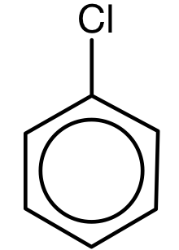

Compound **Z** (4-chloronitrobenzene):

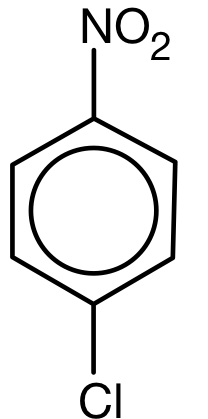

**[2 marks]**

> **[mark-scheme]**
> 1 mark for correct structure of Compound Y: chlorobenzene
> 
> 1 mark for correct structure of Compound Z: 4-chloronitrobenzene

> **[exam-tip]**
> The order matters: chlorination must occur before nitration so that the –Cl group directs the –NO2 into the 4-position
> 
> To decide which step comes first, work backwards from the final product (4-chlorophenylamine) and consider the directing effects:
> 
> The –Cl group is 2,4-directing, so if chlorination occurs first, nitration is directed to the 4-position. This gives 4-chloronitrobenzene (Compound Z). Reduction of the –NO2 group then gives 4-chlorophenylamine.
> 
> If nitration had occurred first, the –NO2 group would direct chlorination to the 3-position, giving 3-chloronitrobenzene, which would produce 3-chlorophenylamine after reduction (not the desired product).
The structure of the organic product is:

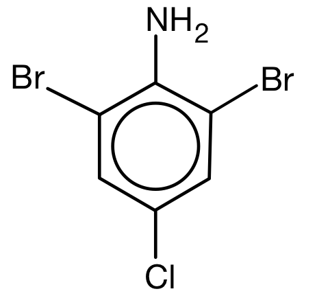

**[1 mark]**

> **[mark-scheme]**
> 1 mark for the correct structure of 2,6-dibromo-4-chloroaminobenzene
> 
> Br atoms must be at positions 2 and 6

> **[exam-tip]**
> The –NH2 group is strongly electron-donating and o/p directing. For unsubstituted aniline, reaction with bromine water gives 2,4,6-tribromoaniline.
> 
> In 4-chlorophenylamine, the 4-position (para to –NH2) is already occupied by –Cl. Only positions 2 and 6 (ortho to –NH2) are available, so the product is 2,6-dibromo-4-chlorophenylamine.

### Q2
Structures of **X** and **Y**:

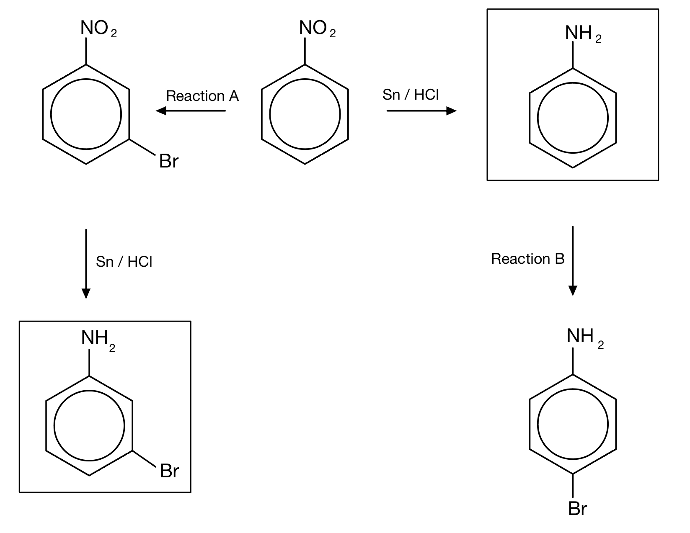

**[2 marks]**

Reagents for Reactions **A** and **B**:

- Br2 in the presence of anhydrous AlBr3 **[1 mark]**

The products are different because:

- Reaction **A** (bromination) must be performed before reduction: the –NO2 group is 3-directing, so bromination of nitrobenzene gives 3-bromonitrobenzene (Compound **X**) **[1 mark]**
- Reduction must be performed before Reaction **B** (bromination): the –NH2 group is 2,4-directing, so bromination of aniline gives 2- or 4-bromoaminobenzene (Compound **Y**) **[1 mark]**

> **[mark-scheme]**
> 1 mark for the correct structure of aniline / aminobenzene
> 
> 1 mark for the correct structure of 3-bromoaniline / 3-bromoaminobenzene
> 
> 1 mark for the correct reagents: Br2 in the presence of anhydrous AlBr3
> 
> 1 mark for the correct explanation for reaction **A**
> 
> 1 mark for the correct explanation for reaction **B**

> **[exam-tip]**
> This question tests knowledge of directing effects. The two products have the same molecular formula but are different structural isomers because the position of bromination on the ring depends on which substituent is present when bromination takes place.
> 
> As a general rule:
> 
> - Electron-donating groups (e.g. –NH2) make the ring more reactive and direct incoming electrophiles to the 2- and 4-positions
> - Electron-withdrawing groups (e.g. –NO2) make the ring less reactive and direct incoming electrophiles to the 3-position
The mechanism for Reaction **A** is:

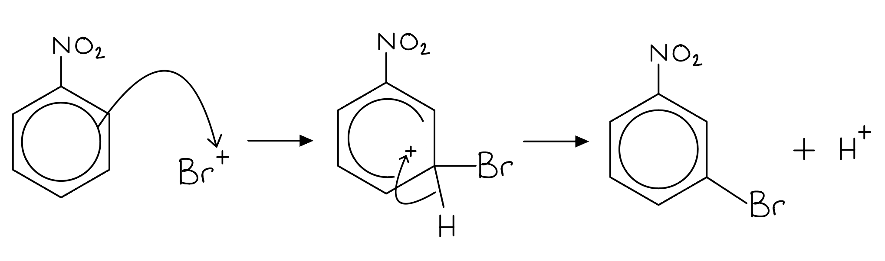

**[3 marks]**

> **[mark-scheme]**
> 1 mark for a curly arrow from the benzene ring to the Br+ electrophile
> 
> 1 mark for a correct carbocation intermediate with the positive charge shown in the horseshoe ring
> 
> The horseshoe must cover more than half the ring, with the gap at carbon 3 (the carbon being substituted)
> 
> 1 mark for a curly arrow from the C–H bond towards the positive charge in the ring **AND** correct products shown

> **[exam-tip]**
> Since the –NO2 group is 3-directing, bromine substitutes at carbon 3. The horseshoe in the intermediate must have its opening (gap) at carbon 3. The –NO2 group makes the ring less reactive overall, so electrophilic substitution is slower than for benzene itself.
The IUPAC name and structure of Compound **Z** are:

4-amino-3,5-dichlorobenzoic acid:

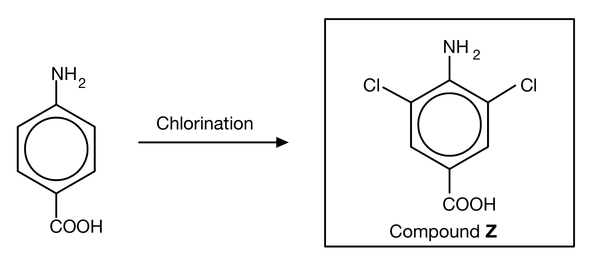

**[2 marks]**

> **[mark-scheme]**
> 1 mark for the correct name: 4-amino-3,5-dichlorobenzoic acid
> 
> 1 mark for the correct structure of 4-amino-3,5-dichlorobenzoic acid

> **[exam-tip]**
> Two groups compete to direct chlorination onto this ring:
> 
> The –NH2 group is electron-donating and directs to the 2- and 4-positions. However, the 4-position is already occupied by –COOH, so no chlorination occurs there.
> 
> The –COOH group is electron-withdrawing and directs to the 3- and 5-positions.
> 
> Both effects therefore direct chlorination to the 3- and 5-positions, giving 3,5-dichlorosubstitution.

### Q3
The structures of Compounds **A** and **B** are:

Compound **A**:

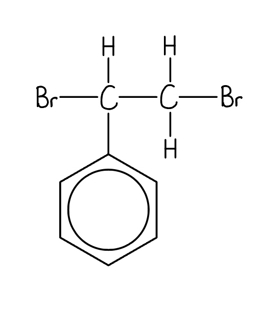

Compound **B** (any one isomer accepted):

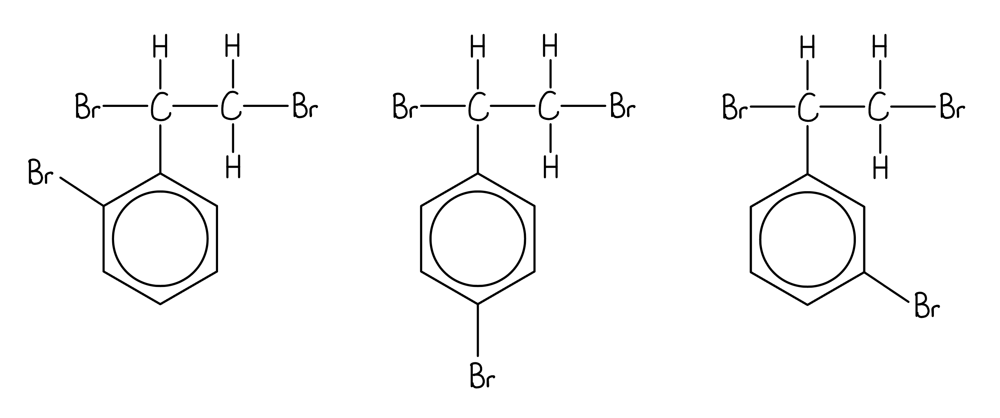

**[2 marks]**

> **[mark-scheme]**
> 1 mark for correct structure of Compound A
> 
> 1 mark for any one of the three possible isomers of Compound B: Br at the 2-, 3-, or 4-position on the ring

> **[exam-tip]**
> Compound A is formed by electrophilic addition of bromine across the C=C double bond. No halogen carrier is needed as alkenes react with halogens directly at room temperature). This adds two Br atoms across the side chain.
> 
> When AlBr3 is added, it acts as a halogen carrier to generate the Br+ electrophile for electrophilic substitution of the ring. There are three possible isomers for Compound B because Br can substitute at the 2nd, 3rd, or 4th position relative to the side chain.
The mechanism for the formation of Compound **B** from Compound **A** is:

Mechanism: electrophilic substitution

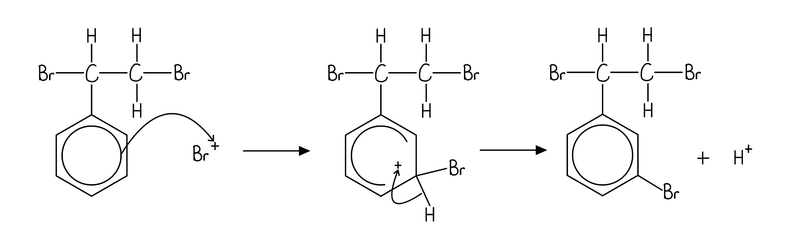

**[4 marks]**

> **[mark-scheme]**
> 1 mark for naming the mechanism: electrophilic substitution
> 
> 1 mark for a curly arrow from the benzene ring to the Br+ electrophile
> 
> 1 mark for a correct carbocation intermediate with the positive charge shown in the horseshoe ring
> 
> The horseshoe must cover more than half the ring, with the gap at the carbon being substituted (must not extend past carbon 2 or 4)
> 
> 1 mark for a curly arrow from the C–H bond towards the positive charge in the ring **AND** correct products shown

> **[exam-tip]**
> All electrophilic substitution mechanisms follow the same general pattern:
> 
> Pay careful attention to the horseshoe in the intermediate: it must cover more than half the benzene ring with the opening (gap) at the carbon being substituted.
The name and structure of the aromatic product are:

- 3-chloronitrobenzene

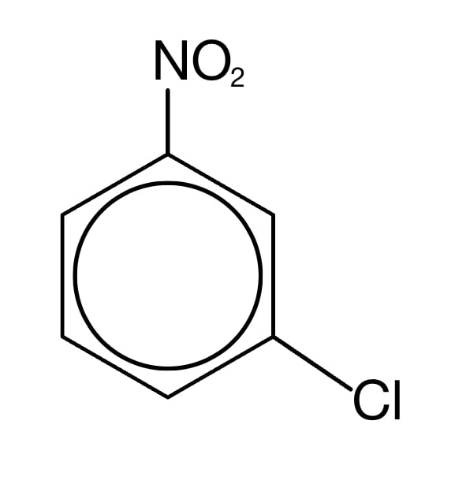

**[2 marks]**

> **[mark-scheme]**
> 1 mark for the correct name: 3-chloronitrobenzene
> 
> 1 mark for the correct structure of 3-chloronitrobenzene
> 
> 5-chloronitrobenzene is an accepted alternative name
> 
> The Cl must be at the 3- or 5-position; products with Cl at any other position are not accepted

> **[exam-tip]**
> The nitro group (–NO2) is an electron-withdrawing group that deactivates the benzene ring and directs incoming electrophiles to the 3- and 5-positions (meta positions). The chlorine atom will therefore substitute onto the 3rd or 5th carbon of the ring.

### Q4
> **[mark-scheme]**
> The reagents and mechanism for the conversion of benzene to chlorobenzene:
> 
> - AlCl3
> **AND**
> Cl2 **[1 mark]**
> - Electrophilic substitution **[1 mark]**

> **[exam-tip]**
> Chlorine gas is passed into benzene in the presence of anhydrous AlCl3 (a halogen carrier). The AlCl3 reacts with Cl2 to generate the Cl+ electrophile, which then attacks the benzene ring. Because a hydrogen is substituted by the chloro group, the mechanism is electrophilic substitution.
> **[mark-scheme]**
> The equation for the generation of the electrophile (Cl+):
> 
> - Cl2 + AlCl3 → AlCl4– + Cl+ **[1 mark]**
> 
> State symbols are not required

> **[exam-tip]**
> The halogen carrier (AlCl3) accepts a chloride ion from Cl2, generating the Cl+ electrophile. AlCl3 acts as a Lewis acid because it accepts an electron pair from Cl–, forming the tetrachloroaluminate ion (AlCl4–).
The mechanism for the chlorination of benzene is:

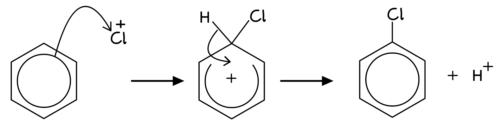

**[4 marks]**

> **[mark-scheme]**
> 1 mark for a curly arrow from the benzene ring to the Cl+ ion
> 
> 1 mark for a correct carbocation intermediate with the positive charge shown in the horseshoe ring
> 
> 1 mark for a curly arrow from the C–H bond towards the positive charge in the benzene cation
> 
> 1 mark for correct structure of chlorobenzene **AND** H+

> **[exam-tip]**
> All electrophilic substitution mechanisms follow the same general pattern:
> 
> The electrophile bonds to the benzene ring, forming an intermediate with a partially delocalised electron system (shown as a horseshoe with a + charge). The + charge may be drawn on the electron-deficient carbon or in the centre of the horseshoe. The intermediate then loses a proton to restore the delocalised electron system.
> **[mark-scheme]**
> How the C–Cl bond in chlorobenzene prevents nucleophilic substitution:
> 
> - One of the lone pairs of electrons on the chlorine atom is delocalised into the π system of the benzene ring **[1 mark]**
> - The C–Cl bond therefore has partial double-bond character **[1 mark]**
> - The C–Cl bond in chlorobenzene is very strong / stronger than in a halogenoalkane **[1 mark]**

> **[exam-tip]**
> Focus your answer on the C–Cl bond itself: the delocalisation of the lone pair into the π system creates partial double-bond character, making the bond very strong.
> 
> Note that the question asks about the C–Cl bond specifically. The repulsion of nucleophiles by the benzene ring's π electron cloud is a valid point about unreactivity in general, but is not what this question is asking about.

### Q5
The completed mechanism showing the generation of the Br+ electrophile is:

![Completed mechanism showing polarised Br₂ attacking AlBr₃ to form Br⁺ and the tetrahedral complex anion [AlBr₄]⁻, with a curved arrow from Br₂ to AlBr₃](assets/017-completed-mechanism-showing-polarised-br-attacki.png)

**[2 marks]**

> **[mark-scheme]**
> 1 mark for correct partial charges on Br2 and full charges on Br+ and [AlBr4]–
> 
> 1 mark for curly arrow going from δ– Br to Al

> **[exam-tip]**
> A lone pair of electrons from the δ– bromine atom is donated to AlBr3, forming a coordinate bond. This draws electrons away from the other bromine atom, making it electron-deficient and generating the Br+ electrophile.
The completed mechanism for the reaction of benzene with the Br+ electrophile is:

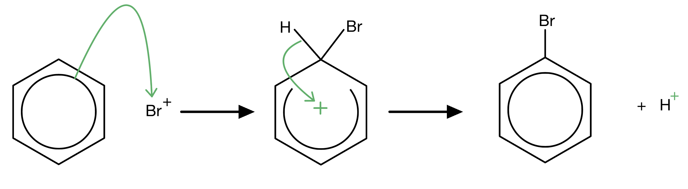

**[3 marks]**

> **[mark-scheme]**
> 1 mark for curly arrow from the benzene ring to the Br+ ion
> 
> 1 mark for positive charge in the horseshoe intermediate ring **AND** curly arrow from the middle of the C–H bond towards the positive charge of the benzene cation
> 
> 1 mark for positive charge on the H atom

> **[exam-tip]**
> All electrophilic substitution mechanisms follow the same general pattern:
> 
> The electrophile bonds to the benzene ring, forming an intermediate with a partially delocalised electron system, shown as a horseshoe with + inside. The + charge can be placed either on the electron-deficient carbon atom or in the centre of the benzene ring. The intermediate then loses a proton, restoring the delocalised electron system.
> **[mark-scheme]**
> The equation for the regeneration of the AlBr3 catalyst is:
> 
> - H+ + [AlBr4]– → HBr + AlBr3 **[1 mark]**

> **[exam-tip]**
> The AlBr3 catalyst is consumed in the first step to generate the Br+ electrophile. It is regenerated when the H+ ion produced during the substitution step reacts with [AlBr4]–. The overall equation for the reaction is:
> 
> C6H6 + Br2 → C6H5Br + HBr

### Q6
> **[mark-scheme]**
> The reagents and conditions for each reaction are:
> 
> - Reaction 1: Cl2 **AND** AlCl3 / FeCl3 / Fe / Al **[1 mark]**
> - Reaction 2: Cl2 **AND** ultraviolet / UV light **[1 mark]**

> **[exam-tip]**
> Halogenation of alkylarenes occurs in two different ways depending on the conditions:
> 
> - In the aromatic ring: requires a halogen carrier. For chlorination, the carrier must be a chloride compound, such as AlCl3, FeCl3, Fe, or Al. Bromide carriers (e.g. AlBr3) would not generate the Cl+ electrophile needed.
> - In the side chain: requires ultraviolet (UV) light to initiate homolytic fission of the Cl–Cl bond, generating chlorine radicals.
> **[mark-scheme]**
> The mechanism for each reaction is:
> 
> - Reaction 1: electrophilic substitution **[1 mark]**
> - Reaction 2: free radical substitution **[1 mark]**

> **[exam-tip]**
> In reaction 1, the AlCl3 catalyst generates the Cl+ electrophile, which attacks the electron-rich benzene ring in an electrophilic substitution reaction.
> 
> In reaction 2, UV light causes homolytic fission of the Cl–Cl bond, producing chlorine radicals that react with the methyl side chain in a free radical substitution reaction.
> 
> Both are substitution reactions because a hydrogen atom is replaced by chlorine, but the mechanisms are completely different.
i) One organic product formed with excess chlorine is:

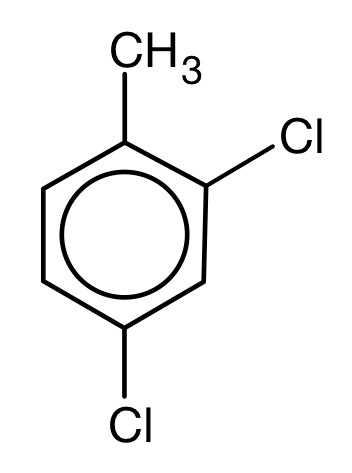

**OR**

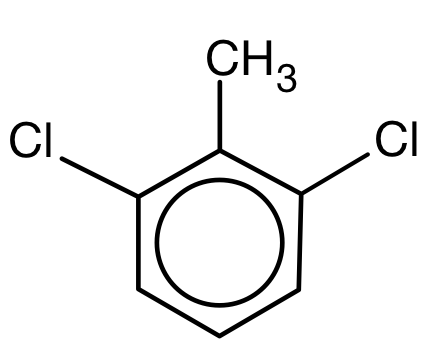

**OR**

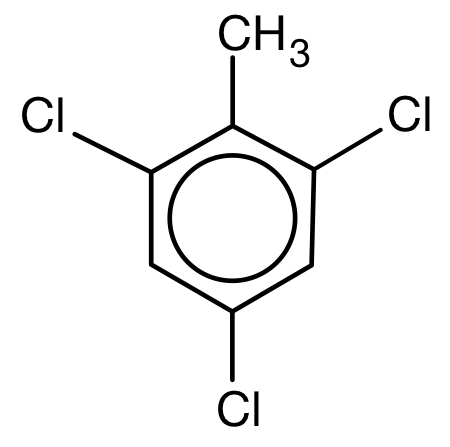

**[1 mark]**

> **[mark-scheme]**
> 1 mark for a correct structure for 2,4-dichloromethylbenzene **OR **2,6-dichloromethylbenzene **OR **2,4, 6-trichloromethylbenzene

> **[mark-scheme]**
> ii) The systematic name of the product drawn in (i) is:
> 
> - 2,4-dichloromethylbenzene
> **OR**
> 2,6-dichloromethylbenzene
> **OR**
> 2,4,6-trichloromethylbenzene **[1 mark]**
> 
> The name must match the structure drawn in (i).
> 
> 4,6-dichloromethylbenzene is the same compound as 2,4-dichloromethylbenzene and is not accepted as a separate answer.

> **[exam-tip]**
> The methyl group is an electron-donating substituent, so it directs incoming electrophiles to the 2- and 4-positions on the ring. When excess chlorine is present, further substitution can occur at any available 2-, 4-, or 6-position, giving up to three possible monochloro, dichloro, or trichloro products.

### Q7
The correct products are:

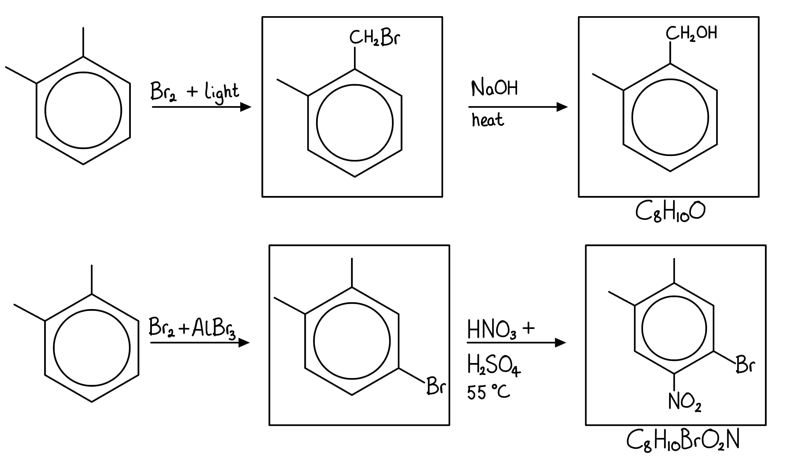

**[4 marks]**

> **[mark-scheme]**
> 1 mark for the correct structure of 1-(bromomethyl)-2-methylbenzene
> 
> 1 mark for the correct structure of (2-methylphenyl)methanol
> 
> 1 mark for the correct structure of 4-bromo-1,2-dimethylbenzene
> 
> 1 mark for the correct structure of 1-bromo-4,5-dimethyl-2-nitrobenzene
> 
> Any orientation of the bromine on the substituted methylbenzene compounds is accepted
> 
> Another suitable halogen carrier is FeBr3

> **[exam-tip]**
> The question covers two different reaction types.
> 
> 1. The first sequence uses UV light and Br2
> 
>   - These are conditions for free radical substitution, not electrophilic substitution.
>   - The Br substitutes a hydrogen on the methyl group side chain to give a bromomethyl compound.
>   - Nucleophilic substitution with OH– then forms the alcohol product.
> 2. The second sequence uses a halogen carrier (AlBr3 or FeBr3)
> 
>   - These are conditions for electrophilic substitution of the ring.
>   - The methyl group is electron-donating and 2,4-directing, so Br enters the ring at the 2- or 4-position.
>   - Concentrated HNO3/H2SO4 generates the NO2+ electrophile for nitration, which also undergoes electrophilic substitution.
> **[mark-scheme]**
> The equation for the generation of the electrophile (Br+):
> 
> - AlBr3 + Br2 → [AlBr4]– + Br+ **[1 mark]**
> 
> State symbols are not required

> **[exam-tip]**
> The halogen carrier (AlBr3) acts as a Lewis acid, accepting a Br– ion from Br2 to generate the Br+ electrophile. Any anhydrous aluminium halide (AlCl3, AlBr3) or iron halide (FeCl3, FeBr3) can act as a halogen carrier.
The mechanism for the bromination of methylbenzene is:

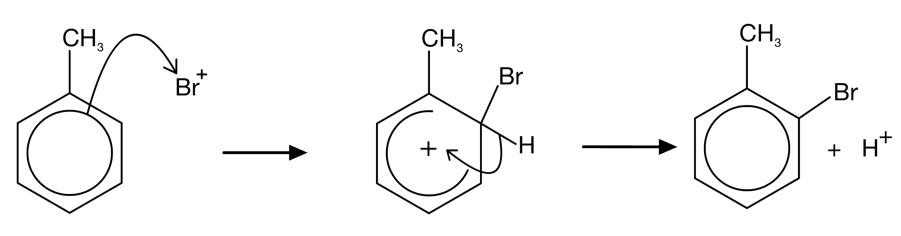

**[4 marks]**

> **[mark-scheme]**
> 1 mark for a curly arrow from the benzene ring to the Br+ ion
> 
> 1 mark for a correct carbocation intermediate with the positive charge shown in the horseshoe ring
> 
> 1 mark for a curly arrow from the C–H bond towards the positive charge in the methylbenzene cation
> 
> 1 mark for correct structure of 2-bromomethylbenzene or 4-bromomethylbenzene **AND** H+

> **[exam-tip]**
> All electrophilic substitution mechanisms follow the same general pattern:
> 
> The methyl group is electron-donating and 2,4-directing, so bromine must substitute at the 2- or 4-position relative to the methyl group:
> **[mark-scheme]**
> Why halogenoalkanes are more reactive than halogenoarenes towards nucleophilic substitution:
> 
> - The C–Br bond in halogenoalkanes / bromopropane is polar: δ+ C atom and δ– Br atom **[1 mark]**
> - Nucleophiles can attack the δ+ carbon atom **[1 mark]**
> - One of the lone pairs of electrons on the bromine in bromobenzene is delocalised into the π system of the benzene ring **[1 mark]**
> - The C–Br bond in bromobenzene therefore has partial double-bond character and is very strong **[1 mark]**

> **[exam-tip]**
> A complete answer contrasts both compounds: in halogenoalkanes, the polar C–Br bond is open to nucleophilic attack at the δ+ carbon; in halogenoarenes, lone pair donation from Br into the ring creates partial double-bond character that strengthens the C–Br bond and prevents nucleophilic substitution.

### Q8
> **[mark-scheme]**
> The more reactive compound towards nucleophilic substitution is:
> 
> - 2-bromopentane **[1 mark]**

> **[exam-tip]**
> Halogenoarenes are much less reactive than halogenoalkanes towards nucleophilic substitution. In bromobenzene, the lone pair on the bromine atom is partially delocalised into the benzene ring, which strengthens the C–Br bond significantly compared to the average C–Br bond.
> **[mark-scheme]**
> The bond enthalpy of the C–Br bond in bromobenzene compared to the average C–Br bond enthalpy, and what this means for bond strength:
> 
> - Greater **[1 mark]**
> - The C–Br bond in bromobenzene is stronger than a typical C–Br bond **[1 mark]**

> **[exam-tip]**
> This question has two parts: state whether the bond enthalpy is greater or less, then state what this means about bond strength. One mark is available for each.
> 
> You are not asked to explain why the bond is strong. There is no need to mention delocalisation of the bromine lone pair into the benzene ring.
> **[mark-scheme]**
> When a hydroxide ion approaches bromobenzene under standard conditions:
> 
> - The hydroxide ion / OH– is repelled by the delocalised electrons of the benzene ring **[1 mark]**

> **[exam-tip]**
> Under standard conditions, the negative charge of the hydroxide ion is repelled by the pi electron cloud above and below the benzene ring, preventing nucleophilic substitution. Only under extreme conditions (around 200 °C and 200 atm pressure) is this repulsion overcome.

### Q9
> **[mark-scheme]**
> i) The conditions required for Reaction 1 (electrophilic substitution of the ring):
> 
> Any **one** from:
> 
> - AlCl3
> - FeCl3
> - Al
> - Fe
> 
> **[1 mark]**
> 
> ii) The conditions required for Reaction 2 (free radical substitution of the side chain):
> 
> - UV light / sunlight / hf **[1 mark]**
> 
> 'Aqueous' is not accepted as a condition for Reaction 2

> **[exam-tip]**
> Reaction 1 substitutes a hydrogen on the benzene ring (electrophilic substitution), requiring a halogen carrier.
> 
> AlCl3 and FeCl3 are used directly; Al and Fe react with Cl2 in situ to form the halide. I2 is not a valid halogen carrier for chlorination.
> 
> Reaction 2 substitutes a hydrogen on the methyl group side chain (free radical substitution), requiring UV light. Writing 'aqueous' does not gain the mark.
> **[mark-scheme]**
> The reagent for Reaction 3 (conversion of carboxylic acid to acyl chloride):
> 
> Any **one** from:
> 
> - SOCl2
> - PCl5
> - PCl3
> 
> **[1 mark]**

> **[exam-tip]**
> Three reagents can convert a carboxylic acid to an acyl chloride:
> 
> - Sulfur dichloride oxide, SOCl2 (liquid)
> - Phosphorus(V) chloride, PCl5 (solid)
> - Phosphorus(III) chloride, PCl3 (liquid, with heat)
> **[mark-scheme]**
> i) The correct order of ease of hydrolysis:
> 
> - **C** > **B** > **A** **[1 mark]**
> 
> ii) The explanation for the differences in reactivity:
> 
> - Compound **C** (acyl chloride) is most reactive: the carbon atom is highly δ+ due to bonding to two electronegative atoms (Cl and =O)
> **OR**
> an addition-elimination mechanism is possible **[1 mark]**
> - Compound **A** (aryl chloride) is least reactive: a lone pair on the Cl atom is delocalised into the π system of the benzene ring, giving the C–Cl bond partial double-bond character and making it very strong **[1 mark]**

> **[exam-tip]**
> Hydrolysis involves nucleophilic attack by OH– on the carbon atom. Ease of hydrolysis depends on how accessible and electron-deficient that carbon is:
> 
> Compound **C** (acyl chloride) is most reactive: the carbon is highly δ+ (bonded to two electronegative groups: Cl and C=O), and an addition-elimination mechanism is available.
> 
> Compound **B** (chloroalkyl benzene) is intermediate: the C–Cl bond is polar and accessible, but the carbon is less activated than in an acyl chloride.
> 
> Compound **A** (aryl chloride) is least reactive: the lone pair on Cl is delocalised into the benzene ring π system, creating partial double-bond character that significantly strengthens the C–Cl bond.
