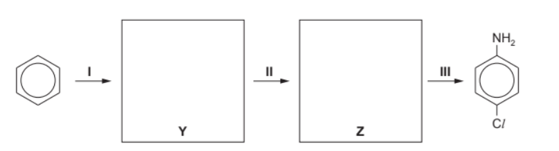
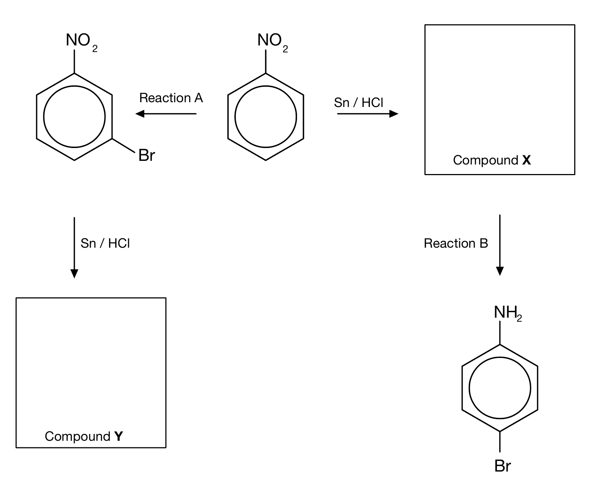
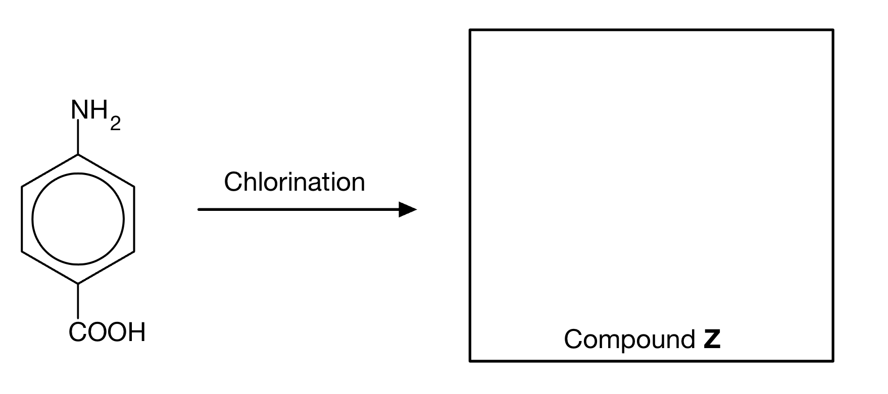
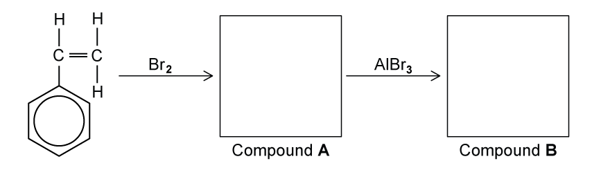
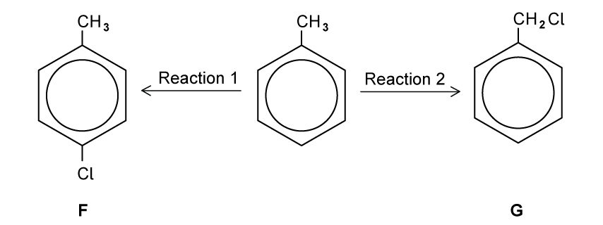
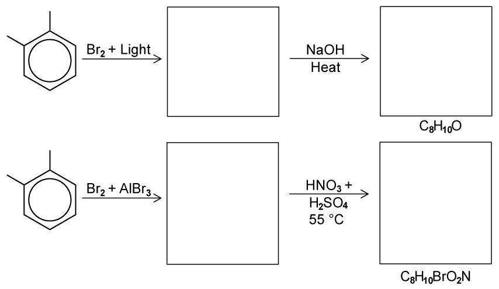
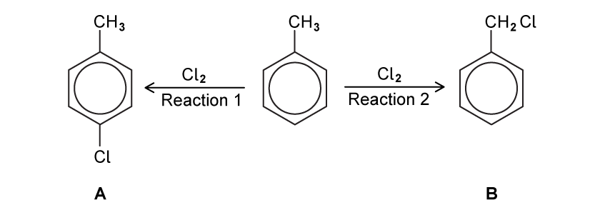

# Exam Questions — Halogen Compounds
**31. Halogen Compounds** · Cambridge (CIE) A-LEVEL chemistry (9701)
> Source: [https://www.savemyexams.com/a-level/chemistry/cie/25/topic-questions/](https://www.savemyexams.com/a-level/chemistry/cie/25/topic-questions/) · 9 questions across 1 sets

## Structured Questions (9 questions)

### Q1 — hard — 7 marks

**Q1** [4 marks]

Chlorobenzene is formed by bubbling chlorine gas into benzene at room temperature in the presence of anhydrous AlCl3.

Explain, by the use of equations, how AlCl3 acts as a catalyst in the chlorination of benzene.

**Q1** [2 marks]

Nitrobenzene undergoes further substitution considerably more slowly than chlorobenzene. In nitrobenzene, the incoming group joins the benzene ring in the 3-position, whereas in chlorobenzene the incoming group joins to the benzene ring in the 4-position. Use these ideas to suggest the structures of the intermediate compounds **Y** and **Z** in the following synthesis of 4-chlorophenylamine.

**Q1** [1 mark]

Suggest the structure of the organic product formed when 4-chlorophenylamine reacts with bromine water.

### Q2 — hard — 10 marks

**Q2** [5 marks]

Nitration of a benzene ring forms nitrobenzene. The subsequent reactions of nitrobenzene are shown in Fig. 1.1.

**Fig. 1.1**

The structures of the products have the same molecular formula. Explain why these products are different. In your answer include the structures of compounds **X** and **Y** and reagents for reactions **A** and **B**.

**Q2** [3 marks]

**Extract:**

Nitration of a benzene ring forms nitrobenzene. The subsequent reactions of nitrobenzene are shown in Fig. 1.1.

Reagents for Reaction A: Br~2~ in the presence of anhydrous AlBr~3~

Reaction A (bromination) must be performed before reduction: the –NO~2~ group is 3-directing, so bromination of nitrobenzene gives 3-bromonitrobenzene (Compound X)

Using curly arrows, describe the mechanism for reaction **A**.

**Q2** [2 marks]

State the IUPAC name of Compound **Z** and draw the structure.

### Q3 — medium — 8 marks

**Q3** [2 marks]

A student investigated two reactions of phenylethene, C6H5CH=CH2 as shown in Fig. 3.1. First she reacted phenylethene with excess bromine at room temperature to form Compound **A**. She then added aluminium bromide, AlBr3 to the reaction mixture to form Compound **B**.

**Fig. 3.1**

Draw the structures of Compounds **A** and **B**.

**Q3** [4 marks]

**Extract:**

A student investigated two reactions of phenylethene, C~6~H~5~CH=CH~2~ as shown in Fig. 3.1. First she reacted phenylethene with excess bromine at room temperature to form Compound **A**. She then added aluminium bromide, AlBr~3~ to the reaction mixture to form Compound **B**.

Name and outline the mechanism for the formation of Compound **B** from Compound **A**.

**Q3** [2 marks]

Nitrobenzene was reacted with aluminium chloride and chlorine. Name and draw the structure of the aromatic product formed in this reaction.

### Q4 — medium — 10 marks

**Q4** [2 marks]

This question is about halogenoarene compounds.

State the reagents and name of the mechanism used to convert benzene into chlorobenzene

**Q4** [1 mark]

**Extract:**

State the reagents and name of the mechanism used to convert benzene into chlorobenzene

The reagents and mechanism for the conversion of benzene to chlorobenzene:
- AlCl3 AND Cl2
- Electrophilic substitution

Using your answer to **(a)**, construct an equation for the generation of the ion which reacts with benzene.

**Q4** [4 marks]

**Extract:**

This question is about halogenoarene compounds.

State the reagents and name of the mechanism used to convert benzene into chlorobenzene

The reagents and mechanism for the conversion of benzene to chlorobenzene:
- AlCl3 AND Cl2
- Electrophilic substitution

The equation for the generation of the electrophile (Cl+):
- Cl2 + AlCl3 → AlCl4– + Cl+

Draw the mechanism for the chlorination of benzene.

**Q4** [3 marks]

Explain how the C–Cl bond in chlorobenzene prevents nucleophilic substitution from occurring.

### Q5 — easy — 6 marks

**Q5** [2 marks]

Benzene reacts with bromine in the presence of an aluminium bromide, AlBr3, catalyst to form bromobenzene. Fig. 1.1 shows an incomplete mechanism for the generation of the Br+ electrophile.

Complete the mechanism in Fig. 1.1. Include all relevant curly arrows, lone pairs, and dipoles.

**Fig. 1.1**

**Q5** [3 marks]

Complete the mechanism in Fig. 1.2 to show the reaction between benzene and the Br+ electrophile. Include all relevant curly arrows and charges.

**Fig. 1.2**

**Q5** [1 mark]

**Extract:**

Benzene reacts with bromine in the presence of an aluminium bromide, AlBr3, catalyst to form bromobenzene. Fig. 1.1 shows an incomplete mechanism for the generation of the Br+ electrophile.

A lone pair of electrons from the δ– bromine atom is donated to AlBr3, forming a coordinate bond. This draws electrons away from the other bromine atom, making it electron-deficient and generating the Br+ electrophile.

The intermediate then loses a proton, restoring the delocalised electron system.

Construct an equation to show how the AlBr3 catalyst is regenerated.

### Q6 — easy — 6 marks

**Q6** [2 marks]

Methylbenzene can react with chlorine under different conditions to give the monochloro derivatives **F** and **G**, shown in Fig. 2.1.

**Fig. 2.1**

State the reagents and conditions for each reaction.

**Q6** [2 marks]

**Extract:**

Methylbenzene can react with chlorine under different conditions to give the monochloro derivatives **F** and **G**, shown in Fig. 2.1.

{align=center} **Fig. 2.1**

State the name of the mechanism for each reaction in Fig. 2.1.

**Q6** [2 marks]

**Extract:**

Methylbenzene can react with chlorine under different conditions to give the monochloro derivatives F and G, shown in Fig. 2.1.

Fig. 2.1

Reaction 1: Cl2 AND AlCl3 / FeCl3 / Fe / Al

Product F: 4-chloromethylbenzene

When the reagent used in reaction 1 is present in excess, further substitution occurs.

i) Draw the skeletal formula of one organic product formed.

[1]

ii) State the systematic name of the product drawn in **(i)**.

[1]

### Q7 — medium — 13 marks

**Q7** [4 marks]

Predict the products of the following reactions in Fig. 2.1 and draw their structures in the boxes provided. Note that the molecular formula of the final product is given in each case.

**Fig. 2.1**

**Q7** [1 mark]

Construct an equation for the generation of the electrophile when methylbenzene reacts with bromine and aluminium bromide.

**Q7** [4 marks]

Draw the reaction mechanism for the reaction of methylbenzene with bromine and aluminium bromide.

**Q7** [4 marks]

Explain why halogenoalkanes such as bromopropane are more reactive than halogenoarenes such as bromobenzene.

### Q8 — easy — 4 marks

**Q8** [1 mark]

2-bromopentane is a halogenoalkane and bromobenzene is a halogenoarene.

State which compound is more reactive towards nucleophilic substitution.

**Q8** [2 marks]

The average bond enthalpy of a C–Br bond is 276 kJ mol-1. Suggest whether the bond enthalpy of the C–Br bond in bromobenzene is greater or less than the average bond enthalpy and state what this means about the strength of the C–Br bond in bromobenzene.

**Q8** [1 mark]

2-bromopentane readily undergoes nucleophilic substitution with a hydroxide ion, OH–, to form pentan-2-ol whereas bromobenzene requires extreme conditions to react when attacked by a nucleophile, such as OH–.

Suggest what happens, under standard conditions, as a hydroxide ion approaches a molecule of bromobenzene.

### Q9 — hard — 6 marks

**Q9** [2 marks]

Fig. 3.1 shows two reactions of methylbenzene.

**Fig. 3.1**

i) State the conditions required for reaction **1**.

[1]

ii) State the conditions required for reaction **2**.

[1]

*Source: 2004 4 Q5A*

**Q9** [1 mark]

State the reagent needed to carry out the following reaction occurring in Fig. 3.2.

**Fig. 3.2**

*Source: 2004 4 Q5*

**Q9** [3 marks]

**Extract:**

Fig. 3.1 shows two reactions of methylbenzene.

Reaction 1 shows chlorination of the ring with Cl~2~/AlCl~3~ (electrophilic substitution), and Reaction 2 shows chlorination of the methyl group side chain with Cl~2~/UV light (free radical substitution)

Fig. 3.2 shows Reaction 3 showing the conversion of 4-methylbenzoic acid (a carboxylic acid) to the corresponding acyl chloride using a suitable reagent

The three chloro-compounds **A**, **B** and **C** vary in their ease of hydrolysis.

i) Place a tick in the box in Table 3.1 corresponding to the correct relative rates of hydrolysis. [the symbol '>' means 'faster than'].

**Table 3.1**

|   | Place **one** tick only in this column |
|---|---|
| **A** > **B** > **C** |   |
| **A** > **C** > **B** |   |
| **B** > **A** > **C** |   |
| **B** > **C** > **A** |   |
| **C** > **B** > **A** |   |
| **C** > **A** > **B** |   |

[1]

ii) Suggest an explanation for these differences in reactivity.

[2]

*Source: 2004 4 Q5*

