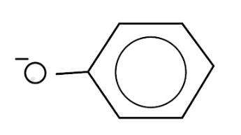
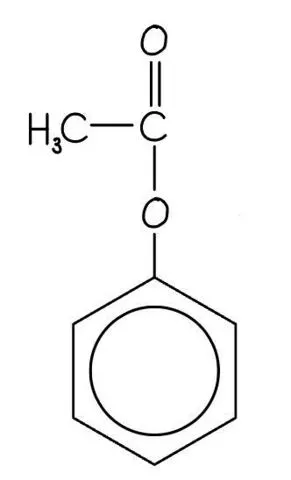
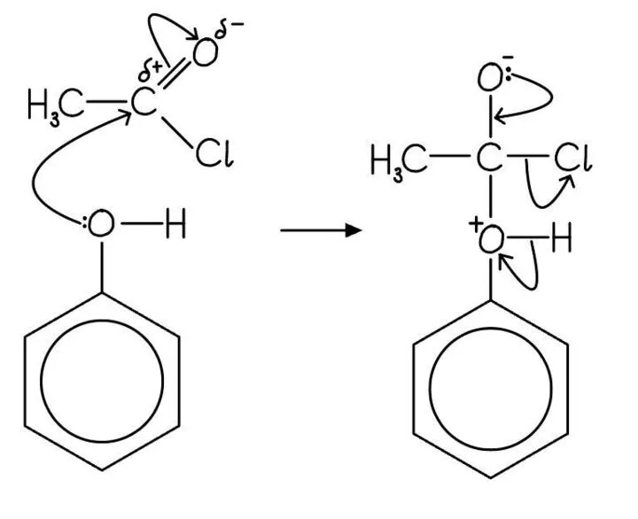
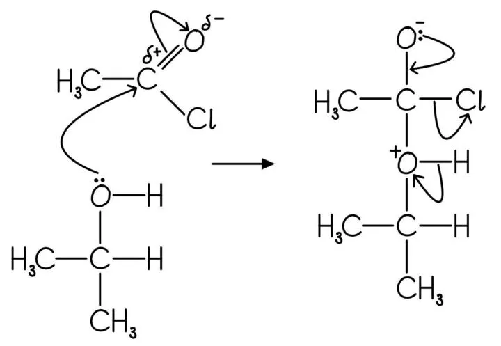

# Mark Schemes — Alcohols
**32. Hydroxy Compounds** · Cambridge (CIE) A-LEVEL chemistry (9701)

## Structured Questions (3 questions)

### Q1
> **[mark-scheme]**
> i) The reagents and conditions required to make ethyl ethanoate directly from a carboxylic acid are:
> 
> - Ethanol / C2H5OH **[1 mark]**
> - Concentrated sulfuric acid / conc H2SO4 (catalyst) **[1 mark]**
> - Heat / heat under reflux **[1 mark]**
> 
> ii) An equation to show the formation of ethyl ethanoate is:
> 
> - C2H5OH + CH3COOH ⇌ CH3COOC2H5 + H2O **[1 mark]**
> 
> State symbols are not required

> **[exam-tip]**
> Fischer esterification requires three things: the alcohol, the carboxylic acid, and concentrated sulfuric acid as the acid catalyst. Heat is also needed to drive the reaction forward at a practical rate.
> 
> The reaction is reversible (⇌), so a large excess of one reactant or continuous removal of water drives the equilibrium towards the ester product.
> 
> The equation follows the pattern: alcohol + carboxylic acid ⇌ ester + water.
> **[mark-scheme]**
> The molecular formula of phenyl benzoate is:
> 
> - C13H10O2 **[1 mark]**

> **[exam-tip]**
> Count the atoms in each part of the molecule systematically. Phenyl benzoate consists of two benzene rings joined by an ester group (–COO–):
> 
> - Benzoate part (C6H5CO–): 7 carbons, 5 hydrogens
> - Ester oxygens: 2 oxygens
> - Phenyl part (–OC6H5): 6 carbons, 5 hydrogens
> 
> Total: C13H10O2
> 
> If you find it easier, draw the full displayed formula and count each type of atom individually before writing the molecular formula.
> **[mark-scheme]**
> i) The reagents and conditions needed for the reaction in part **(b)** are:
> 
> - Aqueous sodium hydroxide / NaOH (aq) / aqueous base **[1 mark]**
> - Room temperature / no heating required **[1 mark]**
> 
> ii) One observation made during this reaction is:
> 
> - (Steamy) white fumes of hydrogen chloride / HCl **[1 mark]**
> 
> 'Smoke' is not accepted; 'fumes' or 'vapour' must be stated

> **[exam-tip]**
> The aqueous sodium hydroxide serves two purposes here: it reacts with phenol to form the phenoxide ion (a stronger nucleophile), and it neutralises the HCl produced during the reaction.
> 
> The reaction between an acyl chloride and a nucleophile is vigorous at room temperature. No heating is needed or appropriate — acyl chlorides react readily with cold aqueous solutions.
i) The structure of the phenoxide ion is:

**[1 mark]**

> **[mark-scheme]**
> 1 mark for correct skeletal formula of the phenoxide ion with a negative charge on the oxygen atom
> 
> ii) Phenol is converted into the phenoxide ion before the addition of benzoyl chloride because:
> 
> - The phenoxide ion is a stronger / better nucleophile than phenol **[1 mark]**
> 
> iii) An equation for the overall reaction is:
> 
> - C6H5O- + C6H5COCl → C6H5COOC6H5 + Cl- **[1 mark]**

> **[exam-tip]**
> The phenoxide ion (C6H5O-) has a full negative charge on the oxygen, making it more electron-rich and a stronger nucleophile than phenol. It attacks the δ+ carbonyl carbon of benzoyl chloride more effectively.
> 
> When writing the equation for part iii), note that the overall reaction between phenoxide ion and benzoyl chloride produces phenyl benzoate and a chloride ion (Cl-), not HCl. The chloride ion forms because the phenoxide ion is already negatively charged. So, the product of the ionic reaction is Cl-, not neutral HCl.

### Q2
i) The skeletal formula of the organic product is:

**[1 mark]**

> **[mark-scheme]**
> 1 mark for correct skeletal formula of phenyl ethanoate
> 
> ii) The systematic (IUPAC) name of the organic product is:
> 
> - Phenyl ethanoate **[1 mark]**

> **[exam-tip]**
> Phenol acts as the alcohol component in this ester formation. When phenol reacts with an acyl chloride, the –OH of phenol bonds to the carbonyl carbon of the acyl chloride, producing an ester and HCl.
> 
> The product is named from two parts: the phenyl group (from phenol) and the ethanoate group (from ethanoyl chloride). Together: phenyl ethanoate.
The mechanism for nucleophilic addition-elimination is:

**[4 marks]**

> **[mark-scheme]**
> 1 mark for a curly arrow from the lone pair on the O–H oxygen to the δ+ carbonyl carbon
> 
> 1 mark for a curly arrow from the C=O bond to the δ– carbonyl oxygen
> 
> 1 mark for a correct tetrahedral intermediate structure
> 
> 1 mark for correct curly arrows on the intermediate showing loss of Cl- and restoration of the C=O bond

> **[exam-tip]**
> This mechanism follows the same nucleophilic addition-elimination pathway as the reaction of an alcohol with an acyl chloride. The lone pair on the oxygen of the phenol acts as the nucleophile, attacking the δ+ carbonyl carbon.
> 
> Remember to show:
> 
> - The δ+ on the carbonyl carbon and δ– on the carbonyl oxygen
> - A curly arrow from the O lone pair to the C=O carbon
> - A curly arrow from the C=O bond to the oxygen
> - The tetrahedral intermediate structure with all bonds shown
> - Curly arrows for the elimination step (Cl- leaving, C=O re-forming)
> **[mark-scheme]**
> Phenol acts as a weak acid because:
> 
> - The lone pair on the oxygen atom delocalises into the benzene / aromatic π system **[1 mark]**
> - This weakens the O–H bond / stabilises the phenoxide ion (C6H5O-) **[1 mark]**
> - The H+ ion can be donated / released more easily **[1 mark]**
> 
> Phenol is a weak acid, so the equilibrium C6H5OH ⇌ C6H5O- + H+ lies to the left; accept references to partial dissociation

> **[exam-tip]**
> Phenol is a weak acid because it only partially dissociates in aqueous solution. The explanation requires three linked ideas:
> 
> 1. Delocalisation: the lone pair on oxygen spreads into the ring π system.
> 2. Effect on O–H bond: this weakens the O–H bond and stabilises the phenoxide ion formed when H+ leaves.
> 3. Result: H+ can be released, but the equilibrium lies to the left, making phenol weak rather than strong.
> 
> Do not describe phenol as fully dissociating — that would make it a strong acid. The stability of the phenoxide ion, provided by delocalisation, is the key driving factor.

### Q3
> **[mark-scheme]**
> An equation for this reaction is:
> 
> - (CH3)2CHOH + CH3COCl → CH3COOCH(CH3)2 + HCl **[1 mark]**
> 
> State symbols are not required

> **[exam-tip]**
> When an alcohol reacts with an acyl chloride, an ester and hydrogen chloride are produced. The ester forms from the R–O group of the alcohol bonding to the carbonyl carbon of the acyl chloride; the Cl leaves as HCl.
> 
> The product is propan-2-yl ethanoate. The ester is named from two parts: the alcohol (propan-2-ol → propan-2-yl) and the acyl chloride (ethanoyl chloride → ethanoate).
The mechanism for nucleophilic addition-elimination is:

**[4 marks]**

> **[mark-scheme]**
> 1 mark for a curly arrow from the lone pair on the O–H oxygen to the δ+ carbonyl carbon
> 
> 1 mark for a curly arrow from the C=O bond to the δ– carbonyl oxygen
> 
> 1 mark for a correct tetrahedral intermediate structure
> 
> 1 mark for correct curly arrows on the intermediate showing loss of Cl- and restoration of the C=O bond

> **[exam-tip]**
> This mechanism is nucleophilic addition-elimination. There are two stages:
> 
> 1. Addition: the lone pair on the oxygen of propan-2-ol attacks the δ+ carbonyl carbon; the C=O breaks to form a tetrahedral intermediate with O- and Cl still attached.
> 2. Elimination: the C–Cl bond breaks (Cl- leaves); the C=O re-forms as electrons from O- move back onto carbon.
> 
> Curly arrows must start from a lone pair or a bond and point towards a positive or partial-positive centre. Show all δ+ and δ– on the C=O and C–Cl bonds clearly before drawing your arrows.
> **[mark-scheme]**
> i) A reagent that could be used to test for the presence of CH3COCl is:
> 
> - Silver nitrate solution / aqueous AgNO3 **[1 mark]**
> 
> ii) The observation for a positive test is:
> 
> - (Immediate) white precipitate **[1 mark]**

> **[exam-tip]**
> The acyl chloride reacts with water in the silver nitrate solution to release HCl, which then reacts with silver ions to form white silver chloride (AgCl). Aldehydes do not react in this way, so a positive test (precipitate) confirms the presence of unreacted acyl chloride.
> 
> The reaction sequence is:
> 
> CH3COCl + H2O → CH3COOH + HCl
> 
> Ag+ (aq) + Cl- (aq) → AgCl (s)
> 
> Note that the precipitate forms immediately with an acyl chloride, whereas a halogenoalkane would require warming. This rapid reaction is a characteristic property of acyl chlorides.
