# Mark Schemes — Phenol
**32. Hydroxy Compounds** · Cambridge (CIE) A-LEVEL chemistry (9701)

## Structured Questions (10 questions)

### Q1
> **[mark-scheme]**
> i) The essential conditions for the reaction in stage 2 are:
> 
> - Temperature below 10 °C **[1 mark]**

ii) The skeletal formula of the diazonium salt formed in stage 2 is:

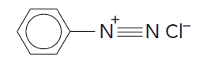

**[3 marks]**

> **[mark-scheme]**
> 1 mark for C6H5– group bonded to nitrogen
> 
> 1 mark for N≡N+ group shown
> 
> 1 mark for Cl- counter ion

> **[exam-tip]**
> The temperature is kept below 10 °C to prevent the diazonium salt decomposing prematurely.
> 
> The diazonium salt formed in stage 2 is benzenediazonium chloride. The diazotisation reaction is:
> 
> C6H5NH2 + HNO2 + HCl → C6H5N2+Cl- + 2H2O
> **[mark-scheme]**
> The balanced equations for each stage are:
> 
> Stage 1:
> 
> - NaNO2 + HCl → HNO2 + NaCl **[1 mark]**
> 
> Stage 2:
> 
> - C6H5NH2 + HNO2 + HCl → C6H5N2+Cl- + 2H2O
> **OR**
> C6H5NH2 + NaNO2 + 2HCl → C6H5N2+Cl- + 2H2O + NaCl **[1 mark]**
> 
> Stage 3:
> 
> - C6H5N2+Cl- + H2O → C6H5OH + HCl + N2 **[1 mark]**

> **[exam-tip]**
> Stage 1: sodium nitrite reacts with hydrochloric acid to produce nitric(III) acid (nitrous acid) and sodium chloride.
> 
> Stage 2: phenylamine undergoes diazotisation with nitric(III) acid and hydrochloric acid to form benzenediazonium chloride and water. The reaction also occurs directly with sodium nitrite and excess hydrochloric acid. In this case sodium chloride is also produced.
> 
> Stage 3: the diazonium salt undergoes thermal decomposition in the presence of water to give phenol, hydrochloric acid, and nitrogen gas.
i) The skeletal formula of Z is:

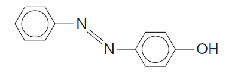

**[2 marks]**

> **[mark-scheme]**
> 1 mark for both arene rings and hydroxyl group (–OH) correctly drawn and connected
> 
> 1 mark for –N=N– azo group connecting the two rings
> 
> ii) A possible use for Z is:
> 
> Any **one** from
> 
> - Dye
> - Food colouring
> - Indicator
> 
> **[1 mark]**

> **[exam-tip]**
> Azo dyes are formed from the reaction between diazonium ions and phenol in a coupling reaction.
> 
> In this reaction, an orange dye is formed.
> 
> Make sure you are able to draw the structure of this azo compound.
> **[mark-scheme]**
> The reaction to produce the diazonium ion is carried out below 10 °C because:
> 
> - The diazonium ion will decompose at higher temperatures **[1 mark]**

> **[exam-tip]**
> In the next step, the diazonium ion is reacted with phenol in a coupling reaction to form the azo compound Z.
> 
> Keeping the temperature below 10 °C prevents the diazonium ion from decomposing before it can react with phenol.
> 
> Decomposition of the diazonium ion produces phenol and nitrogen gas.

### Q2
> **[mark-scheme]**
> The molecular formula of 1-naphthol is:
> 
> - C10H8O **[1 mark]**

> **[exam-tip]**
> It can be useful to sketch 1-naphthol showing all hydrogen atoms explicitly before counting.
> 
> A common mistake is to assume there are 12 carbon atoms because there appear to be two benzene rings. However, two carbon atoms are shared between the fused rings, giving a total of 10 carbons.
> **[mark-scheme]**
> An equation to show how 1-naphthol acting as a weak acid is:
> 
> - C10H7OH ⇌ C10H7O- + H+
> **OR**
>  C10H7OH + H2O ⇌ C10H7O- + H3O+ **[1 mark]**
> 
> Both correct formulae and the equilibrium sign (⇌) are required for this mark.

> **[exam-tip]**
> You would not be penalised for omitting square brackets around the naphtholate anion. The square brackets indicate that the negative charge is delocalised across the whole ion, as a lone pair on the oxygen atom overlaps with the delocalised π system of the ring.
The structure of the organic compound produced when 1-naphthol reacts with bromine water is:

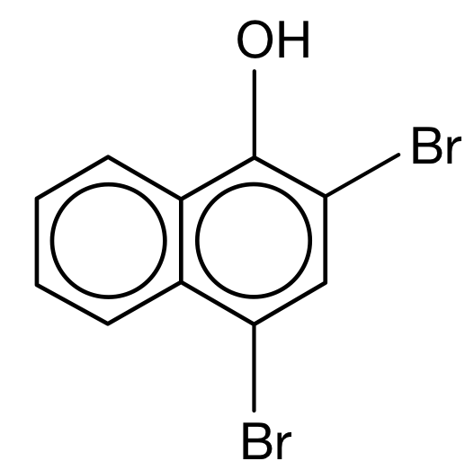

**[1 mark]**

> **[mark-scheme]**
> 1 mark for the correct dibrominated product of 1-naphthol

> **[exam-tip]**
> When phenol reacts with bromine water, 2,4,6-tribromophenol is produced. The –OH group is an activating group that directs incoming electrophiles to the 2, 4 and 6 positions.
> 
> A similar reaction occurs with 1-naphthol, but position 6 is not available (there is no hydrogen atom on that carbon to be replaced), so bromination occurs at positions 2 and 4 to give 2,4-dibromo-1-naphthol.

### Q3
> **[mark-scheme]**
> i) The reagents and conditions for step **1** are:
> 
> - Dilute HNO3 / HNO3 (aq)
> **AND**
> Room temperature **[1 mark]**
> 
> ii) The name of the reaction mechanism for step **1** is:
> 
> - Electrophilic substitution **[1 mark]**

> **[exam-tip]**
> Step 1 is the nitration of phenol. Unlike benzene nitration (which requires concentrated HNO3 and H2SO4), phenol reacts with dilute HNO3 at room temperature because the –OH group activates the ring. Concentrated HNO3 would give 2,4,6-trinitrophenol.
> 
> The product shown has the nitro group at position 4, which is one of the two expected products (along with the 2-nitro isomer).
> **[mark-scheme]**
> i) The type of reaction that occurs in step **2** is:
> 
> - Reduction **[1 mark]**
> 
> ii) The reagents and conditions for step **2** are:
> 
> - Sn / HCl **[1 mark]**
> - Heat under reflux **[1 mark]**

> **[exam-tip]**
> Step 2 converts the nitro group (–NO2) to an amine (–NH2), which is a reduction reaction. Tin (Sn) acts as the reducing agent in the presence of HCl, and heat under reflux provides the energy needed.
> 
> Under acidic conditions the amine product is protonated (–NH3+), so excess NaOH may be added afterwards to give the free amine (–NH2).
The skeletal formulae of compounds **E**, **F** and **G **are:

Compound **E**:

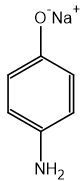

Compound **F**:

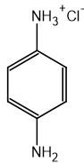

Compound **G**:

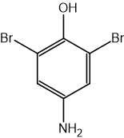

**[3 marks]**

> **[mark-scheme]**
> 1 mark for the correct skeletal formula of **E**: H2N–C6H4–O-Na+
> 
> 1 mark for the correct skeletal formula of **F**: HO–C6H4–NH3+Cl-
> 
> 1 mark for the correct skeletal formula of **G**: HO–C6H2Br2–NH2
> 
> Further substitution of **G** to form HO–C6HBr3–NH2 **OR** HO–C6Br4–NH2 is accepted

> **[exam-tip]**
> Rodinol is a weak acid (phenol group) and a base (amine group):
> 
> - Reaction with NaOH: the phenol –OH is deprotonated to give compound E (sodium 4-aminophenoxide) and water
> - Reaction with HCl: the –NH2 is protonated to give compound F (4-aminophenol hydrochloride)
> 
> When rodinol reacts with excess aqueous bromine, both the –OH and –NH2 groups are activating, directing electrophiles to positions 2 and 6. The most likely product (compound G) is 4-amino-2,6-dibromophenol, but further bromination is also possible and accepted.

### Q4
> **[mark-scheme]**
> i) The equation for the reaction of phenol with sodium hydroxide is:
> 
> - C6H5OH + NaOH → C6H5O-Na+ + H2O **[1 mark]**
> 
> ii) The equation for the reaction of phenol with sodium metal is:
> 
> - 2C6H5OH + 2Na → 2C6H5O-Na+ + H2 **[1 mark]**

> **[exam-tip]**
> These are acid–base reactions:
> 
> Acid + base → salt + water (phenol + NaOH)
> 
> Acid + metal → salt + hydrogen gas (phenol + Na)
> 
> The product in both reactions is sodium phenoxide, C6H5O-Na+. The phenoxide ion (C6H5O-) forms an ionic bond with Na+.
> **[mark-scheme]**
> Two observations when phenol reacts with bromine water at room temperature:
> 
> - The bromine water decolourises (from orange to colourless) **[1 mark]**
> - A white precipitate forms **[1 mark]**

> **[exam-tip]**
> The orange bromine water decolourises as bromine is consumed in the reaction. The white precipitate is 2,4,6-tribromophenol, which is insoluble in water.
The skeletal formulae of the two possible products are:

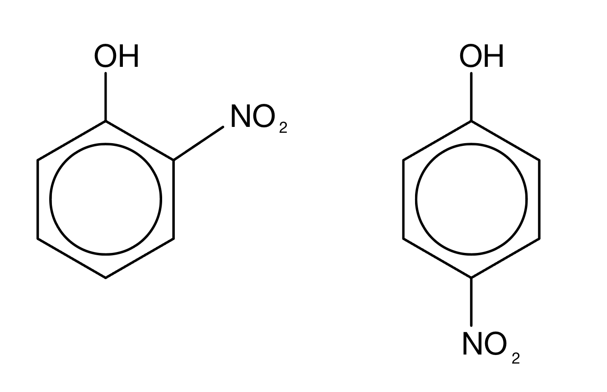

**[2 marks]**

> **[mark-scheme]**
> 1 mark for each correct skeletal formula (2-nitrophenol and 4-nitrophenol)

> **[exam-tip]**
> When phenol reacts with dilute nitric acid, the two products are 2-nitrophenol and 4-nitrophenol. When concentrated HNO3 is used, the product is 2,4,6-trinitrophenol instead.
> **[mark-scheme]**
> 3-nitrophenol is not formed because:
> 
> - The –OH group is 2,4,6-directing (directs substitution to the 2, 4 and 6 positions) **[1 mark]**

> **[exam-tip]**
> The oxygen atom in the –OH group donates electron density into the benzene ring, increasing electron density at positions 2, 4 and 6. Electrophiles attack at these positions, not at position 3.

### Q5
i) The product of phenol and sodium is:

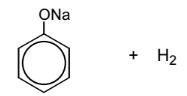

**[1 mark]**

> **[mark-scheme]**
> 1 mark for correct organic product: sodium phenoxide (C6H5ONa or C6H5O-Na+)

ii) The product of phenol and sodium hydroxide is:

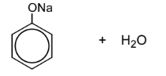

**[1 mark]**

> **[mark-scheme]**
> 1 mark for correct organic product: sodium phenoxide (C6H5ONa)

> **[mark-scheme]**
> iii) Phenol does not react with ethanoic acid **[1 mark]**

iv) The product of phenol and aqueous bromine is:

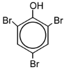

**[1 mark]**

> **[mark-scheme]**
> 1 mark for 2,4,6-tribromophenol
> 
> All three positions (2, 4, and 6) must be substituted with Br

> **[exam-tip]**
> Phenol is a weak acid so it will react with sodium metal to form the salt sodium phenoxide and hydrogen gas. You do not need to balance this equation for this mark.
> 
> Phenol will also react with a base such as NaOH to form the salt sodium phenoxide and water. You can show the negative charge on the oxygen and the positive charge on the sodium in sodium phenoxide.
> 
> Ethanoic acid is also a weak acid and no reaction will occur between phenol and ethanoic acid.
> 
> Phenol reacts with bromine water to form the tri-substituted compound 2,4,6-tribromophenol.
> **[mark-scheme]**
> The name of the reaction mechanism for the reaction of phenol with bromine water is:
> 
> - Electrophilic substitution **[1 mark]**

> **[exam-tip]**
> A lone pair of electrons on the oxygen atom overlaps with the delocalised π system of the benzene ring, increasing the electron density around the ring. This makes phenol particularly susceptible to attack by electrophiles, which is why it undergoes electrophilic substitution more readily than benzene.
> **[mark-scheme]**
> The conditions needed for the bromination of phenol and for the bromination of benzene are:
> 
> - Bromination of phenol: Room temperature **[1 mark]**
> 
> - Bromination of benzene: Pure bromine
> **AND**
> Aluminium bromide / AlBr3 (catalyst) **[1 mark]**

> **[exam-tip]**
> A lone pair of electrons on the oxygen atom overlaps with the π bonding system of the benzene ring, increasing electron density in the ring. This makes phenol more susceptible to attack by electrophiles, so it reacts with bromine water at room temperature without a catalyst. Benzene requires pure bromine (rather than bromine water) and a halogen carrier catalyst such as AlBr3.

### Q6
> **[mark-scheme]**
> The molecular formula of phenol is:
> 
> - C6H6O
> **OR**
> C6H5OH **[1 mark]**

> **[exam-tip]**
> It helps to draw out the structure of phenol with all atoms shown to avoid miscounting hydrogen atoms. There are 5 hydrogens on the ring and 1 in the –OH group, giving 6H total: C6H6O.
> **[mark-scheme]**
> Phenol acts as a weak acid because:
> 
> - Phenol can donate the H atom from the O–H group to form the phenoxide ion **[1 mark]**
> 
> - C6H5OH + H2O ⇌ C6H5O- + H3O+
> **OR**
> C6H5OH ⇌ C6H5O- + H+ **[1 mark]**
> 
> - The phenoxide ion is stable because the negative charge is delocalised (spread) over the entire ion **[1 mark]**

> **[exam-tip]**
> Acids donate protons. Although phenol is a weak acid, it can still lose the H from the –OH group to form the phenoxide ion. The equilibrium lies to the left (phenol is not fully ionised), making it weakly acidic.
> **[mark-scheme]**
> A comparison of the acidities of ethanol and phenol with that of water:
> 
> - Ethanol is less acidic than water **[1 mark]**
> - The ethyl group is electron-donating, concentrating more negative charge on the oxygen atom of the ethoxide ion **[1 mark]**
> - Phenol is more acidic than water **[1 mark]**
> - The phenoxide ion is more stable than hydroxide because the negative charge is delocalised over the ring **[1 mark]**

> **[exam-tip]**
> The order of acidity (least to most acidic): ethanol < water < phenol
> 
> In phenol, the phenoxide ion (C6H5O-) has its charge spread over the benzene ring via delocalisation. This reduces the tendency to accept H+ back, making phenol more acidic than water.
> 
> In ethanol, the ethoxide ion (C2H5O-) has charge concentrated on oxygen because the ethyl group is electron-donating. The higher charge density means H+ is more strongly attracted back, making ethanol less acidic than water.
> **[mark-scheme]**
> i) The name of the product formed when phenol reacts with bromine water is:
> 
> - 2,4,6-tribromophenol **[1 mark]**
> 
> ii) A balanced chemical equation for this reaction is:
> 
> - 3Br2 + C6H5OH → C6H2Br3OH + 3HBr **[1 mark]**

> **[exam-tip]**
> The –OH group activates the benzene ring and directs substitution to positions 2, 4 and 6. Three bromine atoms substitute three hydrogen atoms. The product 2,4,6-tribromophenol forms as a white precipitate.
> **[mark-scheme]**
> A comparison showing that phenol is more reactive than benzene towards bromine:
> 
> Any **two** from (1 mark for each point):
> 
> - Phenol reacts with bromine water (aqueous Br2) but benzene does not
> - Phenol trisubstitutes while benzene monosubstitutes
> - Benzene requires a halogen carrier catalyst (AlBr3 / FeBr3) and pure bromine; phenol does not
> 
> **[2 marks]**

> **[exam-tip]**
> The –OH group in phenol increases the electron density of the ring, making it more reactive towards electrophiles. Phenol reacts under much milder conditions than benzene: no catalyst is needed and bromine water is sufficient.

### Q7
> **[mark-scheme]**
> i) The number of hybridised carbon atoms in phenyl 2-hydroxybenzoate:
> 
> - sp = 0
> **AND**
> sp2 = 13
> **AND**
> sp3 = 0 **[1 mark]**

> **[exam-tip]**
> For part (i), it can be helpful to highlight each carbon and identify its hybridisation.
> 
> In a benzene ring, all carbons are sp2 hybridised. The carbonyl carbon in an ester group (C=O) is also sp2.
> 
> Phenyl 2-hydroxybenzoate contains two benzene rings and one ester group, all with sp2 carbons, so there are no sp or sp3 carbons.

ii) The completed table showing reactions of phenyl 2-hydroxybenzoate is:

| Reagent | Structure of product (s) | Type of reaction |
|---|---|---|
| Na | 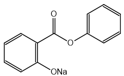 | Acid-base reaction |
| Excess Br2 (aq) | 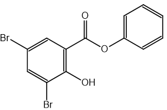 | Bromination / electrophilic substitution |

**[3 marks]**

> **[mark-scheme]**
> 1 mark for the correct structure(s) of the product with excess Br2 (aq): phenyl 3,5-dibromo-2-hydroxybenzoate
> 
> 1 mark for the correct structure of the product with Na: sodium 2-(phenoxycarbonyl)phenolate
> 
> 1 mark for both correct reaction types identified

> **[exam-tip]**
> For part (ii), identify which functional groups react with each reagent:
> 
> - Excess Br2(aq) will not react with a benzene ring alone but will react with an activated phenol group (electrophilic substitution)
> - Na reacts with the phenol –OH group in an acid–base reaction
The equation for the reaction between 2-hydroxybenzoic acid and phenol is:

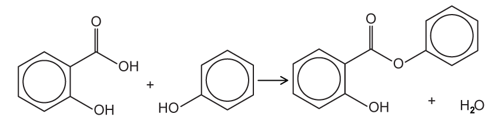

**[2 marks]**

> **[mark-scheme]**
> 1 mark for correct skeletal formulae of the reactants (2-hydroxybenzoic acid and phenol)
> 
> 1 mark for correct skeletal formulae of the products (phenyl 2-hydroxybenzoate and water)

> **[exam-tip]**
> This is an esterification (condensation) reaction between the carboxylic acid group in 2-hydroxybenzoic acid and the phenol group. The small molecule eliminated is water.
> 
> When constructing the equation using skeletal formulae, show the carbon skeleton and all functional groups clearly, but you do not need to show individual C–H bonds.
The completed and balanced equation for the alkaline hydrolysis of phenyl 2-hydroxybenzoate with excess NaOH is:

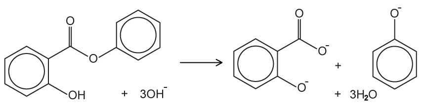

**[2 marks]**

> **[mark-scheme]**
> 1 mark for correct products: 2-hydroxybenzoate salt (carboxylate) and phenoxide ion shown
> 
> 1 mark for correctly balanced equation

> **[exam-tip]**
> Phenols react with alkaline solutions in acid–base reactions to form soluble phenoxide salts. In excess NaOH, all acidic groups are deprotonated: the ester is hydrolysed to give the carboxylate salt (–COO-) and the phenol group is deprotonated to give the phenoxide (–O-).

### Q8
> **[mark-scheme]**
> i) The systematic name for salicylic acid is:
> 
> - 2-hydroxybenzoic acid **[1 mark]**

ii) The two positional isomers of salicylic acid are:

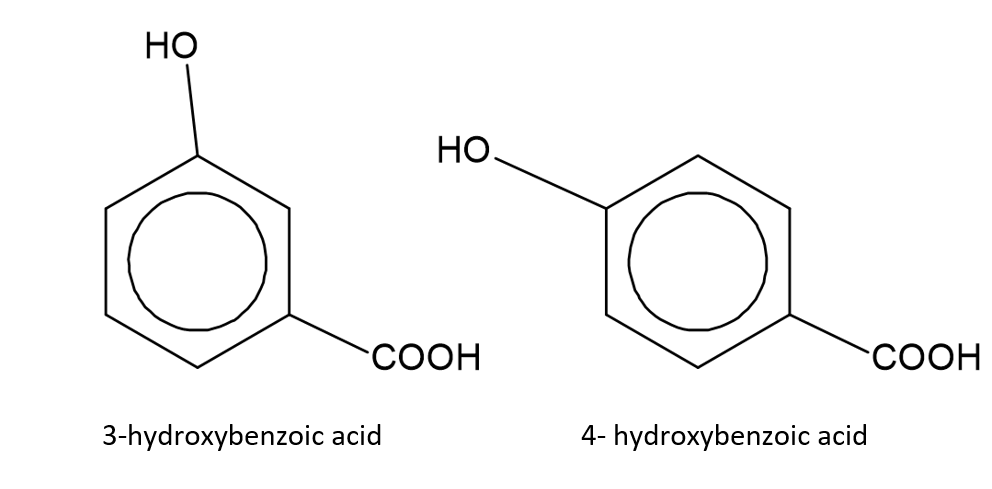

**[2 marks]**

> **[mark-scheme]**
> 1 mark for the correct name and structure of 3-hydroxybenzoic acid
> 
> 1 mark for the correct name and structure of 4-hydroxybenzoic acid

> **[exam-tip]**
> In IUPAC naming, the carboxylic acid group takes highest priority and becomes carbon 1. The hydroxyl group in salicylic acid is at carbon 2, giving 2-hydroxybenzoic acid.
> 
> Moving the hydroxyl group around the benzene ring: positions 3 and 4 are the only distinct remaining positions (position 5 is equivalent to 3, and position 6 is equivalent to 2 when numbering from the other direction).
The skeletal formulae of compound **X** and mesalamine are:

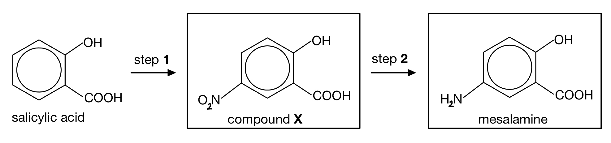

**[2 marks]**

> **[mark-scheme]**
> 1 mark for the correct skeletal formula of compound **X**
> 
> 1 mark for the correct skeletal formula of mesalamine

> **[exam-tip]**
> Mesalamine (5-aminosalicylic acid) has an –NH2 group at position 5 and a –COOH group at position 1 (with –OH at position 2).
> 
> Compound X is the intermediate between salicylic acid and mesalamine. Step 1 introduces a nitro group (–NO2) at position 5 to give compound X (5-nitrosalicylic acid). Step 2 reduces the nitro group to give the amine in mesalamine.
> **[mark-scheme]**
> i) The reagents and conditions required for step **1** are:
> 
> - Dilute HNO3 **[1 mark]**
> - Room temperature **[1 mark]**
> 
> ii) The reagents and conditions required for step **2** are:
> 
> - Sn / HCl **[1 mark]**
> - Heat under reflux **[1 mark]**
> - Excess NaOH (aq) **[1 mark]**

> **[exam-tip]**
> Step 1 is the nitration of salicylic acid. Unlike the nitration of benzene (which requires concentrated HNO3 and concentrated H2SO4), salicylic acid is more reactive because the –OH group is ring-activating. Dilute HNO3 at room temperature is sufficient. The –COOH group is ring-deactivating, but the activating effect of the –OH dominates.
> 
> Step 2 converts the nitro group (–NO2) to an amine (–NH2) by reduction. Sn/HCl is the reducing agent and heat under reflux provides the energy. Under acidic conditions the amine product is protonated (–NH3+), so excess NaOH is added in the final step to deprotonate it and give the free amine –NH2.

### Q9
> **[mark-scheme]**
> i) The completed equation for the formation of nitric(III) acid is:
> 
> - NaNO2 + HCl → HNO2 + NaCl **[1 mark]**
> 
> ii) The temperature required for this reaction is:
> 
> - Ice / below 10 °C **[1 mark]**

> **[exam-tip]**
> Nitric(III) acid is unstable so it needs to be prepared freshly. This is usually done in a test tube surrounded by ice to keep the temperature below 10 °C.
> **[mark-scheme]**
> The formulae of the two other products formed when the diazonium salt is decomposed by warming with water are:
> 
> - HCl **[1 mark]**
> - N2 **[1 mark]**

> **[exam-tip]**
> When the diazonium salt is warmed with water, the following reaction occurs:
> 
> C6H5N2+Cl- + H2O → C6H5OH + HCl + N2
> 
> You would not be awarded marks for giving the names of the products, as the question asks specifically for formulae.
i) The skeletal formula of the organic product is:

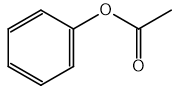

**[1 mark]**

> **[mark-scheme]**
> 1 mark for the skeletal formula of phenyl ethanoate

> **[mark-scheme]**
> ii) The name of the organic product is:
> 
> - Phenyl ethanoate **[1 mark]**

> **[exam-tip]**
> Acyl chlorides react with phenol to produce esters. The sodium hydroxide is required to produce the phenoxide ion, C6H5O-, which acts as a nucleophile, attacking the carbonyl carbon in the acyl chloride.
> 
> When naming esters:
> 
> - The first part of the name comes from the alcohol or phenol used
> 
>   - *Phenol* gives *phenyl*.
> - The second part comes from the acyl chloride
> 
>   - *Ethanoyl chloride* gives *ethanoate*.
> - The product is therefore phenyl ethanoate.

### Q10
The structure of 2,4,6-tribromophenol is:

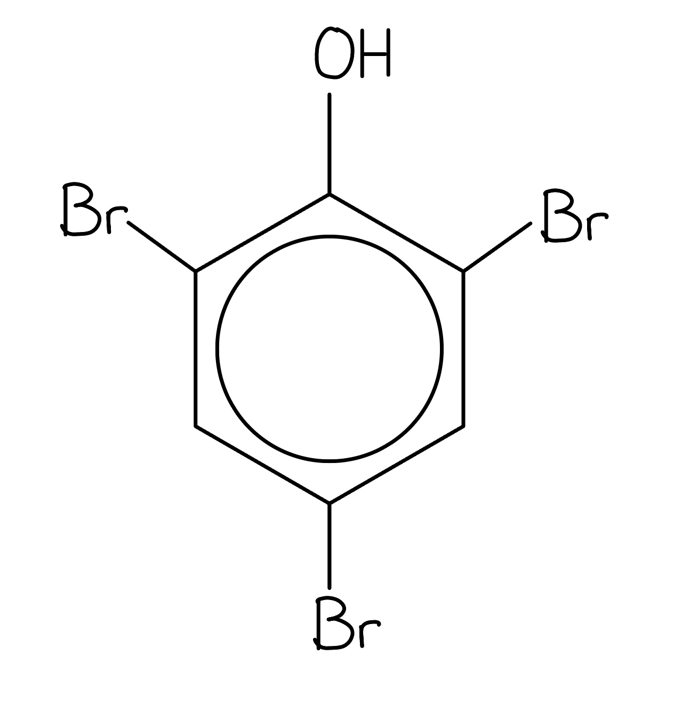

**[1 mark]**

> **[mark-scheme]**
> 1 mark for the correct structure of 2,4,6-tribromophenol
> 
> The difference in bromination of phenol and benzene, including structures of any organic products formed:
> 
> - Phenol has a lone pair on the oxygen atom that (partially) delocalises into the π system of the benzene ring **[1 mark]**
> 
> - The π electrons of benzene are delocalised over the ring **[1 mark]**
> 
> - Phenol has a higher electron density in the ring than benzene **[1 mark]**
> 
> - Benzene cannot polarise the Br–Br bond
> **OR**
> Phenol can polarise the Br–Br bond (allow: δ+ Br or Br+ electrophile) **[1 mark]**
> 
> - Bromination of benzene requires a halogen carrier catalyst such as FeBr3 / AlBr3 and pure bromine **[1 mark]**
> 
> - Phenol reacts with bromine water at room temperature to form 2,4,6-tribromophenol **[1 mark]**

> **[exam-tip]**
> This question covers a lot of content. Break your answer into sections:
> 
> **Bromination of phenol**:
> 
> - The lone pair on the oxygen atom delocalises into the π ring, increasing electron density.
> - This allows phenol to polarise the Br–Br bond and react with bromine water at room temperature without a catalyst, giving 2,4,6-tribromophenol.
> 
> **Bromination of benzene**:
> 
> - The π electrons are delocalised but the electron density is lower than in phenol.
> - Benzene cannot polarise Br–Br on its own and requires pure bromine and a halogen carrier catalyst (FeBr3 or AlBr3), giving bromobenzene.
> 
> **Directing effects**:
> 
> - The –OH group is an activating group that directs electrophiles to the 2, 4 and 6 positions, which is why three bromine atoms are substituted in phenol but only one in benzene.
> **[mark-scheme]**
> i) The reagents and conditions required for reaction **1** are:
> 
> - Dilute HNO3
> **AND**
> Room temperature **[1 mark]**

ii) To calculate the mass of phenol required to produce 30 g of 2-nitrophenol at 35% yield:

- State the Mr values:

*M*r of 2-nitrophenol = 139.0

*M*r of phenol = 94.0

**[1 mark]**

- Calculate the mass of 2-nitrophenol produced at 100% yield:

mass at 100% yield = $\frac{30}{35} \times 100$

mass at 100% yield = 85.71 g

- Calculate the moles of 2-nitrophenol:

moles = $\frac{85.71}{139.0}$

moles = 0.617 mol

**[1 mark]**

- Since the molar ratio of phenol : 2-nitrophenol = 1 : 1

moles of phenol = 0.617 mol

- Calculate the mass of phenol required:

mass = 0.617 x 94.0 = **58.0 g**

**[1 mark]**

> **[exam-tip]**
> The tricky part of this calculation is working back from the actual yield to find the theoretical mass at 100% yield. Rearrange the percentage yield formula: theoretical mass = actual mass ÷ % yield x 100.
> **[mark-scheme]**
> Phenol behaves as a weak acid because:
> 
> - The O–H bond breaks; H+ is donated and the phenoxide ion, C6H5O-, is formed **[1 mark]**
> - A lone pair on the oxygen atom (partially) delocalises into the π system of the benzene ring **[1 mark]**
> - This stabilises the phenoxide ion / the negative charge is delocalised (spread) over the ring **[1 mark]**

> **[exam-tip]**
> The delocalisation of the oxygen lone pair into the ring is the key difference between phenol and simple alcohols. It weakens the O–H bond compared to alcohols, making phenol acidic. However, phenol is still a weak acid because the equilibrium lies to the left, so it does not fully ionise in water.
> 
> The formula of the phenoxide ion is C6H5O-. The dissociation equation is:
> 
> C6H5OH ⇌ C6H5O- + H+
> 
> You may also be asked to calculate the pH of a phenol solution from a given concentration using the Ka expression.
