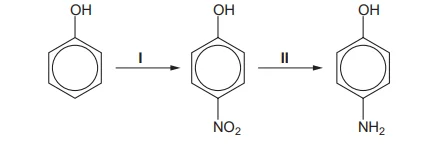
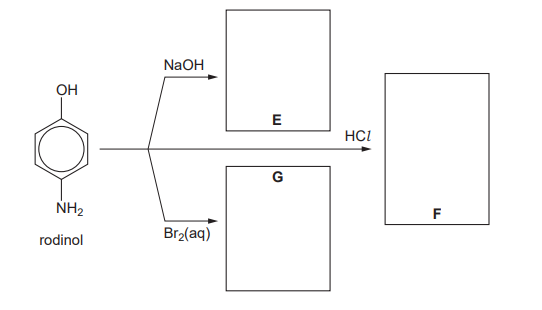
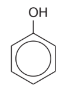
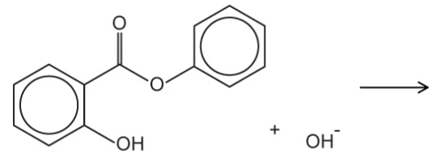
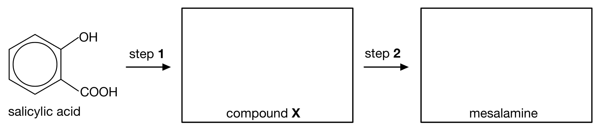
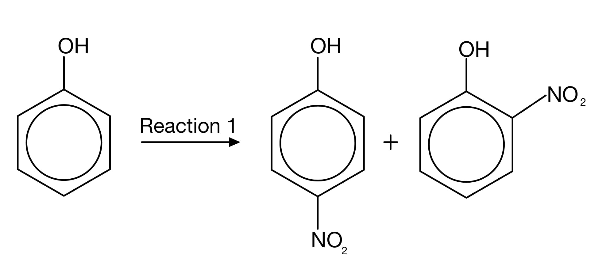

# Exam Questions — Phenol
**32. Hydroxy Compounds** · Cambridge (CIE) A-LEVEL chemistry (9701)
> Source: [https://www.savemyexams.com/a-level/chemistry/cie/25/topic-questions/](https://www.savemyexams.com/a-level/chemistry/cie/25/topic-questions/) · 10 questions across 1 sets

## Structured Questions (10 questions)

### Q1 — medium — 11 marks

**Q1** [4 marks]

Phenol can be prepared from phenylamine.

There are three stages that take place during this preparation:

- **Stage 1:** Prepare nitric(III) acid using sodium nitrate and hydrochloric acid
- **Stage 2:** React phenylamine with nitric(III) acid and hydrochloric acid to form a diazonium salt
- **Stage 3:** Thermal decomposition of the diazonium salt to form phenol, hydrochloric acid, and nitrogen gas

i) State the essential conditions for the reaction in **stage 2**.

[1]

ii) Draw the skeletal formula of the diazonium salt formed in **stage 2**.

[3]

**Q1** [3 marks]

**Extract:**

Phenol can be prepared from phenylamine.

There are three stages that take place during this preparation:

- **Stage 1:** Prepare nitric(III) acid using sodium nitrate and hydrochloric acid
- **Stage 2:** React phenylamine with nitric(III) acid and hydrochloric acid to form a diazonium salt
- **Stage 3:** Thermal decomposition of the diazonium salt to form phenol, hydrochloric acid, and nitrogen gas

Construct balanced equations for the reactions that occur at each stage.

Stage 1:

Stage 2:

Stage 3:

**Q1** [3 marks]

**Extract:**

Phenol can be prepared from phenylamine.

There are three stages that take place during this preparation:

- **Stage 1:** Prepare nitric(III) acid using sodium nitrate and hydrochloric acid
- **Stage 2:** React phenylamine with nitric(III) acid and hydrochloric acid to form a diazonium salt
- **Stage 3:** Thermal decomposition of the diazonium salt to form phenol, hydrochloric acid, and nitrogen gas

The diazonium salt formed during stage 2 can also react with phenol to form a useful substance, **Z**.

i) Draw the skeletal formula of **Z**.

[2]

ii) Suggest a possible use for **Z**.

[1]

**Q1** [1 mark]

**Extract:**

Phenol can be prepared from phenylamine.

There are three stages that take place during this preparation:

- **Stage 1:** Prepare nitric(III) acid using sodium nitrate and hydrochloric acid
- **Stage 2:** React phenylamine with nitric(III) acid and hydrochloric acid to form a diazonium salt
- **Stage 3:** Thermal decomposition of the diazonium salt to form phenol, hydrochloric acid, and nitrogen gas

The first step of substance Z involves creating the diazonium ion.

The reaction is the same as that in stage 2 in part **(a)**.

Explain why the reaction to produce the diazonium ion is carried out at below 10 oC.

### Q2 — easy — 3 marks

**Q2** [1 mark]

1-naphthol is a phenolic compound. Its structure is shown in Fig. 3.1.

**Fig. 3.1**

Deduce the molecular formula of 1-naphthol.

**Q2** [1 mark]

**Extract:**

1-naphthol is a phenolic compound. Its structure is shown in Fig. 3.1.

The molecular formula of 1-naphthol is: C10H8O

Like phenol, 1-naphthol is a weak acid.

Construct an equation to show how 1-naphthol acts as a weak acid.

**Q2** [1 mark]

**Extract:**

1-naphthol is a phenolic compound. Its structure is shown in Fig. 3.1.

Fig. 3.1

1-naphthol undergoes similar reactions to phenol.

Suggest the structure of the organic compound produced when 1-naphthol reacts with bromine water.

### Q3 — medium — 8 marks

**Q3** [2 marks]

Rodinol can be synthesised from phenol by the following route:

i) State the reagents and conditions for step **1**.

[1]

ii) Name the reaction mechanism for step **1**.

[1]

**Q3** [3 marks]

**Extract:**

Rodinol can be synthesised from phenol by the following route:

i) State the type of reaction that occurs in step **2**.

[1]

ii) State the reagents and conditions for step **2**.

[2]

**Q3** [3 marks]

Rodinol can undergo many reactions.

Draw the skeletal formulae of compounds **E**, **F** and **G** from the reaction chart of rodinol shown below.

### Q4 — medium — 7 marks

**Q4** [2 marks]

Phenol behaves as a weak acid.

i) Construct the equation for the reaction of phenol with sodium hydroxide.

[1]

ii) Construct the equation for the reaction of phenol with sodium metal.

[1]

**Q4** [2 marks]

Phenol undergoes electrophilic substitution when reacted with bromine water at room temperature.

State **two** observations that can be made during this reaction.

**Q4** [2 marks]

Draw the skeletal formulae of the two possible products from the reaction of phenol with **dilute** nitric acid.

**Q4** [1 mark]

**Extract:**

When phenol reacts with dilute nitric acid, the two products are 2-nitrophenol and 4-nitrophenol.

State why 3-nitrophenol is not formed when phenol reacts with dilute nitric acid.

### Q5 — easy — 7 marks

**Q5** [4 marks]

Phenol, C6H5OH, has the following skeletal formula:

If no reaction occurs, write **no reaction**.

Draw the skeletal formula of the organic product formed when phenol reacts with:

i) sodium

[1]

ii) sodium hydroxide

[1]

iii) ethanoic acid

[1]

iv) aqueous bromine

[1]

**Q5** [1 mark]

State the name of the reaction mechanism for the reaction of phenol with bromine water.

**Q5** [2 marks]

Phenol undergoes bromination when reacted with bromine water. Benzene also undergoes bromination but requires different conditions.

State the conditions needed for the bromination of phenol and the conditions needed for the bromination of benzene.

### Q6 — medium — 12 marks

**Q6** [1 mark]

Phenol is an aryl compound.

State the molecular formula of phenol.

**Q6** [3 marks]

Explain why phenol is a weak acid.

You should include an equation in your answer.

**Q6** [4 marks]

Describe and explain how the acidities of ethanol and phenol compare with that of water.

**Q6** [2 marks]

Phenol reacts with bromine water.

i) State the name of the product formed.

[1]

ii) Construct a balanced chemical equation for this reaction.

[1]

**Q6** [2 marks]

**Extract:**

Phenol reacts with bromine water.

i) The name of the product formed when phenol reacts with bromine water is:
- 2,4,6-tribromophenol

ii) A balanced chemical equation for this reaction is:
- 3Br₂ + C₆H₅OH → C₆H₂Br₃OH + 3HBr

Compare the reagents and conditions required for the bromination of phenol and benzene. Use your answer to explain how these reactions show that phenol is more reactive than benzene.

### Q7 — hard — 8 marks

**Q7** [4 marks]

Phenyl 2-hydroxybenzoate is an antiseptic and is shown in Fig. 2.1.

**Fig. 2.1**

A molecule of phenyl 2-hydroxybenzoate has 13 carbon atoms

i) State the number of carbon atoms that are sp, sp2 and sp3 hybridised carbon atoms, if any, in phenyl 2-hydroxybenzoate.

[1]

ii) Complete Table 2.1 showing the reactions of phenyl 2-hydroxybenzoate with the two reagents.

**Table 2.1**

| Reagent | Structure of product (s) | Type of reaction |
|---|---|---|
| Na |   |   |
| Excess Br2 (aq) |   |   |

[3]

**Q7** [2 marks]

**Extract:**

Phenyl 2-hydroxybenzoate is an antiseptic and is shown in Fig. 2.1.

Fig. 2.1

Phenyl 2-hydroxybenzoate can be made from 2-hydroxybenzoic acid and phenol by heating the two compounds strongly together.

Construct an equation, using skeletal formulae, for this reaction.

**Q7** [2 marks]

Complete and balance the equation in Fig. 2.2 for the alkaline hydrolysis of phenyl 2-hydroxybenzoate using excess NaOH.

**Fig. 2.2**

### Q8 — hard — 10 marks

**Q8** [3 marks]

Mesalamine can be synthesised from salicylic acid, the chemical structure of which is shown in Fig. 3.1.

**Fig. 3.1**

i) State the systematic name for salicylic acid.

[1]

ii) Deduce the names and structures of the **two** positional isomers of salicylic acid that are possible.

| positional isomer 1 | positional isomer 2 |
|---|---|
|   |   |

[2]

**Q8** [2 marks]

**Extract:**

Mesalamine can be synthesised from salicylic acid, the chemical structure of which is shown in Fig. 3.1.

A possible two step synthesis of mesalamine is shown below in Fig. 3.2.

**Fig. 3.2**

Draw the skeletal formulae of compound **X** and mesalamine.

**Q8** [5 marks]

**Extract:**

A possible two step synthesis of mesalamine is shown below in Fig. 3.2.

Two-step synthesis pathway from salicylic acid to mesalamine via compound X, showing step 1 (nitration) and step 2 (reduction)

State the reagents and conditions required for steps **1** and **2** in Fig. 3.2 in part **(b)**.

### Q9 — easy — 6 marks

**Q9** [2 marks]

Phenol can be prepared by the reaction of phenylamine with nitric(III) acid. This reaction involves three steps.

In the first step, nitric(III) acid, HNO2, is prepared.

i) Complete the equation to show the formation of nitric(III) acid.

_   +   HCl   →  HNO2   +   _

[1]

ii) State the temperature required for this reaction.

[1]

**Q9** [2 marks]

In the second step in the production of phenol, the diazonium salt shown in Fig. 2.1 is formed. In the final step, the diazonium salt is decomposed by warming with water to produce phenol.

**Fig. 2.1**

State the formulae of the **two** other products formed.

**Q9** [2 marks]

Phenol reacts with ethanoyl chloride in the presence of sodium hydroxide and heat.

i) Draw the skeletal formula of the organic product.

[1]

ii) State the name of the organic product.

[1]

### Q10 — hard — 14 marks

**Q10** [7 marks]

This question is about the reactions of phenol and benzene.

Explain the difference in bromination of phenol and benzene. In your answer, include structures of any organic products formed in the reaction.

**Q10** [4 marks]

A mixture of 2-nitrophenol and 4-nitrophenol can be formed via the pathway shown in Fig. 1.1.

**Fig. 1.1**

i) State the reagents **and** conditions required for reaction **1**.

[1]

ii) Calculate the mass, in grams, of phenol required to form 30 g of 2-nitrophenol assuming a 35% yield. Give your answer to three significant figures and show your working.

mass = ............... g

[3]

**Q10** [3 marks]

Phenol reacts with sodium to form a salt and hydrogen gas in an acid-base reaction.

Explain why phenol behaves as a weak acid.
