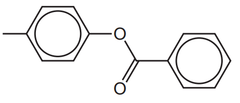
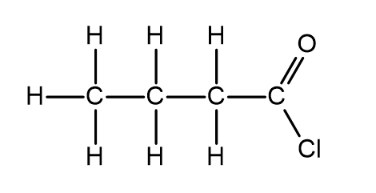
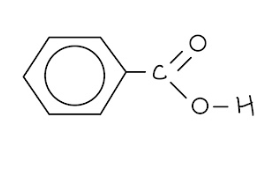
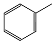
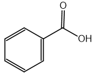

# Mark Schemes — Carboxylic Acids
**33. Carboxylic Acids & Derivatives** · Cambridge (CIE) A-LEVEL chemistry (9701)

## Structured Questions (6 questions)

### Q1
> **[mark-scheme]**
> i) The name of the mechanism is:
> 
> - Addition-elimination / nucleophilic addition-elimination **[1 mark]**

ii) The mechanism for the reaction of ethanoyl chloride with ammonia is:

(Deprotonation of nitrogen — not required for full credit)

> **[mark-scheme]**
> - Dipole on C=O bond with δ+ on C and δ- on O **[1 mark]**
> - Curly arrow from lone pair on N of NH3 to carbonyl carbon
> **AND**
> Curly arrow showing C=O π bond breaking to O- **[1 mark]**
> - Correct tetrahedral intermediate with O- and N+ charges **[1 mark]**
> - Curly arrow from lone pair on O- to reform C=O
> **AND**
> Curly arrow breaking C–Cl bond to Cl- **[1 mark]**
> 
> Allow deprotonation of nitrogen in a subsequent step

> **[exam-tip]**
> In acyl chloride mechanisms, most marks are lost on arrow starts/ends and charges. Make sure your first arrow starts from the lone pair on N in NH3 and points to the carbonyl carbon, and your second arrow moves the C=O π bond onto oxygen to give O-.
> 
> In the intermediate, check you have both O- and N+ shown. When the carbonyl reforms, you need two arrows simultaneously: O- back to C=O and C–Cl breaking to Cl-.
The structure of the zwitterion of alanine is:

**[1 mark]**

> **[mark-scheme]**
> 1 mark for correct zwitterion with NH3+ and COO- both shown, for example H3N+CH(CH3)COO-
> 
> Structural formulae, displayed formulae, or clearly written condensed formulae are all acceptable
> 
> Charges must be shown correctly to gain credit

> **[exam-tip]**
> Ensure the positive charge is clearly located on the nitrogen atom (N+). Writing the charge generally near the group may be penalised if ambiguous.
i) The structure of the repeat unit of Nylon 6,6 is:

Structure of repeat unit: −NH(CH2)6NH−CO(CH2)4CO−

> **[mark-scheme]**
> - Correct amide linkage shown, i.e. –NH–CO– **[1 mark]**
> - Correct carbon backbone on both sides of the amide link, i.e. –NH(CH2)6NH– and –CO(CH2)4CO– **[1 mark]**
> 
> Acceptable representation includes, for example:
> −NH(CH2)6NH−CO(CH2)4CO−

> **[mark-scheme]**
> ii) Polyesters and polyamides are biodegradable polymers, whereas polyalkenes are generally non-biodegradable because:
> 
> - Polyesters / polyamides contain polar ester / amide linkages which can be hydrolysed (by acids, alkalis, or bacteria) **[1 mark]**
> - Polyalkenes contain non-polar C–C bonds and C–H bonds which are chemically unreactive and cannot be hydrolysed **[1 mark]**

> **[exam-tip]**
> When explaining biodegradability, focus on bond type and reactivity rather than just stating the compound breaks down. Polar ester and amide bonds are susceptible to hydrolysis because water molecules can attack the δ+ carbonyl carbon. Non-polar C–C and C–H bonds in polyalkenes have no such dipole and do not react with water.

### Q2
> **[mark-scheme]**
> The relative order of acidity and reasoning are:
> 
> - Benzoic acid > 4-methylphenol > phenylmethanol **[1 mark]**
> - The benzoate ion is stabilised by delocalisation of negative charge over two electronegative oxygen atoms 
> **OR**
> The C=O group withdraws electron density from the O–H bond **[1 mark]**
> - The 4-methylphenoxide ion is stabilised by delocalisation of the oxygen lone pair into the benzene ring **[1 mark]**
> - The alkoxide ion of phenylmethanol is destabilised by the electron-donating CH2 group 
> **OR**
> The alkyl group donates electron density to the oxygen, making it less stable **[1 mark]**

> **[exam-tip]**
> The relative acidity depends on the stability of the conjugate base (the anion formed after losing H+). The more stable the anion, the more readily the compound donates a proton.
> 
> The benzoate ion is particularly stable because the negative charge is delocalised over two electronegative oxygen atoms. The phenoxide ion is less stable as the charge is delocalised into carbon atoms in the ring. The alkoxide ion from phenylmethanol is destabilised by the electron-donating effect of the benzyl group.
i) The skeletal formula of 4-methylphenyl benzoate is:

**[1 mark]**

> **[mark-scheme]**
> ii) A two-step route for the synthesis of 4-methylphenyl benzoate:
> 
> - Starting materials: 4-methylphenol
> **AND**
> Benzoic acid **[1 mark]**
> - Step 1: react benzoic acid with SOCl2 / PCl5 / PCl3 **[1 mark]**
> - Intermediate: benzoyl chloride / C6H5COCl **[1 mark]**
> - Step 2: react benzoyl chloride with 4-methylphenol dissolved in NaOH(aq) / sodium hydroxide solution **[1 mark]**
> - Step 2 condition: at room temperature / shake with the acyl chloride **[1 mark]**

> **[exam-tip]**
> Phenols do not react directly with carboxylic acids to form esters, so the carboxylic acid must first be converted to the more reactive acyl chloride using SOCl2, PCl5, or PCl3.
> 
> In step 2, NaOH(aq) is required to form the phenoxide ion, which acts as the nucleophile in the addition-elimination reaction with the acyl chloride. Without the base, the phenol reacts too slowly.
> **[mark-scheme]**
> The reagents and conditions required to form benzoic acid from methylbenzene are:
> 
> - Alkaline KMnO4 / potassium manganate(VII) **[1 mark]**
> - Dilute acid / dilute H2SO4 / dilute HCl **[1 mark]**
> - Heat
> **AND**
> Reflux **[1 mark]**

> **[exam-tip]**
> The reaction involves two stages: alkaline KMnO4 under reflux oxidises the methyl side chain to give potassium benzoate, which is then acidified with dilute acid to release benzoic acid. Reagents and conditions for both stages must be stated to gain full marks.

### Q3
> **[mark-scheme]**
> The identity of compound X is:
> 
> - HO2C–CO2H (ethanedioic acid)
> **OR**
> HO2C–COCl **[1 mark]**

> **[exam-tip]**
> Ethanedioyl dichloride has two acyl chloride groups (–COCl). To form it in a single step, compound X must have at least one group that can be converted to –COCl. If X is the dicarboxylic acid (ethanedioic acid, HO2C–CO2H), both –OH groups are replaced by –Cl in one reaction. If X already has one –COCl group, it is the half-converted intermediate.
> **[mark-scheme]**
> A suitable reagent to convert compound X into ethanedioyl dichloride is:
> 
> - SOCl2
> **OR**
> PCl5
> **OR**
> PCl3 **[1 mark]**

> **[exam-tip]**
> SOCl2, PCl5, and PCl3 all convert the –OH group of a carboxylic acid to –Cl to form an acyl chloride. PCl3 requires heating to drive the reaction; SOCl2 and PCl5 react readily at room temperature.
i) The displayed formula of the acyl chloride used to synthesise ethyl butanoate is:

**[1 mark]**

> **[mark-scheme]**
> 1 mark for the correct displayed formula

> **[mark-scheme]**
> ii) The name of the mechanism by which ethyl butanoate is formed is:
> 
> - Nucleophilic addition-elimination **[1 mark]**
> 
> iii) The other product formed in this reaction is:
> 
> - HCl / hydrogen chloride **[1 mark]**

> **[exam-tip]**
> In the name ethyl butanoate, the ‘ethyl’ part comes from the alcohol used (ethanol) and the ‘butanoate’ part comes from the acyl chloride (butanoyl chloride). The other product of any reaction between an acyl chloride and an alcohol is always HCl.

### Q4
The displayed formula of benzoic acid is:

**[1 mark]**

> **[mark-scheme]**
> 1 mark for correct displayed formula with all bonds shown

> **[exam-tip]**
> For displayed formulae, every bond must be drawn explicitly, including the O–H bond in the carboxylic acid group. A skeletal formula without all bonds shown would not gain this mark.
> **[mark-scheme]**
> i) The reagents and conditions needed to oxidise methylbenzene to benzoic acid are:
> 
> - Alkaline KMnO4 / potassium manganate(VII) **[1 mark]**
> - Dilute acid / dilute H2SO4 / dilute HCl **[1 mark]**
> - Heat
> **AND**
> Reflux **[1 mark]**
> 
> ii) Two observations that could be made during this reaction are:
> 
> - Solution loses purple colour **[1 mark]**
> - Brown precipitate (of MnO2) forms **[1 mark]**

> **[exam-tip]**
> The oxidation of methylbenzene is a two-stage process: the side chain is first oxidised under alkaline conditions to give potassium benzoate, then acidification with dilute acid releases benzoic acid. Both the alkaline KMnO4 and the dilute acid must be stated.
> 
> Unlike the oxidation of primary alcohols (where acidified KMnO4 gives a colourless solution as Mn7+ is reduced to Mn2+), the oxidation of methylbenzene under alkaline conditions produces a brown precipitate of MnO2 because Mn7+ is only reduced to Mn4+.
> **[mark-scheme]**
> - C6H5COOH (aq) ⇌ C6H5COO- (aq) + H+ (aq) **[1 mark]**
> 
> The reversible sign (⇌) must be present
> 
> State symbols are not required

> **[exam-tip]**
> Benzoic acid is a weak acid and only partially dissociates in aqueous solution, so the equilibrium position lies to the left. Do not use a one-way arrow as this would imply complete dissociation, which is incorrect for a weak acid.

### Q5
i) The skeletal formula of methylbenzene is:

**[1 mark]**

> **[mark-scheme]**
> 1 mark for correct displayed formula of methylbenzene

ii) The skeletal formula of benzoic acid is:

**[1 mark]**

> **[mark-scheme]**
> 1 mark for correct skeletal formula of benzoic acid
> **[mark-scheme]**
> i) The type of reaction taking place in step 1 is:
> 
> - Oxidation **[1 mark]**
> 
> ii) The reagents and conditions needed for step 1 and step 2 are:
> 
> - Step 1: Alkaline KMnO4 / potassium manganate(VII) **[1 mark]**
> - Step 1 condition: Heat
> **AND**
> Reflux **[1 mark]**
> - Step 2: Dilute acid / dilute H2SO4 / dilute HCl **[1 mark]**

> **[exam-tip]**
> Step 1 is the oxidation of the methyl side chain under alkaline conditions, which forms potassium benzoate. Step 2 is the acidification with dilute acid to protonate the carboxylate and release benzoic acid. Reagents and conditions for both steps must be stated.
> 
> Note that a specific acid such as dilute HCl or dilute H2SO4 is accepted for step 2.
> **[mark-scheme]**
> Two observations that could be made during step 1 are:
> 
> - Solution changes from purple to colourless **[1 mark]**
> - Brown precipitate (of MnO2) forms **[1 mark]**

> **[exam-tip]**
> The KMnO4 solution is purple due to MnO4- ions (Mn7+). During the alkaline oxidation of methylbenzene, Mn7+ is reduced to Mn4+, producing brown MnO2 as a precipitate. The solution itself loses its purple colour as the MnO4- ions are consumed.
> **[mark-scheme]**
> The relative acidities of benzoic acid and phenol are:
> 
> - Benzoic acid is a stronger acid than phenol **[1 mark]**
> - The C=O group in benzoic acid withdraws electron density from the O–H bond (negative inductive effect) **[1 mark]**
> - This weakens the O–H bond, making it easier to release H+ / the proton **[1 mark]**

> **[exam-tip]**
> The stronger an acid, the more easily it donates a proton (H+). In benzoic acid, the adjacent C=O group withdraws electron density from the O–H bond, stabilising the benzoate anion and making proton release easier.
> 
> In phenol, the oxygen lone pair is donated into the benzene ring, which reduces the electron density available on the oxygen. However, phenol has no carbonyl group to further weaken the O–H bond, so it is a weaker acid than benzoic acid (though stronger than aliphatic alcohols).

### Q6
> **[mark-scheme]**
> The equation for the reaction of propan-1-ol with sodium is:
> 
> - 2C3H7OH + 2Na → 2C3H7ONa + H2 **[1 mark]**

> **[exam-tip]**
> When an alcohol reacts with sodium, the O–H bond breaks and a sodium alkoxide salt and hydrogen gas are formed. The same reaction occurs with phenols and carboxylic acids, which are also more acidic than water.
> **[mark-scheme]**
> i) The relative order of acidity, starting with the least acidic, is:
> 
> - Propan-1-ol, phenol, propanoic acid **[1 mark]**
> 
> ii) The explanation:
> 
> - In propanoic acid, the C=O group withdraws electron density from the O–H bond 
> **OR**
> The propanoate ion is stabilised by delocalisation of negative charge over two electronegative oxygen atoms **[1 mark]**
> - In phenol, the O–H bond is weakened by the negative inductive effect of the benzene ring 
> **OR**
> The phenoxide ion is stabilised by delocalisation of the oxygen lone pair into the ring **[1 mark]**
> - In propan-1-ol, the O–H bond is strengthened by the positive inductive effect of the alkyl group 
> **OR**
> The propoxide ion is destabilised by the electron-donating alkyl group **[1 mark]**

> **[exam-tip]**
> When explaining relative acidity, always refer to the stability of the conjugate base (the anion formed after losing H+). The more stable the anion, the more readily the compound donates a proton. Propanoic acid forms the most stable anion because the negative charge is delocalised over two electronegative oxygen atoms.
> **[mark-scheme]**
> i) A reagent that could be used for this test is:
> 
> Any **one **from:
> 
> - Tollens' reagent
> - Fehling's solution
> - Acidified KMnO4
> - Acidified K2Cr2O7
> 
> **[1 mark]**
> 
> ii)
> 
> Any **one **from:
> 
> - Methanoic acid gives a positive result with Tollens' reagent **AND** silver mirror forms
> - Methanoic acid gives a positive result with Fehling's solution **AND** red / orange precipitate forms
> - Methanoic acid gives a positive result with acidified KMnO4 **AND** solution turns colourless
> - Methanoic acid gives a positive result with acidified K2Cr2O7 **AND** solution turns green
> 
> **[1 mark]**
> 
> The observation stated must be consistent with the reagent chosen in part (i)

> **[exam-tip]**
> Methanoic acid is unusual among carboxylic acids because it contains a CHO-type group. The hydrogen atom directly bonded to the carbonyl carbon can act as a reducing agent. This means methanoic acid, unlike propanoic acid, gives a positive result with oxidising agents such as Tollens' reagent and Fehling's solution.
> 
> Make sure the observation you describe is consistent with the reagent you named in part (i) as a mismatched reagent/observation pair will not gain the mark.
