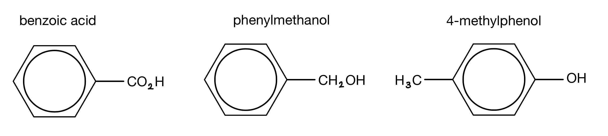
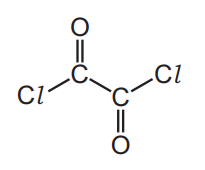
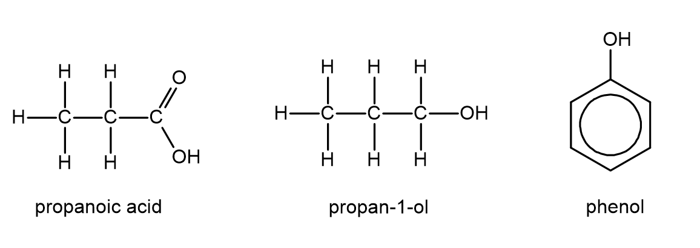

# Exam Questions — Carboxylic Acids
**33. Carboxylic Acids & Derivatives** · Cambridge (CIE) A-LEVEL chemistry (9701)
> Source: [https://www.savemyexams.com/a-level/chemistry/cie/25/topic-questions/](https://www.savemyexams.com/a-level/chemistry/cie/25/topic-questions/) · 6 questions across 1 sets

## Structured Questions (6 questions)

### Q1 — hard — 10 marks

**Q1** [5 marks]

Acyl chlorides, amino acids, and polyamides are important nitrogen-containing organic compounds.

Ethanoyl chloride, CH3COCl, reacts vigorously with ammonia, NH3, to form an amide.

i) State the name of the mechanism of this reaction.

[1]

ii) Draw the mechanism for this reaction. Include all relevant curly arrows, lone pairs, and dipoles.

[4]

**Q1** [1 mark]

Alanine, H2NCH(CH3)COOH, is an amino acid that exists as a zwitterion in the solid state.

Draw the structure of the zwitterion of alanine.

**Q1** [4 marks]

1,6-diaminohexane reacts with hexanedioic acid to form a polyamide called Nylon 6,6.

i) Draw the structure of the repeat unit of Nylon 6,6.

[2]

ii) Polyesters and polyamides are biodegradable polymers, whereas polyalkenes are generally non-biodegradable.

Explain this difference in terms of the structure and reactivity of the polymer chains.

[2]

### Q2 — hard — 13 marks

**Q2** [4 marks]

State the relative order of acidity of benzoic acid, phenylmethanol and 4-methylphenol shown in Fig. 1.1, starting with the most acidic. Explain your reasoning.

**Fig. 1.1**

**Q2** [6 marks]

**Extract:**

State the relative order of acidity of benzoic acid, phenylmethanol and 4-methylphenol shown in Fig. 1.1, starting with the most acidic. Explain your reasoning.

Fig. 1.1 shows structural formulae of three organic compounds: benzoic acid (C₆H₅COOH), phenylmethanol (C₆H₅CH₂OH), and 4-methylphenol (4-CH₃-C₆H₄-OH)

The ester 4-methylphenyl benzoate can be formed in **two** steps from two of the compounds shown in Fig. 1.1 in part **(a)**.

i) Draw the **skeletal** formula of 4-methylphenyl benzoate.

[1]

ii) State the **two**-step route for the synthesis of 4-methylphenyl benzoate. Include reagents and conditions for each step and the structure of the intermediate compound.

[5]

**Q2** [3 marks]

State the reagents and conditions required to form benzoic acid from methylbenzene.

### Q3 — medium — 5 marks

**Q3** [1 mark]

The acyl chloride, ethanedioyl dichloride is shown in Fig. 3.1.

This can be synthesised from compound **X** in a single step.

**Fig. 3.1**

Deduce the identity of compound **X**.

**Q3** [1 mark]

**Extract:**

The acyl chloride, ethanedioyl dichloride is shown in Fig. 3.1.

This can be synthesised from compound **X** in a single step.

The identity of compound X is:

- HO₂C–CO₂H (ethanedioic acid)

OR

HO₂C–COCl

State the reagents and conditions needed to convert **X i**nto ClCOCOCl.

**Q3** [3 marks]

A different acyl chloride was used to synthesise ethyl butanoate.

i) Draw the displayed formula of the acyl chloride.

[1]

ii) State the name of the mechanism by which ethyl butanoate is formed.

[1]

iii) State the name of the other product formed in this reaction.

[1]

### Q4 — easy — 7 marks

**Q4** [1 mark]

Benzoic acid can be formed from the oxidation of methylbenzene.

Draw the displayed formula of benzoic acid.

**Q4** [5 marks]

**Extract:**

Benzoic acid can be formed from the oxidation of methylbenzene.

i) State the reagents and conditions needed to oxidise methylbenzene to benzoic acid.

[3]

ii) State **two** observations that could be made during this reaction.

[2]

**Q4** [1 mark]

Construct an equation to show that benzoic acid acts as a weak acid.

### Q5 — medium — 11 marks

**Q5** [2 marks]

Benzoic acid can be formed from methylbenzene.

This process occurs in two stages.

methylbenzene       $\overset{\mathrm{Step}1}{\rightarrow}$   potassium benzoate    $\overset{\mathrm{Step}2}{\rightarrow}$  benzoic acid

i) Draw the skeletal formula for methylbenzene.

[1]

ii) Draw the skeletal formula for benzoic acid.

[1]

**Q5** [4 marks]

**Extract:**

Benzoic acid can be formed from methylbenzene. 

This process occurs in two stages. 

methylbenzene       \$\$\overset{Step 1}{\rightarrow}\$\$   potassium benzoate    \$\$\overset{Step 2}{\rightarrow}\$\$  benzoic acid

i) State the type of reaction that takes place in **step 1**.

[1]

ii) State the reagents and conditions needed for **step 1** and **step 2** of this reaction.

[3]

**Q5** [2 marks]

**Extract:**

Benzoic acid can be formed from methylbenzene. 

This process occurs in two stages. 

methylbenzene → potassium benzoate → benzoic acid

i) The type of reaction taking place in step 1 is:
- Oxidation

ii) The reagents and conditions needed for step 1 and step 2 are:
- Step 1: Alkaline KMnO4 / potassium manganate(VII)
- Step 1 condition: Heat AND Reflux
- Step 2: Dilute acid / dilute H2SO4 / dilute HCl

State two observations that could be made during **step 1**.

**Q5** [3 marks]

State the relative acidities of benzoic acid and phenol. Explain your reasoning.

### Q6 — medium — 7 marks

**Q6** [1 mark]

Fig. 2.1 shows three different molecules.

**Fig. 2.1**

Propan-1-ol can react with sodium metal.

Construct an equation for this reaction.

**Q6** [4 marks]

**Extract:**

Fig. 2.1 shows three different molecules.

Structural formulae of propan-1-ol, propanoic acid, and phenol

Fig. 2.1

i) State the relative order of acidity of propanoic acid, propan-1-ol and phenol, starting with the least acidic.

[1]

ii) Explain your answer to part **(b)(i)**.

[3]

**Q6** [2 marks]

Methanoic acid and propanoic acid can be distinguished by a simple chemical test.

i) State the name of a reagent that could be used for this test.

[1]

ii) State which of these two acids gives a positive result with your chosen reagent, and state the observation you would make.

[1]
