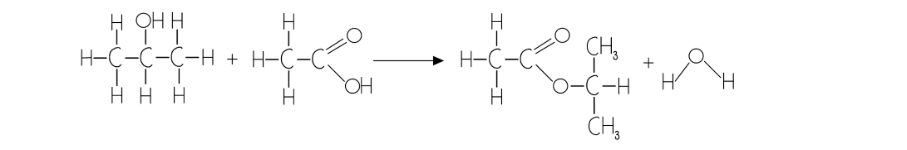
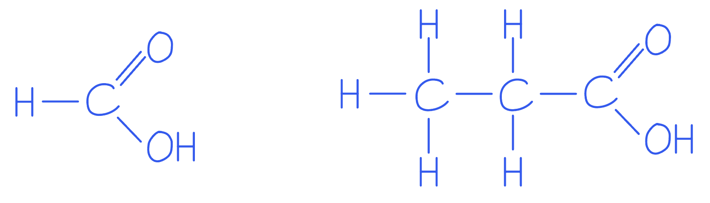
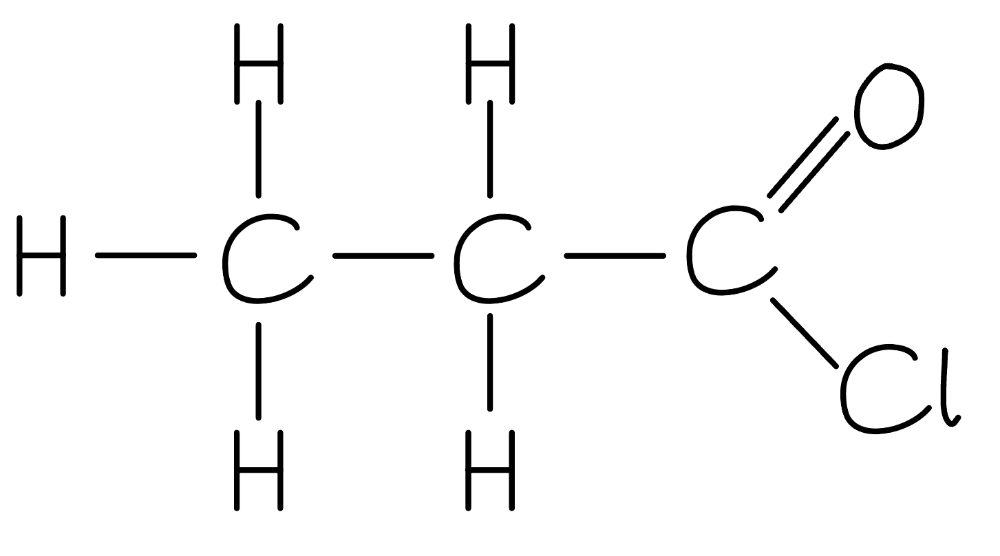

# Mark Schemes — Esters
**33. Carboxylic Acids & Derivatives** · Cambridge (CIE) A-LEVEL chemistry (9701)

## Structured Questions (3 questions)

### Q1
> **[mark-scheme]**
> The word and symbol equations for the formation of ethyl methanoate (raspberry essence) and ethyl butanoate (pineapple essence) are:
> 
> - Ethanol + methanoic acid → ethyl methanoate + water
> **AND**
> CH3CH2OH + HCOOH → HCOOCH2CH3 + H2O **[1 mark]**
> - Ethanol + butanoic acid → ethyl butanoate + water
> **AND**
> CH3CH2OH + CH3CH2CH2COOH → CH3CH2CH2COOCH2CH3 + H2O **[1 mark]**

> **[exam-tip]**
> Remember that acid + alcohol → ester + water.
> 
> The alcohol gives the alkyl part of the ester name (ethanol = ethyl-) and the acid gives the carboxylate part (methanoic acid = -methanoate; butanoic acid = -butanoate).
> **[mark-scheme]**
> i) Distillation would not allow the student to safely obtain their octyl ethanoate because:
> 
> Any **two** from (1 mark for each point):
> 
> - The ester / octyl ethanoate is flammable
> **AND**
> it could ignite using a Bunsen burner / its flash point is below its boiling point
> - The high boiling point of the ester / octyl ethanoate
> **AND**
> means that the aqueous portion would boil off / would leave behind any dissolved materials in the ester / octyl ethanoate
> - There is a risk that the ester / octyl ethanoate could distil across with the water
> 
> **[2 marks]**
> 
> ii) The equipment that the student could use to safely obtain their octyl ethanoate is:
> 
> - A separating funnel **[1 mark]**
> - (Because) the ester / octyl ethanoate does not dissolve in water
> **OR**
> (Because) the ester / octyl ethanoate forms an organic layer
> **OR**
> (Because) the ester / octyl ethanoate floats on top of the other chemicals **[1 mark]**

> **[exam-tip]**
> This question gives you a lot of information about octyl ethanoate: it is flammable (flash point 86 °C), has a high boiling point (211 °C), and has a density of 0.87 g/cm3, meaning it is less dense than water and immiscible with it.
> 
> The flash point (86 °C) is well below the boiling point (211 °C), so the ester would ignite before it could be distilled safely using a Bunsen burner.
> 
> To safely purify the octyl ethanoate, focus on its low density and immiscibility with water. A separating funnel allows the organic layer to be separated from the aqueous layer without any heating.
i) The equation for the reaction between propan-2-ol and ethanoic acid, showing the structure of the organic product:

CH3CH(OH)CH3 + CH3COOH → CH3COOCH(CH3)2 + H2O

The organic product is **propan-2-yl ethanoate**

**[3 marks]**

> **[mark-scheme]**
> i) Marks are awarded for:
> 
> 1 mark for correct structural / displayed formulae for reactants
> 
> 1 mark for correct structural / displayed formula of the products (ester and water)
> 
> 1 mark for correct organic product name: propan-2-yl ethanoate **OR **1-methylethyl ethanoate

> **[exam-tip]**
> Naming esters from secondary alcohols can be challenging. The alcohol provides the first part of the name (propan-2-ol = propan-2-yl) and the acid provides the second part (ethanoic acid = ethanoate). The ester is propan-2-yl ethanoate, also accepted as 1-methylethyl ethanoate.
> 
> You will usually be awarded marks if you have used a mixture of displayed and structural formulae, for example drawing the displayed formula of the ester but writing the structural formula of water as H2O.

> **[mark-scheme]**
> ii) A suitable homogeneous catalyst for the reaction is:
> 
> - Concentrated sulphuric acid / concentrated H2SO4 **[1 mark]**

> **[exam-tip]**
> Concentrated sulphuric acid is the answer CIE expects here. It acts as a homogeneous catalyst because the catalyst and both reactants are in the same liquid phase.
> **[mark-scheme]**
> Any **one** of the following sets (1 mark for the reagent and 1 mark for the other product):
> 
> Set 1:
> 
> - Reagent: Ethanoyl chloride
> - Other product: HCl / hydrogen chloride / hydrochloric acid
> 
> **OR**
> 
> Set 2:
> 
> - Reagent: Ethanoic anhydride
> - Other product: Ethanoic acid / CH3COOH
> 
> **[2 marks]**

> **[exam-tip]**
> The three methods of esterification you are expected to know are:
> 
> - Acid + alcohol → ester + water (reversible, requires concentrated H2SO4)
> - Acyl chloride + alcohol → ester + HCl (fast, irreversible)
> - Acid anhydride + alcohol → ester + carboxylic acid (fast, less hazardous than acyl chlorides)
> 
> You can also be expected to outline the mechanism for any of these methods. The acyl chloride and acid anhydride routes both proceed via addition-elimination.

### Q2
> **[mark-scheme]**
> A chemical test to distinguish between the two acids, and the expected observations, are:
> 
> Any **one** of the following sets (1 mark for the chemical test and 1 mark for the acid/observation):
> 
> Set 1:
> 
> - Chemical test: Tollens' reagent
> - Acid/observation: Methanoic acid gives a silver mirror / black precipitate / grey solid
> 
> **OR**
> 
> Set 2:
> 
> - Chemical test: Fehling's solution
> - Acid/observation: Methanoic acid gives a red / orange precipitate / solid
> 
> **[2 marks]**

> **[exam-tip]**
> Tollens' reagent and Fehling's solution both react with methanoic acid because the carbonyl carbon has a hydrogen directly bonded to it, as shown in the displayed formulae.
> 
> 
> 
> This allows methanoic acid to behave like an aldehyde and act as a reducing agent.
> 
> Propanoic acid does not give a positive result because, although its carbon is doubly bonded to oxygen, it does not have a hydrogen directly attached to the carbonyl carbon.
i) The product of the first step:

**[1 mark]**

> **[mark-scheme]**
> 1 mark for the correct structure of propanoyl chloride

> **[mark-scheme]**
> ii) The reagents and conditions needed for each step are:
> 
> Step 1 (propanoic acid to propanoyl chloride):
> 
> - PCl5
> **OR**
> PCl3 (+ heat)
> **OR**
> SOCl2 (added to propanoic acid) **[1 mark]**
> 
> Step 2 (propanoyl chloride to phenyl propanoate):
> 
> - Add the product of Step 1 to phenol in NaOH **[1 mark]**

> **[exam-tip]**
> In order to form an acyl chloride, propanoic acid can react with solid phosphorus(V) chloride (PCl5), liquid phosphorus(III) chloride (PCl3, with heat), or liquid sulfur dichloride oxide (SOCl2).
> 
> Acyl chlorides are more reactive than carboxylic acids and are therefore often used as starting materials in ester synthesis. With phenols, the reaction requires heat and must be carried out in the presence of a base. The base deprotonates the phenol to form a phenoxide ion, which is a better nucleophile than the phenol molecule itself.
> **[mark-scheme]**
> An acyl chloride should be formed first because:
> 
> Any **one** from:
> 
> - Faster reaction
> - Reaction of phenol and carboxylic acid / propanoic acid does not go to completion
> 
> **[1 mark]**

> **[exam-tip]**
> Carboxylic acids are less reactive than acyl chlorides, so the direct reaction between propanoic acid and phenol is slow and reversible. Acyl chlorides react faster and irreversibly, giving a higher yield. The esterification of acyl chlorides proceeds via an addition-elimination mechanism, which is why the reaction goes to completion.

### Q3
> **[mark-scheme]**
> An equation for the formation of the ester from methanol and propanoic acid is:
> 
> - CH3OH + CH3CH2COOH → CH3CH2COOCH3 + H2O **[1 mark]**

> **[exam-tip]**
> The first part of the ester name comes from the alcohol: methanol gives the methyl- group. The second part comes from the carboxylic acid: propanoic acid gives the -propanoate group. The ester formed is methyl propanoate.
> 
> During the reaction, a water molecule is lost and an ester linkage (-COO-) forms between the two groups. This type of reaction is a condensation reaction.
> 
> In the structural formula, the -CO- portion comes from the carboxylic acid and the -O- portion comes from the alcohol, giving CH3CH2COOCH3.
> **[mark-scheme]**
> i) An equation for the preparation of propanoyl chloride from propanoic acid and phosphorus(V) chloride is:
> 
> - CH3CH2COOH + PCl5 → CH3CH2COCl + POCl3 + HCl **[1 mark]**
> 
> ii) One observation of this reaction is:
> 
> - White fumes / steamy fumes / misty fumes (of HCl) **[1 mark]**

> **[exam-tip]**
> Acyl chlorides are prepared from their corresponding carboxylic acid, so propanoyl chloride is produced from propanoic acid.
> 
> Three different reagents can be used in this preparation: PCl5, PCl3 (with heat), and SOCl2. You should be able to construct equations for the preparation of an acyl chloride using all three.
> 
> The white fumes are hydrogen chloride gas (HCl), which is produced alongside the acyl chloride and phosphoryl chloride (POCl3).
The name and mechanism for the reaction between methanol and propanoyl chloride to form methyl propanoate:

Name = (nucleophilic) addition-elimination

**[5 marks]**

> **[mark-scheme]**
> 1 mark for naming the mechanism: (Nucleophilic) Addition-elimination
> 
> 1 mark for a curly arrow from the lone pair on the oxygen (of the OH) to the carbon atom of C=O **AND **δ+ on C of C=O and δ− on O of C=O
> 
> 1 mark for a curly arrow from C=O bond to the O of the C=O bond
> 
> 1 mark for three correct curly arrows in the second stage **AND **a lone pair on the O atom
> 
> 1 mark for the correct structure of the ion including the two charges

> **[exam-tip]**
> The alcohol acts as a nucleophile in this reaction. The lone pair on the oxygen of methanol attacks the δ+ carbonyl carbon, and an HCl molecule is eliminated in the second step.
> 
> Make sure your curly arrows are clear and double-headed. The first mechanism mark requires both the curly arrow from the lone pair **AND **the partial charges (δ+ on C and δ− on O of C=O) to be shown.
> 
> The mechanism is called addition-elimination because the nucleophile first adds to the carbonyl carbon, forming a tetrahedral intermediate, and then the chloride ion is eliminated.
> **[mark-scheme]**
> Two advantages of using propanoyl chloride over propanoic acid in the preparation of esters in industry:
> 
> Any **two** from (1 mark for each point):
> 
> - The reactions with acyl chlorides are quicker / faster
> - The acyl chloride reactions go to completion / are irreversible / do not form an equilibrium mixture
> - A higher yield of ester is obtained
> - No catalyst is required
> 
> **[2 marks]**

> **[exam-tip]**
> A reaction that forms an equilibrium mixture will result in a lower yield of product, because the reverse reaction continuously converts products back into reactants. Acyl chlorides avoid this problem as they react irreversibly, producing a higher yield in a shorter time.
