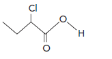
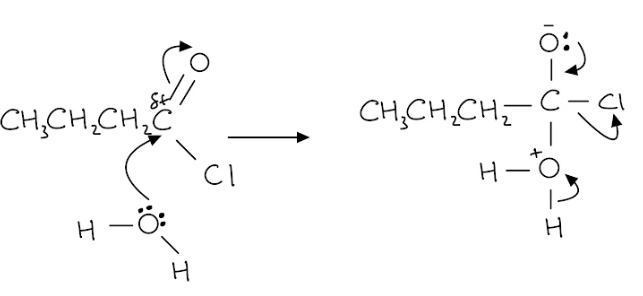
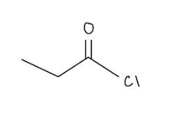
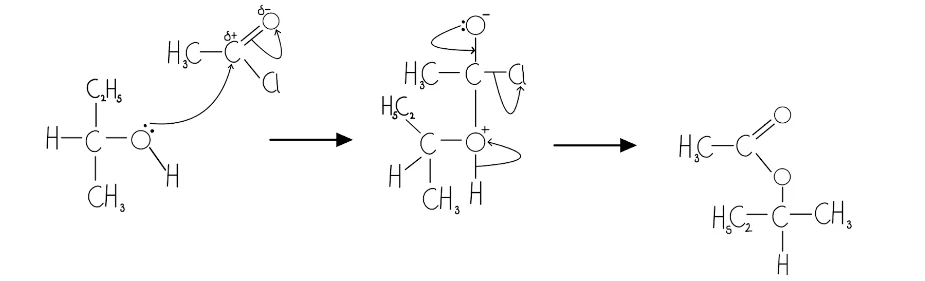
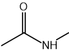

# Mark Schemes — Acyl Chlorides
**33. Carboxylic Acids & Derivatives** · Cambridge (CIE) A-LEVEL chemistry (9701)

## Structured Questions (8 questions)

### Q1
i) The displayed formula of butanoyl chloride is:

**[1 mark]**

> **[mark-scheme]**
> 1 mark for the correct displayed formula of butanoyl chloride

> **[mark-scheme]**
> ii) The name and chemical formula of a reagent that converts butanoic acid into butanoyl chloride are:
> 
> Any **one** of the following sets (1 mark for the name and 1 mark for the chemical formula):
> 
> Set 1:
> 
> - Name: phosphorus(V) chloride
> - Chemical formula: PCl5
> 
> Set 2:
> 
> - Name: phosphorus(III) chloride
> - Chemical formula: PCl3
> 
> Set 3:
> 
> - Name: sulfur dichloride oxide **OR **thionyl chloride
> - Chemical formula: SOCl2
> 
> **[2 marks]**
> 
> The name and formula must refer to the same reagent

> **[exam-tip]**
> All three reagents (PCl5, PCl3, and SOCl2) are used to convert carboxylic acids into acyl chlorides. You must know both the name and the formula for each.
> 
> SOCl2 is also called thionyl chloride, but the IUPAC name sulfur dichloride oxide is the form most commonly credited in CIE mark schemes.
> **[mark-scheme]**
> i) Butanoic acid is a weaker acid than 2-chlorobutanoic acid because:
> 
> - The chlorine atom withdraws electron density from the –COOH group **[1 mark]**
> - (Therefore,) the O–H bond is weakened, making it easier for 2-chlorobutanoic acid to lose an H+ ion **[1 mark]**

ii) The skeletal formula for 2-chlorobutanoic acid is:

**[1 mark]**

> **[mark-scheme]**
> 1 mark for the correct skeletal formula of 2-chlorobutanoic acid

> **[exam-tip]**
> Acids ionise in water by losing an H+ proton from the –OH group. The weaker the O–H bond, the more readily the proton is lost and the stronger the acid.
> 
> In 2-chlorobutanoic acid, the electronegative chlorine at C2 withdraws electron density from the nearby –COOH group through the sigma bonds (inductive effect). This weakens the O–H bond further compared to butanoic acid, making 2-chlorobutanoic acid a stronger acid.
> **[mark-scheme]**
> A chloro-substituted butanoic acid that is a stronger acid than 2-chlorobutanoic acid is:
> 
> - 2,2-dichlorobutanoic acid
> **OR**
> 2,3-dichlorobutanoic acid **[1 mark]**

> **[exam-tip]**
> The more chlorine atoms attached to the molecule, the greater the electron withdrawal from the –COOH group and the stronger the acid. Both 2,2-dichlorobutanoic acid and 2,3-dichlorobutanoic acid are valid answers, as each contains two chlorine atoms compared to one in 2-chlorobutanoic acid.
The mechanism for the hydrolysis of butanoyl chloride is:

**[4 marks]**

> **[mark-scheme]**
> 1 mark for a curly arrow from the lone pair on the oxygen atom of H2O to the δ+ carbonyl carbon **AND** δ+ shown on the carbonyl carbon
> 
> 1 mark for a curly arrow from the C=O bond to the oxygen atom of the C=O group
> 
> 1 mark for all three curly arrows drawn correctly **AND** a lone pair shown on the oxygen atom of H2O
> 
> 1 mark for a correct structure of the tetrahedral intermediate (including both charges)

> **[exam-tip]**
> This is a nucleophilic addition-elimination mechanism. The water molecule acts as the nucleophile, with its lone pair attacking the δ+ carbonyl carbon. After the addition step forms the tetrahedral intermediate, the elimination step regenerates the C=O bond as HCl is eliminated to give butanoic acid.
> 
> Make sure your curly arrows are double-headed and you clearly show the δ+ on the carbonyl carbon.
> **[mark-scheme]**
> The correct order of ease of hydrolysis (most reactive first) is:
> 
> - Butanoyl chloride > 1-chlorobutane > chlorobenzene **[1 mark]**
> 
> Explanation for the order of butanoyl chloride and 1-chlorobutane:
> 
> - Butanoyl chloride has a carbon atom bonded to two electronegative atoms (oxygen and chlorine) **[1 mark]**
> - (Therefore,) the carbonyl carbon is more strongly δ+ than the carbon in 1-chlorobutane, making it more susceptible to nucleophilic attack **[1 mark]**
> 
> Explanation for the position of chlorobenzene:
> 
> - A lone pair of electrons from the Cl atom overlaps with the delocalised π electrons in the benzene ring **[1 mark]**
> - (Therefore,) the C–Cl bond acquires partial double-bond character and is stronger / harder to break **[1 mark]**

> **[exam-tip]**
> Acyl chlorides can be hydrolysed readily at room temperature by water. Alkyl chlorides such as 1-chlorobutane require heating under reflux with aqueous alkali, because hydroxide ions are stronger nucleophiles than water and are needed to break the C–Cl bond.
> 
> Aryl chlorides such as chlorobenzene are the least reactive towards hydrolysis. One of the lone pairs on the Cl atom overlaps with the delocalised π system of the benzene ring, giving the C–Cl bond partial double-bond character. This makes the C–Cl bond significantly stronger and much harder to break.

### Q2
> **[mark-scheme]**
> The systematic name of the carboxylic acid derivative in Fig. 1.1 is:
> 
> - Butanoyl chloride **[1 mark]**

> **[exam-tip]**
> The compound in Fig. 1.1 is an acyl chloride. To name an acyl chloride, take the name of the parent carboxylic acid and replace "-ic acid" with "-oyl chloride". The longest chain (including the carbonyl carbon) has four carbons, so the parent acid is butanoic acid, giving **butanoyl chloride**.
> **[mark-scheme]**
> i) The name of the other product formed:
> 
> - Hydrogen chloride / HCl **[1 mark]**
> 
> ii) This reaction is classified as a condensation reaction because:
> 
> - A small molecule / hydrogen chloride / HCl is eliminated **[1 mark]**

> **[exam-tip]**
> A condensation reaction is one in which two molecules join together and a small molecule is eliminated.
> 
> When an acyl chloride reacts with an alcohol, HCl is the small molecule eliminated. Compare this with the direct esterification of a carboxylic acid with an alcohol, where water (H2O) is eliminated instead.
> 
> Both are condensation reactions and both produce an ester.
> **[mark-scheme]**
> The equation for this reaction is:
> 
> - CH3COCl + 2NH3 → CH3CONH2 + NH4Cl
> **OR**
> CH3COCl + NH3 → CH3CONH2 + HCl **[1 mark]**

> **[exam-tip]**
> Both equations are accepted by CIE. When excess ammonia is present, the HCl produced immediately reacts with a second NH3 molecule to form ammonium chloride, NH4Cl. The equation using 2NH3 is the more complete answer when excess ammonia is specified.
> **[mark-scheme]**
> The two reactants used to form propanoyl chloride are:
> 
> - Propanoic acid **[1 mark]**
> - Sulfur dichloride oxide / thionyl chloride (SOCl2) **[1 mark]**

> **[exam-tip]**
> The by-products SO2 and HCl tell you which reagent was used. SOCl2 (thionyl chloride) produces SO2 and HCl as by-products:
> 
> CH3CH2COOH + SOCl2 → CH3CH2COCl + SO2 + HCl
> 
> The other reagents that convert carboxylic acids to acyl chlorides are PCl5 (by-products: POCl3 + HCl) and PCl3 (by-product: H3PO3).

### Q3
The skeletal formula for propanoyl chloride is:

**[1 mark]**

> **[mark-scheme]**
> 1 mark for the correct skeletal formula of propanoyl chloride

> **[exam-tip]**
> You must be able to draw the skeletal formula for acyl chlorides. The acyl chloride functional group is a carbonyl carbon (C=O) bonded to a chlorine atom. For propanoyl chloride, the three-carbon chain has the acyl chloride group at one end.
> **[mark-scheme]**
> i) The two products formed when propanoyl chloride undergoes hydrolysis are:
> 
> - Propanoic acid **[1 mark]**
> - HCl / hydrochloric acid **[1 mark]**
> 
> ii) The name of the mechanism is:
> 
> - Addition-elimination / nucleophilic addition-elimination **[1 mark]**

> **[exam-tip]**
> The hydrolysis of an acyl chloride always produces the corresponding carboxylic acid and HCl. Water acts as the nucleophile, attacking the electrophilic carbonyl carbon atom, before HCl is eliminated.
> 
> For higher-mark questions, you may be asked to draw the full mechanism for this reaction.
> **[mark-scheme]**
> The reason propanoyl chloride hydrolyses more readily is:
> 
> - The carbonyl carbon is bonded to two highly electronegative atoms (oxygen and chlorine) / the carbonyl carbon is highly electron-deficient (δ+) **[1 mark]**
> - It strongly attracts nucleophiles / is highly susceptible to nucleophilic attack by water **[1 mark]**
> 
> 'The C-Cl bond is weaker' is not accepted without reference to the electron-deficient carbonyl carbon

> **[exam-tip]**
> In 2-chloropropane, the carbon bonded to chlorine is attached to only one electronegative atom. In propanoyl chloride, the carbonyl carbon is attached to both oxygen and chlorine. This creates a much larger δ+ charge on the carbonyl carbon, making it far more susceptible to nucleophilic attack by water.
> 
> Note that the C-Cl bond in an acyl chloride is indeed weaker than in an alkyl chloride, but this alone is not the accepted explanation here. The answer must reference the electron deficiency of the carbonyl carbon and its susceptibility to nucleophilic attack.

### Q4
> **[mark-scheme]**
> i) The name of the mechanism is:
> 
> - Nucleophilic addition-elimination **[1 mark]**

ii) The mechanism for the reaction of butan-2-ol with ethanoyl chloride is:

**[4 marks]**

> **[mark-scheme]**
> 1 mark for a curly arrow from the lone pair on the O of butan-2-ol to the C of the C=O, **AND** δ+ shown on the carbonyl carbon
> 
> 1 mark for a curly arrow from the C=O bond to the O of the C=O group
> 
> 1 mark for O– on the former carbonyl O (with lone pair and negative charge) **AND** O+ on butan-2-ol O **AND** a curly arrow from the lone pair of O– to the C–O bond
> 
> 1 mark for the correct ester product **AND** a curly arrow from the C–Cl bond to the Cl atom

> **[exam-tip]**
> The mechanism is nucleophilic addition-elimination. The oxygen lone pair from butan-2-ol attacks the δ+ carbonyl carbon in the addition step. The subsequent elimination step regenerates the C=O group and HCl is lost.
> 
> Learn the general mechanism rather than memorising it for one specific reaction. If you understand what nucleophilic addition-elimination involves, you can apply it to any acyl chloride reaction.
> **[mark-scheme]**
> The reactants required to make ethanamide using an acyl chloride are:
> 
> - Reactant: Ethanoyl chloride **[1 mark]**
> - Reactant: Ammonia **[1 mark]**
> - Other product: ammonium chloride **[1 mark]**

> **[exam-tip]**
> To identify the reactants, look at the functional groups in the product. Ethanamide (CH3CONH2) contains a carbonyl group (from an acyl chloride) and an amine group (from ammonia). The acyl chloride that produces the CH3CO– group is ethanoyl chloride (CH3COCl).
> 
> When an acyl chloride reacts with ammonia, the byproduct is ammonium chloride (NH4Cl), because excess ammonia reacts with the HCl produced.
> **[mark-scheme]**
> i) Ethanoyl chloride reacts more readily with ethylamine than phenylamine because:
> 
> - Ethylamine is a stronger nucleophile than phenylamine
> **OR**
> Phenylamine is a weaker nucleophile than ethylamine **[1 mark]**
> - The alkyl group in ethylamine donates electron density to N, making the lone pair more available for nucleophilic attack
> **OR**
> The N lone pair in phenylamine is delocalised into the benzene ring, making it less available for nucleophilic attack **[1 mark]**
> 
> ii) The products and classification of nitrogen are:
> 
> - N-ethylethanamide **[1 mark]**
> - N-phenylethanamide **[1 mark]**
> - The nitrogen in both products is secondary / 2° **[1 mark]**

> **[exam-tip]**
> For part (i): the reactivity of an amine as a nucleophile depends on how available the lone pair on N is. Alkyl groups (in ethylamine) donate electron density to N via the inductive effect, increasing lone pair availability. In phenylamine, the N lone pair is partially delocalised into the benzene π system, reducing its availability for nucleophilic attack.
> 
> For part (ii): when naming secondary amides from acyl chloride reactions, identify the chain attached to N (ethyl / phenyl) and the chain containing the carbonyl (ethan-). The product names take the form N-[alkyl/aryl]ethanamide. Both nitrogen atoms are secondary because N is bonded to two carbon atoms in the amide.

### Q5
> **[mark-scheme]**
> The correct equation for the reaction of ethanoyl chloride with excess ammonia is:
> 
> - CH3COCl + 2NH3 → CH3CONH2 + NH4Cl **[1 mark]**
> 
> The student's equation is incorrect because:
> 
> - The excess ammonia reacts with the HCl produced, because ammonia is a base
> **AND**
> Ammonium chloride is formed as the second product (not hydrogen chloride) **[1 mark]**

> **[exam-tip]**
> The student's equation would have been correct if ethanoyl chloride reacted with a single equivalent of ammonia only. The use of excess ammonia means a second molecule of NH3 acts as a base and reacts with the HCl produced, forming NH4Cl as the ionic salt product.
i) The skeletal formula of *N*-methylethanamide is:

**[1 mark]**

> **[mark-scheme]**
> i) 1 mark for the correct skeletal formula of *N*-methylethanamide
> 
> ii) The equation for the formation of *N*-methylethanamide from ethanoyl chloride is:
> 
> - CH3COCl + 2CH3NH2 → CH3CONHCH3 + CH3NH3Cl **[1 mark]**

> **[exam-tip]**
> The *N* at the beginning of *N*-methylethanamide tells you the methyl group is attached to the nitrogen atom, not a carbon in the main chain. This makes it a secondary amide (the nitrogen is bonded to two carbon atoms). Secondary amides are formed from the reaction of an acyl chloride with a primary amine.
> 
> When constructing the equation, remember that excess methylamine is used: the second equivalent of CH3NH2 reacts with the HCl produced, forming the ammonium salt CH3NH3Cl.
The skeletal formula of the ester formed is:

**[1 mark]**

> **[mark-scheme]**
> 1 mark for the correct skeletal formula of 2-methylpropyl ethanoate
> 
> Allow the correct displayed formula

> **[exam-tip]**
> Ethanoyl chloride (CH3COCl) reacts with 2-methylpropan-1-ol to form 2-methylpropyl ethanoate. The ester linkage (–COO–) connects the ethanoyl group (from the acyl chloride) and the 2-methylpropyl group (from the alcohol). Remember that HCl is also produced in this reaction.
