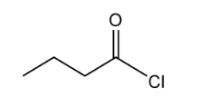
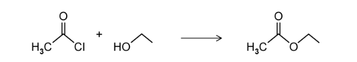

# Exam Questions — Acyl Chlorides
**33. Carboxylic Acids & Derivatives** · Cambridge (CIE) A-LEVEL chemistry (9701)
> Source: [https://www.savemyexams.com/a-level/chemistry/cie/25/topic-questions/](https://www.savemyexams.com/a-level/chemistry/cie/25/topic-questions/) · 5 questions across 1 sets

## Structured Questions (8 questions)

### Q1 — medium — 16 marks

**Q1** [3 marks]

This question is about butanoyl chloride.

Butanoyl chloride can be produced from butanoic acid.

i) Draw the displayed formula of butanoyl chloride.

[1]

ii) State the name and chemical formula of a reagent that converts butanoic acid into butanoyl chloride.

[2]

**Q1** [3 marks]

i) Explain why butanoic acid is a weaker acid than 2-chlorobutanoic acid.

[2]

ii) Draw the skeletal formula for 2-chlorobutanoic acid.

[1]

**Q1** [1 mark]

**Extract:**

i) Explain why butanoic acid is a weaker acid than 2-chlorobutanoic acid.

Butanoic acid is a weaker acid than 2-chlorobutanoic acid because:
- The chlorine atom withdraws electron density from the –COOH group
- (Therefore,) the O–H bond is weakened, making it easier for 2-chlorobutanoic acid to lose an H+ ion

State the name of a chloro-substituted butanoic acid that is a stronger acid than 2-chlorobutanoic acid.

**Q1** [4 marks]

Butanoyl chloride can undergo hydrolysis.

Describe the mechanism for the hydrolysis of butanoyl chloride. Include charges, dipoles, lone pairs of electrons and curly arrows, as appropriate.

**Q1** [5 marks]

State and explain the relative ease of hydrolysis for butanoyl chloride, chlorobenzene and 1-chlorobutane.

### Q2 — easy — 6 marks

**Q2** [1 mark]

This question is about derivatives of carboxylic acids.

Fig. 1.1 shows the structure of a carboxylic acid derivative.

**Fig. 1.1**

State the systematic name of the carboxylic acid derivative shown in Fig. 1.1.

**Q2** [2 marks]

Ethanoyl chloride reacts with ethanol to form ethyl ethanoate as shown in Fig. 1.2.

**Fig. 1.2**

i) State the name of the other product formed in this reaction.

[1]

ii) This reaction can be described as an esterification reaction or an acylation reaction.

Explain why this reaction can also be described as a condensation reaction.

[1]

**Q2** [1 mark]

Ethanoyl chloride can also react with ammonia to form ethanamide.

Construct an equation for this reaction.

**Q2** [2 marks]

During the preparation of propanoyl chloride, SO2 and HCl were also produced.

State the names of the two reactants used to form propanoyl chloride.

### Q3 — easy — 6 marks

**Q3** [1 mark]

Propanoyl chloride is used for the synthesis of other organic compounds.

Draw the skeletal formula for propanoyl chloride.

**Q3** [3 marks]

i) State the names of the two products formed when propanoyl chloride undergoes hydrolysis.

[2]

ii) State the name of the mechanism by which hydrolysis occurs.

[1]

**Q3** [2 marks]

Explain why propanoyl chloride will more readily undergo hydrolysis compared to 2-chloropropane.

### Q4 — medium — 13 marks

**Q4** [5 marks]

A common method for esterification is to react an alcohol with an acyl chloride.

i) State the name of the mechanism for the reaction of butan-2-ol with ethanoyl chloride.

[1]

ii) Describe the mechanism for the reaction of butan-2-ol with ethanoyl chloride. Include charges, dipoles, lone pairs of electrons and curly arrows, as appropriate.

[4]

**Q4** [3 marks]

Acyl chlorides undergo various reactions with water, alcohols, ammonia and primary amines.

Ethanamide is the product of a chemical reaction.

State the necessary reactants and name the other product.

**Q4** [5 marks]

Ethanoyl chloride can react with primary aliphatic and aromatic amines to produce different amides.

i) Explain why ethanoyl chloride is more reactive towards ethylamine than phenylamine.

[2]

ii) Name the products of both reactions and classify the nitrogen in each product.

[3]

### Q5 — medium — 5 marks

**Q5** [2 marks]

Acyl chlorides are commonly used carboxylic acid derivatives.

Ethanoyl chloride reacts with an excess of ammonia.

A student proposes the following equation to represent the reaction:

CH3COCl + NH3  →  CH3CONH2 + HCl

Correct and explain the student's error.

**Q5** [2 marks]

*N*-methylethanamide can also be formed from ethanoyl chloride.

i) Draw the skeletal formula of *N*-methylethanamide.

[1]

ii) Construct an equation for the formation of *N*-methylethanamide from ethanoyl chloride.

[1]

**Q5** [1 mark]

Ethanoyl chloride will react with 2-methylpropan-1-ol to form an ester.

Draw the skeletal formula of the ester formed.
