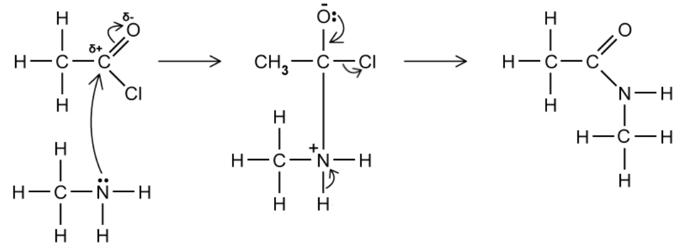
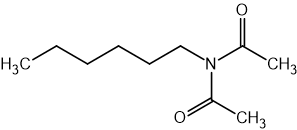

# Mark Schemes — Primary & Secondary Amines
**34. Nitrogen Compounds** · Cambridge (CIE) A-LEVEL chemistry (9701)

## Structured Questions (4 questions)

### Q1
> **[mark-scheme]**
> i) The name of the mechanism:
> 
> - (Nucleophilic) addition-elimination **[1 mark]**

ii) The mechanism for the reaction between ethanoyl chloride and methylamine is:

**[4 marks]**

> **[mark-scheme]**
> ii)
> 
> 1 mark for curly arrow from lone pair on N atom to δ+ C atom AND curly arrow from C=O bond to O atom, with correct dipole shown on C=O
> 
> 1 mark for correct tetrahedral intermediate with positive charge on N and negative charge on O
> 
> 1 mark for curly arrow from lone pair on O- atom to C-O bond AND curly arrow from C-Cl bond to Cl atom
> 
> 1 mark for correct product structure (N-methylethanamide)

> **[mark-scheme]**
> iii) The systematic name of the compound formed:
> 
> - *N*-methylethanamide **[1 mark]**

> **[exam-tip]**
> An *N*-substituted amide is produced during the vigorous reaction between an amine and an acyl chloride.
> 
> Always show the lone pair on the nitrogen atom and the dipole on the C=O bond. The nitrogen atom in the intermediate carries a positive charge (it has four bonds) and the oxygen atom carries a negative charge.
> 
> The final step of the mechanism involves loss of H+ as HCl, removed by the Cl- ion or another methylamine molecule. This step is not required in the mechanism.
> 
> The *N* in *N*-methylethanamide indicates that the methyl group is on the nitrogen atom. This is a condensation reaction, as two molecules combine to eliminate the small molecule HCl.
> **[mark-scheme]**
> i) The reagents and conditions required for the preparation of methylamine:
> 
> - Excess ammonia / NH3 **[1 mark]**
> - Ethanolic solvent / ethanol **[1 mark]**
> - Heat under pressure **[1 mark]**
> 
> ii) The name of the mechanism:
> 
> - Nucleophilic substitution **[1 mark]**

> **[exam-tip]**
> Excess ammonia reduces the likelihood that the methylamine product will attack chloromethane. Because methylamine can itself act as a nucleophile, using excess ammonia prevents the formation of secondary and tertiary amines.
> 
> The excess ammonia also reacts with the HCl produced to form NH4Cl, removing it from the reaction mixture and preventing it from reacting with the methylamine.
> 
> This is a nucleophilic substitution reaction in which the nitrogen lone pair in ammonia attacks the carbon bearing the Cl, replacing Cl- as the leaving group.
i) The skeletal formula of the organic compound formed in this reaction is:

**[1 mark]**

> **[mark-scheme]**
> 1 mark for correct skeletal formula of N-methylethylamine (CH3NHCH2CH3)

> **[mark-scheme]**
> ii) The type of amine formed is:
> 
> - Secondary amine **[1 mark]**

> **[exam-tip]**
> When a halogenoalkane reacts with a primary amine, a secondary amine is formed. The halogen is replaced by the nitrogen in the amine through nucleophilic substitution.
> 
> The product of chloroethane reacting with methylamine is N-methylethylamine (CH3NHCH2CH3). This is a secondary amine as the nitrogen atom has two alkyl groups (a methyl and an ethyl group) attached to it.
> **[mark-scheme]**
> i) A method to distinguish the two solutions:
> 
> - Use a pH meter **[1 mark]**
> - Dimethylamine produces a higher pH reading than methylamine **[1 mark]**
> 
> ii) Explanation:
> 
> - The relative basicity depends on the availability of the lone pair on the nitrogen atom **[1 mark]**
> - Dimethylamine is the stronger base
> **AND**
> the two alkyl groups donate electron density to the N atom (positive inductive effect), making the lone pair more available to accept a proton **[1 mark]**

> **[exam-tip]**
> Secondary amines such as dimethylamine are stronger bases than primary amines such as methylamine. This is because more alkyl groups on the nitrogen atom push electron density towards it, increasing the availability of the lone pair for accepting a proton.
> 
> In terms of base strength:
> 
> tertiary amines > secondary amines > primary amines > ammonia.

### Q2
> **[mark-scheme]**
> The reagents and conditions required for the conversion of 1-bromobutane into butylamine are:
> 
> - Excess ammonia / NH3 **[1 mark]**
> - Ethanolic solvent / ethanol **[1 mark]**
> - Heat under pressure **[1 mark]**

> **[exam-tip]**
> Amines can be prepared by two main routes:
> 
> - The reaction of halogenoalkanes with excess ethanolic ammonia, heated under pressure
> - The reduction of nitriles using LiAlH4 in dry ether
> 
> Make sure you know the reagents and conditions required for both of these reactions.
> **[mark-scheme]**
> Amines can act as bases because:
> 
> - They can accept a proton (H+ ion) / donate the lone pair of electrons on the nitrogen atom to a proton, forming a dative / coordinate bond **[1 mark]**

> **[exam-tip]**
> A base is defined as a proton acceptor or electron-pair donor.
> 
> An amine accepts a proton (H+ ion) by donating its lone pair of electrons from the nitrogen atom to form a dative (coordinate) bond. This is why amines are classified as bases.
> **[mark-scheme]**
> i) The equation for the reaction of ethylamine with hydrochloric acid:
> 
> - CH3CH2NH2 + HCl → CH3CH2NH3+Cl- **[1 mark]**
> 
> ii) The systematic name of the organic product:
> 
> - Ethylammonium chloride **[1 mark]**

> **[exam-tip]**
> The nitrogen atom in ethylamine accepts a proton (H+ ion) from HCl by donating its lone pair of electrons to form a dative bond. This gives the nitrogen atom a positive charge in the product.
> 
> Amines react with HCl to form amine salts. The product must show the correct charges on the correct atoms.

### Q3
The completed table is:

|   | **formula** | **systematic name** | **type of amine** |
|---|---|---|---|
| **A** | CH3CH2NHCH3 | *N*-methylethanamine | **Final answer:** **secondary** |
| **B** | (CH3)3N | **Final answer:** **trimethylamine / N,N-dimethylmethanamine** | tertiary |
| **C** | CH3CH2CH2NH2 | **Final answer:** **propan-1-amine / propylamine** | **Final answer:** **primary** |
| **D** | CH3CH(NH2)CH3 | **Final answer:** **propan-2-amine / 2-aminopropane** | **Final answer:** **primary** |

**[3 marks]**

> **[mark-scheme]**
> 1 mark for A = secondary **AND **B = trimethylamine / N,N-dimethylmethanamine
> 
> 1 mark for C = propan-1-amine / propylamine **AND **primary
> 
> 1 mark for D = propan-2-amine / 2-aminopropane **AND **primary

> **[exam-tip]**
> (CH3)3N has three methyl groups on the nitrogen atom, making it a tertiary amine. It is commonly called trimethylamine; the IUPAC name is N,N-dimethylmethanamine.
> 
> CH3CH2CH2NH2 is a propane chain with the amine group at carbon-1, making it a primary amine. Its IUPAC name is propan-1-amine.
> 
> CH3CH(NH2)CH3 has the amine group at carbon-2, making it a primary amine. Its IUPAC name is propan-2-amine; 2-aminopropane is also accepted.
> 
> Primary amines have an –NH2 group on one alkyl group. Secondary amines have an –NH group between two alkyl groups. Tertiary amines have three alkyl groups on the nitrogen.
> **[mark-scheme]**
> Amine **A** is the stronger base:
> 
> - Amine A is the stronger base
> **AND**
> it has two alkyl groups donating electron density to the nitrogen atom **[1 mark]**
> - The increased electron density on the N atom makes the lone pair more available to accept a proton / H+ **[1 mark]**
> 
> The reverse argument explaining why amine D is a weaker base is accepted.

> **[exam-tip]**
> Amine A is a secondary amine and amine D is a primary amine. Secondary amines are stronger bases than primary amines because they have more alkyl groups donating electron density to the lone pair on the nitrogen atom.
> **[mark-scheme]**
> i) The amine that reacted with ethanoyl chloride:
> 
> - Amine A / *N*-methylethanamine **[1 mark]**
> 
> ii) The name of the inorganic by-product:
> 
> - Hydrogen chloride / HCl **[1 mark]**
> 
> iii) The type of amide formed:
> 
> - *N*-substituted amide / secondary amide **[1 mark]**

> **[exam-tip]**
> You can identify the amine used by splitting the C–N bond in the structure of compound E:
> 
> - The CH3CO– group comes from the ethanoyl chloride
> - The remaining fragment containing the N atom identifies the amine used
> 
> The by-product of the reaction of an acyl chloride with an amine is always hydrogen chloride, not water. Water is the by-product when a carboxylic acid reacts with an amine.

### Q4
> **[mark-scheme]**
> Cyclohexylamine is not an isomer of hexylamine because:
> 
> - They have different molecular formulae
> **OR**
> Hexylamine has the formula C6H15N and cyclohexylamine has the formula C6H13N **[1 mark]**

> **[exam-tip]**
> Isomers have the same molecular formula but a different structural arrangement of atoms.
> 
> It can help to draw out the hydrogen atoms in the structures. In cyclohexylamine, the carbon bearing the NH2 group has only one hydrogen attached, which is often missed when counting.
> **[mark-scheme]**
> The relative order of basicity (most basic to least basic) is:
> 
> - Hexylamine > ammonia > phenylamine **[1 mark]**
> 
> Explanation:
> 
> - The hexyl / alkyl group is electron-donating (positive inductive effect)
> **AND**
> this increases the electron density on the nitrogen atom **[1 mark]**
> - The lone pair on the nitrogen atom in phenylamine is delocalised into the benzene ring
> **AND**
> this decreases the electron density on the nitrogen atom **[1 mark]**

> **[exam-tip]**
> When comparing the basicity of amines:
> 
> - Alkyl groups donate electrons (positive inductive effect), increasing the electron density on nitrogen. This makes the lone pair more available to accept a proton, so hexylamine is a stronger base than ammonia.
> - In phenylamine, the lone pair on nitrogen delocalises into the benzene ring, reducing the electron density on nitrogen. This makes the lone pair less available, so phenylamine is a weaker base than ammonia.
> **[mark-scheme]**
> i) The name of the mechanism:
> 
> - (Nucleophilic) addition-elimination **[1 mark]**

ii) The completed mechanism for the reaction between hexylamine and ethanoyl chloride is:

**[4 marks]**

> **[mark-scheme]**
> 1 mark for curly arrow from lone pair on N atom to δ+ C atom AND curly arrow from C=O bond to O atom, with correct dipole shown on C=O
> 
> 1 mark for correct tetrahedral intermediate with positive charge on N and negative charge on O
> 
> 1 mark for curly arrow from lone pair on O- atom to C-O bond AND curly arrow from C-Cl bond to Cl atom
> 
> 1 mark for correct product structure

iii) The skeletal formula of the compound with molecular formula C10H19NO2 is:

**[1 mark]**

> **[mark-scheme]**
> 1 mark for the correct skeletal formula of N,N-diacetylhexylamine / (CH3CO)2N–C6H13

> **[exam-tip]**
> Always include the lone pair on the nitrogen atom and the δ+ dipole on the C=O bond. Forgetting these can cost marks.
> 
> The nitrogen atom in the intermediate carries a positive charge because it has four bonds, and the oxygen atom carries a negative charge after the C=O bond breaks.
> 
> With excess ethanoyl chloride, hexylamine (R–NH2) first forms N-hexyl ethanamide (R–NH–COCH3), which still has one N–H bond. This N–H bond reacts with a second molecule of ethanoyl chloride to form (CH3CO)2N–C6H13, which has the molecular formula C10H19NO2.
