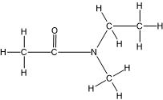
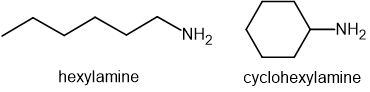
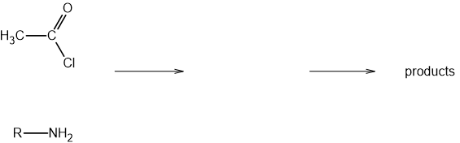

# Exam Questions — Primary & Secondary Amines
**34. Nitrogen Compounds** · Cambridge (CIE) A-LEVEL chemistry (9701)
> Source: [https://www.savemyexams.com/a-level/chemistry/cie/25/topic-questions/](https://www.savemyexams.com/a-level/chemistry/cie/25/topic-questions/) · 4 questions across 1 sets

## Structured Questions (4 questions)

### Q1 — medium — 16 marks

**Q1** [6 marks]

Amines react with acid chlorides to produce nitrogen-containing products.

i) State the name of the mechanism for the reaction between ethanoyl chloride, CH3COCl, and methylamine, CH3NH2.

[1]

ii) Describe the mechanism for this reaction. Include all relevant curly arrows, lone pairs, and dipoles.

[4]

iii) State the systematic name of the compound formed in the reaction.

[1]

**Q1** [4 marks]

Methylamine can be prepared from chloromethane.

i) State the reagents and conditions required for this synthesis.

[3]

ii) State the name of the mechanism for this reaction.

[1]

**Q1** [2 marks]

Chloroethane can also react with methylamine.

i) Draw the skeletal formula of the organic compound formed in this reaction.

[1]

ii) State the type of amine formed in this reaction.

[1]

**Q1** [4 marks]

Methylamine, CH3NH2, and dimethylamine, (CH3)2NH, are both soluble in water.

i) Suggest how, other than smell, the two solutions could be distinguished from one another.

[2]

ii) Explain your answer to part (i).

[2]

### Q2 — easy — 6 marks

**Q2** [3 marks]

Butylamine can be synthesised from 1-bromobutane.

State the reagents and conditions required for this reaction.

**Q2** [1 mark]

Explain why amines can act as bases.

**Q2** [2 marks]

Ethylamine acts as a base when it reacts with hydrochloric acid.

(i) Construct an equation for this reaction.

[1]

(ii) State the systematic name of the organic product formed in this reaction.

[1]

### Q3 — medium — 8 marks

**Q3** [3 marks]

The structural formulae of four isomeric amines, **A**–**D**, with the molecular formula C3H9N are given in Table 2.1.

**Table 2.1**

|   | **formula** | **systematic name** | **type of amine** |
|---|---|---|---|
| **A** | CH3CH2NHCH3 | *N*-methylethanamine |   |
| **B** | (CH3)3N |   | tertiary |
| **C** | CH3CH2CH2NH2 |   |   |
| **D** | CH3CH(NH2)CH3 |   |   |

Complete Table 2.1 to give the name and type of each amine. Each amine is primary, secondary, or tertiary.

**Q3** [2 marks]

**Extract:**

The structural formulae of four isomeric amines, **A**–**D**, with the molecular formula C~3~H~9~N are given in Table 2.1.

**Table 2.1**

|   | **formula** | **systematic name** | **type of amine** |
| :---: | :---: | :---: | :---: |
| **A** | CH~3~CH~2~NHCH~3~ | *N*-methylethanamine |   |
| **B** | (CH~3~)~3~N |   | tertiary |
| **C** | CH~3~CH~2~CH~2~NH~2~ |   |   |
| **D** | CH~3~CH(NH~2~)CH~3~ |   |   |

State which of amines **A** and **D** is the stronger base. Explain your answer.

**Q3** [3 marks]

**Extract:**

The structural formulae of four isomeric amines, **A**–**D**, with the molecular formula C~3~H~9~N are given in Table 2.1.

**Table 2.1**

|   | **formula** | **systematic name** | **type of amine** |
| :---: | :---: | :---: | :---: |
| **A** | CH~3~CH~2~NHCH~3~ | *N*-methylethanamine |   |
| **B** | (CH~3~)~3~N |   | tertiary |
| **C** | CH~3~CH~2~CH~2~NH~2~ |   |   |
| **D** | CH~3~CH(NH~2~)CH~3~ |   |   |

Fig. 2.1 shows compound **E**, which is formed by the reaction of ethanoyl chloride with one of the amines from Table 2.1.

**Fig. 2.1**

i) State which amine, **A**, **B**, **C**, or **D**, reacted with ethanoyl chloride to form compound **E**.

[1]

ii) State the name of the inorganic by-product of this reaction.

[1]

iii) State the type of amide formed in this reaction.

[1]

### Q4 — medium — 10 marks

**Q4** [1 mark]

The structures of hexylamine and cyclohexylamine are shown in Fig. 3.1.

**Fig. 3.1**

Explain why cyclohexylamine is **not** an isomer of hexylamine.

**Q4** [3 marks]

State the relative order of basicity of ammonia, hexylamine, and phenylamine. Explain your reasoning.

most basic  ......................... > ......................... > ......................... least basic

**Q4** [6 marks]

Hexylamine reacts with ethanoyl chloride, CH3COCl, to form an amide.

i) State the name of the mechanism for this reaction.

[1]

ii) Complete the mechanism of the reaction between hexylamine and ethanoyl chloride.

Hexylamine is represented by R–NH2.

Include all relevant curly arrows, lone pairs, and dipoles.

[4]

iii) Hexylamine reacts with an excess of ethanoyl chloride to form another compound with the molecular formula C10H19NO2.

Draw the skeletal formula of this compound.

[1]
