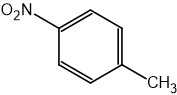
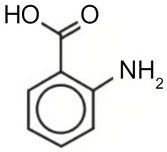
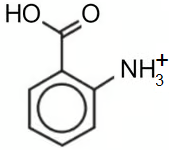
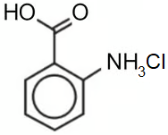
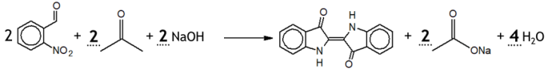
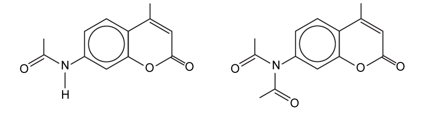

# Mark Schemes — Phenylamine & Azo Compounds
**34. Nitrogen Compounds** · Cambridge (CIE) A-LEVEL chemistry (9701)

## Structured Questions (4 questions)

### Q1
The skeletal formula of the intermediate is:

**[1 mark]**

> **[mark-scheme]**
> 1 mark for the correct skeletal formula of 1-methyl-4-nitrobenzene

> **[exam-tip]**
> To prepare an aromatic amine, the benzene ring must first be nitrated to introduce a –NO2 group, which is then reduced to –NH2 in the second step.
> 
> The methyl group on methylbenzene directs the incoming electrophile to the ortho and para positions. The para product, 1-methyl-4-nitrobenzene, is the major product due to steric factors.
> **[mark-scheme]**
> The reagents and conditions for step 1 are:
> 
> - Concentrated nitric acid / conc HNO3
> **AND**
> concentrated sulfuric acid / conc H2SO4 **[1 mark]**
> - Heat / reflux between 30–50 °C **[1 mark]**

> **[exam-tip]**
> A nitrating mixture of concentrated HNO3 and concentrated H2SO4 generates the nitronium ion (NO2+), which acts as the electrophile in the electrophilic substitution reaction.
> 
> Because the methyl group activates the benzene ring towards electrophilic substitution, nitration of methylbenzene requires a lower temperature than for plain benzene (55 °C). A temperature of 30–50 °C achieves mono-nitration while reducing the risk of a di-nitrated product forming.
> **[mark-scheme]**
> Sodium hydroxide is required because:
> 
> - The reduction in strongly acidic conditions produces the protonated amine / 4-methylphenylammonium salt rather than the free amine **[1 mark]**
> - Aqueous sodium hydroxide deprotonates the ammonium salt / acts as a base to neutralise the acid and liberate the free amine **[1 mark]**

> **[exam-tip]**
> When the nitro group is reduced using Sn and concentrated HCl, the acidic conditions immediately protonate the –NH2 group as it forms, producing a 4-methylphenylammonium salt. The nitrogen's lone pair accepts H+ from the acid.
> 
> To obtain the free amine, aqueous NaOH is added after the reduction step. It accepts the H+ from the ammonium ion (acting as a Brønsted–Lowry base), releasing the neutral 4-methylphenylamine.

### Q2
> **[mark-scheme]**
> i) The reagents and conditions required for step 1 are:
> 
> - NaNO2 / sodium nitrite
> **AND**
> HCl / dilute hydrochloric acid **[1 mark]**
> - Temperature below 10 °C / ice / ice-cold conditions **[1 mark]**
> 
> ii) The equation for step 1 is:
> 
> - C6H5NH2 + HNO2 + HCl → C6H5N2+Cl− + 2H2O
> **OR**
> C6H5NH2 + NaNO2 + 2HCl → C6H5N2+Cl− + NaCl + 2H2O **[1 mark]**

> **[exam-tip]**
> Nitrous acid (HNO2) is unstable and must be generated in situ by mixing sodium nitrite (NaNO2) with dilute hydrochloric acid immediately before use.
> 
> The temperature condition (below 10 °C) is for the stability of the diazonium salt product, not for the formation of nitrous acid. Above 10 °C, the diazonium ion rapidly decomposes by reacting with water to form phenol and nitrogen gas.
> **[mark-scheme]**
> The organic reagent is:
> 
> - Phenol / C6H5OH **[1 mark]**

> **[exam-tip]**
> 4-hydroxyazobenzene contains an –OH group on one of the aromatic rings, which originates from phenol, the coupling partner. Phenol is dissolved in alkaline conditions (NaOH (aq)) to form the more reactive phenoxide ion (C6H5O−) before coupling.
> 
> A common error is to suggest a compound that already contains nitrogen. The diazonium salt provides both nitrogen atoms in the –N=N– azo group. The coupling reagent simply needs to be an electron-rich aromatic compound activated by an electron-donating group such as –OH or –NR2.
> **[mark-scheme]**
> The systematic name of the secondary amine is:
> 
> - *N*-methylphenylamine **[1 mark]**

> **[exam-tip]**
> To identify the secondary amine, examine the nitrogen-containing fragment on the coupling half of the azo dye in Fig. 3.2. The nitrogen is bonded to a methyl group and a phenyl ring.
> 
> The secondary amine has the structure CH3–NH–C6H5, which is *N*-methylphenylamine. It is also called methylaniline; aniline is the common name for phenylamine (aminobenzene).

### Q3
> **[mark-scheme]**
> i) The reagents and conditions for steps 1 and 2 are:
> 
> Step 1:
> 
> - Potassium / sodium dichromate(VI) / K2Cr2O7 / Na2Cr2O7
> **AND**
> sulfuric acid / H2SO4 / H+ **[1 mark]**
> - Heat / reflux **[1 mark]**
> 
> Step 2:
> 
> - Tin / Sn
> **AND**
> concentrated HCl / hydrochloric acid
> **AND**
> heat / heat under reflux **[1 mark]**

ii) Correct structures for compound **A** include:

|  |  |  |
|---|---|---|

**[2 marks]**

> **[mark-scheme]**
> 1 mark for correct structure of 2-aminobenzoic acid (–NH2 and –COOH groups at ortho / adjacent positions on the benzene ring)
> 
> 1 mark for –NH2 group fully displayed (both H atoms shown on the N atom)
> 
> Allow the protonated ammonium form or hydrochloride salt form

> **[exam-tip]**
> Step 1 oxidises the aldehyde group (–CHO) of 2-nitrobenzaldehyde to a carboxylic acid (–COOH) using acidified dichromate(VI). This is the standard aldehyde to carboxylic acid oxidation.
> 
> Step 2 reduces the nitro group (–NO2) to an amino group (–NH2) using tin and concentrated HCl under reflux. Compound A is 2-aminobenzoic acid (also known as anthranilic acid).
> 
> Since the reduction is carried out in strongly acidic conditions, compound A initially forms as the protonated ammonium salt or hydrochloride salt. All three structural forms are accepted.
i) The mechanism for the formation of the *N*-methylphenylammonium iodide salt is:

**[3 marks]**

> **[mark-scheme]**
> 1 mark for curly arrow from the lone pair on N of phenylamine to the δ+ carbon of iodomethane
> 
> 1 mark for curly arrow from the C–I bond to the I atom
> 
> 1 mark for correct product showing positive charge on the N atom **AND** I− / iodide ion as a separate species

> **[exam-tip]**
> This is a nucleophilic substitution reaction. Phenylamine (the nucleophile, lone pair on N) attacks iodomethane (the electrophile, δ+ on C):
> 
> - One curly arrow from the lone pair on N to the δ+ carbon of CH3I
> - One curly arrow from the C–I bond to I
> - Product: *N*-methylphenylammonium iodide salt with positive charge on N and I− as a separate ion

> **[mark-scheme]**
> ii) This implies about the relative basicity:
> 
> - Compound **B** / *N*-methylphenylamine is a stronger base than phenylamine **[1 mark]**
> - The methyl group in compound **B** donates electron density towards the N atom / positive inductive effect of the methyl group **[1 mark]**
> - The lone pair on N in compound **B** is therefore more available to accept a proton than in phenylamine **[1 mark]**
> 
> Both compounds contain a phenyl ring, so the delocalising effect of the ring on the N lone pair applies equally to both. The only structural difference is the methyl group in compound **B**.

> **[exam-tip]**
> Since both phenylamine and compound **B** contain the phenyl ring, the delocalisation of the N lone pair into the π system applies equally to both. The only difference is the methyl group in compound **B**, which donates electron density towards N (positive inductive effect), making the lone pair more available to accept H+. This makes compound **B** a stronger base, which explains why excess iodomethane is required to form compound **C**.
> **[mark-scheme]**
> The temperature must be kept between 0 °C and 10 °C because:
> 
> - Above 10 °C, the diazonium salt decomposes / reacts with water / forms a phenol / nitrogen gas is evolved **[1 mark]**
> - Below 0 °C, the reaction rate is too slow / the diazotization does not proceed at a practical rate **[1 mark]**

> **[exam-tip]**
> The 0–10 °C range is a compromise between two competing requirements:
> 
> - The upper limit (below 10 °C) prevents the diazonium salt from decomposing. Above this temperature the N–N+ group leaves as nitrogen gas and the diazonium ion reacts with water to form a phenol derivative, destroying the intermediate before it can be used.
> - The lower limit (above 0 °C) ensures the reaction proceeds fast enough to be practical.
> 
> This temperature constraint applies to any diazotization step in diazonium salt chemistry.
i) The completed equation is:

**[1 mark]**

> **[mark-scheme]**
> 1 mark for correct balancing: 2 propanone + 2 NaOH; products include 2 CH3COO−Na+ and H2O

> **[exam-tip]**
> Propanone (CH3COCH3, 3 carbons) contributes one carbon to each of the two five-membered rings in indigotin. Two propanone molecules are needed, each losing a CH3 group that becomes sodium ethanoate (CH3COO−Na+). Balance NaOH and water last.

ii) To calculate the mass of 2-nitrobenzaldehyde required:

- Find *M*r values:

*M*r of 2-nitrobenzaldehyde = (7 x 12) + (5 x 1) + 14 + (3 x 16)

*M*r of 2-nitrobenzaldehyde = 151 g mol−1

*M*r of indigotin = (16 x 12) + (10 x 1) + (2 x 14) + (2 x 16)

*M*r of indigotin = 262 g mol−1

**[1 mark]**

- Find theoretical mass and moles of indigotin (100% yield):

mass at 100% yield = $\frac{100}{82.0} \times 12 . 0$

mass at 100% yield = 14.63 g

moles of indigotin = $\frac{14.63}{262}$

moles of indigotin = 0.05585 mol

**[1 mark]**

- Find mass of 2-nitrobenzaldehyde:

molar ratio 2 : 1 from equation

moles of 2-nitrobenzaldehyde = 0.05585 x 2

moles of 2-nitrobenzaldehyde = 0.1171 mol

mass = 0.1171 x 151

mass = **17.7 g**

**[1 mark]**

> **[mark-scheme]**
> 1 mark for the *M*r of 2-nitrobenzaldehyde **AND ** indigotin
> 
> 1 mark for the moles of indigotin
> 
> 1 mark for the mass of 2-nitrobenzaldehyde
> 
> Allow error carried forward from an incorrect *M*r value in subsequent steps

> **[exam-tip]**
> The 82.0% yield means 12.0 g is only 82.0% of the theoretical maximum. Scale up first (12.0 ÷ 0.820 = 14.63 g), then use *M*r and the 2 : 1 molar ratio to find the mass of starting material.
The skeletal formulae of compounds **D** and **E are:**

Compound **D**:

Compound **E**:

**[2 marks]**

> **[mark-scheme]**
> 1 mark for the structure of compound **D**, with hydrolysed ester linkage with carboxylate and phenoxide groups shown as deprotonated anions (–O− / –COO−), consistent with excess NaOH conditions
> 
> 1 mark for the structure of compound **E**, showing an amide bond (–NHCOCH3) formed from condensation of the amine group with ethanoyl chloride

> **[exam-tip]**
> Compound **D** (hydrolysis with excess NaOH):
> 
> The excess NaOH has two effects:
> 
> - It hydrolyses the lactone (cyclic ester) ring, opening the ring to give a hydroxy acid
> - The excess base then deprotonates both the carboxylic acid and phenolic –OH groups, giving the di-anion / sodium salt form
> 
> Compound **E** (condensation with ethanoyl chloride):
> 
> - Ethanoyl chloride (CH3COCl) reacts with the –NH2 group of Coumarin 440 in a nucleophilic addition-elimination reaction
> - The N lone pair attacks the carbonyl carbon; HCl is eliminated; amide bond –NHCOCH3 forms
> - If there are two –NH2 groups, both may react to give the double condensation product
> 
> Tip: draw Coumarin 440 as a general R–NH2 molecule to make it easier to identify the product:

### Q4
> **[mark-scheme]**
> i) The relative order of basicity, from least to most basic, is:
> 
> - Phenylamine < ammonia < *N*-methylethanamine **[1 mark]**
> 
> ii) The explanation for the order of basicity is:
> 
> - Alkyl groups donate electron density towards the N atom in *N*-methylethanamine / the methyl and ethyl groups have a positive inductive effect **[1 mark]**
> - The lone pair on N in *N*-methylethanamine is more available to accept a proton / bond with H+ **[1 mark]**
> - In phenylamine, the lone pair on N overlaps with / becomes delocalised into the π system of the benzene ring **[1 mark]**
> - The lone pair on N in phenylamine is therefore less available to accept a proton **[1 mark]**

> **[exam-tip]**
> Base strength depends on the availability of the lone pair on the nitrogen atom to accept H+.
> 
> For *N*-methylethanamine: two alkyl groups donate electron density towards N through the positive inductive effect, making the lone pair more available. This makes it the strongest base of the three.
> 
> For phenylamine: N is bonded directly to the benzene ring. The lone pair overlaps with the delocalised π electron system, partially withdrawing it from N and reducing its availability to bond with H+. This makes phenylamine the weakest base, weaker even than ammonia, which has no interaction with an aromatic ring system.
> **[mark-scheme]**
> The type of reaction and the reagents and conditions are:
> 
> - Type of reaction: Reduction **[1 mark]**
> - Reagents: Tin / Sn
> **AND**
> concentrated HCl / hydrochloric acid **[1 mark]**
> - Conditions: Heat / heat under reflux
> **AND**
> NaOH (aq) / sodium hydroxide solution **[1 mark]**

> **[exam-tip]**
> The conversion of nitrobenzene to phenylamine is a core syllabus reaction involving reduction of the nitro group (–NO2) to an amino group (–NH2).
> 
> The tin and concentrated HCl reduce the nitrobenzene under heat. The strongly acidic conditions produce a phenylammonium salt rather than the free amine. Aqueous sodium hydroxide is then added to deprotonate the salt and release phenylamine.
> **[mark-scheme]**
> i) The essential temperature condition is:
> 
> - Below 10 °C / between 0 °C and 10 °C / ice-cold conditions **[1 mark]**

ii) The structure of the diazonium salt is:

**[1 mark]**

> **[mark-scheme]**
> 1 mark for correct N≡N+ triple bond AND positive charge on the terminal N atom AND Cl− counterion

> **[exam-tip]**
> The diazonium salt must be kept below 10 °C at all times. Above this temperature it decomposes. The N2 group leaves as nitrogen gas, and the diazonium ion reacts with water to form phenol, destroying the intermediate before it can be used in the coupling reaction.
> 
> The nitrogen-containing group in the diazonium ion is –N≡N+. The two nitrogens are connected by a triple bond, with the positive charge on the terminal N atom furthest from the benzene ring. The counterion is Cl−.
The skeletal formula of the azo dye is:

**[2 marks]**

> **[mark-scheme]**
> 1 mark for correct –N=N– azo linkage connecting the two aromatic rings
> 
> 1 mark for coupling at the 4-position (para to –OH) of the 2,6-dimethylphenol ring, with –OH group retained

> **[exam-tip]**
> In 2,6-dimethylphenol, the methyl groups at positions 2 and 6 block both ortho positions relative to –OH. The coupling reaction therefore occurs at the para position (position 4).
> 
> A common error is to draw the azo linkage at an ortho position, which is sterically impossible when both ortho positions are occupied by methyl groups.
