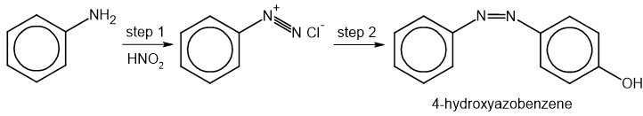
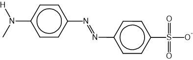
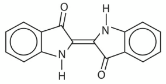
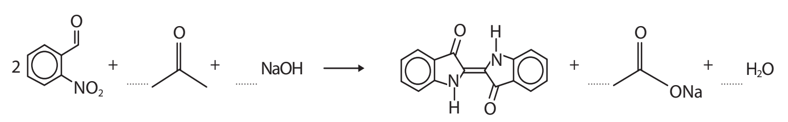
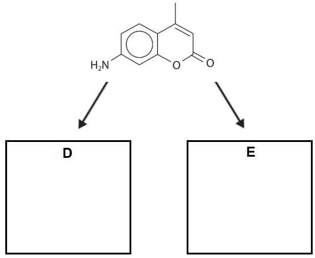
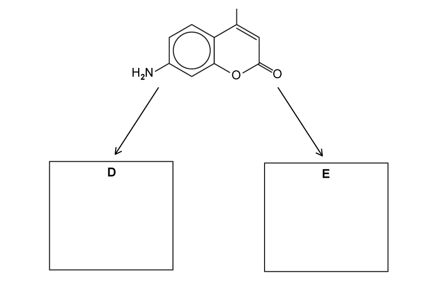
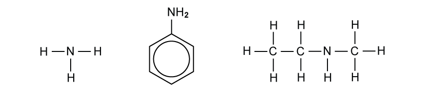

# Exam Questions — Phenylamine & Azo Compounds
**34. Nitrogen Compounds** · Cambridge (CIE) A-LEVEL chemistry (9701)
> Source: [https://www.savemyexams.com/a-level/chemistry/cie/25/topic-questions/](https://www.savemyexams.com/a-level/chemistry/cie/25/topic-questions/) · 4 questions across 1 sets

## Structured Questions (4 questions)

### Q1 — medium — 5 marks

**Q1** [1 mark]

4-methylphenylamine can be manufactured from methylbenzene in two steps.

Draw the skeletal formula of the intermediate organic compound formed in step 1.

**Q1** [2 marks]

**Extract:**

4-methylphenylamine can be manufactured from methylbenzene in two steps.

State the reagents and conditions required for step 1.

reagents ...............................................................

conditions ...............................................................

**Q1** [2 marks]

**Extract:**

4-methylphenylamine can be manufactured from methylbenzene in two steps.

Step 2 involves heating the intermediate under reflux with tin and concentrated hydrochloric acid.

Explain why aqueous sodium hydroxide must also be added to obtain 4-methylphenylamine.

### Q2 — medium — 5 marks

**Q2** [3 marks]

The azo dye 4-hydroxyazobenzene, C12H10N2O, can be produced from phenylamine as shown in Fig. 3.1.

**Fig. 3.1**

Step 1 requires nitrous acid, HNO2, which is generated in situ.

i) State the reagents and conditions required for step 1.

reagents ...............................................................

conditions ...............................................................

[2]

ii) Construct an equation for the reaction that takes place in step 1.

[1]

**Q2** [1 mark]

**Extract:**

The azo dye 4-hydroxyazobenzene, C~12~H~10~N~2~O, can be produced from phenylamine as shown in Fig. 3.1.

Reaction scheme for the synthesis of 4-hydroxyazobenzene from phenylamine: phenylamine reacts in step 1 to form benzenediazonium chloride, which undergoes coupling in step 2 to form 4-hydroxyazobenzene

Step 2 is a coupling reaction.

State the name of the organic reagent required to react with benzenediazonium chloride to form 4-hydroxyazobenzene.

**Q2** [1 mark]

Fig. 3.2 shows the structure of another azo dye.

**Fig. 3.2**

State the systematic name of the secondary amine used to form the structure shown in Fig. 3.2.

### Q3 — hard — 19 marks

**Q3** [5 marks]

The acid-base indicator methyl red is an azo dye synthesised from 2-nitrobenzaldehyde and phenylamine. Fig. 1.1 shows the first stages of this synthesis.

**Fig. 1.1**

i) State the reagents and conditions for steps 1 and 2 of the synthesis.

step 1 ...............................................................

step 2 ...............................................................

[3]

ii) Draw the structural formula of compound **A** in the box provided. The nitrogen-containing group must be shown fully displayed.

[2]

*Source: Oct 2021 WCH15/01 Q21D*

**Q3** [6 marks]

When heated, phenylamine reacts with iodomethane to form compound **B**, *N*-methylphenylamine.

i) Describe the mechanism for the formation of the *N*-methylphenylammonium iodide salt from the reaction of phenylamine and iodomethane. Include all relevant curly arrows, lone pairs, and dipoles.

[3]

ii) A further reaction occurs with an excess of iodomethane to form compound **C**, *N,N*-dimethylphenylamine.

Explain what this implies about the relative basicity of phenylamine and compound **B**.

[3]

**Q3** [2 marks]

**Extract:**

The acid-base indicator methyl red is an azo dye synthesised from 2-nitrobenzaldehyde and phenylamine. Fig. 1.1 shows the first stages of this synthesis.

Synthesis scheme for methyl red showing: 2-nitrobenzaldehyde undergoes step 1 (oxidation) to give 2-nitrobenzoic acid, then step 2 (reduction) to give compound A (2-aminobenzoic acid), which undergoes step 3 (diazotization) and coupling with phenylamine to give methyl red

Explain why the temperature used in step 3 must be kept between 0 °C and 10 °C.

**Q3** [4 marks]

Fig. 1.2 shows the structure of indigotin. It can be synthesised from 2-nitrobenzaldehyde and propanone in aqueous sodium hydroxide.

**Fig. 1.2**

i) Complete the equation for this reaction, shown in Fig. 1.3.

**Fig. 1.3**

[1]

ii) Calculate the mass of 2-nitrobenzaldehyde required to produce 12.0 g of indigotin from this reaction. The percentage yield is 82.0%. Show your working.

[3]

*Source: Oct 2021 WCH15/01 Q21E*

**Q3** [2 marks]

Fig. 1.4 shows the structure of Coumarin 440.

**Fig. 1.4**

Coumarin 440 is hydrolysed with excess aqueous sodium hydroxide to form organic compound **D**.

Coumarin 440 reacts with ethanoyl chloride to form organic compound **E**.

Draw the skeletal formulae of compounds **D** and **E** in the boxes provided.

[2]

*Source: Oct 2021 WCH15/01 Q21F*

### Q4 — medium — 12 marks

**Q4** [5 marks]

Three nitrogen-containing molecules, ammonia, NH3, phenylamine, C6H5NH2, and *N*-methylethanamine, CH3CH2NHCH3, are drawn below in Fig. 1.1.

**Fig. 1.1**

i) State the relative order of basicity of the three amine molecules shown in Fig. 1.1.

least basic ......................... < ......................... < ......................... most basic

[1]

ii) Explain your answer to part (i).

[4]

**Q4** [3 marks]

Phenylamine, C6H5NH2, can be produced from nitrobenzene, C6H5NO2.

State the name of the type of reaction and the reagents and conditions required for this conversion.

type of reaction ...............................................................

reagents ...............................................................

conditions ...............................................................

**Q4** [2 marks]

Phenylamine, C6H5NH2, can be used in the manufacture of azo dyes. In the first step, phenylamine reacts with hydrochloric acid and nitrous acid, HNO2, to form a diazonium salt.

C6H5NH2 + HCl + HNO2 → C6H5N2+Cl− + 2H2O

In the second step, the diazonium salt solution is added to an alkaline solution of a phenol coupling agent to form the azo dye.

i) The diazonium salt, C6H5N2+Cl−, is unstable. State the essential temperature condition required to prevent the diazonium salt from decomposing during this reaction.

[1]

ii) Draw the structure of the diazonium salt formed in this reaction. The nitrogen-containing group must be shown fully displayed.

[1]

**Q4** [2 marks]

**Extract:**

Phenylamine, C6H5NH2, can be used in the manufacture of azo dyes. In the first step, phenylamine reacts with hydrochloric acid and nitrous acid, HNO2, to form a diazonium salt.

C6H5NH2 + HCl + HNO2 → C6H5N2+Cl− + 2H2O

In the second step, the diazonium salt solution is added to an alkaline solution of a phenol coupling agent to form the azo dye.

In the second step of azo dye production, the diazonium salt reacts with an alkaline solution of a phenol coupling agent.

Draw the skeletal formula of the azo dye formed if the coupling agent used is 2,6-dimethylphenol.

[2]
