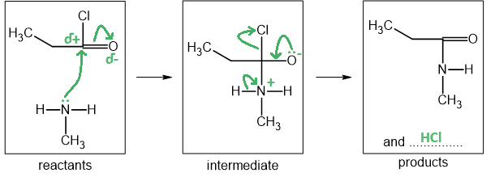
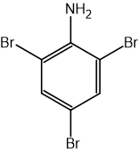
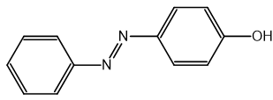
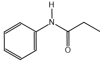
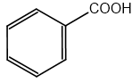
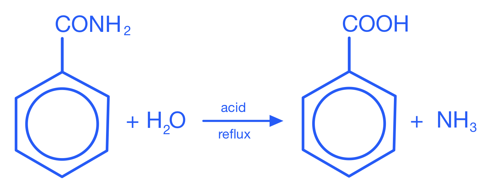

# Mark Schemes — Amides
**34. Nitrogen Compounds** · Cambridge (CIE) A-LEVEL chemistry (9701)

## Structured Questions (4 questions)

### Q1
> **[mark-scheme]**
> i) The name of the mechanism is:
> 
> - (Nucleophilic) addition-elimination **[1 mark]**

ii) The completed mechanism is:

**[5 marks]**

> **[mark-scheme]**
> ii)
> 
> 1 mark for the correct dipole on the C=O bond **AND **the lone pair on the amine nitrogen
> 
> 1 mark for the curly arrow from the amine nitrogen to the δ+ carbon **AND **a curly arrow from the C=O bond to the δ– oxygen
> 
> 1 mark for the correct formal charges: – on oxygen and + on nitrogen in the intermediate **AND **the lone pair on the oxygen in the intermediate
> 
> 1 mark for the curly arrow from the N–H bond to the + nitrogen **AND **a curly arrow from the C–Cl bond to the chlorine **AND **A curly arrow from the oxygen lone pair to the C–O bond
> 
> 1 mark for HCl identified as the second product

> **[exam-tip]**
> The addition-elimination mechanism proceeds in two stages:
> 
> Addition:
> 
> - The lone pair on the nitrogen of methylamine attacks the δ+ carbonyl carbon.
> - The C=O π bond breaks, the oxygen becomes negatively charged (–), and the nitrogen becomes positively charged (+).
> 
> Elimination:
> 
> - A proton is transferred from the + nitrogen to the – oxygen, then the C–Cl bond breaks as Cl– leaves, and the C=O bond reforms. HCl is produced as the second product.
> 
> Make sure you include all three curly arrows in the elimination stage: N–H to + N, C–Cl to Cl, and O lone pair to C–O.
> **[mark-scheme]**
> The systematic name of the organic product is:
> 
> - *N*-methylpropanamide
> **OR**
> methylpropanamide **[1 mark]**

> **[exam-tip]**
> When naming substituted amides:
> 
> - The acyl chloride provides the main chain:
> 
>   - propanoyl chloride → propanamide
> - The amine group is added as an N-prefix:
> 
>   - methylamine → *N*-methyl
> - Together: *N*-methylpropanamide
> **[mark-scheme]**
> i) The role of LiAlH4 is:
> 
> - Reducing agent **[1 mark]**
> 
> ii) The other product formed is:
> 
> - Water **[1 mark]**

> **[exam-tip]**
> The reaction of *N*-methylpropanamide with LiAlH4 is a reduction, so the LiAlH4 acts as the reducing agent.
> 
> The equation for this reduction is:
> 
> CH3CH2CONHCH3 + 4[H] → CH3CH2CH2NHCH3 + H2O

### Q2
> **[mark-scheme]**
> i) The reagents and conditions required are:
> 
> - Ethanoyl chloride / CH3COCl
> **OR**
> Ethanoic acid / CH3COOH
> **AND**
> Ethylamine / CH3CH2NH2 / C2H5NH2 **[1 mark]**
> - Room temperature (for ethanoyl chloride route)
> **OR**
> Heat under reflux (for ethanoic acid route) **[1 mark]**
> 
> ii) The type of reaction is:
> 
> - Condensation **[1 mark]**

> **[exam-tip]**
> Amides are formed by the condensation reaction of a carboxylic acid with an amine (producing water), or an acyl chloride with an amine (producing HCl).
> 
> To identify the reactants from the structure of an amide, break the amide (C–N) bond:
> 
> - Add –OH to the carbonyl carbon to identify the carboxylic acid (or –Cl for the acyl chloride)
> - Add –H to the nitrogen to identify the amine
> **[mark-scheme]**
> The equation for the alkaline hydrolysis of *N*-ethylethanamide is:
> 
> - CH3CONHCH2CH3 + NaOH → CH3COONa + CH3CH2NH2 **[1 mark]**

> **[exam-tip]**
> Alkaline hydrolysis of a substituted (N-substituted) amide produces the carboxylate salt and the amine.
> 
> The amine produced retains the N-substituent. Since *N*-ethylethanamide has an ethyl group on the nitrogen, the amine product is ethylamine, CH3CH2NH2.
> **[mark-scheme]**
> The relative order of basicity (least to most basic) and explanation:
> 
> - *N*-ethylethanamide < ammonia < diethylamine **[1 mark]**
> 
> Explanation:
> 
> - Alkyl groups donate electron density to the nitrogen atom, increasing the availability of the lone pair **[1 mark]**
> - The carbonyl group withdraws electron density from the nitrogen atom, reducing the availability of the lone pair **[1 mark]**

> **[exam-tip]**
> The order of basicity depends on how available the nitrogen lone pair is to accept a proton:
> 
> Alkyl groups:
> 
> - Donate electron density through the inductive effect
> - Increase electron density on nitrogen, making the lone pair more available
> - Diethylamine (two ethyl groups) is a stronger base than ammonia
> 
> Carbonyl group:
> 
> - Withdraws electron density through the inductive effect
> - Decreases electron density on nitrogen, making the lone pair less available
> - *N*-ethylethanamide (carbonyl group adjacent to N) is the weakest base of the three
> 
> Be careful: exam questions sometimes swap the "least basic" and "most basic" labels. Always check which end of the table you are filling from.

### Q3
i) The skeletal formulae of compounds **A** and **B** are:

Compound **A:**

Compound **B:**

**[2 marks]**

> **[mark-scheme]**
> i)
> 
> 1 mark for the correct skeletal formula of compound **A** (2,4,6-tribromophenylamine)
> 
> 1 mark for the correct skeletal formula of compound **B** (azo compound)

> **[mark-scheme]**
> ii) The reagents and conditions for step 1 (diazotisation) are:
> 
> - NaNO2
> **AND**
> HCl / dilute H2SO4
> **OR**
> HNO2 **[1 mark]**
> - Temperature ≤ 10 °C **[1 mark]**

> **[exam-tip]**
> The reaction of phenylamine with bromine water occurs more readily than the reaction of benzene with bromine, which requires a halogen carrier catalyst. The –NH2 group activates the ring and directs bromination to positions 2, 4, and 6, giving 2,4,6-tribromophenylamine.
> 
> When phenylamine reacts with HNO2 at temperatures below 10 °C, a diazonium salt is produced. Nitric(III) acid is unstable and must be freshly prepared from NaNO2 and a dilute acid such as HCl. The diazonium ion then couples with a coupling agent (such as phenoxide) to form the azo compound **B**.
> **[mark-scheme]**
> i) The functional group formed is:
> 
> - Amide / secondary amide
> **OR**
> –CONHR **[1 mark]**

ii) To calculate the percentage by mass of nitrogen in **C**:

- Calculate the molar mass of **C**:

*M*r(**C**) = (9 x 12) + (11 x 1) + 14 + 16

*M*r(**C**) = 149

- Calculate the percentage by mass of nitrogen:

%N = $\frac{14}{149}$ x 100

%N = **9.40%**

**[1 mark]**

> **[mark-scheme]**
> ii)
> 
> 1 mark for *M*r = 149 **AND** %N = 9.4(%)
> 
> A correct answer without working scores 1 mark

iii) The structural formula of **C** is:

**[1 mark]**

> **[mark-scheme]**
> iii)
> 
> 1 mark for the correct structural formula of **C** (*N*-phenylpropanamide)

> **[exam-tip]**
> Phenylamine is a primary amine. When a primary amine reacts with an acyl chloride, a substituted amide is produced via an addition-elimination reaction.
> 
> The amide functional group in **C** is –CONHR (secondary amide), where R is the phenyl group from phenylamine.
> 
> To draw the structural formula of **C**, connect the nitrogen of phenylamine to the carbonyl carbon of propanoyl chloride, removing Cl from the acyl chloride and one H from the nitrogen. The result is C6H5–NH–CO–CH2CH3.
> **[mark-scheme]**
> i) The weaker base and explanation:
> 
> - Benzamide **[1 mark]**
> - The carbonyl / C=O group is electron-withdrawing **[1 mark]**
> - The lone pair on the nitrogen atom is less available to donate / less available to accept a proton **[1 mark]**
> 
> ii) A suitable reducing agent is:
> 
> - LiAlH4 / lithium aluminium hydride **[1 mark]**

> **[exam-tip]**
> Benzamide is a weaker base than benzylamine because the carbonyl group (C=O) adjacent to the nitrogen is electron-withdrawing. This reduces the electron density on the nitrogen atom, making the lone pair less available to accept a proton.
> 
> Both compounds contain the electron-withdrawing benzene ring, but this affects both equally. The key difference is the C=O group in benzamide, which is absent in benzylamine.
> 
> LiAlH4 is required for the reduction of amides to amines. NaBH4 is not strong enough to reduce the C=O group in an amide.
i) The skeletal formula of the organic product is:

**[1 mark]**

> **[mark-scheme]**
> i)
> 
> 1 mark for the correct skeletal formula of benzoic acid
> 
> ii) The other product formed is:
> 
> - Ammonium ion / NH4+ / ammonium salt **[1 mark]**
> -

> **[exam-tip]**
> When a non-substituted amide is hydrolysed with dilute acid, the nitrogen leaves as ammonium ion (NH4+), not free ammonia. The organic product is the carboxylic acid (benzoic acid).
> 
> For alkaline hydrolysis, the products would instead be the carboxylate salt (sodium benzoate) and ammonia (NH3).
> 
> 

### Q4
> **[mark-scheme]**
> The structural formula of compound **X** is:
> 
> - CH3CH2COCl **[1 mark]**

> **[exam-tip]**
> Amides are formed by the reaction of an amine with an acyl chloride. In this case, the primary amine CH3NH2 reacts with propanoyl chloride, CH3CH2COCl, to form the substituted amide and hydrochloric acid.
> **[mark-scheme]**
> The reagent required for this reduction is:
> 
> - LiAlH4 **[1 mark]**

> **[exam-tip]**
> *N*-methylpropanamide is a substituted amide. When reduced with LiAlH4, it forms a secondary amine (compound **Y**) and water.
> 
> LiAlH4 is a strong enough reducing agent for this reaction. NaBH4 is not strong enough to reduce amides.
> **[mark-scheme]**
> i) The equation for this reaction is:
> 
> - CH3CONH2 + NaOH → CH3COONa + NH3 **[1 mark]**
> 
> ii) This reaction can be used as a test for an amide by:
> 
> - Hold damp red litmus paper above the heated reaction mixture **[1 mark]**
> - The paper turns blue **[1 mark]**

> **[exam-tip]**
> When ethanamide is heated with sodium hydroxide solution, ammonia gas is produced and sodium ethanoate remains in solution.
> 
> Ammonia is an alkaline gas, so it turns damp red litmus paper blue. This test confirms the presence of the amide functional group, which undergoes alkaline hydrolysis to release NH3.
