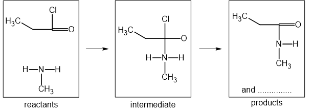
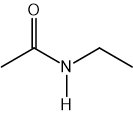
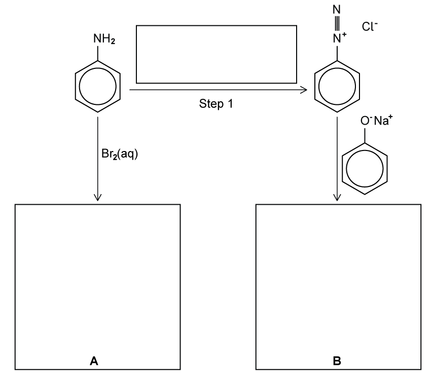
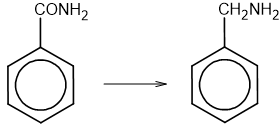

# Exam Questions — Amides
**34. Nitrogen Compounds** · Cambridge (CIE) A-LEVEL chemistry (9701)
> Source: [https://www.savemyexams.com/a-level/chemistry/cie/25/topic-questions/](https://www.savemyexams.com/a-level/chemistry/cie/25/topic-questions/) · 4 questions across 1 sets

## Structured Questions (4 questions)

### Q1 — medium — 9 marks

**Q1** [6 marks]

Methylamine reacts with propanoyl chloride to form CH3CH2CONHCH3.

i) State the name of the mechanism for this reaction.

[1]

An incomplete mechanism for this reaction is shown in Fig. 3.1.

**Fig. 3.1**

ii) Complete the mechanism in Fig. 3.1. Include all relevant curly arrows, lone pairs, and dipoles. Also show the formula of the second product formed.

[5]

**Q1** [1 mark]

**Extract:**

Methylamine reacts with propanoyl chloride to form CH~3~CH~2~CONHCH~3~.

State the systematic name of the organic product formed in part **(a)**.

**Q1** [2 marks]

**Extract:**

Methylamine reacts with propanoyl chloride to form CH~3~CH~2~CONHCH~3~.

The organic product of part **(a)** reacts with LiAlH4 to form a secondary amine.

i) State the role of LiAlH4 in this reaction.

[1]

ii) State the name of the other product formed during this reaction.

[1]

### Q2 — medium — 7 marks

**Q2** [3 marks]

The structure of *N*-ethylethanamide is shown in Fig. 2.1.

**Fig. 2.1**

i) State the reagents and conditions required to produce *N*-ethylethanamide.

[2]

ii) State the type of reaction that occurs during the formation of *N*-ethylethanamide.

[1]

**Q2** [1 mark]

**Extract:**

The structure of *N*-ethylethanamide is shown in Fig. 2.1.

Structural formula of N-ethylethanamide showing an ethanoyl group connected via an NH group to an ethyl group

Construct an equation to show the alkaline hydrolysis of *N*-ethylethanamide.

**Q2** [3 marks]

**Extract:**

The structure of *N*-ethylethanamide is shown in Fig. 2.1.

State the relative order of basicity of diethylamine, *N*-ethylethanamide and ammonia in aqueous solution. Explain your reasoning.

least basic ......................... > .........................  > .........................  most basic

### Q3 — medium — 13 marks

**Q3** [4 marks]

Phenylamine can be converted into the organic compounds **A** and **B** as shown in Fig. 1.1.

**Fig. 1.1**

i) Draw the skeletal formulae of compounds **A** and **B** in the boxes in Fig. 1.1.

[2]

ii) State the reagents and conditions for step 1 in the box over the arrow in Fig. 1.1.

[2]

**Q3** [3 marks]

When phenylamine is treated with propanoyl chloride, a white crystalline compound **C**, C9H11NO, is formed.

i) State the name of the functional group formed in this reaction.

[1]

ii) Calculate the percentage by mass of nitrogen in **C**.

[1]

iii) Draw the structural formula of **C**.

[1]

**Q3** [4 marks]

Fig. 1.2 shows the reduction of benzamide to form benzylamine.

**Fig. 1.2**

i) State which of these two compounds is the weaker base. Explain your answer.

[3]

ii) State the name or formula of a suitable reducing agent for this reduction.

[1]

**Q3** [2 marks]

**Extract:**

Fig. 1.2 shows the reduction of benzamide to form benzylamine.

When benzamide is refluxed with dilute acid, hydrolysis occurs.

i) Draw the skeletal formula of the organic product formed.

[1]

ii) State the name of the other product formed during this hydrolysis reaction.

[1]

### Q4 — easy — 5 marks

**Q4** [1 mark]

Amides can be formed from amines. An example is shown in the following reaction scheme where compound **X** reacts with methylamine to form *N*-methylpropanamide and hydrogen chloride.

compound **X** + CH3NH2 → CH3CH2CONHCH3 + HCl

Deduce the structural formula of compound **X**.

**Q4** [1 mark]

*N*-methylpropanamide can undergo reduction forming compound **Y** and water. State the reagent required for this reaction.

**Q4** [3 marks]

A different amide, ethanamide, was heated with sodium hydroxide; ammonia gas is formed along with one other product.

i) Construct an equation for this reaction.

[1]

ii) Explain how this reaction could be used as a test for an amide.

[2]
