# Mark Schemes — Amino Acids
**34. Nitrogen Compounds** · Cambridge (CIE) A-LEVEL chemistry (9701)

## Structured Questions (6 questions)

### Q1
> **[mark-scheme]**
> The general formula for an α-amino acid is:
> 
> - RCH(NH2)COOH **[1 mark]**

> **[exam-tip]**
> You are expected to know the general formula for an α-amino acid.
The structures of alanine in acidic and basic conditions are:

Acidic conditions:

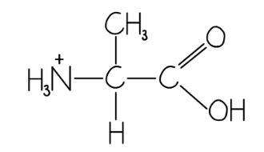

Basic conditions:

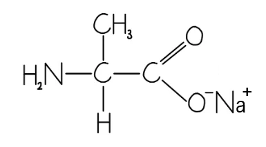

**[2 marks]**

> **[mark-scheme]**
> 1 mark for the correct structure alanine in acidic conditions
> 
> 1 mark for the correct structure alanine in basic conditions

> **[exam-tip]**
> Amino acids have both an acidic –COOH group and a basic –NH2 group.
> 
> In acidic conditions (low pH), the –NH2 group accepts a proton to give –NH3+. The –COOH group remains unchanged.
> 
> In basic conditions (high pH), the –COOH group loses a proton to give –COO–. The –NH2 group remains unchanged.
> **[mark-scheme]**
> A sample of amino acids can be separated using this technique by:
> 
> - A sample of amino acids is placed between two oppositely charged electrodes **[1 mark]**
> - The positively charged ions will move towards the negative electrode
> **AND**
> The negatively charged ions will move towards the positive electrode **[1 mark]**
> - Larger ions move more slowly
> **OR**
> Smaller ions move more quickly **[1 mark]**
> - Highly charged ions move more quickly
> **OR**
> Ions with a low charge move slowly **[1 mark]**

> **[exam-tip]**
> This question asks you to describe how amino acids are separated, not how they are identified.
> 
> After electrophoresis, an electropherogram is produced. This is a series of bands on the paper or gel, where each band corresponds to a particular species. The distance each band has moved from the origin indicates the relative size and charge of that species.

### Q2
> **[mark-scheme]**
> Some amino acids remain stationary because:
> 
> Any **two** from (1 mark per point):
> 
> - The amino acid is uncharged / neutral / a zwitterion **OR** charges balance / are equal
> - It is equally attracted by the anode / + and the cathode / – **OR**
> It is attracted by neither the anode nor the cathode
> - The pH of the buffer is at the isoelectric point / IEP of the amino acid
> 
> **[2 marks]**

> **[exam-tip]**
> When a sample of amino acids is placed between two oppositely charged electrodes:
> 
> - The positively charged amino acids will move toward the negative electrode
> - The negatively charged amino acids will move toward the positive electrode
> - Amino acids with an overall neutral charge will remain stationary
> 
> If the pH of the buffer is at the isoelectric point of the amino acid, neither the positively nor negatively charged ions will dominate and the amino acid will exist as a neutral zwitterion
> **[mark-scheme]**
> The species formed is:
> 
> - H2NCH2CO2– / H2NCH2COO– **[1 mark]**

> **[exam-tip]**
> - If a species moves to the positive side, it must be negative
> - Glycine forms a negative ion by losing the H from the –COOH group
The relative sizes and charges of **A**, **B** and **C** are:

| **amino acid** | **relative size** | **charge** |
|---|---|---|
| **A** | **Final answer:** **small(est) / 1** | **Final answer:** **negative / –** |
| **B** | **Final answer:** **large(est) / 3** | **Final answer:** **negative / –** |
| **C** | **Final answer:** **middle / 2** | **Final answer:** **positive / +** |

**[3 marks]**

> **[mark-scheme]**
> 1 mark for **A **identified as the smallest **AND **negative
> 
> 1 mark for **B **identified as the largest **AND **negative
> 
> 1 mark for **C **identified as the middle / intermediate **AND **positive

> **[exam-tip]**
> The direction of travel depends on the charge on the ion:
> 
> - Species moving toward the positive side are negative
> - Species moving toward the negative side are positive
> 
> The distance the amino acid species travels depends on the size of the ion. Larger ions move more slowly
> 
> A has moved the furthest, so is the smallest species; B has moved the least, so is the largest species
> 
> You can use numbers to identify the relative sizes
> **[mark-scheme]**
> i) The number of different tripeptides that can be made using **one** molecule of **each** of the amino acids in Table 2.1 is:
> 
> - 6 / six **[1 mark]**

ii) An example tripeptide drawn showing peptide bonds in displayed form:

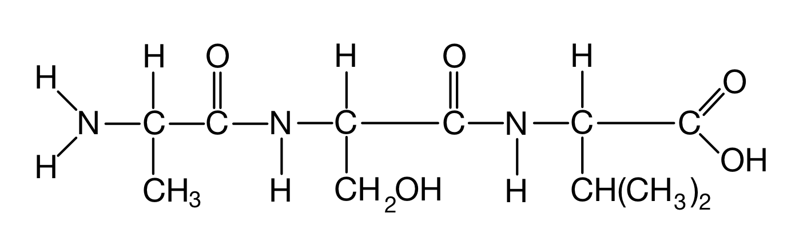

**[2 marks]**

> **[mark-scheme]**
> 1 mark for two displayed peptide bonds
> 
> 1 mark for the correct formula of the peptide

> **[exam-tip]**
> The three amino acids can be arranged in six different ways:
> 
> - alanine-serine-valine
> - alanine-valine-serine
> - serine-alanine-valine
> - serine-valine-alanine
> - valine-alanine-serine
> - valine-serine-alanine
> 
> You would get credit for any one of these tripeptides, so the central R groups of each amino acid can be shown in any order
> 
> You can write this as a structural formula but with the peptide bond, –NHCO– shown in displayed form

### Q3
> **[mark-scheme]**
> The zwitterion structure of glycine is:
> 
> - NH3+CH2COO– **[1 mark]**

> **[exam-tip]**
> When an amino acid forms a zwitterion, the hydrogen ion from the –COOH group is transferred to the –NH2 group. This produces a molecule with both a positive charge (on the nitrogen) and a negative charge (on the oxygen), but with no overall charge.
> 
> To draw the zwitterion of glycine: move the H from –COOH to –NH2, add a positive charge to give –NH3+, and add a negative charge to give –COO–.
> 
> Do not show individual single bonds in the structural formula.
> **[mark-scheme]**
> i) The equation for the reaction between alanine and HCl (aq) is:
> 
> - H2NCH(CH3)COOH + HCl → +H3NCH(CH3)COOH + Cl– **[1 mark]**
> 
> ii) The equation for the reaction between serine and NaOH (aq) is:
> 
> - H2NCH(CH2OH)COOH + NaOH → H2NCH(CH2OH)COONa + H2O **[1 mark]**

> **[exam-tip]**
> Amino acids exist as zwitterions in solution. Think of the amino acid as having two separate functional groups: an acidic –COOH group and a basic –NH2 group.
> 
> When HCl is added, the H+ ion protonates the –NH2 group to give –NH3+. The –COOH group remains unchanged.
> 
> When NaOH is added, the OH– ion deprotonates the –COOH group to give –COO–, with the Na+ forming the sodium salt. Water is produced.
i) The structural formula of a portion of the silk protein, with a peptide bond labelled, is:

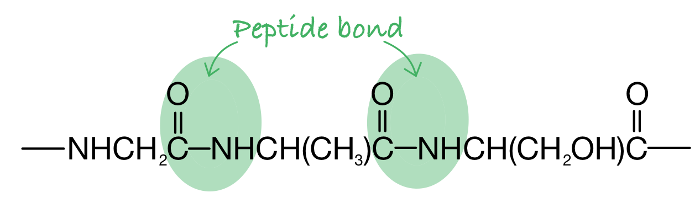

**[3 marks]**

> **[mark-scheme]**
> 1 mark for correct CO–NH bonding, including at least one C=O bond
> 
> 1 mark for at least one peptide bond labelled
> 
> 1 mark for 3 amino acid residues shown

> **[mark-scheme]**
> ii) The polymer **type** of silk protein is:
> 
> - Condensation
> **OR**
> Polyamide **[1 mark]**

> **[exam-tip]**
> The amine group of one amino acid reacts with the carboxylic acid group of the next. A water molecule is lost (condensation reaction) and a peptide bond (C(=O)–NH) forms between them.
> 
> The structural formula you draw must contain 3 residues. A residue is an amino acid that has lost a water molecule when forming the chain. The three residues do not all need to be different, but should be glycine, alanine or serine.
> 
> A polyamide is a condensation polymer containing amide (peptide) bonds. Silk and nylon are both polyamides.
To calculate the average number of amino acid residues in the protein chain:

- List the known values:

  - *M*r(glycine) = 75
  - *M*r(alanine) = 89
  - *M*r(serine) = 105
  - *M*r(protein chain) = 600 000
- Determine the *M*r of one repeating unit of three amino acid residues (each residue loses one water molecule when forming the chain):

(75 − 18) + (89 − 18) + (105 − 18)

= 57 + 71 + 87 = 215

**[1 mark]**

- Calculate the number of three-residue sets in the protein chain:

$\frac{600000}{215}$

= 2791

**[1 mark]**

- Calculate the total number of amino acid residues:

2791 x 3 = **8372**

**[1 mark]**

> **[mark-scheme]**
> 1 mark for calculating the *M*r of one repeating unit of three amino acid residues: 215
> 
> 1 mark for calculating the number of three-residue sets in the protein chain: 2791
> 
> 1 mark for calculating the total number of amino acid residues: 8372

> **[exam-tip]**
> When an amino acid joins a protein chain via a peptide bond, one water molecule (*M*r = 18) is lost per residue. Subtract 18 from each amino acid *M*r to find the residue *M*r.
> 
> The second step gives the number of repeating three-residue sets. Multiply by 3 to get the total number of individual amino acid residues.
> 
> If you did not subtract 18 from each *M*r value (using 75 + 89 + 105 = 269 instead of 215), you would still score 2 marks if the method for steps 2 and 3 is correct.

### Q4
The structural formula of the product formed in the reaction between alanine and excess chloromethane:

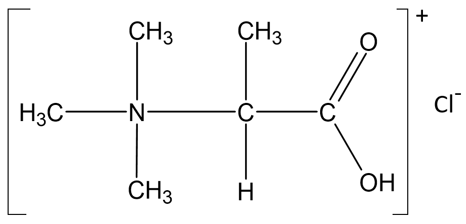

**[1 mark]**

> **[mark-scheme]**
> 1 mark for the correct structure with a positive charge on the main compound **AND** a chloride / Cl– counter-ion

> **[exam-tip]**
> The lone pair on the nitrogen atom allows it to act as a nucleophile. Amino acids react with halogenoalkanes in a similar way to amines
> 
> Further substitution of the hydrogen atoms forms a secondary and then tertiary amine, and finally a quaternary ammonium salt
> 
> The clue is that the halogenoalkane is in excess. So, the available lone pair on the nitrogen can attack a δ+ carbon on another chloromethane molecule
> 
> This question is often answered incorrectly. The amine produced is actually more reactive due to the lone pair on the nitrogen being more readily available
The structure of the dipeptides formed are:

Dipeptide 1:

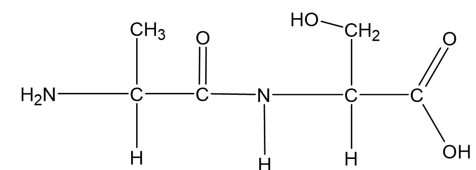

Dipeptide 2:

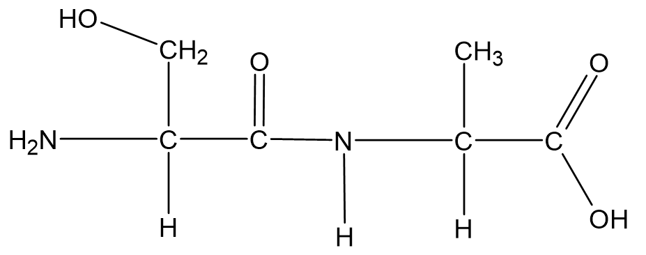

**[2 marks]**

> **[mark-scheme]**
> 1 mark for the correct structure of dipeptide 1
> 
> 1 mark for the correct structure of dipeptide 2
> 
> Dipeptide structures can be in either order

> **[exam-tip]**
> Reading the question carefully is key as two **different** structures are needed to gain both marks
> 
> Amino acids can form a peptide/amide link between themselves because they have both the –NH2 and the –COOH groups, enabling a condensation reaction
> 
> To draw the two possible dipeptides: place one amino acid first and draw the peptide/amide link; then swap the order and repeat
> 
> Note that the carbon skeleton remains the same and the peptide/amide link also remains unchanged
> **[mark-scheme]**
> i) Alanine has a high melting point because:
> 
> - Alanine exists as a zwitterion / ionic form in the solid state **[1 mark]**
> - The zwitterions form an ionic lattice / strong electrostatic forces exist between them, requiring more energy to break **[1 mark]**

ii) The structural formula of alanine in the solid state:

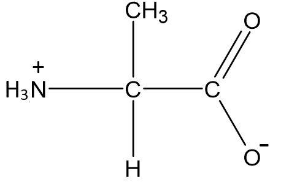

**[1 mark]**

> **[exam-tip]**
> A zwitterion is a compound with no overall electrical charge, but which contains separate parts that are positively and negatively charged
> 
> The structure of an amino acid allows it to act as both an acid and a base. At the isoelectric point, nearly all amino acid molecules exist as zwitterions
> 
> Amino acids adopt the zwitterionic form in the solid state, forming an ionic lattice similar to ionic compounds
The labelled electrophoresis paper is:

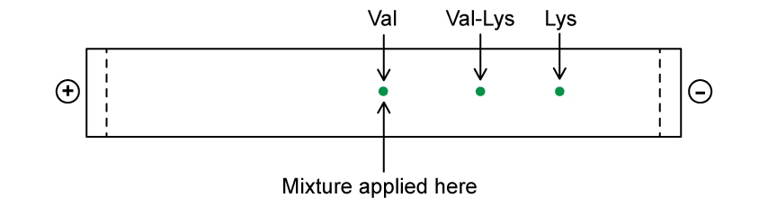

**[3 marks]**

> **[mark-scheme]**
> 1 mark for valine on the cross
> 
> 1 mark for Val-Lys and Lys on the right of the cross (in any order)
> 
> 1 mark for the relative order of Val-Lys and Lys (on the same side of the cross)
> 
> Explanation of movement:
> 
> - Val does not move as it is a zwitterion / neutral (at pH 6) **OR**
> Lys / Val-Lys move towards the negative pole as they are positively charged **[1 mark]**
> - Lys moves the furthest as it has the lowest *M*r (with the same positive charge) **OR**
> Val-Lys moves the least as it has the largest *M*r (with the same positive charge) **[1 mark]**

> **[exam-tip]**
> The isoelectric point is the pH at which an amino acid exists as a zwitterion, which means that the overall charge depends on the pH of the buffer solution
> 
> Val will exist as a zwitterion as the buffer pH (6.0) equals its isoelectric point
> 
> Lysine and val-lys will have a positive charge overall as the basic side chain amine group is protonated to form –NH3+ at pH 6.0
> 
> Lysine and val-lys have the same overall charge at pH 6 as both contain two NH2 groups that are protonated (one on the side chain, one on the terminal amine)
> 
> The larger the *M*r, the less the amino acid or dipeptide will trave, which explains why valine, lysine, and val-lys can be separated

### Q5
The R group in this amino acid:

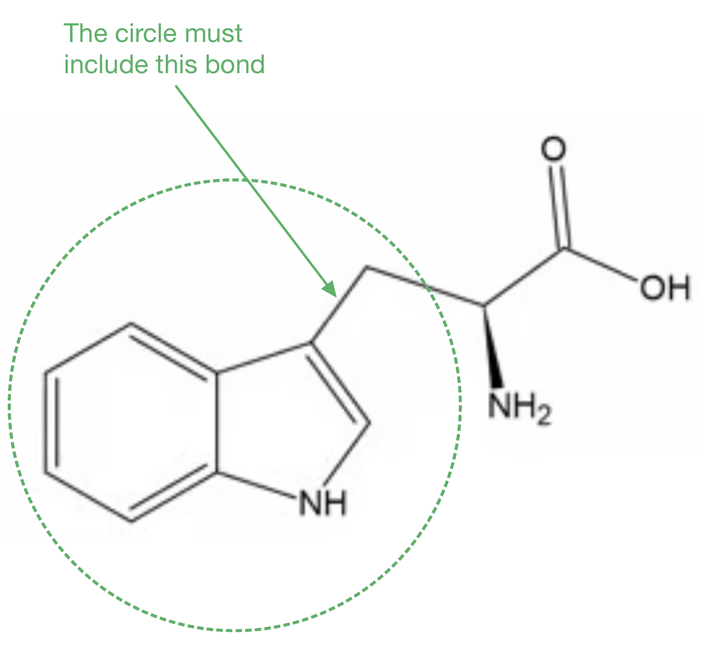

**[1 mark]**

> **[mark-scheme]**
> 1 mark for identifying the two ring system **AND** the first bond of the side-chain

> **[exam-tip]**
> All naturally occurring amino acids have the general formula H2NCH(R)COOH
> 
> The R group is attached to the central carbon, along with the amino and carboxylic acid groups
> **[mark-scheme]**
> The molecular formula and equation are:
> 
> - Molecular formula: C11H12N2O2 **[1 mark]**
> - Equation: C11H12N2O2 + HNO3 → C11H13N3O5 **[1 mark]**

> **[exam-tip]**
> When an amino group reacts with a dilute acid it is protonated:
> 
> RNH2 + H+ → RNH3+
> 
> Tryptophan has only one basic amino group, which is the α-amino group (–NH2) attached to the central carbon
> 
> The nitrogen in the indole ring is part of the aromatic π system; its lone pair is delocalised into the ring and cannot be protonated by dilute acid
> 
> Adding one mole of HNO3 contributes 1H, 1N, and 3O to the molecular formula of tryptophan, giving the ammonium nitrate salt C11H13N3O5
i) The structure of the organic product of the reaction with NaOH:

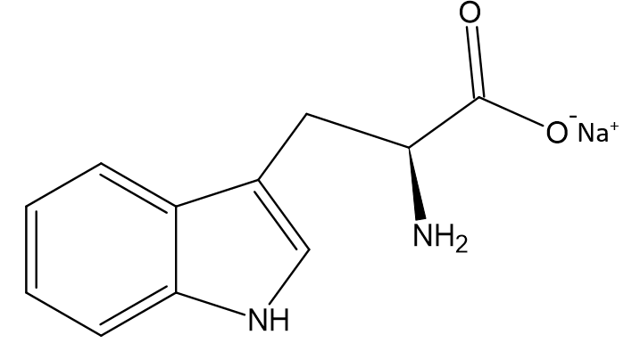

**[1 mark]**

> **[mark-scheme]**
> 1 mark for the correct structure shown

ii) The structure of the organic product of the reaction with C2H5OH and concentrated H2SO4:

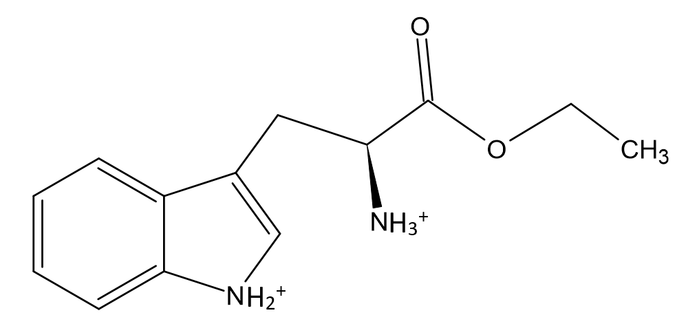

**[2 marks]**

> **[mark-scheme]**
> 1 mark for the correct structure including the ester group
> 
> 1 mark for the protonated amino group(s)

> **[exam-tip]**
> For the reaction with NaOH:
> 
> - A carboxylic acid reacts with NaOH to produce the sodium salt
> - Replace the H in the –OH of the acid with Na+
> 
> For the reaction with ethanol and concentrated H2SO4:
> 
> - The –COOH group forms an ester linkage with ethanol
> - The reagent is ethanol so there are two carbons after the oxygen
> 
> Under the acidic conditions of concentrated H2SO4, the amino group(s) will be protonated to –NH3+. This mark is easily missed.
> **[mark-scheme]**
> The number of optical isomers:
> 
> - Leucine: 2 **[1 mark]**
> - Isoleucine: 4 **[1 mark]**

> **[exam-tip]**
> Every chiral centre gives rise to two optical isomers
> 
> - Leucine has 1 chiral centre (2 optical isomers)
> - Isoleucine has 2 chiral centres (4 optical isomers)
> 
> Enantiomers are optical isomer pairs which are non-superimposable mirror images of one another

### Q6
> **[mark-scheme]**
> i) The systematic name of valine is:
> 
> - 2-amino-3-methylbutanoic acid **[1 mark]**

> **[exam-tip]**
> When naming an amino acid, identify the carbon chain in the molecule first and then add the functional groups accordingly
> 
> Amino acids are carboxylic acids so their names end in –oic acid

ii) The species formed when alanine is in a solution of high pH:

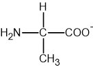

**[1 mark]**

> **[mark-scheme]**
> 1 mark for the correct structure of alanine with a deprotonated carboxylic acid group (COO-)

> **[exam-tip]**
> In basic conditions, the positively charged nitrogen (NH3+) donates a proton, giving an anionic species with a negatively charged carboxylate (COO-) group
The type of reaction  and fully displayed structure of the product are:

Reaction: esterification / condensation

Propyl 2-aminopropanoate product structure:

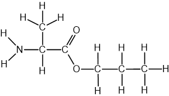

**[2 marks]**

> **[mark-scheme]**
> 1 mark for naming the reaction as esterification **OR** condensation
> 
> 1 mark for the fully displayed structure of propyl 2-aminopropanoate

> **[exam-tip]**
> When an alcohol in acidic conditions reacts with a carboxylic acid group, an ester is produced
> 
> With amino acids the alcohol forms an ester linkage with the carboxylic acid group of the amino acid
> **[mark-scheme]**
> i) The isoelectric point is:
> 
> - The pH at which the amino acid exists as a zwitterion / has no net charge **[1 mark]**

ii) The structure of alanine at pH 6.0:

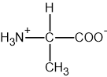

**[1 mark]**

> **[mark-scheme]**
> 1 mark for the correct structure of alanine at pH 6.0 with a protonated amine group (NH3+) and a deprotonated carboxylic acid group (COO-)

> **[exam-tip]**
> Amino acids form zwitterions, where the NH₂ group is protonated to NH3+ and the COOH loses a proton to form COO-
> 
> The negative charge is on the oxygen. Take care not to put it on the C=O carbon
> 
> In acidic conditions, the negatively charged oxygen accepts a proton; in basic conditions, the positively charged nitrogen donates a proton
> **[mark-scheme]**
> Stereoisomers are defined as follows:
> 
> - Molecules with the same structure / structural formula **[1 mark]**
> - But with bonds / atoms / groups arranged differently in space **[1 mark]**
> 
> The stereoisomers of valine can be distinguished by:
> 
> - Plane polarised light **[1 mark]**
> - Will be rotated equally in opposite directions **[1 mark]**

> **[exam-tip]**
> - Amino acids that have four different groups bonded to a carbon atom exhibit optical stereoisomerism
> - A pair of enantiomers exist which are mirror images of one another
> - A solution of one enantiomer rotates the plane of polarisation in a clockwise direction; the other rotates it anti-clockwise by the same angle
> - When optically active substances are made in the lab, they often occur as a 50/50 mixture of the two enantiomers — this is known as a racemic mixture or racemate
