# Exam Questions — Amino Acids
**34. Nitrogen Compounds** · Cambridge (CIE) A-LEVEL chemistry (9701)
> Source: [https://www.savemyexams.com/a-level/chemistry/cie/25/topic-questions/](https://www.savemyexams.com/a-level/chemistry/cie/25/topic-questions/) · 6 questions across 1 sets

## Structured Questions (6 questions)

### Q1 — easy — 7 marks

**Q1** [1 mark]

This question is about amino acids.

State the general formula for an amino acid.

**Q1** [2 marks]

The amino acid alanine is shown in Fig. 1.1

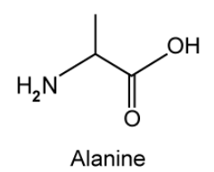

**Fig. 1.1**

Draw the **two** structures of alanine in acidic and basic conditions.

**Q1** [4 marks]

Electrophoresis is an analytical technique which separates ions by placing them in an electrical field.

Describe how a sample of amino acids can be separated using this technique.

### Q2 — medium — 9 marks

**Q2** [2 marks]

A mixture of amino acids may be separated using electrophoresis. A typical practical set-up is shown in Fig. 2.1.

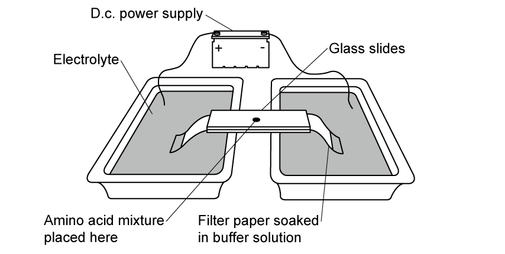

**Fig. 2.1**

When the power supply is switched on, some amino acids may not move, but remain stationary. Suggest an explanation for this observation.

**Q2** [1 mark]

**Extract:**

A mixture of amino acids may be separated using electrophoresis. A typical practical set-up is shown in Fig. 2.1.

When the power supply is switched on, some amino acids may not move, but remain stationary.

The amino acid glycine has the formula H2NCH2CO2H. State the species formed on the filter paper if glycine moves to the left (positive) end of the filter paper.

**Q2** [3 marks]

The result shown in Fig. 2.2 was obtained from another electrophoresis.

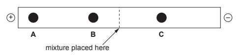

**Fig. 2.2**

What can be deduced about the relative sizes of, and charges on, the amino acid species **A**, **B** and **C**?

| **amino acid** | **relative size** | **charge** |
|---|---|---|
| **A** |   |   |
| **B** |   |   |
| **C** |   |   |

**Q2** [3 marks]

A tripeptide was formed from three different amino acids, alanine, serine and valine. The structural formulae of the amino acids are shown in Table 2.1.

**Table 2.1**

| **amino acid** | **structural formulae** |
|---|---|
| alanine | H2NCH(CH3)CO2H |
| serine | H2NCH(CH2OH)CO2H |
| valine | H2NCH(CH(CH3)2)CO2H |

i) State the number of different tripeptides that can be made using **one** molecule of **each** of the amino acids in Table 2.1.

[1]

ii) Draw the tripeptide, showing the peptide bonds in displayed form.

[2]

### Q3 — medium — 10 marks

**Q3** [1 mark]

Much research has been carried out in recent years investigating the exact structure of silk. The silk of a spider's web is at least five times as strong as steel, and twice as elastic as nylon. The silk fibre is composed of many identical protein chains, which are mainly made from the amino acids glycine, alanine and serine, shown in Fig. 1.1, with smaller amounts of four other amino acids.

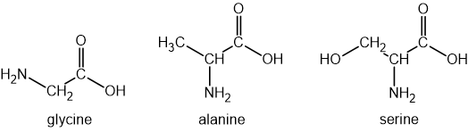

**Fig. 1.1**

Amino acids can exist as zwitterions. Draw the zwitterion structure for glycine.

**Q3** [2 marks]

**Extract:**

Much research has been carried out in recent years investigating the exact structure of silk. The silk of a spider's web is at least five times as strong as steel, and twice as elastic as nylon. The silk fibre is composed of many identical protein chains, which are mainly made from the amino acids glycine, alanine and serine, shown in Fig. 1.1, with smaller amounts of four other amino acids.

{align=center} **Fig. 1.1**

Amino acids can act as acids or bases. Construct equations to show:

i) the reaction between alanine and HCl (aq),

[1]

ii) the reaction between serine and NaOH (aq).

[1]

**Q3** [4 marks]

**Extract:**

Much research has been carried out in recent years investigating the exact structure of silk. The silk fibre is composed of many identical protein chains, which are mainly made from the amino acids glycine, alanine and serine, shown in Fig. 1.1, with smaller amounts of four other amino acids.

i) Draw the structural formula of a portion of the silk protein, showing three amino acid residues. Label a peptide bond on your structure.

[3]

ii) State the polymer **type** of silk protein.

[1]

**Q3** [3 marks]

The *M*r of a silk protein molecule is about 600,000. Assuming it is made from equal amounts of the three amino acids in Fig. 1.1, calculate the average number of amino acid residues in the protein chain. Show your working.

[*M*r (glycine) = 75;   *M*r (alanine) = 89;     *M*r (serine) = 105]

number of residues .............................................

### Q4 — hard — 11 marks

**Q4** [1 mark]

The amino acid alanine is shown below.

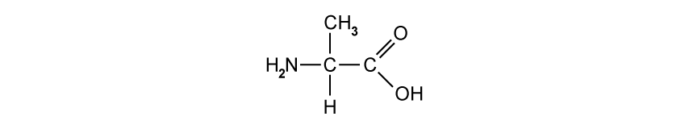

Alanine will react with excess chloromethane. Draw the structural formula of the product formed in this reaction.

**Q4** [2 marks]

**Extract:**

The amino acid alanine is shown below.

Alanine can also react with serine to produce two different dipeptides. The structure of serine is shown below.

serine

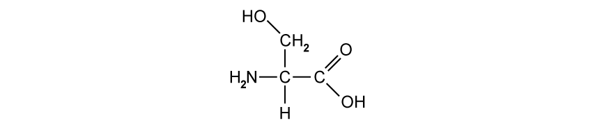

Draw both dipeptides formed in this reaction.

**Q4** [3 marks]

**Extract:**

The amino acid alanine is shown below.

i) Explain why alanine has a high melting point compared with amines of similar molecular mass.

[2]

ii) Draw the structural formula of alanine in the solid state.

[1]

**Q4** [5 marks]

The isoelectric point is the pH at which an amino acid exists as a zwitterion. The isoelectric point of valine is 6.0 and of lysine is 9.8 and their structures are shown below.

valine                                                           lysine

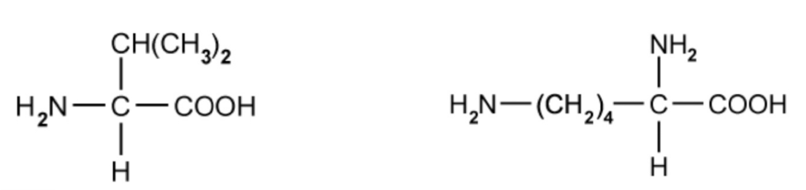

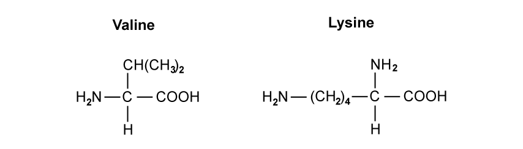

A mixture of the dipeptide, val-lys, and its two constituent amino acids, valine and lysine, was analysed by electrophoresis using a buffer at pH 6.0.

Draw and label **three** spots on the diagram in Fig. 1.1 of the electrophoresis paper to indicate the likely position of each of these species after electrophoresis. Explain your answer.

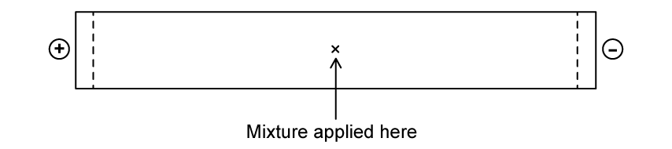

**Fig. 1.1**

### Q5 — hard — 8 marks

**Q5** [1 mark]

Tryptophan is a naturally occurring α-amino acid. Its structure is shown below.

tryptophan

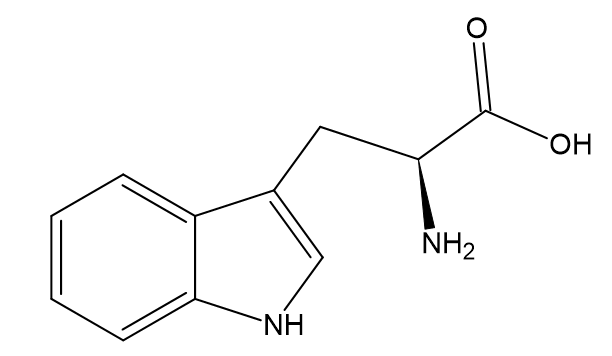

Draw a circle around the R group in this amino acid.

**Q5** [2 marks]

**Extract:**

Tryptophan is a naturally occurring α-amino acid. Its structure is shown below.

Deduce the molecular formula for tryptophan and write a balanced equation for the reaction of tryptophan with dilute nitric acid.

**Q5** [3 marks]

**Extract:**

Tryptophan is a naturally occurring α-amino acid. Its structure is shown below.

tryptophan

Draw the structure of the organic product formed in each of the following reactions of tryptophan:

i) NaOH (aq)

[1]

ii) C2H5OH and concentrated sulfuric acid.

[2]

**Q5** [2 marks]

Two more naturally occurring amino acids are leucine and isoleucine shown below:

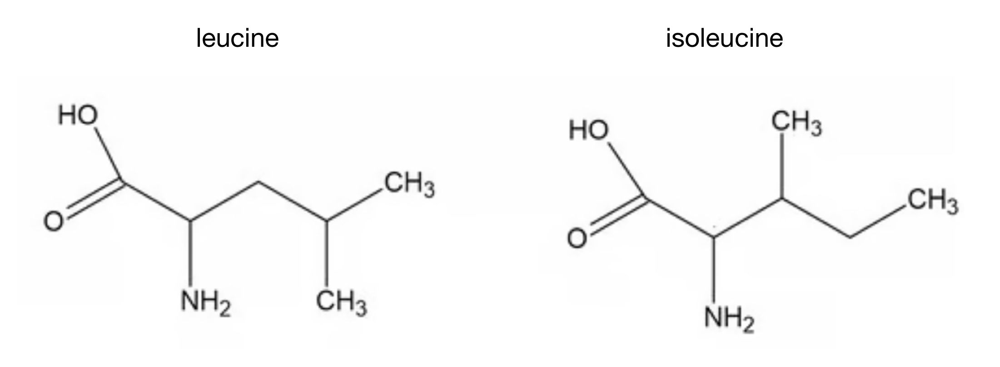

State how many optical isomers there are for leucine and isoleucine.

### Q6 — medium — 10 marks

**Q6** [2 marks]

Fig. 3.1 shows the structures of the amino acids, alanine and valine.

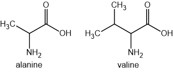

**Fig. 3.1**

i) State the systematic name of valine.

[1]

ii) Draw the species formed when alanine is in a solution of high pH.

[1]

**Q6** [2 marks]

**Extract:**

Fig. 3.1 shows the structures of the amino acids, alanine and valine.

Alanine reacts with propanol, CH3CH2CH2OH in the presence of concentrated sulfuric acid, H2SO4.

Name the type of reaction and draw the fully displayed structure of the product.

**Q6** [2 marks]

**Extract:**

Fig. 3.1 shows the structures of the amino acids, alanine and valine.

The isoelectric point of alanine is at pH 6.0.

i) State what is meant by the term isoelectric point.

[1]

ii) Draw the structure of alanine at pH 6.0.

[1]

**Q6** [4 marks]

**Extract:**

Fig. 3.1 shows the structures of the amino acids, alanine and valine.

Valine exists as a pair of stereoisomers.

State what is meant by the term stereoisomers and how the stereoisomers of valine can be distinguished from one another.
