# Mark Schemes — Condensation Polymerisation
**35. Polymerisation** · Cambridge (CIE) A-LEVEL chemistry (9701)

## Structured Questions (8 questions)

### Q1
> **[mark-scheme]**
> i) The two functional groups present in lactic acid are:
> 
> - Alcohol / hydroxyl
> **AND**
> Carboxylic acid / carboxyl **[1 mark]**
> 
> ii) The systematic name of lactic acid is:
> 
> - 2-hydroxypropanoic acid **[1 mark]**
> 
> iii) The type of stereoisomerism shown by lactic acid is:
> 
> - Optical (isomerism) **[1 mark]**

> **[exam-tip]**
> For part i): both groups must be named for the mark, either systematic (hydroxyl / carboxyl) or common names (–OH group / carboxylic acid group) are accepted.
> 
> For part ii): work from the structural formula. 3 carbons (prop-), a carboxylic acid at C1 (-oic acid), and an –OH at C2 (2-hydroxy-) gives 2-hydroxypropanoic acid.
> 
> For part iii): optical isomerism arises because C2 is a chiral centre. It has four different groups attached: –CH3, –H, –OH, and –COOH.

iv) The three-dimensional structures of the two stereoisomers of lactic acid are:

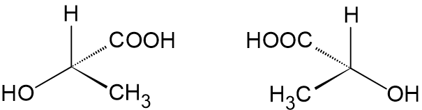

**[1 mark]**

> **[mark-scheme]**
> 1 mark for two correct tetrahedral structures that are non-superimposable mirror images of each other.

> **[exam-tip]**
> For part iv): place the chiral carbon at the centre. Draw two bonds in the plane (straight lines), one coming towards you (solid wedge), and one going away (dashed wedge). The second structure must be a non-superimposable mirror image. Swap any two groups to draw it.
> **[mark-scheme]**
> How lactic acid can undergo condensation polymerisation:
> 
> - Lactic acid contains an alcohol / hydroxyl / –OH group
> **AND**
> A carboxylic acid / carboxyl / –COOH group
> **AND**
> These two groups can react together to form an ester linkage, eliminating water **[1 mark]**

> **[exam-tip]**
> A single molecule can polymerise if it contains two complementary reactive groups. In lactic acid, the –OH group of one molecule reacts with the –COOH group of the next, building up the polyester chain.
> 
> All three conditions are needed for the mark: both groups identified and the reaction stated.
i) A section of the poly(lactic acid) chain showing exactly two repeat units is:

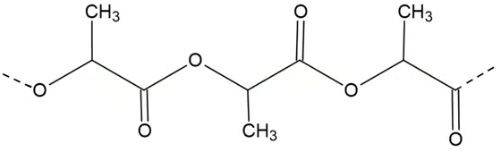

**[1 mark]**

> **[mark-scheme]**
> 1 mark for a correct skeletal formula showing two repeat units with –CO–O– ester linkage fully displayed and continuation bonds.

> **[exam-tip]**
> "Fully displayed" means you must draw the C=O and C–O explicitly in the ester linkage. Show continuation bonds at both ends to indicate the repeating structure.

> **[mark-scheme]**
> ii) Whether the central carbon atom remains a chiral centre in the polymer:
> 
> - Remains / stays chiral
> **AND**
> Because the polymer chain extensions on either side of the carbon are not identical (the carbon is still bonded to four different groups) **[1 mark]**

> **[exam-tip]**
> The chiral centre at C2 of each repeat unit still has four different groups attached: –CH3, –H, –O–CO– (going one way along the chain) and –CO–O– (going the other way). Because the chain extensions differ, the carbon remains chiral.
The skeletal formulaand systematic name of the alternative monomer are:

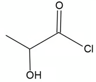

2-hydroxypropanoyl chloride

**[2 marks]**

> **[mark-scheme]**
> 1 mark for the correct skeletal formula of 2-hydroxypropanoyl chloride
> 
> 1 mark for the systematic name: 2-hydroxypropanoyl chloride

> **[exam-tip]**
> An acyl chloride (–COCl) reacts with an –OH group in the same way as a carboxylic acid but more vigorously, eliminating HCl instead of water. So 2-hydroxypropanoyl chloride (the acyl chloride analogue of lactic acid) can form the same polyester chain.
> 
> The systematic name: 3 carbons (propan-), acyl chloride at C1 (-oyl chloride), –OH at C2 (2-hydroxy-) gives 2-hydroxypropanoyl chloride.

### Q2
The skeletal formulae of the two monomers are:

1,3-diaminobenzene:

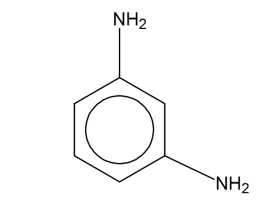

Benzene-1,3-dicarboxylic acid:

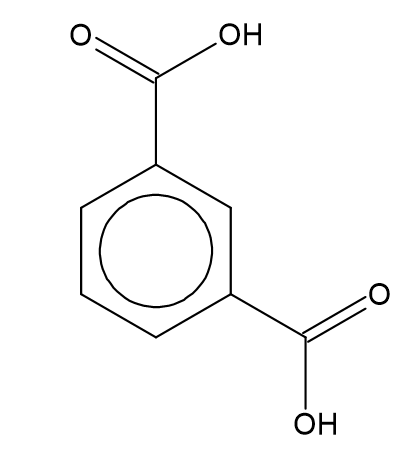

**[2 marks]**

> **[mark-scheme]**
> 1 mark for the correct structure of 1,3-diaminobenzene
> 
> 1 mark for the correct structure of benzene-1,3-dicarboxylic acid

> **[exam-tip]**
> Both monomers are based on a benzene ring with two functional groups at positions 1 and 3 (the meta positions). A common mistake is drawing the groups at the 1,4 positions (para) instead.
> 
> The amine group is –NH2 and the carboxylic acid group is –COOH. In the skeletal formula, the ring vertices represent CH groups and the substituents replace H atoms.
One repeat unit of the Nomex® polymer is:

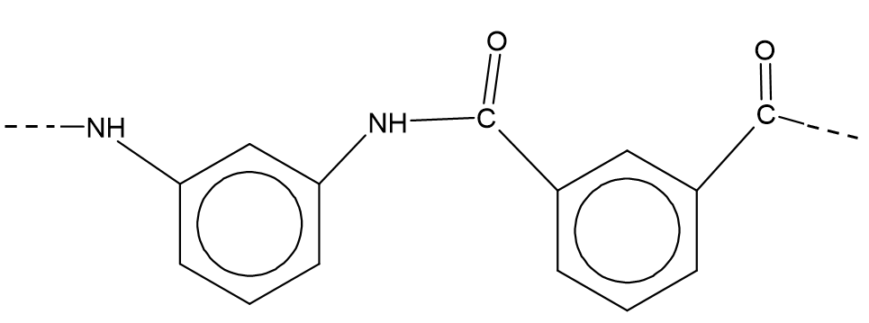

**[2 marks]**

> **[mark-scheme]**
> 1 mark for correct amide linkage (–CO–NH–) shown fully displayed between the two monomers.
> 
> 1 mark for correct repeat unit with 1,3-substituted benzene rings and continuation bonds at both ends.

> **[exam-tip]**
> Place the two monomers side by side. The –COOH of the diacid reacts with one –NH2 of the diamine, eliminating water and forming the amide bond –CO–NH–. Draw this bond with C=O and N–H both explicitly shown.
> 
> The 1,3-substitution means the chain is angled (kinked) at each benzene ring, unlike the straight chain in Kevlar. Make sure the bonds come from the 1 and 3 positions, not from 1 and 4.
Two adjacent polymer chains of Kevlar®, each showing one repeat unit:

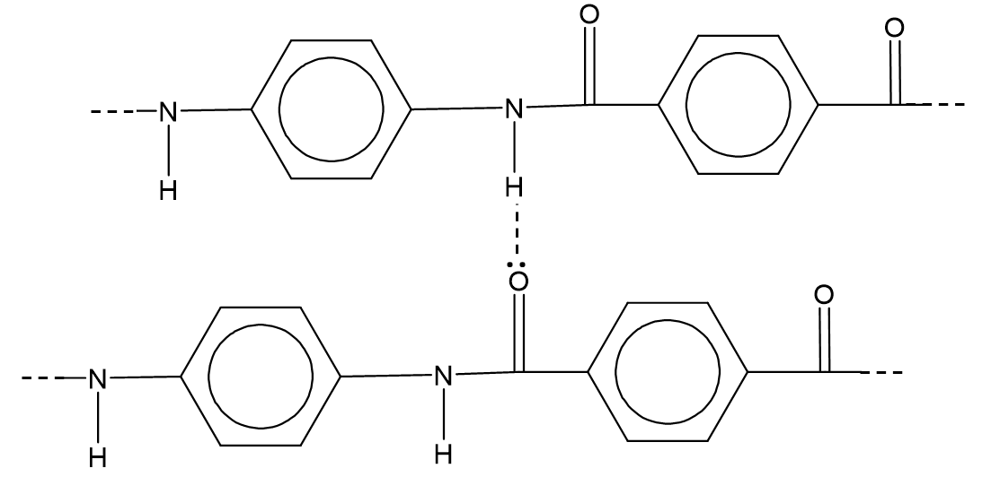

**[2 marks]**

> **[mark-scheme]**
> 1 mark for correct structure of both repeat units (1,4-substituted benzene rings, amide linkages, continuation bonds).
> 
> 1 mark for hydrogen bond correctly drawn as a dashed line from the lone pair on the C=O oxygen of one chain to the H on the N–H of the adjacent chain.
> 
> Accept other orientations with the monomers the other way around.

> **[exam-tip]**
> The strongest intermolecular force in Kevlar is hydrogen bonding. It forms between the lone pair on the oxygen of a C=O group on one chain and the hydrogen on the N–H group of an adjacent chain.
> 
> Always start the hydrogen bond arrow / dashed line at the lone pair on oxygen. The bond points towards the H on nitrogen.
> 
> Drawing two adjacent parallel chains (rather than one long chain) is essential here. Hydrogen bonding is an intermolecular force and must be shown between separate chains.
> **[mark-scheme]**
> The polymer with the higher melting point is:
> 
> - Kevlar® **[1 mark]**
> 
> Explanation:
> 
> - The 1,4-substitution in Kevlar creates straight, linear polymer chains, so adjacent chains can pack more closely together. The 1,3-substitution in Nomex creates a kinked chain, so chains pack less closely.
> **AND**
> Closer packing makes the hydrogen bonds between chains more effective / stronger, requiring more energy to separate the chains **[1 mark]**

> **[exam-tip]**
> The key difference between Kevlar and Nomex is the substitution pattern: Kevlar uses 1,4-substitution (para), giving a straight chain; Nomex uses 1,3-substitution (meta), giving a kinked chain.
> 
> You can also give the reverse argument: Nomex has the lower melting point because its kinked chains pack less closely, giving weaker and fewer hydrogen bonds between chains.
> 
> Both marks require you to link chain shape to packing to intermolecular force strength to melting point. Simply stating "Kevlar is straighter" without explaining why that affects the melting point is not sufficient for the second mark.

### Q3
The repeat unit of the polyester is:

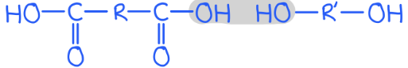

**[2 marks]**

> **[mark-scheme]**
> 1 mark for correct ester linkage (–CO–O–) shown fully displayed.
> 
> 1 mark for remainder of repeat unit correct with R groups and continuation bonds at both ends.

> **[exam-tip]**
> The ester linkage –CO–O– forms when the –COOH of the diacid reacts with one –OH of the diol. Draw both the C=O and the C–O–C explicitly.
> 
> The repeat unit must not show the full –COOH and –OH at the ends. Those bonds have been used to form the ester linkage. Instead, show continuation bonds (lines extending beyond the brackets).
> 
> R represents the hydrocarbon portion of each monomer. For a real example: in Terylene, R from the diacid is the benzene-1,4-diyl group and R from the diol is –CH2CH2–.
> **[mark-scheme]**
> In terms of *n*, the number of molecules of water formed is:
> 
> - 2*n* − 1 **[1 mark]**
> 
> Allow 2*n* (if candidate treats the polymer as having no free end groups).

> **[exam-tip]**
> Try small values to find the pattern:
> 
> - For *n* = 1 (one acid + one diol): one ester bond forms, releasing 1 water
> - For *n* = 2: three ester bonds form, releasing 3 water molecules
> - For *n* = 3: five water molecules. The pattern is 2*n* − 1.
> 
> The 2*n* answer arises if you assume a fully cyclic or infinite-chain polymer where both ends have also reacted. Both answers can be credited.
The equation for the condensation polymerisation is:

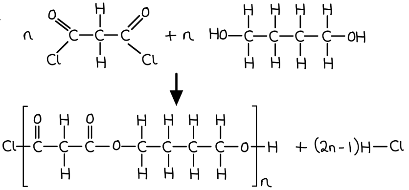

**[3 marks]**

> **[mark-scheme]**
> 1 mark for correct structural formulae of both monomers with stoichiometry *n*.
> 
> 1 mark for correct structural formula of the repeat unit in square brackets with *n*.
> 
> 1 mark for (2*n* − 1) HCl as the by-product.

> **[exam-tip]**
> Propanedioyl dichloride has the structure ClCO–CH2–COCl, a three-carbon chain with an acyl chloride (–COCl) group at each end. Draw it as a structural formula showing all bonds in the functional groups.
> 
> Butane-1,4-diol is HO–CH2CH2CH2CH2–OH: four carbons with –OH at each end.
> 
> Each –COCl + –OH reaction forms one ester linkage and releases one HCl. For *n* of each monomer, (2*n* − 1) HCl molecules are eliminated overall.
> **[mark-scheme]**
> An alternative pair of monomers that could produce the same polymer chain is:
> 
> - Monomer 1: propanedioic acid / malonic acid **[1 mark]**
> - Monomer 2: butane-1,4-diol **[1 mark]**
> 
> Monomers can be in either order

> **[exam-tip]**
> The polymer from part **(c)** has ester linkages from a three-carbon diacid and a four-carbon diol. Propanedioyl dichloride (an acyl chloride) can be replaced by propanedioic acid, which forms the same ester linkage via condensation with the –OH group.
> 
> You cannot simply swap the diacid and diol (e.g. butanedioyl dichloride + propane-1,3-diol) as that produces a different polymer with a different repeat unit length.

### Q4
The structural formulae of the two monomers are:

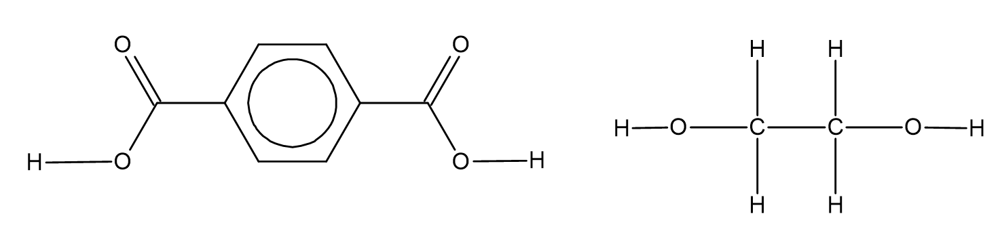

**[2 marks]**

> **[mark-scheme]**
> 1 mark for the correct of the dicarboxylic acid
> 
> 1 mark for the correct structure of the diol
> 
> Accept benzene-1,4-dioyl dichloride in place of benzene-1,4-dicarboxylic acid.

> **[exam-tip]**
> To identify the monomers, locate the ester linkage (–CO–O–) in the polymer. Break it so that both oxygens go with one monomer (forming the –COOH group of the dicarboxylic acid) and the other monomer is left with –OH groups at each end (the diol).
> 
> One monomer is benzene-1,4-dicarboxylic acid (a benzene ring with –COOH at positions 1 and 4). The other is a short-chain diol.
> **[mark-scheme]**
> The systematic name of the other monomer is:
> 
> - Ethane-1,2-diol **[1 mark]**

> **[exam-tip]**
> The other monomer has two alcohol groups (–OH), one on each carbon, so it is a diol. The two-carbon chain gives the stem ethane, and the locants 1,2 show the –OH groups are on adjacent carbons.
> 
> Diols and dicarboxylic acids are the two key monomers for making polyesters by condensation polymerisation.
> **[mark-scheme]**
> The other product formed during the reaction is:
> 
> - Water **[1 mark]**

> **[exam-tip]**
> Every time an ester linkage forms between a –COOH group and an –OH group, one water molecule is eliminated. This is why the reaction is called condensation polymerisation.
> **[mark-scheme]**
> The molecule that reacts with benzene-1,4-dicarboxylic acid to form a polyamide is:
> 
> - **R** **[1 mark]**

> **[exam-tip]**
> A polyamide forms from a dicarboxylic acid (or diacyl chloride) reacting with a **diamine**, a molecule with two –NH2 groups.
> 
> Molecule R is the diamine: it has an –NH2 group at each end of the chain. S and T do not have the two –NH2 groups needed to form the amide links.

### Q5
> **[mark-scheme]**
> Two classes of organic molecules that can take part in condensation polymerisation include:
> 
> Any **two** from (1 mark for each point):
> 
> - Dicarboxylic acids
> - Hydroxy acids / hydroxycarboxylic acids
> - Diols
> - Diamines
> - Amino acids
> - Diacyl chlorides / dioyl chlorides
> 
> **[2 marks]**

> **[exam-tip]**
> To undergo condensation polymerisation, each monomer must have two reactive functional groups, either two identical groups (one at each end) or two complementary groups that can react with each other.
> 
> The key combinations are:
> 
> - Carboxylic acid (or acyl chloride) + alcohol forms a polyester
> - Carboxylic acid (or acyl chloride) + amine forms a polyamide.
> 
> In both cases a small molecule (water or HCl) is eliminated at each step.
> 
> Amino acids can self-polymerise because every amino acid already contains both –NH2 and –COOH groups in the same molecule.
The structural formula of butanedioic acid is:

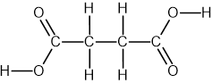

**[1 mark]**

> **[mark-scheme]**
> 1 mark for correct structural formula of butanedioic acid with both –COOH groups fully displayed.

> **[exam-tip]**
> The molecular formula C4H6O4 tells you there are four carbons and four oxygens, consistent with two –COOH groups plus a two-carbon chain between them.
> 
> "Fully displayed" means you must draw the C=O double bond and the –OH explicitly in each carboxylic acid group.
> 
> Every carbon must have exactly four bonds in your diagram.
> **[mark-scheme]**
> The systematic name of the dicarboxylic acid in (b) is:
> 
> - Butanedioic acid / butane-1,4-dioic acid **[1 mark]**

> **[exam-tip]**
> The longest chain is four carbons (counting both –COOH carbons), so the stem is butane.
> 
> The prefix *di* and suffix *-oic acid* indicate two carboxylic acid groups. The locants 1 and 4 are technically redundant (they can only be in those positions), so you will not be penalised for omitting them.
The repeat unit of the polyamide is:

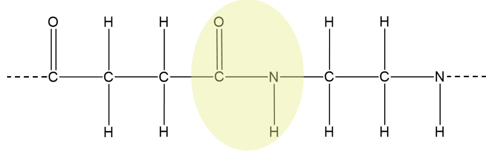

**[2 marks]**

> **[mark-scheme]**
> 1 mark for correct amide linkage (–CO–NH–) shown fully displayed.
> 
> 1 mark for remainder of repeat unit correct with continuation bonds at both ends.

> **[exam-tip]**
> The amide linkage –CO–NH– forms when a carboxylic acid reacts with an amine, eliminating water. You must draw both the C=O and the N–H explicitly.
> 
> The repeat unit must show continuation bonds (lines extending beyond each bracket end) to indicate that the structure repeats.
> 
> The four-carbon section (from butanedioic acid) and the two-carbon section (from 1,2-diaminoethane) alternate around the amide links in the chain.

### Q6
One of the organic products formed from the acid hydrolysis of valylalanine is:

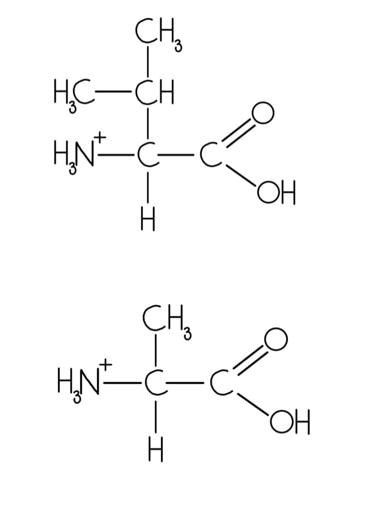

**[1 mark]**

> **[mark-scheme]**
> 1 mark for either correct protonated amino acid product (valine or alanine with –NH3+ and –COOH groups shown correctly).

> **[exam-tip]**
> Under acidic conditions, the amide bond is hydrolysed by heating under reflux. The two amino acids are released as their protonated forms. The –NH2 group accepts a proton from the acid to become –NH3+.
> 
> Draw either valine (with the isopropyl side chain) or alanine (with the methyl side chain). Both must show –NH3+ rather than –NH2 in acidic conditions.
The skeletal formula of tryptophan is:

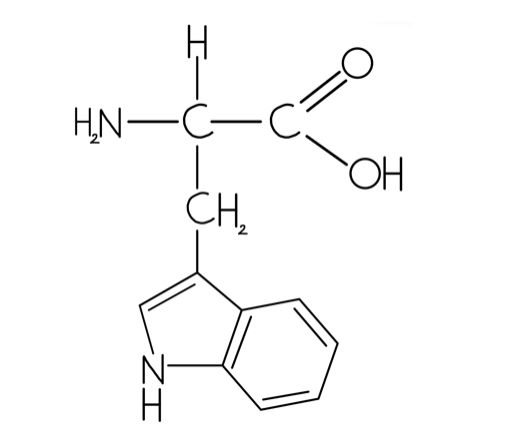

**[1 mark]**

> **[mark-scheme]**
> 1 mark for correct skeletal formula of tryptophan with –NH2, –COOH, and indole ring side chain.

> **[exam-tip]**
> To identify tryptophan in the dipeptide, locate the amide bond (C=O bonded to N–H). Break the bond and add the atoms lost as water: one fragment gets –NH2 and the other gets –COOH.
> 
> Cysteine is the amino acid with a thiol group (–CH2–SH side chain). The other fragment, with the indole ring system, is tryptophan.
> **[mark-scheme]**
> Why polyamides are suitable for weaving fibres but polyalkenes are not:
> 
> - Polyamides have hydrogen bonding between chains
> **OR**
> Polyalkenes have no hydrogen bonding between chains **[1 mark]**
> - Polyalkenes only have (weak) van der Waals forces between chains **[1 mark]**
> - Hydrogen bonds are much stronger than van der Waals forces
> **OR**
> Polyalkenes require much less energy to separate the chains **[1 mark]**

> **[exam-tip]**
> Hydrogen bonding can form between the –C=O and –N–H groups on adjacent polyamide chains. Polyalkenes have no N, O, or F atoms, so no hydrogen bonding is possible.
> 
> The first mark is for identifying the type of force in each polymer. The second mark is for naming van der Waals forces specifically in polyalkenes. The third mark is for explicitly comparing the strengths.
> 
> Van der Waals forces are weak because they require large electron clouds or high molecular mass to become significant. Polyalkene chains can slide past each other relatively easily.
> **[mark-scheme]**
> Why NH2CH2CH2COCl can undergo condensation polymerisation:
> 
> - The molecule contains two different functional groups: an amine (–NH2) and an acyl chloride (–COCl) **[1 mark]**
> - These two groups react with each other, forming an amide linkage and eliminating HCl **[1 mark]**

> **[exam-tip]**
> A molecule can self-polymerise if it contains two complementary reactive groups, one at each end. Here, the –NH2 at one molecule reacts with the –COCl of the next molecule, building up the polymer chain.
> 
> Each step eliminates HCl (not water), but it is still called condensation polymerisation because a small molecule is lost each time a new bond forms.

### Q7
> **[mark-scheme]**
> i) The molecular formula of diisocyanate **P** is:
> 
> - C15H10N2O2 **[1 mark]**

> **[exam-tip]**
> To find the molecular formula of **P**, look at the Lycra repeat unit.
> 
> It shows two benzene rings connected by a –CH2– group, each bearing one –NCO group.
> 
> Count:
> 
> - 13 C from rings and bridge plus 2 from –NCO groups = 15 C total
> - 10 H (4 per disubstituted ring x2 plus 2 on –CH2–)
> - 2 N and 2 O from the two –NCO groups.

ii) One repeat unit of Lycra® is:

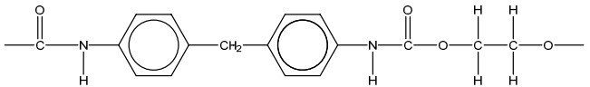

**[2 marks]**

> **[mark-scheme]**
> 1 mark for for the correct –NH–CO–O– urethane linkage shown fully displayed.
> 
> 1 mark for the remainder of repeat unit correct (R1 = diphenylmethane group, R2 = –CH2CH2–) with continuation bonds.

> **[exam-tip]**
> R1 comes from the diisocyanate (the diphenylmethane group between the two NCO-derived N atoms), and R2 comes from the diol (–CH2CH2– from ethane-1,2-diol).
> 
> The urethane linkage –NH–CO–O– must be drawn with the N–H and C=O and C–O all explicitly shown to earn the first mark.
The completed table is:

| **Intermolecular force** | **Group(s) involved** |
|---|---|
| Hydrogen bonding | –NH |
| Van der Waals forces / induced dipole–dipole forces | –C6H4CH2– / benzene rings |

**[2 marks]**

> **[mark-scheme]**
> 1 mark for hydrogen bonding **AND** –NH group correctly identified.
> 
> 1 mark for van der Waals forces (accept induced dipole–dipole / London dispersion) **AND** –C6H4CH2– or benzene/aromatic rings correctly identified.

> **[exam-tip]**
> Hydrogen bonding occurs between the H on the –NH group of one chain and the lone pair on the C=O of an adjacent chain. Both the force and the group must be correct for the mark.
> 
> The –C6H4CH2– section contains only C and H, so no polar bonds, making the strongest force here van der Waals. Large aromatic groups produce relatively strong van der Waals forces.
> **[mark-scheme]**
> Examples of commercially important synthetic polymers:
> 
> - Synthetic polyamide: Nylon / Kevlar / Nomex **[1 mark]**
> - Synthetic polyester: Terylene / PET / polylactic acid (PLA) **[1 mark]**

> **[exam-tip]**
> You should be able to recall at least one commercial example of each type from your A level studies. Nylon (polyamide) and Terylene (polyester) are the most commonly cited.
The two organic products formed from the acid hydrolysis of Nylon 66 are:

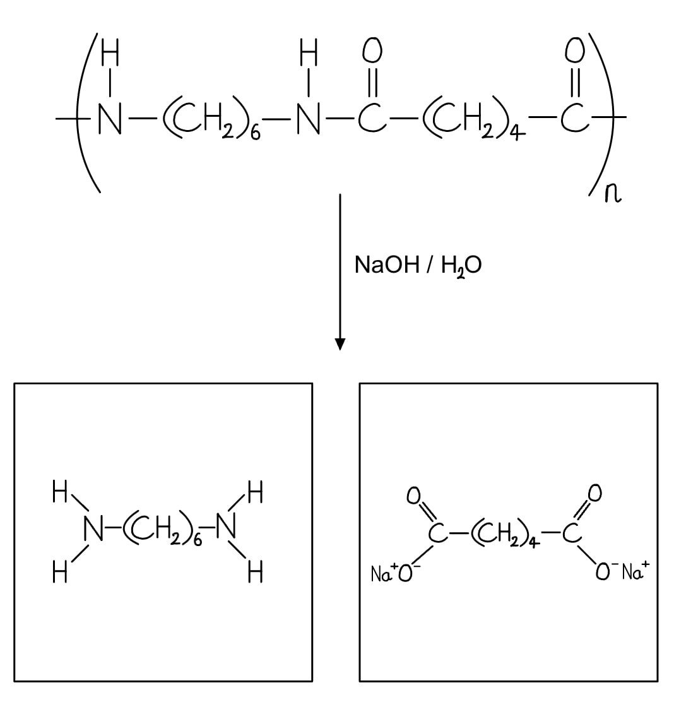

**[2 marks]**

> **[mark-scheme]**
> 1 mark for correct skeletal formula of the diamine product with both –NH3+ groups (protonated under acidic conditions).
> 
> 1 mark for correct skeletal formula of hexanedioic acid (adipic acid) with both –COOH groups.

> **[exam-tip]**
> Under acidic conditions (dilute H2SO4, heated under reflux), the amide bonds are hydrolysed. Each –CO–NH– bond breaks to give a –COOH group and a –NH2 group. In acidic solution the amine is immediately protonated to –NH3+.
> 
> The two products are: (1) the protonated diamine (hexane-1,6-diamine with both ends as –NH3+) and (2) hexanedioic acid (adipic acid, HOOC(CH2)4COOH).
> 
> If alkaline hydrolysis (NaOH) were used instead, the products would be different: the diamine would be neutral (–NH2) and the diacid would be deprotonated (carboxylate salt, –COO-Na+).

### Q8
> **[mark-scheme]**
> How ethane-1,2-diamine acts as a Brønsted–Lowry base:
> 
> - The nitrogen atoms have lone pairs of electrons
> **AND**
> Which can accept a proton (H+) **[1 mark]**

> **[exam-tip]**
> A Brønsted–Lowry base is any species that accepts a proton. Ethane-1,2-diamine has two nitrogen atoms, each with a lone pair. Either lone pair can accept H+ from an acid.
> 
> Both conditions are needed for the mark: the lone pair must be identified and the proton acceptance stated.
> **[mark-scheme]**
> The equation for the reaction of ethane-1,2-diamine with excess hydrochloric acid is:
> 
> - H2NCH2CH2NH2 + 2HCl → ClH3NCH2CH2NH3Cl
> **OR**
> C2N2H8 + 2HCl → C2N2H10Cl2 **[1 mark]**

> **[exam-tip]**
> With excess HCl, both –NH2 groups are protonated. Each nitrogen accepts one H+ from HCl, forming the dihydrochloride salt. Make sure you use 2HCl to show both groups react.
> 
> The product has the formula C2N2H10Cl2. The original H8 gains two extra H atoms (one per NH3+), and two Cl- ions balance the charge.
The skeletal formula of the polymer showing exactly two repeat units is:

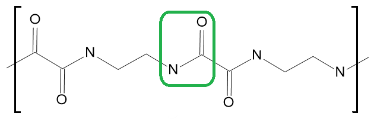

**[2 marks]**

> **[mark-scheme]**
> 1 mark for correct amide bond (–CO–NH–) shown fully displayed.
> 
> 1 mark for correct overall structure with exactly two repeat units and continuation bonds at both ends.

> **[exam-tip]**
> Ethanedioic acid (HOOCCOOH) provides a very short two-carbon diacid. The repeat unit has no carbon atoms between the two amide links on the acid side. Draw the –CO–NH– linkage with N–H explicitly shown.
> 
> Show continuation bonds (lines extending beyond the brackets at each end) to indicate the repeating structure. The hydrogen on nitrogen can be shown or omitted as long as the N–H bond is implied.
