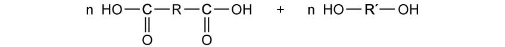
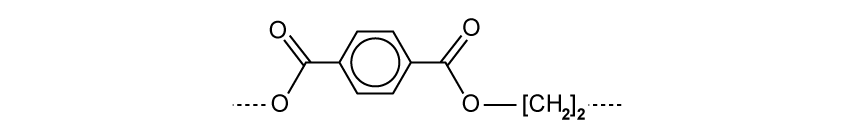
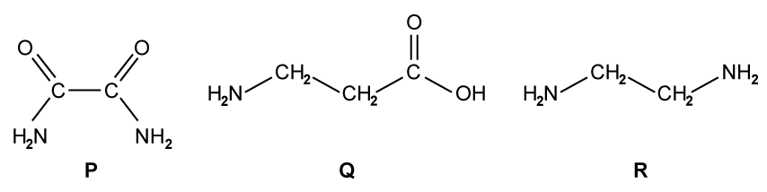
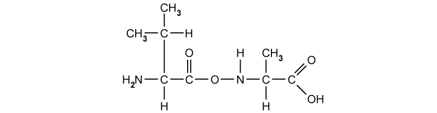
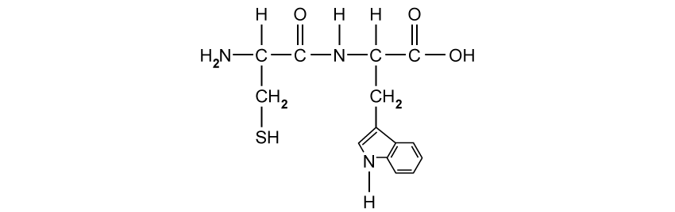
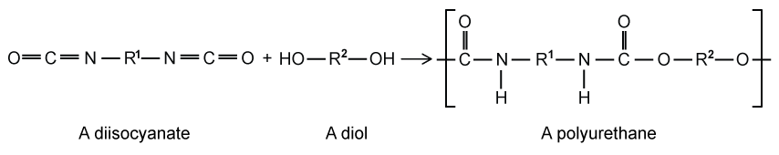
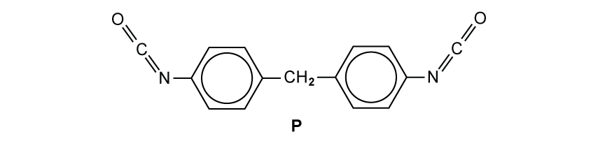
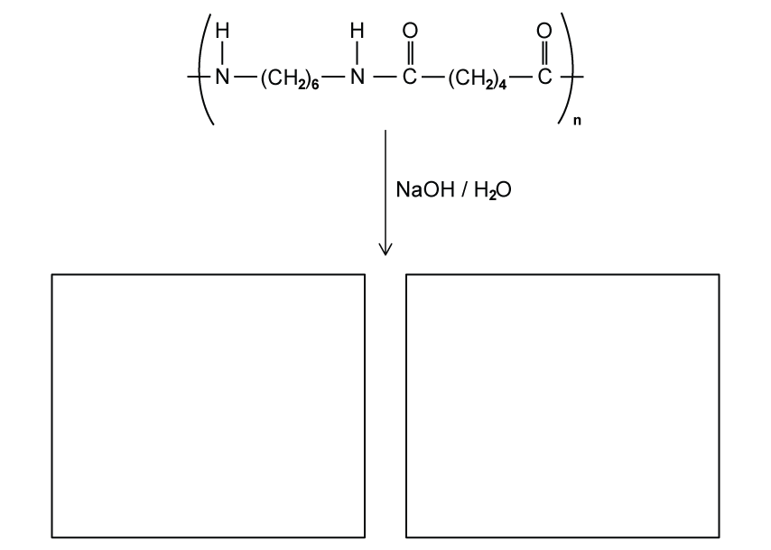

# Exam Questions — Condensation Polymerisation
**35. Polymerisation** · Cambridge (CIE) A-LEVEL chemistry (9701)
> Source: [https://www.savemyexams.com/a-level/chemistry/cie/25/topic-questions/](https://www.savemyexams.com/a-level/chemistry/cie/25/topic-questions/) · 8 questions across 1 sets

## Structured Questions (8 questions)

### Q1 — hard — 9 marks

**Q1** [4 marks]

Lactic acid has the structural formula CH3CHOHCOOH.

i) State the names of the **two** functional groups present in lactic acid.

[1]

ii) State the systematic name of lactic acid.

[1]

iii) State the type of stereoisomerism shown by lactic acid.

[1]

iv) Draw three-dimensional structures for the two stereoisomers of lactic acid.

[1]

**Q1** [1 mark]

**Extract:**

Lactic acid has the structural formula CH~3~CHOHCOOH.

Explain how lactic acid can undergo condensation polymerisation.

**Q1** [2 marks]

**Extract:**

Lactic acid has the structural formula CH~3~CHOHCOOH.

Poly(lactic acid) is a polyester.

i) Draw a section of the poly(lactic acid) chain showing exactly **two** repeat units. The newly formed ester linkages must be shown fully displayed.

[1]

ii) State whether the central carbon atom in the repeat unit remains a chiral centre in the polymer. Explain your answer.

[1]

**Q1** [2 marks]

**Extract:**

Lactic acid has the structural formula CH3CHOHCOOH.

Poly(lactic acid) can also be synthesised from a monomer containing an acyl chloride functional group.

Draw the skeletal formula of this alternative monomer.

State the systematic name of this monomer.

### Q2 — hard — 8 marks

**Q2** [2 marks]

Nomex® and Kevlar® are two examples of polyamides containing benzene rings. Nomex® is made from 1,3-diaminobenzene and benzene-1,3-dicarboxylic acid.

Draw the skeletal formulae of these two monomers.

**Q2** [2 marks]

**Extract:**

Nomex® and Kevlar® are two examples of polyamides containing benzene rings. Nomex® is made from 1,3-diaminobenzene and benzene-1,3-dicarboxylic acid.

Draw **one** repeat unit of the Nomex® polymer. The newly formed linkages must be shown fully displayed.

**Q2** [2 marks]

Kevlar® is made from 1,4-diaminobenzene and benzene-1,4-dicarboxylic acid.

Draw **two adjacent polymer chains** of Kevlar®, each showing **one** repeat unit. Clearly show the strongest intermolecular force between the two chains.

**Q2** [2 marks]

**Extract:**

Nomex® and Kevlar® are two examples of polyamides containing benzene rings. Nomex® is made from 1,3-diaminobenzene and benzene-1,3-dicarboxylic acid.

The 1,3-substitution means the chain is angled (kinked) at each benzene ring, unlike the straight chain in Kevlar. Make sure the bonds come from the 1 and 3 positions, not from 1 and 4.

Kevlar® is made from 1,4-diaminobenzene and benzene-1,4-dicarboxylic acid.

State whether Kevlar® or Nomex® will have the higher melting point. Explain your answer in terms of the structure of the polymer chains.

### Q3 — hard — 8 marks

**Q3** [2 marks]

Fig. 1.1 shows a general dicarboxylic acid and a general diol.

**Fig. 1.1**

Draw **one** repeat unit of the polyester formed from these monomers. The newly formed linkage must be shown fully displayed.

**Q3** [1 mark]

In terms of *n*, state the number of molecules of water formed in the condensation polymerisation of *n* molecules of a dicarboxylic acid and *n* molecules of a diol.

**Q3** [3 marks]

Construct an equation for the condensation polymerisation of propanedioyl dichloride and butane-1,4-diol. Your equation should use structural formulae for the monomers and the repeat unit.

**Q3** [2 marks]

**Extract:**

Construct an equation for the condensation polymerisation of propanedioyl dichloride and butane-1,4-diol. Your equation should use structural formulae for the monomers and the repeat unit.

Propanedioyl dichloride has the structure ClCO–CH~2~–COCl, a three-carbon chain with an acyl chloride (–COCl) group at each end.

Butane-1,4-diol is HO–CH~2~CH~2~CH~2~CH~2~–OH: four carbons with –OH at each end.

State the systematic names of an alternative pair of monomers that could be used to produce the same polymer chain as in **(c)**.

Monomer 1 ..................................................................................................

Monomer 2 ..................................................................................................

### Q4 — easy — 5 marks

**Q4** [2 marks]

The structure of a synthetic polyester is shown below.

Draw the structural formulae of the **two** monomers used to make this polyester.

**Q4** [1 mark]

**Extract:**

The structure of a synthetic polyester is shown below.

Draw the structural formulae of the **two** monomers used to make this polyester.

One of the monomers is benzene-1,4-dicarboxylic acid. State the systematic name of the other monomer.

**Q4** [1 mark]

**Extract:**

One of the monomers is benzene-1,4-dicarboxylic acid. State the systematic name of the other monomer.

The systematic name of the other monomer is: Ethane-1,2-diol

State the name of the other product formed during the reaction between the two monomers in **(b)**.

**Q4** [1 mark]

Benzene-1,4-dicarboxylic acid will also react to form a polyamide.

Fig. 2.2 shows the structures of three molecules, **R**, **S**, and **T**.

State which of the molecules, **R**, **S**, or **T**, reacts with benzene-1,4-dicarboxylic acid to form a polyamide.

### Q5 — easy — 6 marks

**Q5** [2 marks]

State the names of **two** classes of organic molecules that can take part in condensation polymerisation.

**Q5** [1 mark]

Draw the structural formula of the dicarboxylic acid with the molecular formula C4H6O4. The carboxylic acid groups must be shown fully displayed.

**Q5** [1 mark]

**Extract:**

Draw the structural formula of the dicarboxylic acid with the molecular formula C~4~H~6~O~4~. The carboxylic acid groups must be shown fully displayed.

State the systematic name of the dicarboxylic acid in **(b)**.

**Q5** [2 marks]

**Extract:**

Draw the structural formula of the dicarboxylic acid with the molecular formula C₄H₆O₄. The carboxylic acid groups must be shown fully displayed.

The structural formula of butanedioic acid is shown with two fully displayed carboxylic acid groups connected by a two-carbon chain.

Draw one repeat unit of the polymer formed when C4H6O4 polymerises with 1,2-diaminoethane, H2NCH2CH2NH2. The newly formed linkage must be shown fully displayed.

### Q6 — medium — 7 marks

**Q6** [1 mark]

Valylalanine, shown in Fig. 1.1, is a dipeptide.

**Fig. 1.1**

Valylalanine is heated under reflux with dilute hydrochloric acid. Two organic products are formed.

Draw the structural formula of **one** of these organic products.

**Q6** [1 mark]

Fig. 1.2 shows a dipeptide synthesised from the amino acids cysteine and tryptophan.

**Fig. 1.2**

Draw the skeletal formula of the amino acid tryptophan.

**Q6** [3 marks]

Polyamides can form strong fibres suitable for weaving. Polyalkenes are generally too weak for this purpose.

Fig. 1.3 shows the structure of serine, an amino acid that forms polyamide links.

**Fig. 1.3**

Explain why polyamides are suitable for use as weaving fibres but polyalkenes are not. In your answer, refer to the intermolecular forces between the polymer chains.

**Q6** [2 marks]

Explain how the molecule NH2CH2CH2COCl can undergo condensation polymerisation.

### Q7 — medium — 9 marks

**Q7** [3 marks]

Polyurethanes are polymers made by the reaction of a diisocyanate with a diol, as shown in Fig. 2.1. R1 and R2 are hydrocarbon groups.

**Fig. 2.1**

Lycra® in Fig. 2.2 is a polyurethane formed from the diisocyanate **P** and HOCH2CH2OH.

**Fig. 2.2**

i) State the molecular formula of diisocyanate **P**.

[1]

ii) Draw **one** repeat unit of Lycra®. The newly formed linkages must be shown fully displayed.

[2]

*Source: 2018 O42 Q7A*

**Q7** [2 marks]

**Extract:**

Lycra® in Fig. 2.2 is a polyurethane formed from the diisocyanate P and HOCH₂CH₂OH.

Polyurethanes are polymers made by the reaction of a diisocyanate with a diol, as shown in Fig. 2.1. R¹ and R² are hydrocarbon groups.

Fibres of Lycra® are strong due to the intermolecular forces between the polymer chains. Complete the table to state two types of intermolecular force responsible for this property, and the groups involved.

| **Intermolecular force** | **Group(s) involved** |
|---|---|
|   |   |
|   |   |

**Q7** [2 marks]

State the name of one commercially important example of each of the following types of synthetic polymer.

Synthetic polyamide ..................................................................................................

Synthetic polyester ..................................................................................................

**Q7** [2 marks]

Fig. 2.3 shows the repeat unit of Nylon 66.

**Fig. 2.3**

Nylon 66 is heated under reflux with dilute sulfuric acid.

Draw the skeletal formulae of the **two** organic products formed.

### Q8 — medium — 4 marks

**Q8** [1 mark]

Explain how ethane-1,2-diamine acts as a Brønsted–Lowry base.

**Q8** [1 mark]

Construct an equation to show the reaction of ethane-1,2-diamine with an excess of hydrochloric acid.

**Q8** [2 marks]

Ethane-1,2-diamine can react with ethanedioic acid, HOOCCOOH, to form a condensation polymer.

Draw the skeletal formula of the polymer, showing exactly two repeat units. The newly formed linkages must be shown fully displayed.
