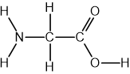
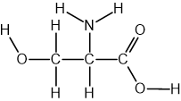
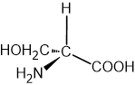
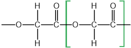
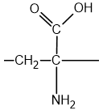
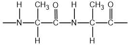

# Mark Schemes — Predicting the Type of Polymerisation
**35. Polymerisation** · Cambridge (CIE) A-LEVEL chemistry (9701)

## Structured Questions (3 questions)

### Q1
The he structural formulae of glycine and serine are:

Glycine:

Serine:

**[2 marks]**

> **[mark-scheme]**
> 1 mark for the correct structure of glycine
> 
> 1 mark for the correct structure of serine
> 
> Allow skeletal formulae

> **[exam-tip]**
> Glycine (2-aminoethanoic acid): based on ethanoic acid with one H on the CH3 group replaced by –NH2, giving H2N–CH2–COOH.
> 
> Serine (2-amino-3-hydroxypropanoic acid): based on propanoic acid with one H on C-2 replaced by –NH2 and one H on C-3 replaced by –OH, giving H2N–CH(CH2OH)–COOH.
The three-dimensional structure of the other optical isomer of serine is:

**[1 mark]**

> **[mark-scheme]**
> 1 mark for the correct mirror image of Fig. 3.2 with all four groups retained and wedge-dash bonds reversed

> **[exam-tip]**
> The two optical isomers are non-superimposable mirror images of each other. The simplest approach is to reverse the wedge and dash bonds while keeping all four groups attached to the chiral carbon.
> **[mark-scheme]**
> i) The functional groups that react to form an ester linkage are:
> 
> - Hydroxyl / –OH
> **AND**
> carboxylic acid / –COOH **[1 mark]**
> 
> ii) The functional groups that react to form an amide linkage are:
> 
> - Amine / amino / –NH₂
> **AND**
> carboxylic acid / –COOH **[1 mark]**

> **[exam-tip]**
> An ester linkage forms from a reaction between a hydroxyl group (–OH) and a carboxylic acid group (–COOH). Only serine has a hydroxyl group, so ester formation requires at least one serine monomer.
> 
> An amide linkage forms from a reaction between an amine group (–NH2) and a carboxylic acid group (–COOH). Both glycine and serine have these groups, so amide linkages can form between any combination of the two amino acids.

### Q2
> **[mark-scheme]**
> The systematic name of glycolic acid is:
> 
> - 2-hydroxyethanoic acid
> **OR**
> hydroxyethanoic acid **[1 mark]**

> **[exam-tip]**
> Glycolic acid (HOCH2COOH) contains two functional groups: a carboxylic acid group (–COOH) and a hydroxyl group (–OH).
> 
> The name is built from: hydroxy- (for –OH) + ethan- (two carbons) + -oic acid (for –COOH) = 2-hydroxyethanoic acid. The locant 2 is not required as the –OH can only be on C-2.
> **[mark-scheme]**
> The type of polymerisation and functional group formed are:
> 
> - Type of polymerisation: condensation **[1 mark]**
> - Functional group: ester **[1 mark]**

> **[exam-tip]**
> Glycolic acid contains both a carboxylic acid group (–COOH) and a hydroxyl group (–OH). When these groups from two monomers react, they form an ester linkage and release water, which is condensation polymerisation.
A  section of the PGA polymer chain showing two repeat units is:

**[2 marks]**

> **[mark-scheme]**
> 1 mark for a diagram with continuation bonds **AND** a minimum of two monomers
> 
> 1 mark for a correct repeat unit **OR** a correct ester linkage
> 
> 1 mark for the rest of the diagram fully correct

> **[exam-tip]**
> PGA is a polyester: the carboxylic acid group of one glycolic acid monomer reacts with the hydroxyl group of another, releasing water (condensation polymerisation) and forming an ester linkage.
> 
> A common mistake is to omit the continuation bonds at each end of the drawn chain, which are required for full marks.
> **[mark-scheme]**
> Whether PGA is biodegradable and why:
> 
> - PGA is biodegradable **[1 mark]**
> - The ester linkage / ester bond can be hydrolysed / undergoes hydrolysis **[1 mark]**

> **[exam-tip]**
> PGA is a polyester. Ester bonds can be broken down by hydrolysis (reaction with water or enzymes), making PGA biodegradable.
> 
> This contrasts with addition polymers such as poly(ethene), which contain only C–C and C–H bonds in the backbone. These cannot be hydrolysed and are therefore non-biodegradable.

### Q3
> **[mark-scheme]**
> The functional group not present in most naturally occurring amino acids is:
> 
> - Alkene / carbon–carbon double bond / C=C **[1 mark]**

> **[exam-tip]**
> Amino acids contain two common functional groups: an amino group (–NH2) and a carboxylic acid group (–COOH).
> 
> Dehydroalanine also contains an alkene group (C=CH2), which is not found in most naturally occurring amino acids.
One repeat unit of the addition polymer formed by dehydroalanine is:

**[1 mark]**

> **[mark-scheme]**
> 1 mark for a correct repeat unit with continuation bonds shown

> **[exam-tip]**
> In addition polymerisation, the alkene (C=CH2) double bond opens. The repeat unit retains the –NH2 and –COOH groups.
> 
> Continuation bonds must be shown at each end of the repeat unit.
A section of the condensation polymer formed by alanine showing two repeat units is:

**[2 marks]**

> **[mark-scheme]**
> 1 mark for a diagram with continuation bonds **AND** a minimum of two monomers **AND** the amide / peptide linkage is correct
> 
> 1 mark for the rest of the diagram fully correct

> **[exam-tip]**
> Alanine undergoes condensation polymerisation: the carboxylic acid group (–COOH) of one monomer reacts with the amino group (–NH2) of the next, releasing water and forming a peptide (amide) bond (–CO–NH–).
> 
> A common mistake is to omit the continuation bonds at each end of the drawn chain.
