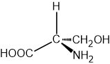
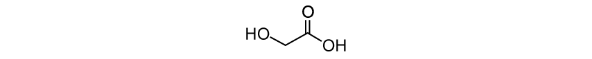
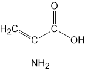

# Exam Questions — Predicting the Type of Polymerisation
**35. Polymerisation** · Cambridge (CIE) A-LEVEL chemistry (9701)
> Source: [https://www.savemyexams.com/a-level/chemistry/cie/25/topic-questions/](https://www.savemyexams.com/a-level/chemistry/cie/25/topic-questions/) · 3 questions across 1 sets

## Structured Questions (3 questions)

### Q1 — medium — 5 marks

**Q1** [2 marks]

Glycine and serine are amino acids with the systematic names 2-aminoethanoic acid and 2-amino-3-hydroxypropanoic acid respectively.

Draw the structural formulae of glycine and serine.

**Q1** [1 mark]

Serine exists as a pair of optical isomers. The three-dimensional structure of one optical isomer is shown in Fig. 3.2.

**Fig. 3.2**

Draw the three-dimensional structure of the other optical isomer of serine.

**Q1** [2 marks]

**Extract:**

Glycine and serine are amino acids with the systematic names 2-aminoethanoic acid and 2-amino-3-hydroxypropanoic acid respectively.

Glycine and serine can react to form condensation polymers containing ester and amide linkages.

State the names of the functional groups that react to form:

i) an ester linkage

[1]

ii) an amide linkage

[1]

### Q2 — medium — 8 marks

**Q2** [1 mark]

Glycolic acid polymerises to form polyglycolic acid (PGA). The structure of glycolic acid is shown in Fig. 1.1.

**Fig. 1.1**

State the systematic name of glycolic acid.

**Q2** [2 marks]

**Extract:**

Glycolic acid polymerises to form polyglycolic acid (PGA). The structure of glycolic acid is shown in Fig. 1.1.

Glycolic acid (HOCH₂COOH) contains two functional groups: a carboxylic acid group (–COOH) and a hydroxyl group (–OH).

State the type of polymerisation involved in the formation of PGA and state the name of the functional group formed between the monomers.

type of polymerisation: ..............................

functional group: ..............................

**Q2** [3 marks]

**Extract:**

Glycolic acid polymerises to form polyglycolic acid (PGA). The structure of glycolic acid is shown in Fig. 1.1.

Draw a section of the PGA polymer chain showing two repeat units. The ester linkages must be shown fully displayed.

Label one repeat unit on your diagram.

**Q2** [2 marks]

**Extract:**

State the type of polymerisation involved in the formation of PGA and state the name of the functional group formed between the monomers.

type of polymerisation: ..............................

functional group: ..............................

The type of polymerisation and functional group formed are:

- Type of polymerisation: condensation
- Functional group: ester

State whether PGA is biodegradable. Explain your answer.

### Q3 — medium — 4 marks

**Q3** [1 mark]

Fig. 2.1 shows the structure of dehydroalanine.

**Fig. 2.1**

State the name of the functional group in dehydroalanine that is not present in most naturally occurring amino acids.

**Q3** [1 mark]

**Extract:**

Fig. 2.1 shows the structure of dehydroalanine.

Displayed formula of dehydroalanine showing an amino group (–NH₂), a carboxylic acid group (–COOH), and an alkene group (C=CH₂)

Fig. 2.1

Dehydroalanine can undergo addition polymerisation.

Draw one repeat unit of the addition polymer formed by dehydroalanine.

**Q3** [2 marks]

The catalytic hydrogenation of dehydroalanine produces alanine, CH3CH(NH2)COOH.

Draw a section of the condensation polymer formed by alanine showing two repeat units. The peptide bond must be shown fully displayed.
