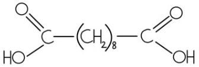
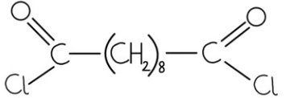
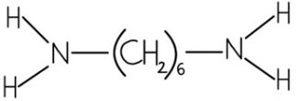
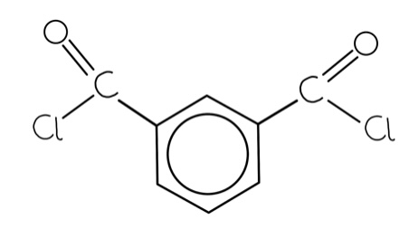
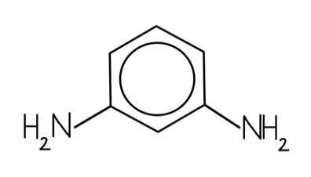
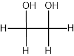
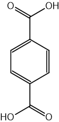
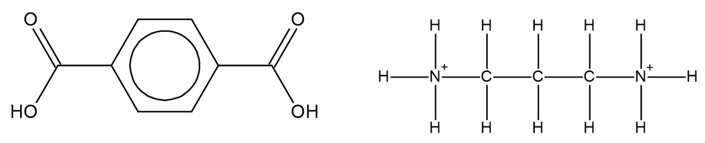
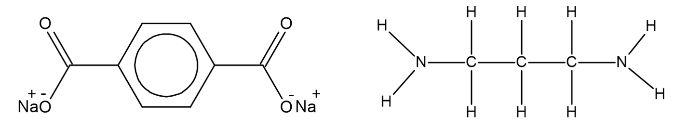

# Mark Schemes — Degradable Polymers
**35. Polymerisation** · Cambridge (CIE) A-LEVEL chemistry (9701)

## Structured Questions (4 questions)

### Q1
i) The skeletal formulae of the two monomers are:

Monomer 1 (dicarboxylic acid or diacyl chloride):

**OR**

Monomer 2 (diamine):

**[2 marks]**

> **[mark-scheme]**
> 1 mark for the correct skeletal formula of the dicarboxylic acid **OR** diacyl chloride
> 
> 1 mark for the correct skeletal formula of the diamine
> 
> ii) The type of polymerisation is:
> 
> - Condensation (polymerisation) **[1 mark]**

> **[exam-tip]**
> To identify the monomers of a polyamide, locate the amide linkage (–CO–NH–) in the polymer chain and break each bond. The carbonyl (C=O) side comes from the dicarboxylic acid or diacyl chloride; the nitrogen side comes from the diamine.
> 
> Remember: if you draw a diacyl chloride monomer, the by-product is HCl. If you draw a dicarboxylic acid monomer, the by-product is H2O.
> **[mark-scheme]**
> The reason why nylon clothing is easily damaged by strong acids and alkalis:
> 
> - The amide linkages in nylon can be hydrolysed by strong acids and strong alkalis **[1 mark]**
> - Hydrolysis breaks the polymer chains, destroying the structural integrity of the fabric / creating holes in the fabric **[1 mark]**

> **[exam-tip]**
> Nylon is a polyamide, which means it contains amide bonds (–CO–NH–). Strong acids and alkalis catalyse the hydrolysis of these bonds, breaking the long polymer chains into shorter fragments. Once the polymer chains are broken, the fabric loses its structural integrity.
> 
> This is why polyamide fabrics and equipment should be kept away from corrosive chemicals in the laboratory.
> **[mark-scheme]**
> The reason why Nomex has a higher melting point than nylon:
> 
> - The benzene rings make the Nomex chains more rigid and planar, allowing the chains to pack together more closely **[1 mark]**
> - This results in stronger intermolecular forces (van der Waals' forces / hydrogen bonding) between chains, requiring more energy to overcome **[1 mark]**

> **[exam-tip]**
> Melting point depends on the strength of intermolecular forces between polymer chains. The more closely chains can pack, the stronger the forces between them.
> 
> Nylon has a flexible aliphatic backbone, while Nomex contains rigid, planar benzene rings. The planar rings allow Nomex chains to pack together more tightly than the flexible chains in nylon, creating stronger van der Waals' forces and more hydrogen bonding between chains.
i) The skeletal formulae of the two Nomex monomers are:

Monomer 1 (dicarboxylic acid or diacyl chloride):

**OR**

Monomer 2 (diamine):

**[2 marks]**

> **[mark-scheme]**
> 1 mark for the correct skeletal formula of the dicarboxylic acid **OR** diacyl chloride monomer
> 
> 1 mark for the correct skeletal formula of the diamine monomer
> 
> ii) The formula of the by-product formed is:
> 
> - H2O
> **OR**
> HCl **[1 mark]**
> 
> The by-product must be consistent with the monomer drawn in part (i): H2O if a dicarboxylic acid was drawn; HCl if a diacyl chloride was drawn.

> **[exam-tip]**
> To draw the Nomex monomers, identify the amide linkage (–CO–NH–) in the repeat unit and break each bond. The carbonyl side comes from the dicarboxylic acid or diacyl chloride; the nitrogen side comes from the diamine.
> 
> Make sure the by-product you state is consistent with the monomer you drew. Drawing the dicarboxylic acid monomer gives H2O; drawing the diacyl chloride gives HCl.

### Q2
> **[mark-scheme]**
> i) Examples of a synthetic polyester and polyamide are:
> 
> - Polyester: Terylene / PET / polylactic acid (PLA) **[1 mark]**
> - Polyamide: nylon / Kevlar / Nomex **[1 mark]**
> 
> ii) A molecule commonly eliminated in condensation reactions is:
> 
> - Water / H2O
> **OR**
> Hydrochloric acid / HCl / hydrogen chloride **[1 mark]**

> **[exam-tip]**
> Although the term "condensation" implies water, the eliminated molecule is not always H2O. If a diacyl chloride is used as one of the monomers (instead of a dicarboxylic acid), HCl is eliminated instead.
The biodegradable polymers are A, B, and D. The completed table is:

| **Polymer** | **Biodegradable** |
|---|---|
| A | **Final answer:** **✓** |
| B | **Final answer:** **✓** |
| C |   |
| D | **Final answer:** **✓** |

**[2 marks]**

> **[mark-scheme]**
> 2 marks for ticks against A, B, and D only, with no tick against C
> 
> 1 mark for any two of A, B, and D ticked correctly

> **[exam-tip]**
> Polymers A, B, and D are condensation polymers (polyesters or polyamides). They contain hydrolysable ester or amide linkages, so microorganisms can break them down.
> 
> Polymer C is an addition polymer (a polyalkene). Addition polymers have no hydrolysable bonds and very strong C–C backbones, making them resistant to biodegradation.
The structural formulae of the two monomers used to form polymer **B** are:

Ethane-1,2-diol:

Benzene-1,4-dicarboxylic acid:

**[2 marks]**

> **[mark-scheme]**
> 1 mark for HOCH2CH2OH (ethane-1,2-diol)
> 
> 1 mark for the correct structural formula of benzene-1,4-dioic acid (terephthalic acid) **OR** the equivalent 1,4-diacyl chloride **OR** 1,4-diester

> **[exam-tip]**
> To identify the monomers from a polymer structure:
> 
> - Identify the type of linkage that forms the polymer (ester link for a polyester)
> - → Locate the ester group (–COO–) and break it apart
> - → The C=O side comes from the dicarboxylic acid (or diacyl chloride); the O side comes from the diol
> 
> Remember: if a diacyl chloride is used instead of the dicarboxylic acid, the by-product is HCl rather than H2O.

### Q3
> **[mark-scheme]**
> The amino acid with the highest pH in aqueous solution:
> 
> - Amino acid V **[1 mark]**
> - It has two amine / NH2 groups (which can be protonated) **OR** it has an additional amine / NH2 group on its side chain / R group (compared to T and U) **[1 mark]**

> **[exam-tip]**
> A higher pH means a more basic solution. Amino acids are amphoteric, but if the amine group count exceeds the carboxylic acid count, the amino acid produces a more basic solution.
> 
> Amino acid V has two –NH2 groups and one –COOH group, giving it a greater capacity to accept protons than T or U (which each have one –NH2 and one –COOH group). More proton acceptance means a higher pH.
> **[mark-scheme]**
> The number of different dipeptides that could be formed from amino acids T and U:
> 
> - 4 / four **[1 mark]**

> **[exam-tip]**
> A dipeptide contains two amino acid residues. The four possibilities when two different amino acids (T and U) are present are:
> 
> - T–T
> - U–U
> - T–U
> - U–T
> 
> Note that T–U and U–T are different dipeptides because the amino acid at the N-terminus differs. Students often forget the self-combinations (T–T and U–U) or forget that order matters.
> **[mark-scheme]**
> The reason why polypeptides are soluble in water despite their high C and H content:
> 
> - Hydrogen bonds form between the polar N–H and C=O groups (peptide bonds) in the polypeptide chain and water molecules **[1 mark]**
> - This allows the polypeptide to interact with and dissolve in water **[1 mark]**
> 
> Allow ion-dipole attractions between the NH3+ and CO2– end groups of the zwitterion and polar water molecules for the first marking point

> **[exam-tip]**
> Although the majority of a polypeptide chain is made up of C–C and C–H bonds (which are non-polar), the peptide bonds (–CO–NH–) contain polar C=O and N–H groups. These groups can form hydrogen bonds with water.
> 
> In addition, amino acids exist as zwitterions at physiological pH, with NH3+ and CO2– end groups. These charged groups form strong ion-dipole interactions with water molecules, further aiding solubility.

### Q4
> **[mark-scheme]**
> The meaning of the term hydrolysis is:
> 
> - The breakdown of a compound by reaction with water **[1 mark]**

> **[exam-tip]**
> The word *hydrolysis* comes from the Greek roots *hydro* (water) and *lysis* (breaking apart). Remembering this helps you recall the definition without memorising it word for word.
> **[mark-scheme]**
> The reagents and conditions for the acid hydrolysis of a polyamide are:
> 
> - Dilute acid (dilute HCl / dilute H2SO4) **[1 mark]**
> - Heat under reflux **[1 mark]**

> **[exam-tip]**
> Acid hydrolysis of a polyamide requires H+ ions as a catalyst and heat under reflux to supply enough energy to break the amide bonds. Without the acid catalyst, hydrolysis is extremely slow at any practical temperature.
The skeletal formulae of the acid hydrolysis products are:

**[2 marks]**

> **[mark-scheme]**
> 1 mark for the correct skeletal formula of the dicarboxylic acid
> 
> 1 mark for the correct skeletal formula of the diamine salt / protonated diamine

> **[exam-tip]**
> In acid hydrolysis, the amide bond (C–N) is broken by reaction with water. The amine groups are protonated by the acid to give –NH3+ groups, so the products are a dicarboxylic acid and the diamine salt (not the free diamine).
> 
> Compare this with base hydrolysis in part (d), where excess NaOH is used and the dicarboxylate salt and free diamine are formed instead.
The skeletal formulae of the base hydrolysis products are:

**[2 marks]**

> **[mark-scheme]**
> 1 mark for the correct skeletal formula of the dicarboxylate salt / sodium salt of the dicarboxylic acid
> 
> 1 mark for the correct skeletal formula of the free diamine

> **[exam-tip]**
> In base hydrolysis, excess NaOH is used. The alkaline conditions mean the amine groups are not protonated, so the free diamine is produced. The carboxylic acid groups are deprotonated by NaOH to give the dicarboxylate salt.
> 
> Contrast with acid hydrolysis in part (c): the products are a dicarboxylic acid and the diamine salt.
