# Mark Schemes — Organic Synthesis
**36. Organic Synthesis** · Cambridge (CIE) A-LEVEL chemistry (9701)

## Structured Questions (14 questions)

### Q1
> **[mark-scheme]**
> i) A possible halogenoalkane, D, that undergoes nucleophilic substitution in step 4 to form propan-1-ol:
> 
> Any **one** from:
> 
> - 1-chloropropane
> - 1-bromopropane
> - 1-iodopropane
> 
> **[1 mark]**
> 
> ii) The reagents and conditions for step 4 are:
> 
> - Aqueous sodium hydroxide / NaOH (aq)
> **OR**
> Aqueous potassium hydroxide / KOH (aq) **[1 mark]**
> - Heat / heat under reflux **[1 mark]**

> **[exam-tip]**
> For part i): the halogen must be on carbon-1 (not carbon-2) to give propan-1-ol as the product. Any halide (Cl, Br, or I) is accepted.
> 
> For part ii): the NaOH must be aqueous, not ethanolic/alcoholic. Alcoholic NaOH favours elimination (forming an alkene) rather than substitution.
> **[mark-scheme]**
> The identity of the alkene, C, in **Fig. 3.1** is:
> 
> - Propene **[1 mark]**

> **[exam-tip]**
> Alkene C can be deduced from either the final product (propan-1-ol) or from a correct answer to part (a)(i). Both have a 3-carbon chain, so the alkene formed in step 3 must be propene as it is the only 3-carbon alkene.
> **[mark-scheme]**
> The electrophilic addition reaction in step 3 might not be favourable in an industrial multistep reaction because:
> 
> - The reaction produces more than one product / a major and minor product
> **OR**
> The products would require purification / separation
> **OR**
> The reaction has low atom economy (as a second / unwanted product is formed) **[1 mark]**

> **[exam-tip]**
> Electrophilic addition to an unsymmetrical alkene (such as propene) produces both Markovnikov and anti-Markovnikov products. In industrial synthesis, reactions with low atom economy are undesirable because they produce significant amounts of waste by-products.
> 
> Note that the question excludes economic considerations, so answers about cost are not accepted.

### Q2
> **[mark-scheme]**
> The functional groups present in compound **G** are:
> 
> - Phenol **[1 mark]**
> - Ketone **[1 mark]**

> **[exam-tip]**
> When an -OH group is bonded directly to a benzene ring it is a phenol group, not an alcohol group.
> 
> The C=O group in the carbon chain (not on the ring) is a ketone group.
The completed table is:

| **Reagent** | **Observation** | **Structure of organic product** | **Type of reaction** |
|---|---|---|---|
| Na (s) | **Final answer:** **Effervescence / bubbles / fizzing** | 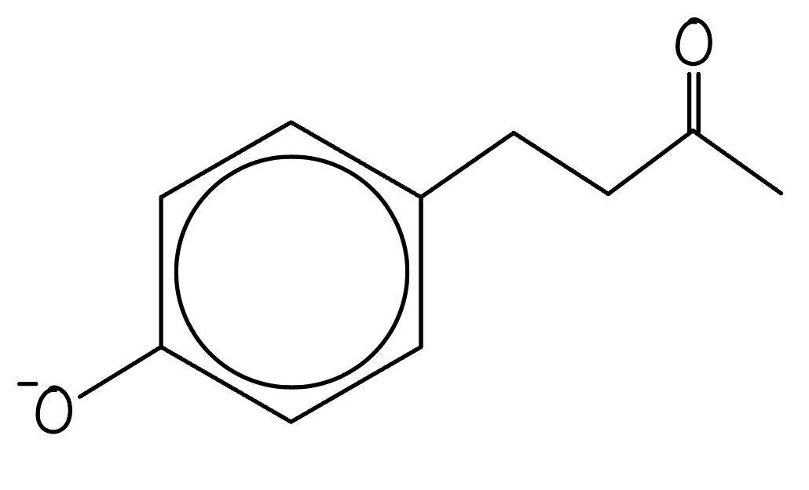 | **Final answer:** **Redox** |
| Br2 (aq) | **Final answer:** **Decolourises / white precipitate** | 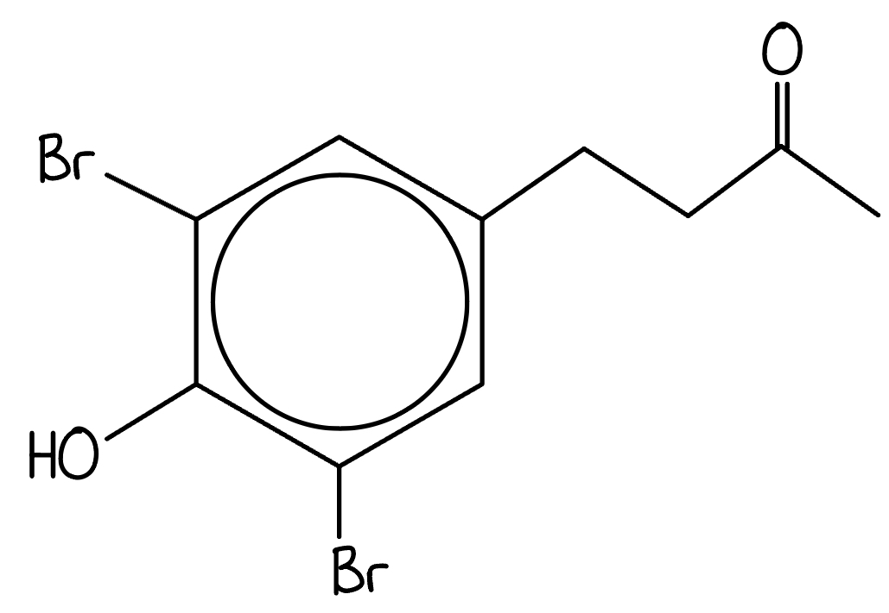 | **Final answer:** **Electrophilic substitution** |
| I2 / NaOH (aq) | **Final answer:** **Yellow precipitate (CHI****3****)** | 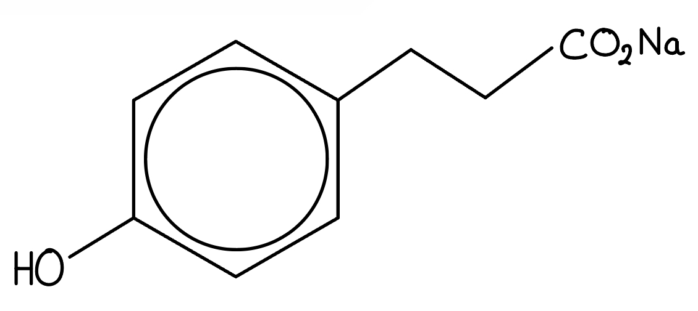 | **Final answer:** **Oxidation** |

**[9 marks]**

> **[mark-scheme]**
> 1 mark for effervescence / bubbles observed with Na (s)
> 
> 1 mark for correct product structure from Na (s) reaction
> 
> 1 mark for redox as the reaction type for Na (s)
> 
> 1 mark for bromine decolourising or white precipitate observed with Br2 (aq)
> 
> 1 mark for correct dibrominated product structure from Br2 (aq)
> 
> 1 mark for electrophilic substitution as the reaction type for Br2 (aq)
> 
> 1 mark for yellow precipitate (CHI3) observed with I2 / NaOH (aq)
> 
> 1 mark for correct product structure from I2 / NaOH (aq) — must show both the carboxylate group (-COO-Na+ / -COONa) from the iodoform reaction **AND **the phenoxide group (-O-Na+ / -ONa) from deprotonation by NaOH
> 
> 1 mark for oxidation as the reaction type for I2 / NaOH (aq)

> **[exam-tip]**
> Na (s) reacts with the phenolic -OH group, breaking the O–H bond to form the phenoxide -O-Na+.
> 
> Bromine water reacts with the phenol group via electrophilic substitution. The -OH group is 2,4,6-directing; however, position 4 is occupied by the ketone side chain, so bromine substitutes at positions 2 and 6.
> 
> I2 / NaOH (aq) is used in the iodoform reaction. The methyl ketone group reacts: first, all three H-atoms on the CH3 group are replaced by iodine to form a -CI3 group; the alkaline solution then hydrolyses this intermediate to give the carboxylate salt (-COONa) and yellow CHI3 precipitate. Under alkaline conditions, the phenol is simultaneously deprotonated to give the phenoxide (-ONa). Both groups must be shown in the product structure.
i) The structures are:

Compound **J**:

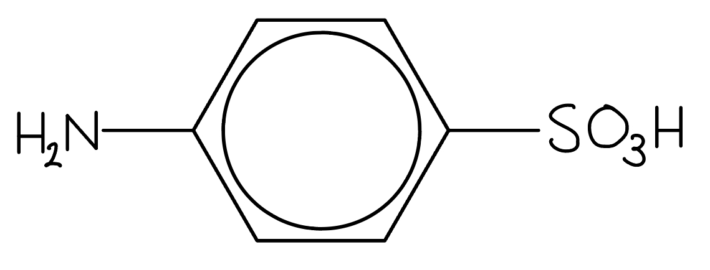

Compound **K**:

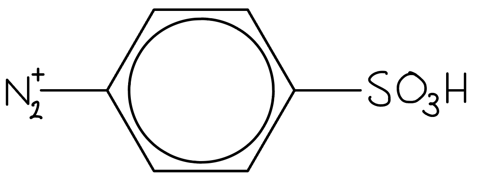

**[2 marks]**

> **[mark-scheme]**
> 1 mark for the correct structure of compound **J**
> 
> 1 mark for the correct structure of compound **K**

> **[mark-scheme]**
> ii) The reagents and conditions for each step are:
> 
> Step 1:
> 
> - NaNO2 and HCl
> **OR**
> HNO2 (formed in situ) **[1 mark]**
> - Temperature below 10 °C **[1 mark]**
> 
> Step 2:
> 
> - NaOH(aq) / alkaline conditions **[1 mark]**

> **[exam-tip]**
> Compound **J** is an aryl primary amine. For diazotisation (step 1), the amine is converted to a diazonium ion (-N2+) using NaNO2 and HCl.
> 
> HNO2 (nitrous acid) must be formed in situ as it is unstable. Using NaNO2 and HCl generates HNO2 in the reaction vessel.
> 
> The reaction must be kept below 10 °C to prevent decomposition of the diazonium salt.
> 
> For the coupling step (step 2), the diazonium salt **K** reacts with compound **G** under alkaline conditions. NaOH converts the phenol in **G** to a phenoxide ion, which is a much more reactive coupling partner, directing the azo group to the ortho or para position.
> **[mark-scheme]**
> Dye **H** is very stable because:
> 
> - Delocalised electrons in the π bonding systems of the two benzene rings **[1 mark]**
> - The delocalisation is extended through the -N=N- group, which acts as a bridge between the two rings **[1 mark]**

> **[exam-tip]**
> Azo dyes contain two arene rings connected by the -N=N- (azo) group.
> 
> The π electrons are delocalised across both benzene rings and the azo bridge, spreading the electron density over the entire conjugated system.
> 
> This extended delocalisation makes the molecule very stable, as the energy is distributed over a larger area rather than being confined to individual bonds.

### Q3
The functional groups present in farnesol and their locations are:

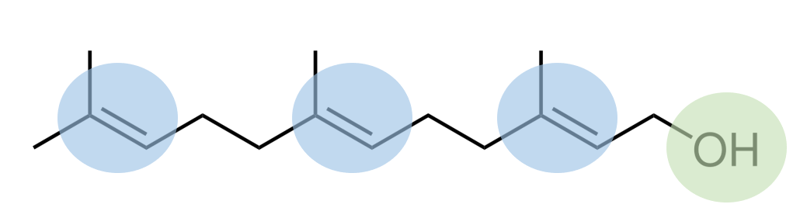

**[2 marks]**

> **[mark-scheme]**
> 1 mark for alkene / C=C correctly identified on any C=C bond
> 
> 1 mark for (primary) alcohol / hydroxyl / –OH correctly identified at the terminal CH2OH group

> **[exam-tip]**
> Farnesol contains three C=C (alkene) bonds and one –OH (primary alcohol) group. Any one of the three alkene positions is accepted.
> 
> Both the family names (alkene, alcohol) and the group names (alkenyl, hydroxyl) are accepted.
> **[mark-scheme]**
> When farnesol is shaken with bromine water:
> 
> - Bromine water decolourises **[1 mark]**

> **[exam-tip]**
> This is a standard test for unsaturated compounds containing an alkene group. All alkenes decolourise bromine water.
> 
> Use only a small amount of bromine water as using too much may result in fading rather than complete decolourisation.
> **[mark-scheme]**
> A functional group present in the product of Step 1 but not in farnesol is:
> 
> - Carboxylic acid **[1 mark]**

> **[exam-tip]**
> The reagent in Step 1 is acidified potassium dichromate, an oxidising agent. A primary alcohol is oxidised first to an aldehyde, then to a carboxylic acid when excess oxidant is used.
> 
> For example:
> 
> CH3CH2OH + 2[O] → CH3COOH + H2O
> **[mark-scheme]**
> A functional group present in the final product but not in farnesol is:
> 
> - Ester **[1 mark]**

> **[exam-tip]**
> The reagents in Step 2 are methanol and concentrated sulfuric acid — the conditions for Fischer esterification. This converts the carboxylic acid formed in Step 1 into a methyl ester.
> 
> For example:
> 
> CH3COOH + CH3OH → CH3COOCH3 + H2O

### Q4
> **[mark-scheme]**
> The systematic names of compounds A, B and C are:
> 
> - Compound A = benzoic acid **[1 mark]**
> - Compound B = phenylamine
> **OR**
> aminobenzene **[1 mark]**
> - Compound C = 1,3-dimethylbenzene **[1 mark]**
> 
> 'Aniline' is not accepted for compound B.

> **[exam-tip]**
> Compound A (benzoic acid): the functional groups are the benzene ring and the carboxylic acid. The –COOH group provides the –oic acid suffix.
> 
> Compound B (phenylamine or aminobenzene): the –NH2 group can be named as an amino- prefix (aminobenzene) or a phenyl-amine suffix (phenylamine). Both are accepted. The common name aniline is not a systematic name and is not accepted.
> 
> Compound C (1,3-dimethylbenzene): both methyl groups must be numbered. Number positions to give the lowest possible locants.
> **[mark-scheme]**
> The positions activated for electrophilic substitution are:
> 
> - Compound A: 3
> **AND**
> 5 **[1 mark]**
> - Compound B: 2
> **AND**
> 4
> **AND**
> 6 **[1 mark]**

> **[exam-tip]**
> The –COOH group in compound A is electron-withdrawing. It deactivates the ring overall and directs electrophiles to the meta positions (3 and 5). Both positions 3 and 5 are required for the mark.
> 
> The –NH2 group in compound B is electron-donating. It activates the ring and directs electrophiles to the ortho (2, 6) and para (4) positions. All three positions 2, 4, and 6 are required for the mark.
> **[mark-scheme]**
> i) The reagents for steps 1–4 are:
> 
> - Step 1: (hot alkaline) potassium manganate(VII) / KMnO4 **[1 mark]**
> - Step 2: (dilute) hydrochloric acid / HCl **[1 mark]**
> - Step 3: concentrated sulfuric acid / H2SO4
> **AND**
> concentrated nitric acid / HNO3 **[1 mark]**
> - Step 4: tin / Sn
> **AND**
> hydrochloric acid / HCl **[1 mark]**

ii) The skeletal formulae of compounds D and E are:

Compound D:

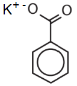

Compound E:

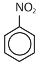

**[2 marks]**

> **[mark-scheme]**
> 1 mark for correct skeletal formula of compound D (potassium benzoate)
> 
> 1 mark for correct skeletal formula of compound E (nitrobenzene)

> **[exam-tip]**
> Route 1 (methylbenzene → benzoic acid):
> 
> - Step 1: hot alkaline KMnO4 oxidises the methyl side chain of methylbenzene to give the carboxylate salt, potassium benzoate (compound D)
> - Step 2: dilute HCl acidifies the carboxylate to give benzoic acid (compound A)
> 
> Route 2 (benzene → phenylamine):
> 
> - Step 3: concentrated H2SO4 and concentrated HNO3 generate the nitronium ion (NO2+), which reacts with benzene by electrophilic substitution to form nitrobenzene (compound E)
> - Step 4: Sn and HCl reduce the nitro group to give phenylamine / aminobenzene (compound B)
> **[mark-scheme]**
> i) One set of reagents and conditions for both steps:
> 
> - Reagents: chloromethane / CH3Cl **[1 mark]**
> - Conditions: aluminium chloride / aluminium trichloride / AlCl3 (catalyst) **[1 mark]**
> 
> ii) Step 2 is less likely to occur because:
> 
> - The methyl group on methylbenzene activates positions 2, 4 and 6 (ortho and para), not position 3
> **OR**
> The methyl group does not activate the 3-position (meta to the methyl group) **[1 mark]**

> **[exam-tip]**
> Both steps are Friedel-Crafts alkylation reactions, requiring an alkyl halide and an AlCl3 Lewis acid catalyst. The AlCl3 generates a carbocation electrophile from the chloromethane.
> 
> Step 2 is unfavourable because the methyl group in methylbenzene is an electron-donating, ortho/para director. Position 3 is meta to the existing methyl group and is not activated, making the formation of 1,3-dimethylbenzene (compound C) unlikely by this route.

### Q5
> **[mark-scheme]**
> The reagents and conditions for each step are:
> 
> Step 1:
> 
> - Ethanolic / alcoholic sodium hydroxide / NaOH
> **OR**
> Ethanolic / alcoholic potassium hydroxide / KOH **[1 mark]**
> - Heated under reflux **[1 mark]**
> 
> Step 2:
> 
> - Steam / water vapour / H2O (g) at 300 °C **[1 mark]**
> - Concentrated sulfuric acid / H2SO4 catalyst
> **OR**
> Concentrated phosphoric acid / H3PO4 catalyst **[1 mark]**
> 
> Step 3:
> 
> - Acidified potassium dichromate(VI) / K2Cr2O7 solution, heat / distillation **[1 mark]**

> **[exam-tip]**
> Step 1 is not completed in acidic conditions. Alkaline / basic conditions with an ethanolic base give the elimination reaction (forming propene). If aqueous conditions were used instead, nucleophilic substitution would give propan-2-ol directly.
> 
> Step 2 converts propene into propan-2-ol via hydration. This requires steam, an acid catalyst, and a temperature of 300 °C (and approximately 7 MPa pressure).
> 
> Step 3 is the oxidation of propan-2-ol (a secondary alcohol) to propanone (a ketone) using acidified potassium dichromate(VI). You do not need to specify distillation, as a secondary alcohol oxidises only to a ketone and no further with acidified potassium dichromate.
> **[mark-scheme]**
> One reaction to replace steps 1 and 2 is:
> 
> - Nucleophilic substitution **[1 mark]**
> - Aqueous sodium hydroxide / NaOH(aq), heated under reflux **[1 mark]**

> **[exam-tip]**
> The synthesis goes from 2-bromopropane to propan-2-ol. The bromine has been substituted by a hydroxyl group.
> 
> Aqueous conditions favour nucleophilic substitution, while ethanolic conditions favour elimination. Since we need a direct conversion to the alcohol, aqueous NaOH heated under reflux is correct.
> 
> This replaces the two-step elimination/hydration route with a single nucleophilic substitution step.
> **[mark-scheme]**
> The equation for the reaction of compound **B** with an oxidising agent [O] to form propanone:
> 
> - CH3CHOHCH3 + [O] → CH3COCH3 + H2O **[1 mark]**

> **[exam-tip]**
> The question asks for structural formulae, not skeletal formulae.
> 
> Compound **B** is propan-2-ol with the structural formula CH3CHOHCH3.
> 
> Propanone has the structural formula CH3COCH3.
> 
> The oxidising agent [O] removes hydrogen from the secondary alcohol to form a ketone, with water as the second product.

### Q6
> **[mark-scheme]**
> The functional groups present in morphine are:
> 
> Any **two** from (1 mark for each point):
> 
> - alcohol / hydroxyl
> - alkene / C=C
> - phenol
> - (tertiary) amine
> - ether
> 
> **[2 marks]**

> **[exam-tip]**
> The structure of morphine is given in **Fig. 1.1**. Work through the structure systematically, identifying each distinct functional group in turn.
> 
> You are not expected to know the ether group, but it is accepted. The locations of all functional groups are shown below:
> **[mark-scheme]**
> The functional group present in heroin but not in morphine is:
> 
> - Ester **[1 mark]**

> **[exam-tip]**
> Heroin is synthesised from morphine by converting the –OH groups to ester groups using an acyl compound. Ester groups have the general structure RCOOR.
> 
> The two ester groups in heroin are shown below:
> **[mark-scheme]**
> The reagents and conditions needed to convert morphine into heroin are:
> 
> - Ethanoic anhydride / (CH3CO)2O
> **OR**
> Ethanoyl chloride / CH3COCl **[1 mark]**
> - Heat / heat under reflux (if ethanoic anhydride)
> **OR**
> Room temperature (if ethanoyl chloride) **[1 mark]**
> 
> Allow error carried forward if the conditions are consistent with the reagent given.
> 
> Ethanoic acid / CH3COOH is not accepted.

> **[exam-tip]**
> This reaction converts the –OH groups in morphine to ester groups. Ethanoic acid cannot esterify phenol groups, a more reactive acyl compound is needed.
> 
> Ethanoyl chloride reacts at room temperature because acyl chlorides are highly reactive. Ethanoic anhydride requires heat under reflux.
> **[mark-scheme]**
> When morphine and heroin are each separately reacted with warm acidified potassium dichromate solution:
> 
> - Morphine: solution changes from orange to green **[1 mark]**
> - Heroin: no change / solution remains orange **[1 mark]**
> - Morphine contains a secondary alcohol group (which can be oxidised) **[1 mark]**

> **[exam-tip]**
> Always state both the colour before and the colour after when describing the outcome of a colour change test.
> 
> The secondary alcohol group at C6 of morphine is oxidised by acidified potassium dichromate. Heroin has no free alcohol group, both –OH groups in morphine have been converted to esters in the synthesis of heroin.

### Q7
> **[mark-scheme]**
> The reagents and conditions for each step are:
> 
> - Step 1: (CH3)2CHCl and AlCl3 / CH3CH=CH2 and AlCl3 / heat **[1 mark]**
> - Step 2: CH3COCl and AlCl3 / heat **[1 mark]**
> - Step 3: NaOH and I2 / Cl2 / Br2, then H+ **[1 mark]**
> - Step 4: LiAlH4 in dry ether **[1 mark]**

> **[exam-tip]**
> Steps 1 and 2 both involve Friedel-Crafts electrophilic substitution of the benzene ring.
> 
> Step 1 adds an isopropyl group (alkylation). A halogen carrier catalyst such as AlCl3 is needed to generate the carbocation electrophile:
> 
> AlCl3 + (CH3)2CHCl → AlCl4- + (CH3)2CH+
> 
> Step 2 adds an acyl group (acylation). An acyl chloride and halogen carrier are required:
> 
> AlCl3 + CH3COCl → AlCl4- + CH3CO+
> 
> Step 3 converts the methyl ketone to a carboxylic acid via the haloform (iodoform) reaction:
> 
> R-CO-CH3 + 3I2 + 4OH- → CHI3 + RCOO- + 3I- + 3H2O
> 
> The carboxylate RCOO- is then acidified with H+ to give RCOOH.
> 
> Step 4 uses LiAlH4 in dry ether to reduce the carboxylic acid to a primary alcohol.
> **[mark-scheme]**
> The mechanism for step 2 and the type of reaction in step 4 are:
> 
> - Mechanism of step 2: electrophilic substitution **[1 mark]**
> - Type of reaction in step 4: reduction **[1 mark]**

> **[exam-tip]**
> Arenes undergo electrophilic substitution, in which a hydrogen atom on the benzene ring is replaced by an attacking electrophile.
> 
> Make sure you know the mechanism for this reaction.
> 
> The formation of a primary alcohol from a carboxylic acid involves reduction.
The reaction mechanism for step 2 is:

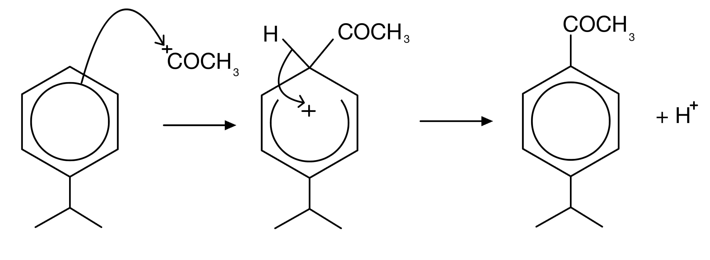

**[4 marks]**

> **[mark-scheme]**
> 1 mark for a curly arrow from the ring system to the positively charged carbon of CH3CO+
> 
> 1 mark for the correct arenium intermediate structure with a positive charge, the horseshoe covering more than half the ring but not extending past carbons 2 and 6
> 
> 1 mark for a curly arrow from the C–H bond back into the ring
> 
> 1 mark for the correct benzene product AND H+ shown
> 
> The origin and destination of curly arrows must be clear and unambiguous, or the marks are not awarded.

> **[exam-tip]**
> Common mistakes in benzene electrophilic substitution mechanisms:
> 
> - Not drawing the hydrogen that is being substituted
> - Drawing the substituted hydrogen in the wrong position
> - Forgetting to place the positive charge in the correct position on the intermediate
> - Drawing the ring inside the intermediate structure incorrectly
> 
> The general mechanism: the electrophile attacks the pi system of benzene, forming a positively charged arenium (carbocation) intermediate. A curly arrow then shows the C–H bond electrons returning to restore aromaticity, releasing H+.
> **[mark-scheme]**
> The number of 13C NMR peaks in cuminyl alcohol is:
> 
> - 7 peaks **[1 mark]**

> **[exam-tip]**
> Look for symmetry within the molecule to identify equivalent carbon environments, as these give only one peak between them.
> 
> Cuminyl alcohol (4-isopropylbenzyl alcohol) has 7 distinct carbon environments:
> 
> - C1: ring carbon bearing the CH2OH group
> - C2 and C6: equivalent ring carbons (ortho to CH2OH, meta to isopropyl)
> - C3 and C5: equivalent ring carbons (ortho to isopropyl)
> - C4: ring carbon bearing the isopropyl group
> - CH2: the methylene carbon of CH2OH
> - CH: the methine carbon of the isopropyl group
> - CH3: both methyl groups of the isopropyl group are equivalent

### Q8
> **[mark-scheme]**
> The functional groups in noradrenaline are:
> 
> Any **three** from (1 mark for each point):
> 
> - Phenol
> - Secondary alcohol
> - Primary amine / amine
> - Arene / aryl / benzene
> 
> **[3 marks]**

> **[exam-tip]**
> Noradrenaline contains two phenolic OH groups attached directly to the benzene ring, a secondary alcohol (the -CH(OH)- group in the side chain, where the carbon is bonded to the ring, an H, and the CH2NH2 group), and a primary amine (-CH2-NH2).
> 
> The arene / benzene ring itself is also a functional group and is accepted as an answer.
Compound **Z** is:

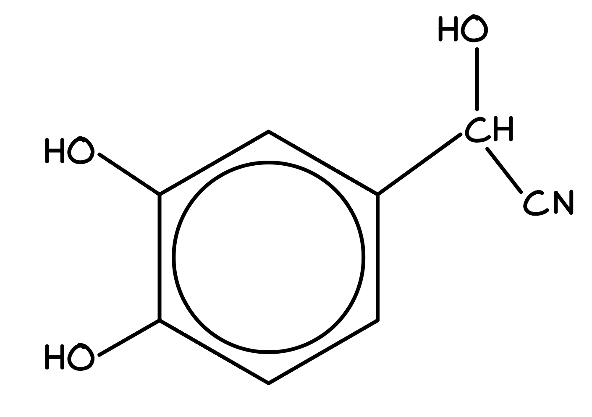

**[1 mark]**

> **[mark-scheme]**
> 1 mark for the correct structure of compound **Z**
> 
> Reagents for steps 1 and 2:
> 
> - Step 1: HCN / NaCN / KCN
> **OR**
> HCN and base **[1 mark]**
> - Step 2: H2 and Ni
> **OR**
> LiAlH4 in dry ether
> **OR**
> Na and ethanol **[1 mark]**

> **[exam-tip]**
> To extend the carbon chain from dihydroxybenzaldehyde to noradrenaline, a nitrile group (CN) must be added to the carbonyl carbon via nucleophilic addition.
> 
> The intermediate Z is a cyanohydrin (an α-hydroxy nitrile).
> 
> Reduction of the nitrile group then converts it to the primary amine group in noradrenaline.
The structure of the product is:

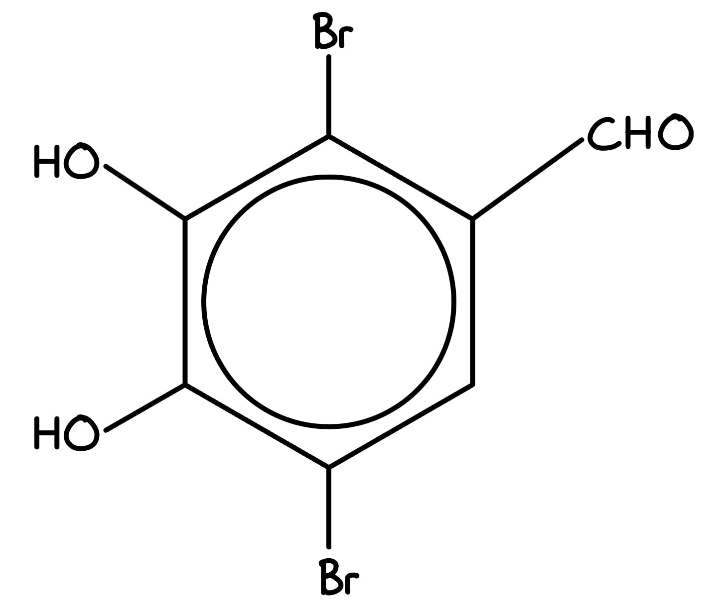

**OR**

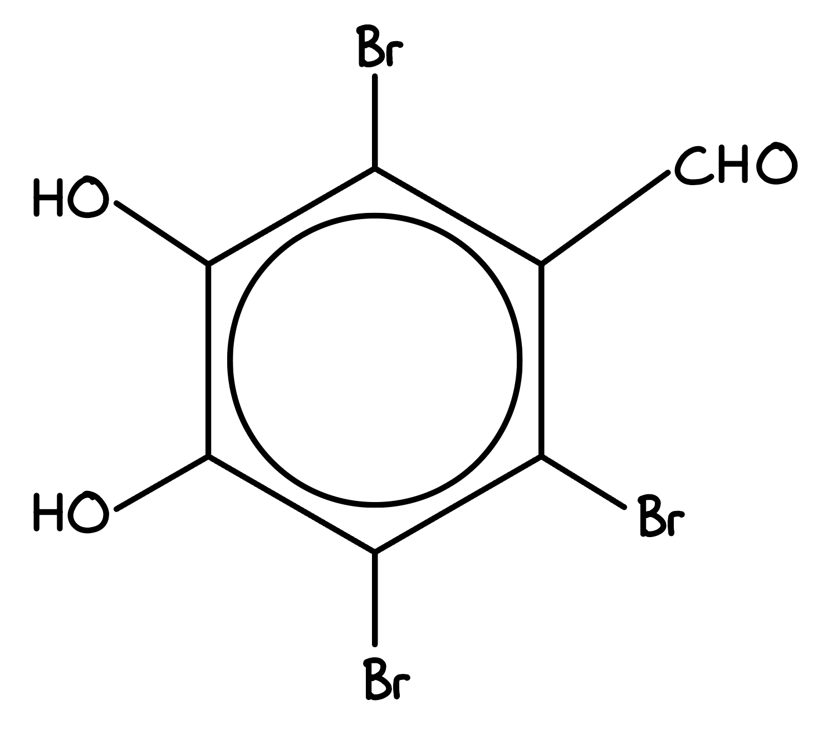

**[1 mark]**

> **[mark-scheme]**
> 1 mark for the correct brominated product structure
> 
> Either 2 or 3 bromine atoms substituted into the ring are accepted.
> 
> The observation when dihydroxybenzaldehyde is shaken with Br2(aq):
> 
> - Bromine solution decolourises / changes from orange to colourless
> **OR**
> A white precipitate forms **[1 mark]**

> **[exam-tip]**
> Phenols react readily with bromine solution at room temperature via electrophilic substitution, decolourising the orange bromine solution.
> 
> Dihydroxybenzaldehyde has two phenolic OH groups, which strongly activate the ring towards electrophilic substitution. More than one hydrogen atom on the ring can be substituted because both OH groups direct to adjacent positions.

### Q9
> **[mark-scheme]**
> The synthesis of ethanal from ethane:
> 
> i) Step 1: Ethane → chloroethane
> 
> - Reagent: Cl2 / chlorine **[1 mark]**
> - Conditions: UV light / high temperature **[1 mark]**
> - Reaction type: free radical substitution / halogenation **[1 mark]**
> 
> ii) Step 2: Chloroethane → ethanol
> 
> - Reagent: aqueous NaOH / NaOH(aq) / aqueous KOH / KOH(aq) **[1 mark]**
> - Conditions: heat under reflux **[1 mark]**
> - Reaction type: nucleophilic substitution / hydrolysis **[1 mark]**
> 
> iii) Step 3: Ethanol → ethanal
> 
> - Reagent: acidified potassium dichromate(VI) / K2Cr2O7
> **OR**
> Acidified potassium manganate(VII) / KMnO4 **[1 mark]**
> - Conditions: distillation **[1 mark]**
> - Reaction type: oxidation **[1 mark]**

> **[exam-tip]**
> The conversion of an alkane to a haloalkane is hard to control industrially, as it is difficult to prevent multiple products from forming. It is included here to test your ability to apply knowledge of organic reactions to synthesis problems.
> 
> The mechanism types are shown in brackets in the mark scheme but are not essential for the mark.
> 
> The dichromate ion, Cr2O72-, is the oxidising species, so sodium dichromate(VI) is also an acceptable reagent for step 3.
> **[mark-scheme]**
> Suitable reagents and conditions for the synthesis of compound **A** via step 1:
> 
> - K2Cr2O7 / potassium dichromate(VI)
> **OR**
> KMnO4 / potassium manganate(VII) **[1 mark]**
> - H2SO4 / acidified / with acid **[1 mark]**
> - Oxidation **[1 mark]**
> 
> Sodium dichromate(VI) is also accepted for the first marking point.
> 
> Ions such as Cr2O72- are not accepted as a reagent must be something that can be found on a laboratory shelf.

> **[exam-tip]**
> An ester is commonly made from a carboxylic acid and an alcohol.
> 
> A carboxylic acid cannot be produced from a ketone, so compound **A** must come from the oxidation of an aldehyde.
> 
> The question asks for the names of reagents, not ions. Writing Cr2O72- alone would not score the mark.
> **[mark-scheme]**
> i) The name of the molecule produced from step 2 is:
> 
> - Butan-2-ol **[1 mark]**
> 
> ii) The type of reaction in step 2 and suitable reagents:
> 
> - Reduction **[1 mark]**
> - LiAlH4 / lithium aluminium hydride / lithium tetrahydridoaluminate
> **OR**
> NaBH4 / sodium borohydride / sodium tetrahydridoborate **[1 mark]**

> **[exam-tip]**
> The reduction of a ketone produces a secondary alcohol.
> 
> This secondary alcohol is required to produce the branched chain ester in part **(a)**.
> 
> LiAlH4 is much more reactive than NaBH4, making it more hazardous to use in the laboratory. For the purposes of this question, both reagents are suitable.
The skeletal formula of the ester formed from the reaction scheme is:

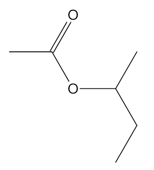

**[1 mark]**

> **[mark-scheme]**
> 1 mark for the correct skeletal formula of the branched ester

> **[exam-tip]**
> When drawing esters, the acid provides the -COO- portion of the ester link, while the alcohol provides the oxygen with its attached carbon chain, with elimination of water.

### Q10
The structures of the organic compounds **A**, **B**, **C** and **D** are:

Compound **A**

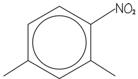

Compound **B**

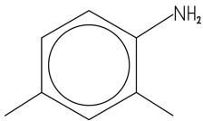

Compound **C**

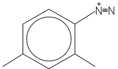

Compound **D**

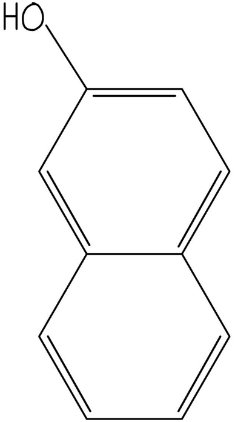

**[4 marks]**

> **[mark-scheme]**
> 1 mark for correct structure of compound **A**
> 
> 1 mark for correct structure of compound **B**
> 
> 1 mark for correct structure of compound **C** including positive charge on the correct nitrogen atom
> 
> 1 mark for correct structure of compound **D**

> **[exam-tip]**
> The first reaction with concentrated sulfuric acid and concentrated nitric acid is nitration. From the structure of the final product, the nitro group must add to carbon-4.
> 
> The second reaction with Sn / concentrated HCl is the reduction of a –NO2 group to a –NH2 group.
> 
> The third reaction with NaNO2 and HCl below 10 °C is the formation of a diazonium ion from the –NH2 group.
> 
> Compound **D** can be deduced from the structure of compound **C** and the final Sudan II product. Identify the aromatic portion that forms the azo link with the diazonium salt of compound **C**.
> **[mark-scheme]**
> i) The equation for the formation of the nitronium ion is:
> 
> - HNO3 + 2H2SO4 → NO2+ + H3O+ + 2HSO4– **[1 mark]**

ii) The mechanism for the electrophilic substitution nitration of 1,3-dimethylbenzene is:

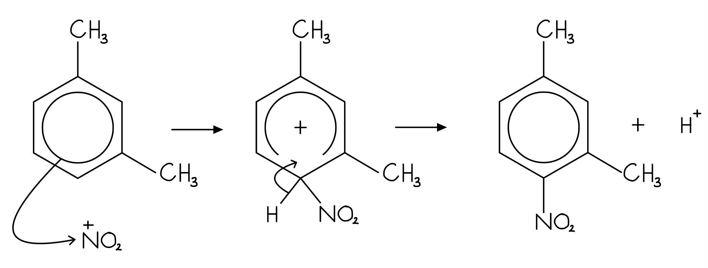

**[3 marks]**

> **[mark-scheme]**
> 1 mark for curly arrow from the π ring to the NO2+ electrophile
> 
> 1 mark for correct intermediate structure
> 
> 1 mark for curly arrow from the C–H bond back to the + within the ring AND H+ as a product

> **[exam-tip]**
> The reaction of 1,3-dimethylbenzene with concentrated sulfuric acid and concentrated nitric acid is nitration. The appropriate reactive species is the nitronium ion, NO2+.
> 
> The mechanism continues as a standard electrophilic substitution reaction:
> 
> - The electrophile bonds to the benzene ring
> - This forms an intermediate with a partially delocalised electron system, shown as a horseshoe with a + inside
> - The intermediate loses a proton, restoring the delocalised electron system and regenerating the catalyst
> 
> Extra marking points for electrophilic substitution mechanisms:
> 
> - The + must be on the nitrogen atom in the NO2+ electrophile
> - The first arrow must start touching the ring, not start inside the ring
> - The horseshoe in the ring must be centred about the carbon that is attacked and not extend past the adjacent carbons
The diagram showing the directing effect of the methyl groups on the benzene ring is:

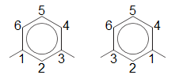

> **[mark-scheme]**
> 1,3-dimethyl-2-nitrobenzene is likely to be the more abundant product:
> 
> - Methyl / CH3 groups direct attacks to the 2, 4 and 6 positions (on the ring) **[1 mark]**
> 
> - Position 2 is ortho to both methyl groups (doubly activated), whereas position 5 is meta to both methyl groups **[1 mark]**

> **[exam-tip]**
> Alkyl groups activate the 2, 4 and 6 positions on a benzene ring.
> 
> As the diagram shows, position 2 is ortho to both methyl groups (at C-1 and C-3), so it is doubly activated and is a more reactive position than position 5.
> 
> Position 5 is meta to both methyl groups and is therefore not preferentially activated, making 1,3-dimethyl-5-nitrobenzene the less abundant isomer.
> 
> Although mononitration is theoretically possible on positions 2, 4, 5 and 6, it is most likely at positions 2, 4 and 6 (those activated by both methyl groups).

### Q11
> **[mark-scheme]**
> The other functional groups present in each molecule are:
> 
> - Ibuprofen: carboxylic acid **[1 mark]**
> - Paracetamol: phenol
> **AND**
> (Secondary) amide **[1 mark]**

> **[exam-tip]**
> An OH group attached to an arene ring changes the chemistry of the OH group completely.
> 
> This is why it is termed phenol rather than alcohol.
> 
> Paracetamol contains a secondary amide, although you do not need this classification to score the mark. A primary amide would have two hydrogens on the nitrogen atom.
> **[mark-scheme]**
> i) One similarity and one difference in the physical or chemical properties between the two enantiomers are:
> 
> - Similarity: enantiomers have identical physical and chemical properties
> **AND**
> Difference: the ability to rotate plane-polarised light / potential biological activity **[1 mark]**
> 
> ii) The meaning of racemic mixture:
> 
> - A mixture containing equal amounts / proportions of each enantiomer **[1 mark]**

> **[exam-tip]**
> Enantiomers are mirror-image molecules containing a chiral carbon, which is a carbon atom with four different groups attached.
> 
> Another term for racemic mixture is a racemate.
The completed table is:

| **reagent** | **organic product structure** | **type of reaction** |
|---|---|---|
| LiAlH4 | 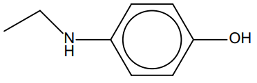 | **Final answer:** **Reduction** |
| An excess of Br2(aq) | 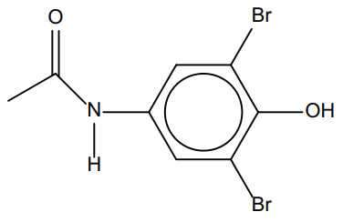 | **Final answer:** **Electrophilic substitution** |

**[3 marks]**

> **[mark-scheme]**
> 1 mark for the correct organic product structure from LiAlH4
> 
> 1 mark for the correct organic product structure from excess Br2(aq) showing bromine at positions 2 and 6
> 
> 1 mark for both correct reaction types

> **[exam-tip]**
> Lithium aluminium hydride, LiAlH4, is a reducing agent. Look for functional groups that can be reduced.
> 
> Amides can be reduced to amines. Paracetamol contains a secondary amide, so a secondary amine is formed.
> 
> Due to the phenolic OH group, bromination is directed to the 2 and 6 positions (ortho to OH). The para position (position 4) is already occupied by the amide group, so bromination does not occur there.
> **[mark-scheme]**
> i) The equation to show how AlCl3 generates the electrophile:
> 
> - CH3COCl + AlCl3 → CH3CO+ + AlCl4- **[1 mark]**

ii) The mechanism for the conversion of **X** into **Y** is:

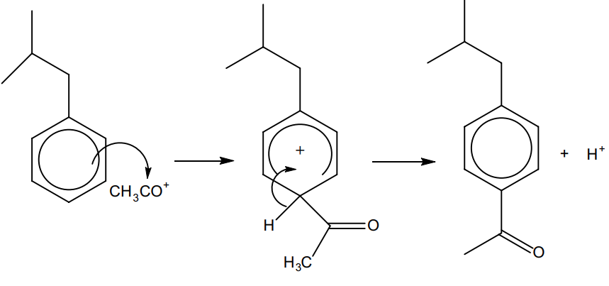

**[3 marks]**

> **[mark-scheme]**
> 1 mark for a curly arrow from the ring system to the positively charged carbon of CH3CO+
> 
> 1 mark for the correct intermediate structure with a positive charge shown
> 
> 1 mark for a curly arrow from the C–H bond into the ring AND loss of H+

> **[mark-scheme]**
> iii) The equation to show how AlCl3 is regenerated:
> 
> - H+ + AlCl4- → HCl + AlCl3 **[1 mark]**

> **[exam-tip]**
> You need to know how AlCl3 acts as a catalyst to form the positive ion required for the reaction, including the equations to form the electrophile and to reform the AlCl3 catalyst.
> 
> For the mechanism (ii):
> 
> - The curly arrows must start from inside the delocalised ring and point to the bond being formed
> - The intermediate must show a positive charge
> - The bond forms between the carbon of the ring and the carbonyl carbon of CH3CO+ — the arrow must point to the carbon, not the oxygen
> - The origin and destination of curly arrows must be clear and unambiguous
> - Mechanisms are a good way to pick up marks, so it is worth practising them

### Q12
> **[mark-scheme]**
> The systematic name of benzocaine is:
> 
> - Ethyl 4-aminobenzoate **[1 mark]**

> **[exam-tip]**
> Benzocaine is an ester, so its name follows the alkyl alkanoate format.
> 
> The alcohol portion: ethanol (2 carbons) → gives the 'ethyl' part of the name.
> 
> The acid portion: 4-aminobenzoic acid (benzoic acid with an amino group at position 4) → gives '4-aminobenzoate'.
> 
> So: ethanol + 4-aminobenzoic acid → ethyl 4-aminobenzoate + water.
> **[mark-scheme]**
> i) A suitable catalyst for step 1:
> 
> - AlBr3 / aluminium tribromide 
> **OR**
> FeBr3 / iron tribromide **[1 mark]**

ii) The mechanism for step 1 is:

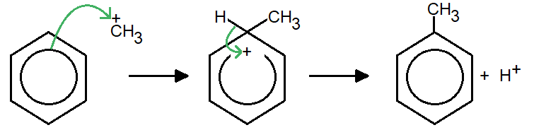

**[3 marks]**

> **[mark-scheme]**
> 1 mark for a curly arrow from the ring to the positively charged carbon of +CH3
> 
> 1 mark for the correct arenium intermediate structure with a positive charge, the horseshoe covering more than half the ring but not extending past carbons 2 or 6
> 
> 1 mark for a curly arrow from the C–H bond back into the ring AND the correct structure of compound **A** (methylbenzene) shown

> **[exam-tip]**
> The reaction of benzene with bromomethane is a Friedel-Crafts alkylation reaction. It is most commonly performed with a chloroalkane and AlCl3, but since bromomethane is specified, an AlBr3 or FeBr3 catalyst is required. The halogen in the catalyst must match the halogen in the halogenoalkane.
> 
> The catalyst generates the electrophile:
> 
> CH3Br + AlBr3 → +CH3 + AlBr4-
> 
> The first curly arrow must start touching the ring boundary (not from inside the ring) and point to the positive carbon of the electrophile.
> 
> The horseshoe in the intermediate must be centred about carbon 1 and not extend past carbons 2 or 6.
> **[mark-scheme]**
> i) The roles of each acid in this reaction:
> 
> - Sulfuric acid acts as a Brønsted–Lowry acid
> **AND**
> It donates a proton / H+ to nitric acid **[1 mark]**
> 
> - Nitric acid acts as a Brønsted–Lowry base
> **AND**
> It accepts a proton / H+ from sulfuric acid **[1 mark]**
> 
> ii) The relative strengths of the acids:
> 
> - Sulfuric acid is stronger than nitric acid (as it donates a proton to nitric acid)
> **OR**
> Nitric acid is weaker than sulfuric acid (as it accepts a proton from sulfuric acid) **[1 mark]**

iii) The structure of isomer **B** is:

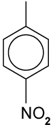

**[1 mark]**

> **[mark-scheme]**
> 1 mark for the correct structure of isomer **B**
> 
> Explanation
> 
> - The methyl / CH3 group on methylbenzene activates positions 2, 4 and 6 on the ring
> **AND**
> The nitro / NO2 group must attach to carbon-4 to form the product of step 3 **[1 mark]**

> **[exam-tip]**
> The reversible arrow in the equilibrium is not directly relevant to answering part (i). So, focus on which species loses and which gains a proton.
> 
> The overall equation for nitronium ion formation is:
> 
> HNO3 + 2H2SO4 → NO2+ + 2HSO4- + H3O+
> 
> For part (ii): since both H2SO4 and HNO3 are normally proton donors, whichever donates a proton to the other must be the stronger acid. Your answer must include comparative language (e.g. 'stronger than', 'weaker than').
> 
> For part (iii): the methyl group donates electron density to the π-system, activating positions 2, 4, and 6. Since the product of step 3 must have the nitro group at carbon-4, isomer **B** is 4-nitromethylbenzene (p-nitrotoluene).
> **[mark-scheme]**
> The reagents and conditions for steps 3 to 5 of the synthesis are:
> 
> Step 3:
> 
> - Hot alkaline KMnO4 / potassium manganate(VII), heat under reflux, then dilute acid / dilute H2SO4 / H+ **[1 mark]**
> 
> Step 4:
> 
> - Ethanol / warm with ethanol **[1 mark]**
> - Concentrated sulfuric acid catalyst **[1 mark]**
> 
> Step 5:
> 
> - Tin / Sn and concentrated hydrochloric acid / HCl, heat under reflux
> **OR**
> Iron / Fe and concentrated hydrochloric acid / HCl, heat under reflux
> **OR**
> Hydrogen / H2 and nickel / Ni catalyst **[1 mark]**

> **[exam-tip]**
> Step 3 is the complete oxidation of the alkyl arene side chain to a carboxylic acid using alkaline KMnO4 under reflux. The product is initially a carboxylate salt, which is then acidified with dilute acid to give the carboxylic acid.
> 
> Step 4 is esterification: the carboxylic acid reacts with ethanol in the presence of a concentrated sulfuric acid catalyst, warmed gently.
> 
> Step 5 is the reduction of a nitro group (-NO2) to an amine (-NH2). This can be done with Sn/HCl, Fe/HCl, or H2/Ni. Note that LiAlH4 and NaBH4 are not suitable for this reduction.
> **[mark-scheme]**
> i) This reaction scheme is an improvement because:
> 
> - There are fewer steps in the reaction scheme **[1 mark]**
> 
> ii) This reaction scheme may not work because:
> 
> - The nitration of benzoyl chloride does not preferentially form 4-nitrobenzoyl chloride / nitration does not occur at carbon-4 of the benzene ring **[1 mark]**

> **[exam-tip]**
> Chemists aim to minimise the number of steps in any reaction scheme as this improves efficiency and overall atom economy.
> 
> The key difference between the two schemes is in the first two steps. Fig. 1.1 uses methylation then nitration; Fig. 1.2 uses acylation then nitration.
> 
> Fig. 1.1 converts 4-nitromethylbenzene to 4-nitrobenzoic acid (an extra oxidation step). Fig. 1.2 avoids this by starting with Friedel-Crafts acylation.
> 
> However, the acyl chloride group in benzoyl chloride is an electron-withdrawing meta-director. Nitration of benzoyl chloride preferentially places the nitro group at carbon-3, not carbon-4. This gives 3-nitrobenzoyl chloride, which would produce the wrong isomer of benzocaine.

### Q13
> **[mark-scheme]**
> The step that could use potassium cyanide / KCN dissolved in ethanol is step 2. Marks are only awarded if step 2 is correctly identified.
> 
> - It cannot be step 1 because the cyanide ion / CN- is a nucleophile
> **AND**
> It will not react with / attack the C=C double bond of ethene **[1 mark]**
> - It cannot be step 3 because the reaction of CN- / KCN with compound **B** does not produce an amine
> **AND**
> A reduction step is required to convert the nitrile group to an amine **[1 mark]**

> **[exam-tip]**
> There are three steps and two marks, which combined with 'explain your answer' suggest that you should gain marks for explaining why two steps cannot use potassium cyanide.
> 
> Potassium cyanide provides CN- ions, which act as nucleophiles. Nucleophiles attack electron-deficient centres (positive or partial positive carbons), not electron-rich C=C double bonds.
> 
> Step 2 is a nucleophilic substitution: the CN- ion displaces the halide from compound **A** (a haloalkane), extending the carbon chain by one to give compound **B** (a nitrile). This is why KCN in ethanol is the correct reagent rather than not HCN, which is used for nucleophilic addition to carbonyl groups.
The skeletal structure of compound **A** is:

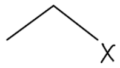

**[1 mark]**

> **[mark-scheme]**
> 1 mark for the correct structure of compound **A**
> 
> Reagents for the formation of compound **A** from ethene:
> 
> - The corresponding hydrogen halide to match the halogen shown in the drawn structure: HCl / HBr / HI **[1 mark]**

> **[exam-tip]**
> Compound **A** must be able to react with the cyanide ion (CN-) via nucleophilic substitution, so it must contain a C–X bond (a haloalkane).
> 
> Ethene most commonly undergoes electrophilic addition. Reagents that add across a C=C include H2, HX, X2, and H2SO4.
> 
> Since the next reaction requires nucleophilic substitution with CN-, compound **A** must be a monosubstituted haloalkane with one polar C–X bond. The only realistic option is the reaction of ethene with a hydrogen halide (HX).
> **[mark-scheme]**
> Compound **B** and the type of reaction it undergoes:
> 
> - Compound **B** = propanenitrile **[1 mark]**
> - Reduction
> **AND**
> The nitrile / nitrogen group has gained hydrogen **[1 mark]**

> **[exam-tip]**
> Nitriles are often tested in naming questions because the carbon chain increases by one when a CN group is added (e.g. eth- becomes prop-). Make sure you can name nitriles correctly as propanenitrile, not propenenitrile or propanitrile.
> 
> The nitrile group has gained hydrogen as it is converted into an amine. Look for GCSE identifiers of oxidation and reduction first: gain of hydrogen = reduction.

### Q14
> **[mark-scheme]**
> i) The name of compound **A** and the reaction conditions for step 1 are:
> 
> - Compound **A** = nitrobenzene **[1 mark]**
> - Reaction conditions = reflux / heat
> **AND**
> Any temperature between 25 and 60 °C **[1 mark]**
> 
> ii) The mechanism for the conversion of benzene into compound **A** and the reactive species are:
> 
> - Mechanism = electrophilic substitution **[1 mark]**
> - Species = NO2+ / nitronium ion **[1 mark]**

> **[exam-tip]**
> The reaction of benzene with concentrated nitric acid and concentrated sulfuric acid is nitration.
> 
> This is completed under reflux at 25–60 °C.
> 
> You need to know the reagents and conditions for many organic reactions, so take the time to learn them.
> 
> Concentrated nitric acid and concentrated sulfuric acid react together to form the nitronium ion, NO2+.
> 
> The nitronium ion is an electrophile that replaces a hydrogen on the benzene ring, making this an electrophilic substitution reaction.
> 
> You could be asked to draw the mechanism for this reaction.
> **[mark-scheme]**
> The catalyst required for this reaction and the equation to show how the catalyst forms the electrophile are:
> 
> - Aluminium trichloride / AlCl3
> **AND**
> CH3COCl + AlCl3 → CH3CO+ + AlCl4- **[1 mark]**

> **[exam-tip]**
> This is another example of an electrophilic substitution reaction, for which you could be asked to draw the mechanism.
> 
> You need to know the reagents and conditions for Friedel-Crafts alkylation and acylation.
> 
> Both reactions require an appropriate halogenoalkane or haloacyl compound and a halogen carrier catalyst such as AlCl3.
> 
> The halogen in the catalyst must match the halogen in the reacting molecule.
> 
> You should also be able to explain how the catalyst forms the electrophile.
> **[mark-scheme]**
> Two changes that occur to compound **B** during this reaction to show that reduction has taken place are:
> 
> - Oxygen is lost
> **AND**
> Hydrogen is gained **[1 mark]**

> **[exam-tip]**
> You do not need to know the structure of compound **B** to answer this question.
> 
> The key piece of information is that a nitro group, -NO2, is being converted into an amino group, -NH2.
> 
> Therefore, oxygen is being lost and hydrogen is being gained.
> 
> There is more than one way to describe reduction:
> 
> - Loss of oxygen
> - Gain of hydrogen
> - Gain of electrons
i) The aliphatic functional group formed after the reaction of compound **C** with NaBH4 is:

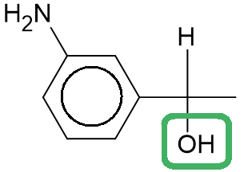

**[1 mark]**

> **[mark-scheme]**
> 1 mark for the OH / hydroxyl group correctly identified

ii) The structure of compound **C** is:

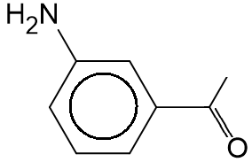

**[1 mark]**

> **[mark-scheme]**
> 1 mark for the correct structure of compound **C** shown

> **[exam-tip]**
> NaBH4 is a reducing agent used to reduce:
> 
> - Aldehydes to primary alcohols
> - Ketones to secondary alcohols
> 
> Since the product, 1-(3-aminophenyl)ethanol, contains a secondary alcohol group, compound **C** must be a ketone.
> 
> To deduce the structure of compound **C**:
> 
> - Remove the H from the C–OH group
> - Remove the H attached to the same carbon
> - Replace the C–OH single bond with a C=O double bond
