# Exam Questions — Organic Synthesis
**36. Organic Synthesis** · Cambridge (CIE) A-LEVEL chemistry (9701)
> Source: [https://www.savemyexams.com/a-level/chemistry/cie/25/topic-questions/](https://www.savemyexams.com/a-level/chemistry/cie/25/topic-questions/) · 14 questions across 1 sets

## Structured Questions (14 questions)

### Q1 — easy — 5 marks

**Q1** [3 marks]

The four-step synthesis to form propan-1-ol from a ketone is outlined in **Fig. 3.1**.

**Fig. 3.1**

i) State the name of a possible halogenoalkane, **D**, that undergoes nucleophilic substitution in step 4 to form propan-1-ol.

[1]

ii) State the reagents and conditions for step 4.

[2]

**Q1** [1 mark]

**Extract:**

The four-step synthesis to form propan-1-ol from a ketone is outlined in **Fig. 3.1**.

{align=center} **Fig. 3.1**

Deduce the identity of the alkene, **C**, in Fig. 3.1 in part **(a)**.

**Q1** [1 mark]

**Extract:**

The four-step synthesis to form propan-1-ol from a ketone is outlined in **Fig. 3.1**.

{align=center} **Fig. 3.1**

Suggest why the electrophilic addition reaction in step 3, in Fig. 3.1 in part **(a)**, might not be favourable in an industrial multistep reaction. You should not include economic considerations.

### Q2 — medium — 18 marks

**Q2** [2 marks]

Compound **G** is a naturally occurring aromatic compound that is present in raspberries.

Identify the functional groups present in compound **G**.

*Source: 2012 9701/41/O/N Q5A*

**Q2** [9 marks]

**Extract:**

Compound **G** is a naturally occurring aromatic compound that is present in raspberries.

The functional groups present in compound **G** are:
- Phenol
- Ketone

Complete Table 5.1 with information about the reactions of the three stated reagents with compound **G**.

**Table 5.1**

| **Reagent** | **Observation** | **Structure of organic product** | **Type of reaction** |
|---|---|---|---|
| Na (s) |   |   |   |
| Br2 (aq) |   |   |   |
| I2 / NaOH (aq) |   |   |   |

*Source: 2012 9701/41/O/N Q5B*

**Q2** [5 marks]

**Extract:**

Compound **G** is a naturally occurring aromatic compound that is present in raspberries.

The dye H can be made from compound **G** by the route shown below in Fig. 5.1.

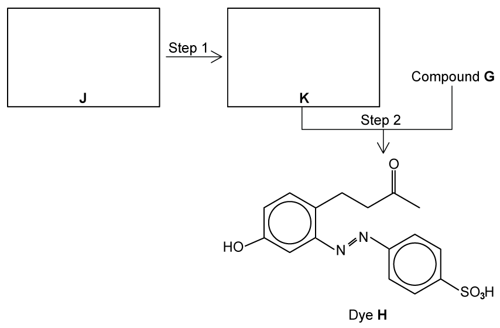

**Fig. 5.1**

i) Draw the structures of the amine **J** and the intermediate **K** in the boxes above.

[2]

ii) Suggest reagents and conditions for

step 1 ........................................................................................................................

step 2 ........................................................................................................................

[3]

**Q2** [2 marks]

**Extract:**

The dye H can be made from compound G by the route shown below in Fig. 5.1.

Fig. 5.1

Explain why dye **H** is very stable.

### Q3 — easy — 5 marks

**Q3** [2 marks]

This question is about farnesol, a chemical found in essential oils and used in perfumes. The structure of farnesol is shown in **Fig. 2.1**.

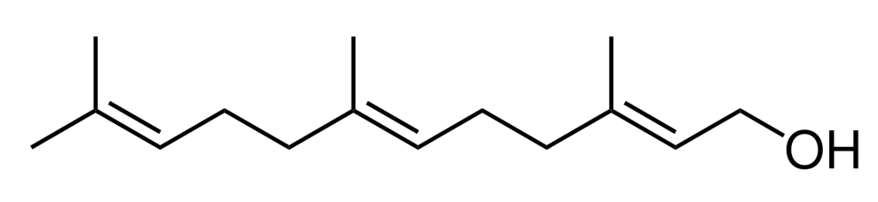

**Fig. 2.1**

State the two functional groups present in farnesol and identify their locations on **Fig. 2.1**.

**Q3** [1 mark]

**Extract:**

This question is about farnesol, a chemical found in essential oils and used in perfumes. The structure of farnesol is shown in **Fig. 2.1**.

{align=center} **Fig. 2.1**

Describe how you would expect farnesol to react if shaken with a little bromine water.

**Q3** [1 mark]

**Extract:**

This question is about farnesol, a chemical found in essential oils and used in perfumes. The structure of farnesol is shown in **Fig. 2.1**.

The functional groups present in farnesol and their locations are:

1 mark for alkene / C=C correctly identified on any C=C bond

1 mark for (primary) alcohol / hydroxyl / –OH correctly identified at the terminal CH~2~OH group

Farnesol is an important starting compound in organic synthesis. **Fig. 2.2** shows a two-step synthesis of a compound made from farnesol.

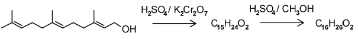

**Fig. 2.2**

Suggest a functional group present in the product of Step 1 but not in farnesol.

**Q3** [1 mark]

**Extract:**

This question is about farnesol, a chemical found in essential oils and used in perfumes. The structure of farnesol is shown in **Fig. 2.1**.

Farnesol is an important starting compound in organic synthesis. **Fig. 2.2** shows a two-step synthesis of a compound made from farnesol.

Suggest a functional group present in the final product, but not in farnesol.

### Q4 — easy — 12 marks

**Q4** [3 marks]

Benzene and its derivatives are used in various industrial applications, including the production of plastics, synthetic fibres, rubber, dyes, and detergents.

**Fig. 4.1** shows three compounds, **A**, **B** and **C**, which are all derivatives of benzene.

| 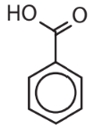  **A** | 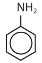  **B** | 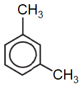  **C** |
|---|---|---|

**Fig. 4.1**

State the systematic names of compounds **A**, **B** and **C**.

Compound **A** ..................................................

Compound **B** ..................................................

Compound **C** ..................................................

**Q4** [2 marks]

**Extract:**

Benzene and its derivatives are used in various industrial applications, including the production of plastics, synthetic fibres, rubber, dyes, and detergents.

**Fig. 4.1** shows three compounds, **A**, **B** and **C**, which are all derivatives of benzene.

| 

**A** | 

**B** | 

**C** |
| --- | --- | --- |

{align=center} **Fig. 4.1**

Different functional groups attached to the benzene ring activate specific carbons within the ring structure and make them more likely to undergo electrophilic substitution.

State the positions activated for electrophilic substitution for the following compounds from part **(a)**.

Compound **A** ..............................

Compound **B** ..............................

**Q4** [4 marks]

**Extract:**

**Fig. 4.1** shows three compounds, **A**, **B** and **C**, which are all derivatives of benzene.

| 

**A** | 

**B** | 

**C** |

Compound **A** can be synthesised from methylbenzene and compound **B** from benzene by the routes shown in **Fig. 4.2**.

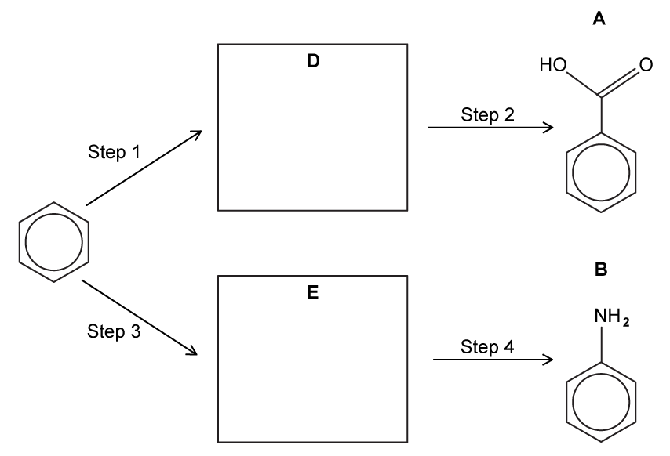

**Fig. 4.2**

i) Suggest the reagents for steps **1**–**4**.

step **1** ................................................................................

step **2** ................................................................................

step **3** ................................................................................

step **4** ................................................................................

[4]

ii) Draw the skeletal formulae of compounds **D** and **E** in the boxes.

[2]

**Q4** [3 marks]

The route shown in **Fig. 4.3** is proposed for the synthesis of compound **C**.

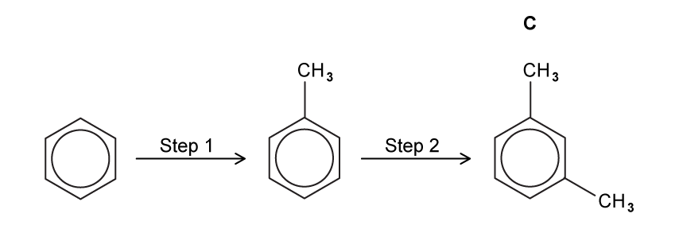

**Fig. 4.3**

i) Suggest **one** set of reagents and conditions that could be used for both steps.

reagents ............................................................

conditions ............................................................

[2]

ii) Suggest why step **2** is less likely to occur.

[1]

### Q5 — hard — 8 marks

**Q5** [5 marks]

Propanone can be synthesised from 2-bromopropane according to the reaction scheme shown in Fig. 2.1.

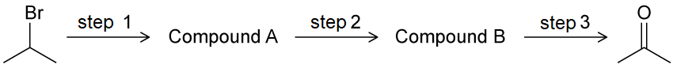

**Fig. 2.1**

Step 1 is not completed in acidic conditions.

Suggest reagents and conditions for each of steps 1 to 3.

step 1 ................................................................................

step 2 ................................................................................

step 3 ................................................................................

**Q5** [2 marks]

**Extract:**

Propanone can be synthesised from 2-bromopropane according to the reaction scheme shown in Fig. 2.1.

**Fig. 2.1**

Step 1 is not completed in acidic conditions.

Suggest reagents and conditions for each of steps 1 to 3.

step 1 ................................................................................

step 2 ................................................................................

step 3 ................................................................................

Suggest **one** reaction, including reagents and conditions, to replace steps 1 and 2.

**Q5** [1 mark]

**Extract:**

Propanone can be synthesised from 2-bromopropane according to the reaction scheme shown in Fig. 2.1.

**Fig. 2.1**

Using structural formulae, construct an equation for the reaction of compound **B** with an oxidising agent, [O], to form propanone.

### Q6 — easy — 8 marks

**Q6** [2 marks]

Morphine is a naturally occurring opiate found in opium from poppies. Heroin is a synthetic opiate that can be synthesised from morphine. **Fig. 1.1** shows the chemical structures of morphine and heroin.

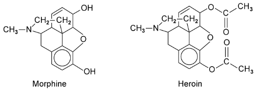

**Fig. 1.1**

State the functional groups present in morphine.

**Q6** [1 mark]

**Extract:**

Morphine is a naturally occurring opiate found in opium from poppies. Heroin is a synthetic opiate that can be synthesised from morphine. **Fig. 1.1** shows the chemical structures of morphine and heroin.

{align=center} **Fig. 1.1**

State the functional group present in heroin but not in morphine.

**Q6** [2 marks]

**Extract:**

Morphine is a naturally occurring opiate found in opium from poppies. Heroin is a synthetic opiate that can be synthesised from morphine. **Fig. 1.1** shows the chemical structures of morphine and heroin.

State the reagents and conditions needed to turn morphine into heroin.

**Q6** [3 marks]

**Extract:**

Morphine is a naturally occurring opiate found in opium from poppies. Heroin is a synthetic opiate that can be synthesised from morphine. **Fig. 1.1** shows the chemical structures of morphine and heroin.

Predict and explain the observations when morphine and heroin are each separately reacted with warm acidified potassium dichromate solution.

### Q7 — medium — 11 marks

**Q7** [4 marks]

Cuminyl alcohol can be synthesised from benzene by the following route shown in Fig. 2.1.

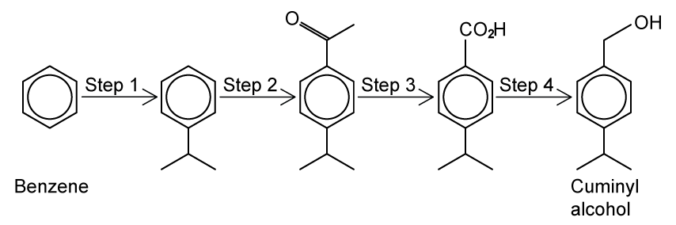

**Fig. 2.1**

Suggest reagents and conditions for steps 1–4.

step 1 ...................................................

step 2 ...................................................

step 3 ...................................................

step 4 ...................................................

*Source: 2018 9701/42/F/M Q8B*

**Q7** [2 marks]

**Extract:**

Cuminyl alcohol can be synthesised from benzene by the following route shown in Fig. 2.1.

**Fig. 2.1**

Name the mechanism of step 2 and state the type of reaction in step 4.

Mechanism of step 2 ..........................................................................................................

Type of reaction in step 4 ....................................................................................................

**Q7** [4 marks]

**Extract:**

Cuminyl alcohol can be synthesised from benzene by the following route shown in Fig. 2.1.

Step 2: CH3COCl and AlCl3 / heat

Step 2 adds an acyl group (acylation). An acyl chloride and halogen carrier are required:

AlCl3 + CH3COCl → AlCl4^-^ + CH3CO^+^

Draw the reaction mechanism for step 2.

**Q7** [1 mark]

**Extract:**

Cuminyl alcohol can be synthesised from benzene by the following route shown in Fig. 2.1.

Deduce the number of peaks that would be present in the 13C NMR spectrum of cuminyl alcohol.

### Q8 — medium — 8 marks

**Q8** [3 marks]

Noradrenaline shown in Fig. 4.1 is a hormone and neurotransmitter, which is released during stress to stimulate the heart and increase blood pressure.

**Fig. 4.1**

State the names of three functional groups in the noradrenaline molecule.

*Source: 2014 9701/41/M/J Q4A*

**Q8** [3 marks]

Consider the following two-step synthesis of noradrenaline from dihydroxybenzaldehyde in Fig. 4.2.

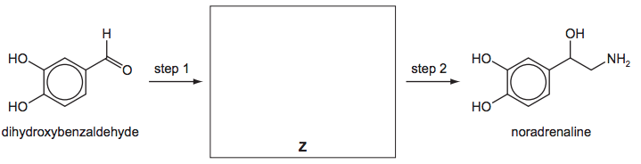

**Fig. 4.2**

Draw the structure of the intermediate Z in the box.

Suggest reagents for steps 1 and 2.

step 1 ..................................................................................................................................

step 2 ..................................................................................................................................

*Source: 2014 9701/41/M/J Q4B*

**Q8** [2 marks]

**Extract:**

Consider the following two-step synthesis of noradrenaline from dihydroxybenzaldehyde in Fig. 4.2.

Dihydroxybenzaldehyde reacts with Br2(aq).

- Describe what you would see during this reaction
- Draw the structure of the product

*Source: 2014 9701/41/M/J Q4C*

### Q9 — medium — 16 marks

**Q9** [9 marks]

Outline how ethanal can be synthesised from ethane in three steps.

ethane $\overset{\mathrm{step}1}{\rightarrow}$ chloroethane $\overset{\mathrm{step}2}{\rightarrow}$ ethanol $\overset{\mathrm{step}3}{\rightarrow}$ ethanal

State the reaction conditions and reagents and name the type of reaction taking place.

i) Step 1

Reagents ..........................................................................................................

Conditions .........................................................................................................

Reaction type ....................................................................................................

[3]

ii) Step 2

Reagents ..........................................................................................................

Conditions .........................................................................................................

Reaction type ....................................................................................................

[3]

iii) Step 3

Reagents ..........................................................................................................

Conditions .........................................................................................................

Reaction type ....................................................................................................

[3]

**Q9** [3 marks]

The following reaction pathway in Fig. 3.1 is used to produce compounds **A** and **B**, which when reacted together, form a branched ester molecule, compound **C**.

Suggest suitable reagents and conditions for the synthesis of compound **A** via step 1 and give the name for this type of reaction.

**Fig. 3.1**

**Q9** [3 marks]

**Extract:**

The following reaction pathway in Fig. 3.1 is used to produce compounds **A** and **B**, which when reacted together, form a branched ester molecule, compound **C**.

**Fig. 3.1**

The ketone in part **(a)** must be converted to compound **B** to produce the ester.

i) Name the molecule that is produced from step 2

[1]

ii) Name the type of reaction that is involved in step 2 and suggest suitable reagents and conditions for this step.

[2]

**Q9** [1 mark]

**Extract:**

The following reaction pathway in Fig. 3.1 is used to produce compounds **A** and **B**, which when reacted together, form a branched ester molecule, compound **C**.

Suggest suitable reagents and conditions for the synthesis of compound **A** via step 1 and give the name for this type of reaction.

**Fig. 3.1**

Draw the skeletal formula of the ester formed from the reaction scheme.

### Q10 — hard — 10 marks

**Q10** [4 marks]

Sudan II is an azo dye that was used as a colourant in chilli powder until it was banned due to its links to an increased risk of cancer.  It can be synthesised from 1,3-dimethylbenzene by the route shown in Fig. 4.1

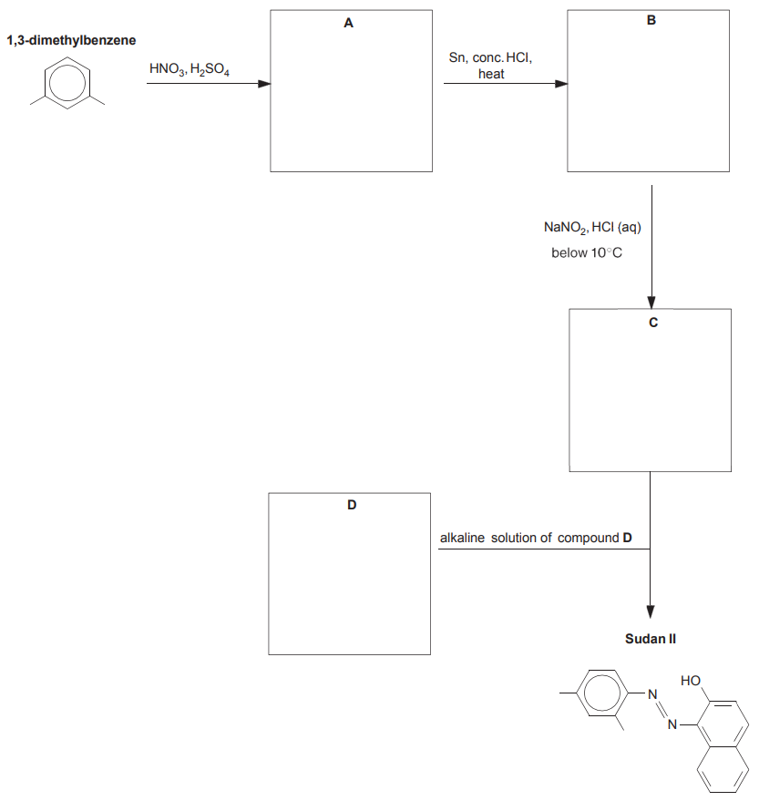

**Fig. 4.1**

Draw the structures of the organic compounds **A**, **B**, **C** and **D** in the boxes.

**Q10** [4 marks]

**Extract:**

Sudan II is an azo dye that was used as a colourant in chilli powder until it was banned due to its links to an increased risk of cancer. It can be synthesised from 1,3-dimethylbenzene by the route shown in Fig. 4.1

The first reaction with concentrated sulfuric acid and concentrated nitric acid is nitration. From the structure of the final product, the nitro group must add to carbon-4.

Compound A is 1,3-dimethyl-4-nitrobenzene.

i) Write an equation to show the formation of an appropriate reactive species to react with 1,3-dimethylbenzene to form compound **A**.

[1]

ii) Draw the mechanism for this reaction. Include all necessary curly arrows and charges.

[3]

**Q10** [2 marks]

**Extract:**

Sudan II is an azo dye that was used as a colourant in chilli powder until it was banned due to its links to an increased risk of cancer. It can be synthesised from 1,3-dimethylbenzene by the route shown in Fig. 4.1

Fig. 4.1

Draw the structures of the organic compounds **A**, **B**, **C** and **D** in the boxes.

Two other structural isomers of compound **A** could have been formed from the mononitration of 1,3-dimethylbenzene, as shown in Fig.4.2.

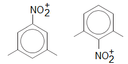

**Fig. 4.2**

Suggest, with the aid of suitable diagrams, why 1,3-dimethyl-2-nitrobenzene is likely to be the more abundant product.

### Q11 — medium — 12 marks

**Q11** [2 marks]

Ibuprofen and paracetamol are pain-relief drugs.

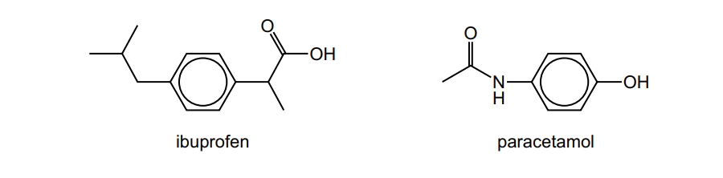

**Fig. 1.1**

Ibuprofen and paracetamol both contain the aryl (benzene) functional group.

State the other functional groups present in each molecule.

ibuprofen .........................................................................

paracetamol ...................................................................

*Source: 2022 Specimen Paper 4 Q8A*

**Q11** [2 marks]

Ibuprofen contains a chiral centre and has two enantiomers.

i) State one similarity and one difference in the physical or chemical properties between the two enantiomers.

similarity.......................................

difference.....................................

[1]

ii) Explain what is meant by racemic mixture.

[1]

*Source: 2022 Specimen Paper 4 Q8B*

**Q11** [3 marks]

**Extract:**

Ibuprofen and paracetamol are pain-relief drugs.

{align=center} **Fig. 1.1**

Ibuprofen and paracetamol both contain the aryl (benzene) functional group.

The other functional groups present in each molecule are:
- Ibuprofen: carboxylic acid
- Paracetamol: phenol and (secondary) amide

Paracetamol reacts separately with the two reagents shown in the table.

Complete Table 1.1 by:

- drawing the structures of the organic products formed,
- stating the types of reaction.

**Table 1.1**

| **reagent** | **organic product structure** | **type of reaction** |
|---|---|---|
| LiAlH4 |   |   |
| an excess of Br2(aq) |   |   |

*Source: 2022 Specimen Paper 4 Q8C*

**Q11** [5 marks]

One of the steps in the manufacture of ibuprofen is shown in Fig. 1.2.

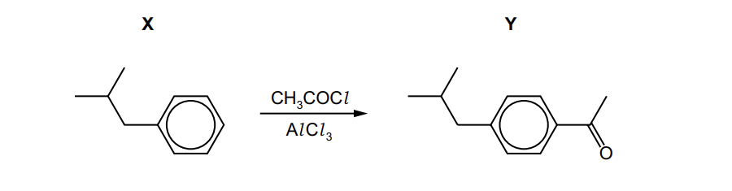

**Fig. 1.2**

i) Write an equation to show how AlCl3 generates the electrophile for the conversion of **X** into **Y**.

[1]

ii) Draw the mechanism for the conversion of **X** into **Y**. Include all necessary curly arrows and charges.

[3]

iii) Write an equation to show how the AlCl3 is regenerated.

[1]

*Source: 2022 Specimen Paper 4 Q8D*

### Q12 — hard — 16 marks

**Q12** [1 mark]

Benzocaine is an ester based compound that is used medicinally as a local anaesthetic in pain relievers and cough drops. One of the first industrial processes to manufacture benzocaine was the five-step reaction shown in Fig. 1.1.

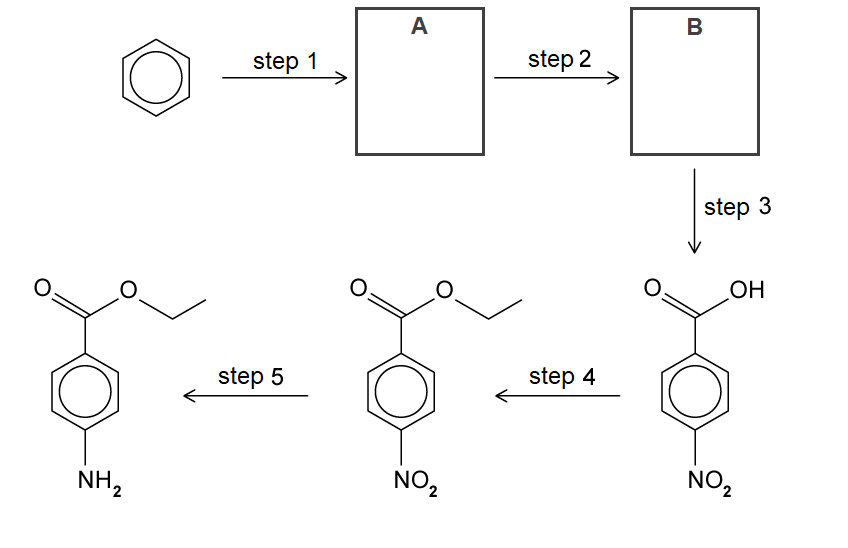

**Fig. 1.1**

State the systematic name of benzocaine.

**Q12** [4 marks]

**Extract:**

Benzocaine is an ester based compound that is used medicinally as a local anaesthetic in pain relievers and cough drops. One of the first industrial processes to manufacture benzocaine was the five-step reaction shown in Fig. 1.1.

Step 1 involves the reaction of benzene with bromomethane.

i) State a suitable catalyst for step 1.

[1]

ii) Draw a mechanism for step 1. Include all necessary curly arrows, charges and the structure of **A**.

[3]

**Q12** [5 marks]

**Extract:**

Benzocaine is an ester based compound that is used medicinally as a local anaesthetic in pain relievers and cough drops. One of the first industrial processes to manufacture benzocaine was the five-step reaction shown in Fig. 1.1.

Fig. 1.1

Step 1 involves the reaction of benzene with bromomethane.

The correct structure of compound A (methylbenzene)

Concentrated sulphuric acid and concentrated nitric acid are used to form the ion required for step 2.

The following equilibrium is the first step in the formation of the ion:

H2SO4 + HNO3 ⇋ HSO4- + H2NO3+

i) State the roles of each acid in this reaction.

[2]

ii) Use your answer to part **(i)** to suggest the relative strengths of the acids.

[1]

iii) Different isomers with the molecular formula C7H7NO2 can be formed during step 2.

Draw the structure of the isomer **B**. Explain your answer.

[2]

**Q12** [4 marks]

**Extract:**

Benzocaine is an ester based compound that is used medicinally as a local anaesthetic in pain relievers and cough drops. One of the first industrial processes to manufacture benzocaine was the five-step reaction shown in Fig. 1.1.

{align=center} **Fig. 1.1**

Suggest reagents and conditions for steps 3–5 of the synthesis.

step 3 ................................................................................

step 4 ................................................................................

step 5 ................................................................................

**Q12** [2 marks]

**Extract:**

Benzocaine is an ester based compound that is used medicinally as a local anaesthetic in pain relievers and cough drops. One of the first industrial processes to manufacture benzocaine was the five-step reaction shown in Fig. 1.1.

Fig. 1.2 shows an alternative reaction scheme for the production of benzocaine.

**Fig. 1.2**

i) Suggest why this reaction scheme is an improvement.

[1]

ii) Suggest why this reaction scheme may not work.

[1]

### Q13 — hard — 6 marks

**Q13** [2 marks]

Ethene is used in the radical-free synthesis of 1-aminopropane as shown.

ethene $\overset{\mathrm{step}1}{\rightarrow}$ compound **A** $\overset{\mathrm{step}2}{\rightarrow}$ compound **B** $\overset{\mathrm{step}3}{\rightarrow}$ propylamine

Identify which step of the reaction scheme could use potassium cyanide dissolved in ethanol. Explain your answer.

**Q13** [2 marks]

**Extract:**

Ethene is used in the radical-free synthesis of 1-aminopropane as shown.

ethene → compound A → compound B → propylamine

Draw the **skeletal** structure of compound **A** and state the reagents required for its formation.

**Q13** [2 marks]

**Extract:**

Ethene is used in the radical-free synthesis of 1-aminopropane as shown.

ethene → compound A → compound B → propylamine

The final step of the reaction scheme forms 1-aminopropane from compound **B**.

Name compound **B** and identify the type of reaction that compound **B** undergoes to form propylamine. Explain your answer.

### Q14 — easy — 8 marks

**Q14** [4 marks]

1-(3-aminophenyl)ethanol can be synthesised from benzene by the route shown in Fig. 5.1.

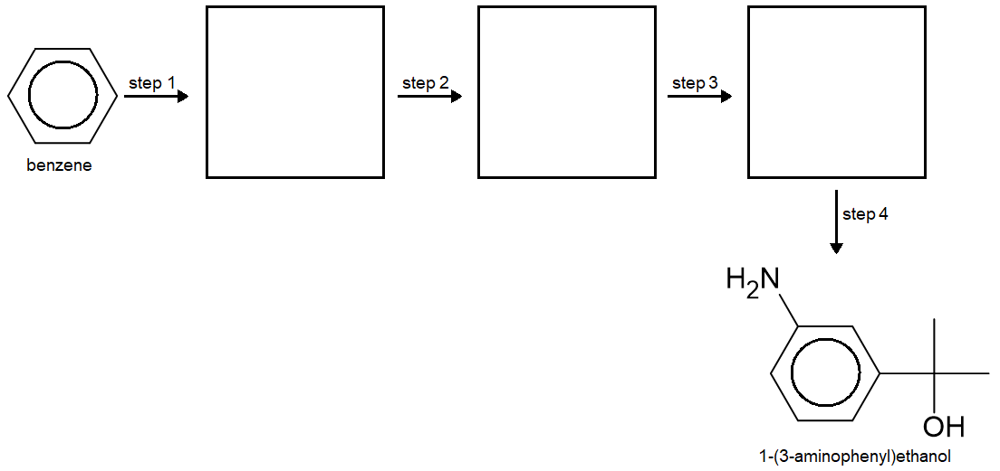

**Fig. 5.1**

Step 1 involves a reaction with concentrated nitric acid and concentrated sulfuric acid.

i) Name compound **A** and state the reaction conditions for step 1.

compound **A** ................................................................................

reaction conditions ................................................................................

[2]

ii) Stae the mechanism for the conversion of benzene into compound **A** and identify the specific species that reacts with benzene.

mechanism ................................................................................

species ................................................................................

[2]

**Q14** [1 mark]

**Extract:**

1-(3-aminophenyl)ethanol can be synthesised from benzene by the route shown in Fig. 5.1.

Fig. 5.1

Compound A = nitrobenzene

Step 2, in Fig. 5.1 in part **(a)**, is the reaction of compound **A** with ethanoyl chloride, CH3COCl, in the presence of a suitable catalyst.

State the catalyst required for this reaction and write an equation to show how the catalyst forms the electrophile for this reaction.

**Q14** [1 mark]

**Extract:**

1-(3-aminophenyl)ethanol can be synthesised from benzene by the route shown in Fig. 5.1.

**Fig. 5.1**

Step 3, in Fig. 5.1 in part **(a)**, is the reaction of compound **B** with tin and hydrochloric acid, converting a nitro group into an amino group.

State **two** changes that occur to compound **B** during this reaction to show that reduction has taken place.

**Q14** [2 marks]

**Extract:**

1-(3-aminophenyl)ethanol can be synthesised from benzene by the route shown in Fig. 5.1.

{align=center} **Fig. 5.1**

Step 4, in Fig. 5.1 in part **(a)**, is the reduction of compound **C** to 1-(3-aminophenyl)ethanol using NaBH4.

The structure of 1-(3-aminophenyl)ethanol is repeated in Fig. 5.2.

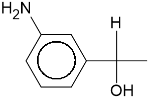

**Fig. 5.2**

i) Draw a circle around the aliphatic functional group that is formed **after** the reaction of compound **C** with NaBH4.

[1]

ii) Draw the structure of compound **C**.

[1]
