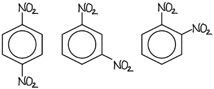
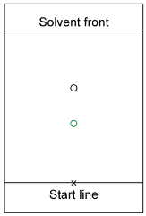
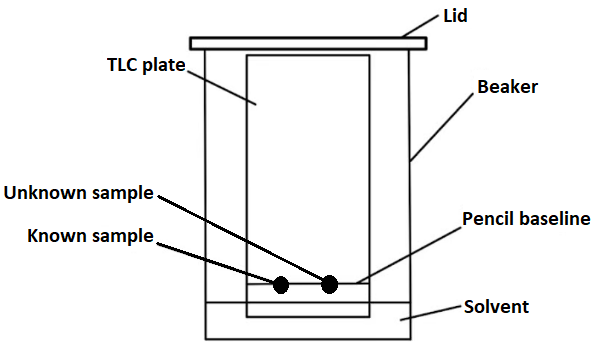

# Mark Schemes — Thin-Layer Chromatography
**37. Analytical Techniques** · Cambridge (CIE) A-LEVEL chemistry (9701)

## Structured Questions (5 questions)

### Q1
The *M*r of ibuprofen (C13H18O2) is:

*M*r = (12.0 x 13) + (1.0 x 18) + (16.0 x 2)

*M*r = **206.0** **[1 mark]**

> **[exam-tip]**
> The molecular formula of ibuprofen is C13H18O2. When counting atoms in a skeletal formula, remember that hydrogen atoms bonded to carbon are not shown.
> **[mark-scheme]**
> Advantages of using TLC to analyse organic samples include:
> 
> Any **two** from (1 mark for each point):
> 
> - Quick analysis time
> - Many samples can be processed simultaneously
> - High degree of accuracy / repeatability / reproducibility
> - (Very) small sample sizes are needed
> 
> **[2 marks]**

> **[exam-tip]**
> TLC is widely used in organic chemistry because it requires only small amounts of material, gives results quickly, and can test many samples side by side. The *R*f value of each spot can then be compared against reference data.
> **[mark-scheme]**
> The ibuprofen sample produced two spots because:
> 
> - The sample contains an impurity / is not pure **[1 mark]**

> **[exam-tip]**
> In chromatography, each compound in a sample produces one spot. If only one compound is expected but two spots appear, the sample must contain an impurity. A pure sample gives a single spot; a mixture gives multiple spots.

### Q2
> **[mark-scheme]**
> i) The baseline is drawn in pencil rather than ink because:
> 
> - Pencil does not dissolve in / is not carried up the plate by the solvent **[1 mark]**
> 
> ii) A lid is placed on the container because:
> 
> - To prevent evaporation of the solvent / to maintain a saturated atmosphere **[1 mark]**

> **[exam-tip]**
> Both are standard precautions in TLC. Ink would dissolve in the solvent and be carried up the plate, interfering with the chromatogram. A lid prevents solvent evaporation, which would cause the solvent front to stop moving.
> **[mark-scheme]**
> The steps to determine the identity of the compounds are:
> 
> - Measure the distance travelled by the solvent
> **OR**
> Measure the distance to the solvent front **[1 mark]**
> - Measure the distance travelled by each compound / component / spot **[1 mark]**
> - Calculate the *R*f value using the equation *R*f = $\frac{\mathrm{distance} \mathrm{travelled} \mathrm{by} \mathrm{compound}}{\mathrm{distance} \mathrm{travelled} \mathrm{by} \mathrm{solvent}}$ **[1 mark]**
> - Compare the *R*f value of each spot with data table / reference values to identify the compound **[1 mark]**

> **[exam-tip]**
> This question asks how to go from a chromatogram to an identification. State the two distances measured (compound and solvent front), write the *R*f equation, and explain that the calculated *R*f values are compared against known reference data.
> **[mark-scheme]**
> - Expose the TLC plate to UV light
> **OR**
> Place the TLC plate in an iodine vapour chamber **[1 mark]**

> **[exam-tip]**
> Colourless compounds are not visible under normal light. Two common methods to reveal spots are UV light (if the silica contains a UV-active indicator) and iodine vapour, which temporarily stains organic compounds brown.
To calculate the *R*f values for benzaldehyde and benzyl alcohol:

- Apply the *R*f equation:

*R*f = $\frac{\mathrm{distance} \mathrm{travelled} \mathrm{by} \mathrm{compound}}{\mathrm{distance} \mathrm{travelled} \mathrm{by} \mathrm{solvent}}$

- Calculate *R*f for benzaldehyde:

*R*f = $\frac{3.2}{5.0}$

*R*f (benzaldehyde) = **0.64** **[1 mark]**

- Calculate *R*f for benzyl alcohol:

*R*f = $\frac{1.5}{5.0}$

*R*f (benzyl alcohol) = **0.30** **[1 mark]**

> **[exam-tip]**
> A compound that is very soluble in the mobile phase has a high *R*f (close to 1); a compound that adsorbs strongly to the stationary phase has a low *R*f (close to 0).
> **[mark-scheme]**
> The maximum *R*f value cannot exceed 1 because:
> 
> - *R*f is a ratio of the distance a compound has travelled to the distance travelled by the solvent **[1 mark]**
> - An *R*f value of 1 means the compound is fully soluble in the mobile phase and does not interact with the stationary phase **[1 mark]**

> **[exam-tip]**
> Think about what *R*f physically represents: the distance the compound travels as a fraction of the solvent front distance. Since the compound cannot travel further than the solvent, the maximum ratio is 1. An *R*f of exactly 1 would mean the compound has no interaction with the stationary phase at all.

### Q3
i) The three structural isomers of dinitrobenzene are:

**[3 marks]**

> **[mark-scheme]**
> 1 mark for each correct skeletal formula:
> 
> - 1,2-dinitrobenzene
> - 1,3-dinitrobenzene
> - 1,4-dinitrobenzene
> 
> ii) The type of structural isomerism shown is:
> 
> - Positional / position isomerism **[1 mark]**

> **[exam-tip]**
> When drawing di-substituted isomers of benzene, place one functional group at carbon-1 and keep it fixed. Then move the second functional group around the ring one carbon at a time, starting from carbon-2 and ending at carbon-4.
> **[mark-scheme]**
> The factors that determine the distance travelled by a spot in thin-layer chromatography are:
> 
> - Solubility in the mobile phase / solvent **[1 mark]**
> - Adsorption by / strength of adsorption onto the stationary phase / silica gel **[1 mark]**

> **[exam-tip]**
> The distance a compound travels depends on two opposing interactions:
> 
> 1. How soluble it is in the mobile phase (which carries it up the plate)
> 2. How strongly it adsorbs onto the stationary phase (which holds it back).
> **[mark-scheme]**
> - A fine capillary tube produces a smaller / more concentrated spot
> **OR**
> A smaller spot produces a better / more accurate chromatogram
> **OR**
> To avoid smudging / smearing the spot **[1 mark]**

> **[exam-tip]**
> This question tests understanding of practical technique. A smaller, more concentrated spot gives a cleaner chromatogram and makes accurate *R*f calculation easier. A large or smeared spot makes measurements unreliable.
The expected position of the spot for 1,2-dinitrobenzene is:

**[1 mark]**

> **[mark-scheme]**
> 1 mark for the spot correctly placed below the existing spot on the chromatogram
> 
> - The silica gel / stationary phase is polar
> **OR**
> The hexane / mobile phase is non-polar **[1 mark]**
> - 1,2-dinitrobenzene is more polar
> **AND**
> 1,2-dinitrobenzene adsorbs more strongly to the stationary phase / is less soluble in the mobile phase
> **AND**
> Therefore, 1,2-dinitrobenzene does not travel as far **[1 mark]**

> **[exam-tip]**
> Both compounds are dinitrobenzene isomers, so the difference in their positions on the chromatogram must be due to their structural differences. 1,2-dinitrobenzene has both nitro groups on adjacent carbons and is therefore more polar. A more polar compound adsorbs more strongly to the polar silica gel and travels less far up the plate.
> **[mark-scheme]**
> To reverse the relative positions of the spots, the student could:
> 
> - Replace the hexane with a polar solvent / use a polar solvent **[1 mark]**
> - 1,2-dinitrobenzene is more soluble in a polar solvent
> **AND**
> Therefore, 1,2-dinitrobenzene travels further / the positions are reversed **[1 mark]**

> **[exam-tip]**
> Polar compounds are more soluble in polar solvents. Switching to a polar solvent increases the solubility of 1,2-dinitrobenzene in the mobile phase, so it moves further up the plate relative to 1,4-dinitrobenzene, reversing their positions.

### Q4
> **[mark-scheme]**
> Butanone has a higher *R*f value than butan-2-ol because:
> 
> - Butan-2-ol is more polar than butanone
> **OR**
> Butan-2-ol contains hydrogen bonding **[1 mark]**
> - Butan-2-ol adsorbs more strongly to the silica gel / stationary phase
> **OR**
> Butanone is more soluble in the mobile phase / solvent **[1 mark]**
> - Therefore, butanone travels further on the TLC plate **[1 mark]**

> **[exam-tip]**
> Butan-2-ol contains an -OH group which enables hydrogen bonding, making it more polar than butanone. More polar compounds adsorb more strongly to the polar silica gel stationary phase and travel less far up the plate, giving a lower *R*f value.
> **[mark-scheme]**
> The stationary and mobile phases in this chromatography experiment are:
> 
> - Stationary phase = silica gel **[1 mark]**
> - Mobile phase = hexane **[1 mark]**

> **[exam-tip]**
> In thin-layer chromatography, the stationary phase is a layer of silica gel (SiO2) or alumina (Al2O3) coated onto a plate. The mobile phase is the liquid solvent that moves up the plate by capillary action.
> **[mark-scheme]**
> The effect on the *R*f value of benzyl alcohol is:
> 
> - The *R*f value would increase **[1 mark]**
> - Benzyl alcohol is more soluble in a polar solvent / has a greater affinity for the polar mobile phase, so it travels further up the plate **[1 mark]**

> **[exam-tip]**
> Benzyl alcohol contains an -OH group and is relatively polar. A polar solvent increases the solubility of polar compounds in the mobile phase, reducing their interaction with the stationary phase and causing them to travel further, increasing their *R*f value.

### Q5
> **[mark-scheme]**
> The two phases of thin-layer chromatography and one example of a chemical used for each are:
> 
> - The mobile phase **[1 mark]**
> - Specific named solvent, e.g. water / ethanol / hexane
> **OR**
> General solvent, e.g. alkane / alcohol **[1 mark]**
> - The stationary phase **[1 mark]**
> - Silica / silicon dioxide / SiO2
> **OR**
> Alumina / aluminium oxide / Al2O3 **[1 mark]**

> **[exam-tip]**
> The mobile phase moves during TLC, carrying the sample up the plate. The stationary phase stays fixed.
> 
> Common examples of polar mobile phases are water and alcohols. Common examples of non-polar mobile phases are alkanes such as hexane.
A labelled diagram of the apparatus for thin-layer chromatography is:

**[3 marks]**

> **[mark-scheme]**
> 1 mark for pencil baseline labelled **AND **sealed container / lid shown
> 
> 1 mark for solvent labelled **AND **level of solvent shown below the pencil baseline
> 
> 1 mark for two spots labelled on the baseline

> **[exam-tip]**
> Always include the lid on the beaker in your diagram. This prevents evaporation of the volatile organic solvents used as the mobile phase.
> 
> The solvent level must be below the pencil baseline. If the solvent touches the spots, they will dissolve directly into the solvent rather than being carried up the plate.
> **[mark-scheme]**
> The two factors that determine the distance travelled by a compound in thin-layer chromatography are:
> 
> - The solubility of the compound in the mobile phase **[1 mark]**
> - The adsorption of the compound by the stationary phase **[1 mark]**

> **[exam-tip]**
> A compound that is very soluble in the mobile phase is carried further up the plate. A compound that adsorbs strongly to the stationary phase is held back and travels a shorter distance.
> 
> For TLC using a solid stationary phase such as silica, the correct term for the interaction with the stationary phase is adsorption.
> **[mark-scheme]**
> The equation used to calculate the retention factor, *R*f, of a compound is:
> 
> - *R*f = $\frac{\text{distance travelled by compound}}{\text{distance travelled by solvent front}}$ **[1 mark]**

> **[exam-tip]**
> This equation is not often specifically asked for in a question. You are more likely to be asked to apply it to calculate an *R*f value from a chromatogram.
To calculate the *R*f value of the compound:

- Determine the distances from the baseline:

Distance travelled by solvent front = 20 − 2 = 18 cm

Distance travelled by compound = 16 − 2 = 14 cm

**[1 mark]**

- Calculate the *R*f value:

*R*f = $\frac{\mathrm{distance} \mathrm{travelled} \mathrm{by} \mathrm{spot}}{\mathrm{distance} \mathrm{travelled} \mathrm{by} \mathrm{solvent} \mathrm{front}}$

*R*f = $\frac{14}{18}$

*R*f = **0.78**

**[1 mark]**

> **[mark-scheme]**
> 1 mark for both distances correctly measured from the baseline: solvent front = 18 cm **AND **compound = 14 cm
> 
> 1 mark for correct *R*f value: 0.78 (Allow 0.777–0.778)

> **[exam-tip]**
> Distances are measured from the pencil baseline, not from the bottom of the plate. In this chromatogram, the baseline is at 2 cm, so subtract 2 cm from each measurement before dividing.
> 
> The *R*f value has no units because it is a ratio.
