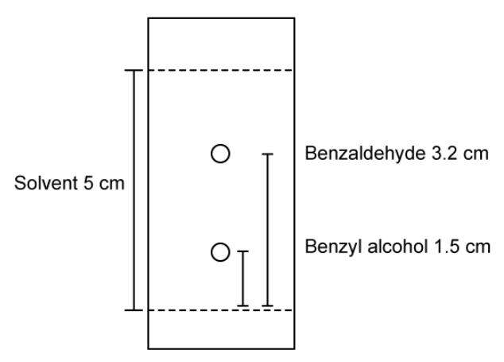
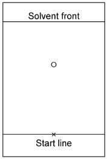
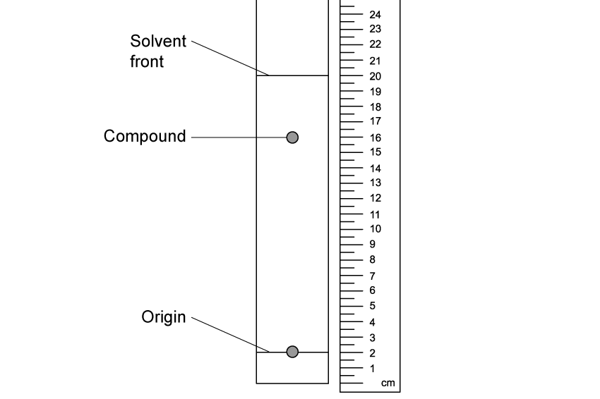

# Exam Questions — Thin-Layer Chromatography
**37. Analytical Techniques** · Cambridge (CIE) A-LEVEL chemistry (9701)
> Source: [https://www.savemyexams.com/a-level/chemistry/cie/25/topic-questions/](https://www.savemyexams.com/a-level/chemistry/cie/25/topic-questions/) · 5 questions across 1 sets

## Structured Questions (5 questions)

### Q1 — medium — 4 marks

**Q1** [1 mark]

Thin-layer chromatography (TLC) is used to analyse samples of organic compounds.

Fig. 3.1 shows the structure of ibuprofen.

**Fig. 3.1**

Calculate the *M*r of ibuprofen to 1 decimal place.

**Q1** [2 marks]

State **two** advantages of using TLC for the analysis of organic samples.

**Q1** [1 mark]

Thin-layer chromatography was performed on a sample of ibuprofen.

Only one spot was expected on the TLC plate but two were observed.

Suggest why the ibuprofen sample produced two spots on the TLC plate rather than one.

### Q2 — medium — 11 marks

**Q2** [2 marks]

A student sets up a thin-layer chromatography experiment.

Explain why:

i) the baseline is drawn in pencil rather than ink.

[1]

ii) a lid is placed on the container during the experiment.

[1]

**Q2** [4 marks]

A student runs a thin-layer chromatography experiment and plans to determine the compounds from their *R*f values.

Describe the steps that the student needs to perform to determine the identity of the compounds.

**Q2** [1 mark]

The compounds in the mixture are colourless.

Suggest how the student could locate the spots on the TLC plate.

**Q2** [2 marks]

The student runs another TLC practical on a mixture of benzaldehyde and benzyl alcohol using 7:3 pentane / diethyl ether as a solvent.

The student's chromatogram is shown in Fig. 1.1.

**Fig. 1.1**

Calculate the *R*f values for both compounds in the chromatogram. Show your working.

**Q2** [2 marks]

Explain why the maximum *R*f value of a compound cannot exceed 1.

### Q3 — hard — 12 marks

**Q3** [4 marks]

Dinitrobenzene has the molecular formula C6H4N2O4.

i) Draw the skeletal formulae of the three structural isomers of dinitrobenzene.

[3]

ii) State the type of structural isomerism shown.

[1]

**Q3** [2 marks]

State the factors that determine the distance travelled by a spot in thin-layer chromatography.

**Q3** [1 mark]

Samples of 1,2-dinitrobenzene and 1,4-dinitrobenzene are spotted on a thin-layer chromatography plate coated with silica gel.

The solvent used to run the thin-layer chromatography experiment is hexane.

Suggest why each sample is applied to the thin-layer chromatography plate using a fine capillary tube rather than a dropping pipette.

**Q3** [3 marks]

**Extract:**

Samples of 1,2-dinitrobenzene and 1,4-dinitrobenzene are spotted on a thin-layer chromatography plate coated with silica gel.

The solvent used to run the thin-layer chromatography experiment is hexane.

The factors that determine the distance travelled by a spot in thin-layer chromatography are:
- Solubility in the mobile phase / solvent
- Adsorption by / strength of adsorption onto the stationary phase / silica gel

Fig. 1.1 shows the chromatogram with the spot for 1,4-dinitrobenzene.

**Fig. 1.1**

Draw the expected position of the spot for 1,2-dinitrobenzene. Explain your answer.

**Q3** [2 marks]

**Extract:**

Samples of 1,2-dinitrobenzene and 1,4-dinitrobenzene are spotted on a thin-layer chromatography plate coated with silica gel.

The solvent used to run the thin-layer chromatography experiment is hexane.

1,2-dinitrobenzene is more polar and adsorbs more strongly to the stationary phase / is less soluble in the mobile phase, therefore 1,2-dinitrobenzene does not travel as far.

Explain what the student could do to reverse the relative positions of the 1,2-dinitrobenzene and 1,4-dinitrobenzene spots.

### Q4 — medium — 7 marks

**Q4** [3 marks]

Thin layer chromatography was used to analyse the contents of a bottle containing butan-2-ol and butanone.

The contents of the bottle were dissolved in hexane and spotted onto the silica plate.

Explain why butanone has a higher *R*f value than butan-2-ol.

**Q4** [2 marks]

**Extract:**

Thin layer chromatography was used to analyse the contents of a bottle containing butan-2-ol and butanone. 

The contents of the bottle were dissolved in hexane and spotted onto the silica plate.

State the names of the stationary and mobile phases in this chromatography experiment.

**Q4** [2 marks]

The student repeats the experiment using a more polar solvent instead of 7:3 pentane / diethyl ether.

Suggest and explain the effect on the *R*f value of benzyl alcohol.

### Q5 — easy — 12 marks

**Q5** [4 marks]

State the names of the two phases in thin-layer chromatography. State one example of a chemical used for each phase.

**Q5** [3 marks]

Draw a labelled diagram of the apparatus used to separate a mixture using thin-layer chromatography (TLC).

**Q5** [2 marks]

State the two factors that determine the distance travelled by a compound in thin-layer chromatography.

**Q5** [1 mark]

State the equation used to calculate the retention factor, *R*f, of a compound.

**Q5** [2 marks]

**Extract:**

The equation used to calculate the retention factor, *R*~f~, of a compound is:

*R*~f~ = \$\$\frac{\text{distance travelled by compound}}{\text{distance travelled by solvent front}}\$\$

Calculate the *R*f value of the compound shown in the chromatogram below. Show your working.

