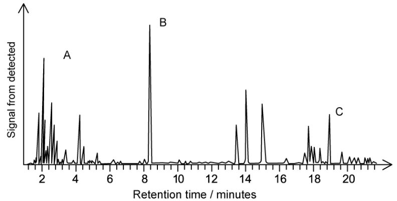
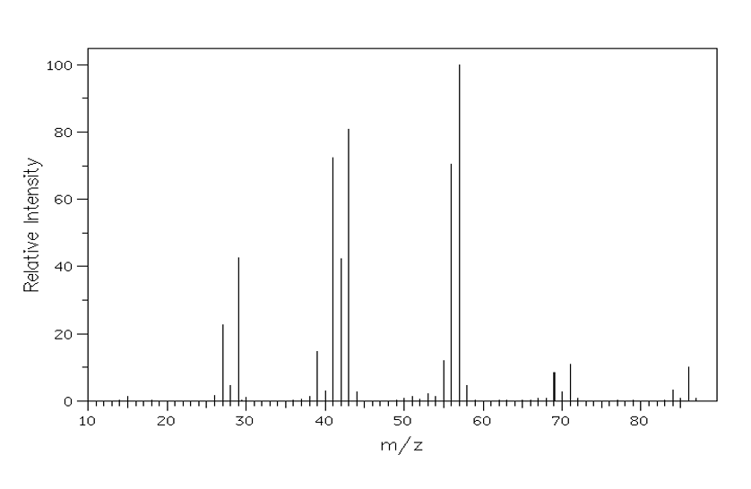

# Exam Questions — Gas/Liquid Chromatography
**37. Analytical Techniques** · Cambridge (CIE) A-LEVEL chemistry (9701)
> Source: [https://www.savemyexams.com/a-level/chemistry/cie/25/topic-questions/](https://www.savemyexams.com/a-level/chemistry/cie/25/topic-questions/) · 5 questions across 1 sets

## Structured Questions (5 questions)

### Q1 — medium — 6 marks

**Q1** [3 marks]

A mixture of volatile esters can be analysed using gas chromatography, coupled with mass spectrometry.

Describe how each method contributes to the analysis.

**Q1** [1 mark]

Define the term retention time.

**Q1** [2 marks]

A mixture of two volatile esters, methyl propanoate and propyl methanoate, is analysed by gas chromatography followed by mass spectrometry.

Explain why the mixture of esters can be separated by gas chromatography.

### Q2 — medium — 5 marks

**Q2** [2 marks]

A mixture is analysed using gas chromatography. The gas chromatogram is shown in Fig. 3.1.

**Fig. 3.1**

Deduce the compound that has the greatest affinity for the stationary phase. Justify and explain your answer.

**Q2** [1 mark]

**Extract:**

A mixture is analysed using gas chromatography. The gas chromatogram is shown in Fig. 3.1.

{align=center} **Fig. 3.1**

Deduce the most abundant compound in the sample. Justify your answer using the gas chromatogram in **Fig. 3.1** in part **(a)**.

**Q2** [2 marks]

An oil tanker is travelling through the English Channel. The tanker has a slight leak which is not large enough to result in an oil slick, but some oil is noticed on a beach.

Suggest how gas chromatography could be used to identify the tanker as the source of crude oil pollution on the beach.

### Q3 — easy — 15 marks

**Q3** [3 marks]

This question is about gas chromatography.

Name the **three** types of chemical that gas chromatography is used for.

**Q3** [2 marks]

State the physical nature of the stationary phase used in gas-liquid chromatography.

**Q3** [2 marks]

State the type of chemical used as the mobile phase in gas chromatography. Give one specific example of a suitable carrier gas.

**Q3** [4 marks]

Results in gas chromatography are based on retention time.

i) Define the term retention time.

[1]

ii) State **three **factors that retention time depends upon.

[3]

**Q3** [1 mark]

State what information the relative size or area under the peak on a gas chromatogram provides.

**Q3** [3 marks]

Gas chromatography is carried out using a polar stationary phase and argon as the carrier gas.

Use the chromatogram in Fig. 1.1 to answer the following questions.

**Fig. 1.1**

i) State which compound has the lowest retention time.

[1]

ii) State which compound is the least polar.

[1]

iii) State which compound has the greatest interaction with the stationary phase.

[1]

### Q4 — medium — 6 marks

**Q4** [1 mark]

State the difference between the mobile phases used in column chromatography and gas-liquid chromatography.

**Q4** [2 marks]

Three compounds, **A**, **B** and **C**, of similar volatility, are mixed together. The mixture is then analysed in a gas chromatograph.

The gas chromatogram produced is shown in Fig. 1.1.

**Fig. 1.1**

State which compound, **A**, **B** or **C**, has the greatest affinity for the stationary phase. Explain your reasoning.

**Q4** [1 mark]

**Extract:**

Three compounds, **A**, **B** and **C**, of similar volatility, are mixed together. The mixture is then analysed in a gas chromatograph.

The gas chromatogram produced is shown in Fig. 1.1.

{align=center} **Fig. 1.1**

State which compound in the mixture shown in Fig. 1.1 is the most abundant. Give a reason for your answer.

**Q4** [2 marks]

Suggest how gas chromatography could be used to confirm that oil pollution found on a beach originated from a specific oil tanker.

### Q5 — hard — 16 marks

**Q5** [3 marks]

Gas chromatography is often connected to mass spectrometry in order to analyse each compound as it exits the gas chromatography column. This combined technique is called GC-MS.

The gas chromatogram of an organic mixture is shown in Fig. 1.1. The stationary phase is a polar, high-boiling point liquid on a solid support.

**Fig. 1.1**

i) State the name of an appropriate mobile phase that could be used to form this gas chromatogram.

[1]

ii) State the number of compounds present in this mixture. Explain how to identify the most polar compound present.

[2]

**Q5** [6 marks]

Two of the compounds in the organic mixture are hydrocarbons with similar retention times.

The mass spectra of the two compounds revealed that they have the same molecular formula but with subtle differences indicating structural isomerism is present.

The mass spectrum of one of the isomers is shown in Fig. 1.2.

Both isomers are tested with bromine water, which remains orange.

**Fig. 1.2**

i) Deduce the molar mass and hence the molecular formula of the isomers.

molar mass ................................................................................

molecular formula ................................................................................

[2]

ii) Deduce the identity of the fragments responsible for the following signals.

*m / e* = 29 ................................................................................

*m / e* = 43 ................................................................................

*m / e* = 57 ................................................................................

[3]

iii) Deduce the skeletal formula of the isomer responsible for this spectrum.

[1]

**Q5** [3 marks]

**Extract:**

Two of the compounds in the organic mixture are hydrocarbons with similar retention times.

The mass spectra of the two compounds revealed that they have the same molecular formula but with subtle differences indicating structural isomerism is present.

The mass spectrum of one of the isomers is shown in Fig. 1.2.

i) Deduce the molar mass and hence the molecular formula of the isomers.

molar mass ................................................................................

molecular formula ................................................................................

Molar mass = 86 (g mol^-1^)
Molecular formula = C~6~H~14~

There is a small peak at *m / e* = 87 in the mass spectrum. This is known as the [M+1] peak.

i) State the identity of the isotope responsible for the [M+1] peak.

[1]

ii) Suggest the type of molecules for which this [M+1] peak would become more pronounced. Explain your answer.

[2]

**Q5** [4 marks]

**Extract:**

Two of the compounds in the organic mixture are hydrocarbons with similar retention times.

The mass spectra of the two compounds revealed that they have the same molecular formula but with subtle differences indicating structural isomerism is present.

The mass spectrum of one of the isomers is shown in Fig. 1.2.

Both isomers are tested with bromine water, which remains orange.

i) Deduce the molar mass and hence the molecular formula of the isomers.

ii) Deduce the identity of the fragments responsible for the following signals.

*m / e* = 29
*m / e* = 43
*m / e* = 57

iii) Deduce the skeletal formula of the isomer responsible for this spectrum.

Mark scheme:
Molar mass = 86 (g mol^-1^)
Molecular formula = C6H14
*m/e* = 29 = C2H5+
*m/e* = 43 = C3H7+
*m/e* = 57 = C4H9+
Skeletal formula of hexane showing a straight chain of 6 carbon atoms

One other isomer present in the original mixture was 2,3-dimethylbutane.

i) Suggest **one** way in which the mass spectrum of 2,3-dimethylbutane will differ from Fig. 1.2 in part **(b)**.

[1]

ii) Suggest an alternative spectroscopic technique for distinguishing between 2,3-dimethylbutane and your answer to **(b)(iii)**.

[1]

iii) Predict which of the two isomers would have the longest retention time. Explain your answer.

[2]
