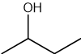
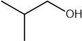
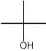
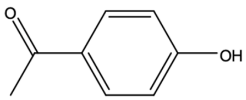
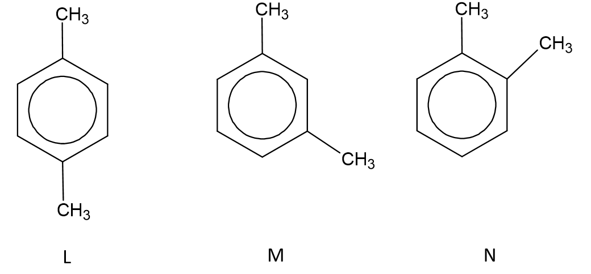
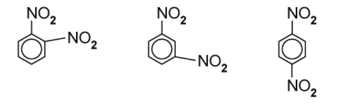

# Mark Schemes — Carbon-13 NMR Spectroscopy
**37. Analytical Techniques** · Cambridge (CIE) A-LEVEL chemistry (9701)

## Structured Questions (6 questions)

### Q1
To calculate the molecular formula of the unknown alcohol:

- Calculate the percentage of oxygen:

% O = 100 − 64.9 − 13.5 = 21.6%

- Calculate the moles of each element per 100 g:

moles of C = $\frac{64.9}{12.0}$ = 5.41

moles of H = $\frac{13.5}{1.0}$ = 13.5

moles of O = $\frac{21.6}{16.0}$ = 1.35

**[1 mark]**

- Divide by the smallest value (1.35) to find the atom ratio C : H : O = 4 : 10 : 1

- The empirical formula is:

C4H10O

**[1 mark]**

- Calculate the empirical formula mass:

empirical formula mass = (4 × 12.0) + (10 × 1.0) + 16.0

empirical formula mass = 74.0 g mol-1

- This matches the given molar mass, so the molecular formula is:

**Final answer:** **C****4****H****10****O**

**[1 mark]**

> **[mark-scheme]**
> 1 mark for correctly calculating the moles of C, H, and O
> 
> 1 mark for correct empirical formula C4H10O
> 
> 1 mark for correct molecular formula C4H10O
> 
> Allow molar mass of 74.12 g mol-1 as given; accept *M*r = 74

> **[exam-tip]**
> The percentage of oxygen is not given directly, so you must calculate it first:
> 
> 100 − 64.9 − 13.5 = 21.6%.
> 
> Divide all mole values by the smallest (1.35) to get the whole number ratio C : H : O = 4 : 10 : 1.
> 
> Since the empirical formula mass (74.0) matches the given molar mass (74.12 g mol-1), the empirical formula and molecular formula are the same: C4H10O.
The four structural isomers of C4H10O and their 13C NMR peak counts are:

| **Skeletal formula of isomer** | **Number of peaks in ****13****C NMR spectrum** |
|---|---|
|  | 4 |
|  | 4 |
|  | 3 |
|  | 2 |

**[6 marks]**

> **[mark-scheme]**
> 1 mark for correct skeletal formula of butan-1-ol
> 
> 1 mark for correct skeletal formula of butan-2-ol
> 
> 1 mark for correct skeletal formula of 2-methylpropan-1-ol
> 
> 1 mark for correct skeletal formula of 2-methylpropan-2-ol
> 
> 1 mark for butan-1-ol = 4 peaks **AND** butan-2-ol = 4 peaks
> 
> 1 mark for 2-methylpropan-1-ol = 3 peaks **AND** 2-methylpropan-2-ol = 2 peaks

> **[exam-tip]**
> Draw the isomers systematically: consider all possible carbon chain lengths (4-carbon straight chain, or 3-carbon chain with a methyl branch at C-2), then vary the position of the −OH group.
> 
> The number of 13C NMR peaks equals the number of chemically distinct carbon environments. Check for symmetry as 2-methylpropan-2-ol has three equivalent methyl groups, giving only 2 carbon environments.
> **[mark-scheme]**
> The isomer that produced the spectrum in Fig. 3.1 is:
> 
> - 2-methylpropan-2-ol **[1 mark]**
> - Peak at 0–50 ppm corresponds to alkyl C (CH3 groups) **[1 mark]**
> - Peak at 50–70 ppm corresponds to C−OH **[1 mark]**
> 
> Allow reference to 2 peaks in the spectrum as justification for identifying 2-methylpropan-2-ol

> **[exam-tip]**
> The spectrum in Fig. 3.1 shows exactly 2 peaks. So, check your answer to part (b) to identify which isomer gives only 2 carbon environments.
> 
> Use the Data Booklet to match each peak to its environment: the peak at 30 ppm corresponds to the three equivalent CH3 groups (alkyl region, 0–50 ppm), and the peak at 70 ppm corresponds to the quaternary C−OH carbon (next to oxygen, 50–70 ppm).

### Q2
To determine the molecular formula of compound K:

- Calculate the moles of each element per 100 g:

moles of C = $\frac{70.58}{12.0}$ = 5.88

moles of H = $\frac{5.92}{1.0}$ = 5.92

moles of O = $\frac{23.50}{16.0}$ = 1.47

**[1 mark]**

- Divide by the smallest value (1.47):

C = $\frac{5.88}{1.47}$ = 4

H =  $\frac{5.92}{1.47}$ 4.03

O = $\frac{1.47}{1.47}$ = 1

- Determine the atom ratio:

4 : 4.03 : 1 ≈ 4 : 4 : 1

- The empirical formula is:

C4H4O

**[1 mark]**

- Calculate the empirical formula mass:

empirical formula mass = (4 × 12.0) + (4 × 1.0) + 16.0

empirical formula mass = 68.0 g mol-1

- From the mass spectrum (Fig. 5.1), the molecular ion peak is at m/e = 136

n = $\frac{136}{68.0}$ = 2

- The molecular formula is:

**Final answer:** **C****8****H****8****O****2**

**[1 mark]**

> **[mark-scheme]**
> 1 mark for calculating the moles ratio for C, H, and O
> 
> 1 mark for correct empirical formula C4H4O
> 
> 1 mark for correct molecular formula C8H8O2
> 
> Allow H moles as 5.92 or 5.93

> **[exam-tip]**
> The H : O moles ratio (5.92 : 1.47) divides to 4.03, which rounds to 4, giving empirical formula C4H4O.
> 
> Read the molecular ion peak from the mass spectrum (Fig. 5.1) as m/e = 136. Divide by the empirical formula mass (68.0) to get n = 2, giving the molecular formula C8H8O2.
> **[mark-scheme]**
> The functional groups present in compound K are:
> 
> - Phenol / arene with −OH group **[1 mark]**
> - pH 5.0 indicates a weak acid
> **AND**
> No reaction with Na2CO3 (aq) confirms it is a weaker acid than carbonic acid / not a carboxylic acid **[1 mark]**
> - Ketone / carbonyl group (C=O) **[1 mark]**
> - Orange precipitate with 2,4-DNPH confirms a C=O group is present
> **AND**
> No reaction with Tollens’ reagent confirms it is not an aldehyde, therefore it is a ketone **[1 mark]**
> 
> Carboxylic acid is not accepted (a carboxylic acid would react with Na2CO3 solution to produce effervescence)

> **[exam-tip]**
> Work through each piece of test evidence systematically as two separate functional groups are present.
> 
> The pH 5.0 and no reaction with Na2CO3 combination is the diagnostic for phenol: phenol is acidic enough to give pH below 7, but not acidic enough to react with carbonate ions. Carboxylic acids do react with Na2CO3, so this result rules out a carboxylic acid.
> 
> 2,4-DNPH identifies any carbonyl compound (aldehyde or ketone). The negative Tollens’ test rules out an aldehyde, so the carbonyl must be a ketone.
The structure of compound K is:

**[1 mark]**

> **[mark-scheme]**
> 1 mark for correct structure of 4-hydroxyphenylethanone
> 
> Evidence from Fig. 5.2:
> 
> - Four peaks at 110–160 ppm
> **AND**
> The molecule contains an arene / benzene ring with 4 unique carbon environments / is 1,4-disubstituted **[1 mark]**
> - Peak at 190–220 ppm corresponds to a carbonyl C=O
> **AND**
> A ketone group (consistent with part (b)) is attached to the benzene ring **[1 mark]**

> **[exam-tip]**
> Use all available information: molecular formula C8H8O2 from part (a) and functional groups (phenol and ketone) from part (b).
> 
> The 13C NMR spectrum (Fig. 5.2) shows peaks in three regions: 110–160 ppm (aromatic ring carbons), 190–220 ppm (carbonyl C=O), and 20–30 ppm (CH3~). Four peaks in the aromatic region confirm 1,4-disubstitution.
> 
> Combining a phenol (−OH on benzene) with a ketone (−COCH3) at the para position gives 4-hydroxyphenylethanone, which accounts for all atoms in C8H8O2 and is consistent with all spectral evidence.

### Q3
The structures of L, M and N are:

**[3 marks]**

> **[mark-scheme]**
> 1 mark for correct structure of L as 1,4-dimethylbenzene (3 carbon environments)
> 
> 1 mark for correct structure of M as 1,3-dimethylbenzene (5 carbon environments)
> 
> 1 mark for correct structure of N as 1,2-dimethylbenzene (4 carbon environments)
> 
> Ethylbenzene is not accepted (it has 6 carbon environments and does not match any entry in Table 1.1)

> **[exam-tip]**
> Start by noting that C8H10 with a benzene ring (C6H5) leaves two carbons. These can be: an ethyl group −CH2CH3 attached to the ring, or two separate methyl groups on the ring.
> 
> Ethylbenzene has 6 carbon environments, which does not match L (3), M (5), or N (4), so only the three dimethylbenzene isomers are needed.
> 
> For the dimethylbenzene isomers, count unique carbon environments using symmetry: 1,4-dimethylbenzene has only 3 environments; 1,3-dimethylbenzene has 5; 1,2-dimethylbenzene has 4.
The completed table is:

| Hydrocarbon | **Number of ****1****H NMR peaks** | **Relative peak area** |
|---|---|---|
| **L** | **Final answer:** **2** | **Final answer:** **3 : 2** |
| **M** | **Final answer:** **4** | **Final answer:** **6 : 1 : 2 : 1** |
| **N** | **Final answer:** **3** | **Final answer:** **3 : 1 : 1** |

**[3 marks]**

> **[mark-scheme]**
> 1 mark for correct number of peaks and relative peak area for L: 2 peaks, ratio 3 : 2
> 
> 1 mark for correct number of peaks and relative peak area for M: 4 peaks, ratio 6 : 1 : 2 : 1
> 
> 1 mark for correct number of peaks and relative peak area for N: 3 peaks, ratio 3 : 1 : 1

> **[exam-tip]**
> Use your structures from part (a) to identify the distinct proton environments in each isomer.
> 
> L (1,4-dimethylbenzene):
> 
> - Two environments
> 
>   - The CH3 protons (6H)
>   - The ring C−H protons (4H)
> - This gives 2 peaks and ratio 3 : 2.
> 
> M (1,3-dimethylbenzene):
> 
> - Four environments
> 
>   - CH3 (6H)
>   - H-C2 (1H)
>   - H-C4/C6 (2H)
>   - H-C5 (1H)
> - This gives 4 peaks and ratio 6 : 1 : 2 : 1.
> 
> N (1,2-dimethylbenzene):
> 
> - Three environments
> 
>   - CH3 (6H)
>   - H-C3/C6 (2H)
>   - H-C4/C5 (2H)
> - This gives 3 peaks and ratio 3 : 1 : 1.
> **[mark-scheme]**
> The isomer with the highest melting point is:
> 
> - L (1,4-dimethylbenzene) **[1 mark]**
> - Most symmetrical isomer / the two CH3 groups are in the para position
> **AND**
> Packs more efficiently in the crystal lattice
> **AND**
> Stronger intermolecular forces (van der Waals / induced dipole-dipole interactions) **[1 mark]**

> **[exam-tip]**
> Melting point depends on how efficiently molecules pack in the crystal lattice, not just the strength of individual intermolecular forces.
> 
> The 1,4-isomer (para) is the most symmetrical because both CH3 groups are directly opposite each other. This allows the molecules to pack more neatly into a regular repeating crystal lattice, increasing the contact area between neighbours and strengthening the overall intermolecular forces.
> 
> The 1,2- and 1,3-isomers are less symmetrical and pack less efficiently, so they have lower melting points.

### Q4
> **[mark-scheme]**
> Explaining why the 13C NMR spectrum of benzene contains only one peak:
> 
> - All six carbon atoms are in the same chemical environment **[1 mark]**

> **[exam-tip]**
> The key to this question is symmetry. Benzene has a perfect hexagonal structure, so every carbon atom has exactly the same bonding environment. In 13C NMR spectroscopy, carbon atoms in the same chemical environment absorb at the same frequency and produce a single combined peak.
> 
> Any molecule where all carbons are symmetrically equivalent will show only one 13C peak. Benzene is the classic example, but watch for other symmetric molecules such as cyclohexane.
> **[mark-scheme]**
> The number of peaks in the low-resolution 1H NMR spectrum of methylbenzene is:
> 
> - 4 / four **[1 mark]**

> **[exam-tip]**
> To count the number of peaks in a low-resolution 1H NMR spectrum, identify how many groups of protons are in different chemical environments. Two protons are in the same environment if they occupy identical positions within the molecule by symmetry.
> 
> For methylbenzene, there are four distinct proton environments:
> 
> - The CH3 group: 3 protons
> - The two ring C–H groups adjacent to the methyl-bearing carbon: 2 protons
> - The two ring C–H groups one further position around the ring: 2 protons
> - The ring C–H group directly opposite the methyl group: 1 proton
> 
> The two pairs of ring protons are each equivalent by symmetry, so each pair counts as one environment. The key to any benzene derivative NMR question is spotting the symmetry elements of the molecule.
The completed table is:

| **Isomer** | **Number of peaks in ****1****H NMR spectrum** | **Number of peaks in ****13****C NMR spectrum** |
|---|---|---|
| 1,2-dimethylbenzene | **Final answer:** **3** | **Final answer:** **4** |
| 1,3-dimethylbenzene | **Final answer:** **4** | **Final answer:** **5** |
| 1,4-dimethylbenzene | **Final answer:** **2** | **Final answer:** **3** |

**[3 marks]**

> **[mark-scheme]**
> 1 mark for 1,2-dimethylbenzene: 1H = 3 **AND** 13C = 4
> 
> 1 mark for 1,3-dimethylbenzene: 1H = 4 **AND** 13C = 5
> 
> 1 mark for 1,4-dimethylbenzene: 1H = 2 **AND** 13C = 3

> **[exam-tip]**
> To count NMR environments in substituted benzenes, draw each structure and identify all lines of symmetry. Carbons or hydrogens that are mirror images of each other through a line of symmetry are equivalent and produce one combined peak.
> 
> For the three dimethylbenzene isomers:
> 
> - 1,2-dimethylbenzene has one plane of symmetry bisecting the bond between the two methyl-bearing carbons. This gives 4 13C environments (the two equivalent methyl carbons plus three distinct ring environments) and 3 1H environments.
> - 1,3-dimethylbenzene has one plane of symmetry through the carbon positioned between the two methyl groups. This gives 5 13C environments and 4 1H environments.
> - 1,4-dimethylbenzene is the most symmetric, with two planes of symmetry. All four ring C–H groups are equivalent, and the two CH3 groups are equivalent. This gives 3 13C environments and 2 1H environments.
> 
> As a general rule, the more symmetric the molecule, the fewer NMR peaks it produces.

### Q5
> **[mark-scheme]**
> The formula of the fragment ion responsible for the peak at *m/e* = 76 is:
> 
> - C6H4+ **[1 mark]**
> 
> The positive charge must be shown. C6H4 without a charge is not accepted.

> **[exam-tip]**
> A fragment ion is produced when a molecule loses one or more atoms or groups after ionisation. The *m/e* value tells you the mass-to-charge ratio of the fragment.
> 
> Dinitrobenzene (C6H4N2O4) has *M*r = (6 x 12) + (4 x 1) + (2 x 14) + (4 x 16) = 168. The peak at *m/e* = 76 is well below the molecular ion, so it is a fragment, not the intact molecule.
> 
> Benzene (C6H6) has *M*r = 78. Losing two hydrogen atoms gives C6H4 with mass 76. The fragment ion is therefore C6H4+.
> 
> Always include the positive charge on any ion in a mass spectrum. Missing this is one of the most common ways to lose a mark on this type of question.
The three structural isomers of dinitrobenzene are:

**[3 marks]**

> **[mark-scheme]**
> 1 mark for correct skeletal formula of 1,2-dinitrobenzene
> 
> 1 mark for correct skeletal formula of 1,3-dinitrobenzene
> 
> 1 mark for correct skeletal formula of 1,4-dinitrobenzene

> **[exam-tip]**
> Dinitrobenzene has two –NO2 groups on a benzene ring. Fix one NO2 group at position 1, then the second can go at position 2 (1,2-), position 3 (1,3-), or position 4 (1,4-). Positions 5 and 6 are equivalent to positions 3 and 2 respectively by symmetry, so there are only three distinct isomers.
> 
> Draw skeletal formulae only. A fully displayed formula showing every C–H bond is not the expected format for CIE questions involving benzene rings.
> **[mark-scheme]**
> Deducing the identity of compound A from the 13C NMR data:
> 
> - Compound **A** is 1,3-dinitrobenzene **[1 mark]**
> - 1,2-dinitrobenzene would produce exactly 3 peaks in its 13C NMR spectrum **[1 mark]**
> - 1,4-dinitrobenzene would produce exactly 2 peaks in its 13C NMR spectrum **[1 mark]**

> **[exam-tip]**
> To identify which isomer has four 13C peaks, count the carbon environments in each structure by looking for lines of symmetry:
> 
> - 1,2-dinitrobenzene has one plane of symmetry between the two NO2-bearing carbons. This gives 3 unique 13C environments.
> - 1,3-dinitrobenzene has one plane of symmetry through the carbon between the two NO2 groups. This gives 4 unique environments, matching compound A.
> - 1,4-dinitrobenzene has two planes of symmetry. This gives only 2 unique environments.
> 
> For the first mark, just state which isomer compound A is. The next two marks require you to justify by accounting for the other two isomers. Showing your reasoning is essential here.

### Q6
> **[mark-scheme]**
> i) The structural formula of TMS is:
> 
> - Si(CH3)4 **[1 mark]**
> 
> ii) Two reasons why TMS is suitable as a standard reference chemical:
> 
> Any **two** from (1 mark for each point):
> 
> - Volatile / has a low boiling point
> - Non-toxic
> - Inert / chemically unreactive
> - Produces a single peak (all 12 hydrogen atoms / all four carbon atoms are in the same environment)
> - Its peak appears far to the right (upfield) / far from most other peaks so it does not overlap with the sample
> 
> **[2 marks]**

> **[exam-tip]**
> For part (i), TMS is a silicon atom bonded to four methyl groups. Its structural formula is Si(CH3)4. You can also write it as (CH3)4Si.
> 
> For part (ii), you need any two distinct reasons. The most commonly tested are:
> 
> - TMS produces a single, sharp peak because all 12 protons (and all four carbons) are equivalent by symmetry.
> - Its peak appears at 0 ppm, well to the right of almost all organic compound peaks, so there is no overlap with the sample.
> - TMS is volatile, so it can be easily removed from the sample after analysis.
> - TMS is inert and does not react with the sample.
> 
> Note that TMS gives a signal of zero on both the 1H and 13C NMR scales. All other peaks are measured as shifts relative to TMS.
> **[mark-scheme]**
> The number of peaks in the 13C NMR spectrum of 1,3-dichlorobenzene is:
> 
> - 4 / four **[1 mark]**

> **[exam-tip]**
> To determine the number of 13C environments in 1,3-dichlorobenzene, draw the structure and look for a vertical plane of symmetry. The plane passes through the two chlorine-bearing carbons (C1 and C3) and the carbon directly opposite (C5 or C2, depending on numbering).
> 
> With this symmetry:
> 
> - C1 and C3 are equivalent (both carry Cl)
> - C2 (between the two Cl groups) is unique
> - C4 and C6 are equivalent
> - C5 (directly opposite C2) is unique
> 
> This gives four distinct 13C environments, so four peaks.
> 
> A common mistake is to count all six carbons separately and give 6 peaks. Always look for the symmetry axis before counting.
> **[mark-scheme]**
> i) The number of peaks in the 13C NMR spectrum of ethylbenzene is:
> 
> - 6 / six **[1 mark]**
> 
> ii) The 13C chemical shift range for the asterisked carbon is:
> 
> - 110–160 ppm **[1 mark]**

> **[exam-tip]**
> For part (i), ethylbenzene has an ethyl group (–CH2CH3) attached to a benzene ring. To count the six environments:
> 
> - The CH3 carbon: 1 environment
> - The CH2 carbon next to the ring: 1 environment
> - The ring carbon bonded to the ethyl group (C1): 1 environment
> - The two ring C–H groups adjacent to C1 (C2 and C6, equivalent by symmetry): 1 environment
> - The two ring C–H groups at C3 and C5 (equivalent by symmetry): 1 environment
> - The ring C–H at C4 (directly opposite the ethyl group): 1 environment
> 
> Total: 6 environments, giving 6 peaks.
> 
> For part (ii), the asterisk is on one of the ring carbons. The Data Booklet gives a shift of 110–160 ppm for sp2 alkene or arene carbons. This is the range to quote.
