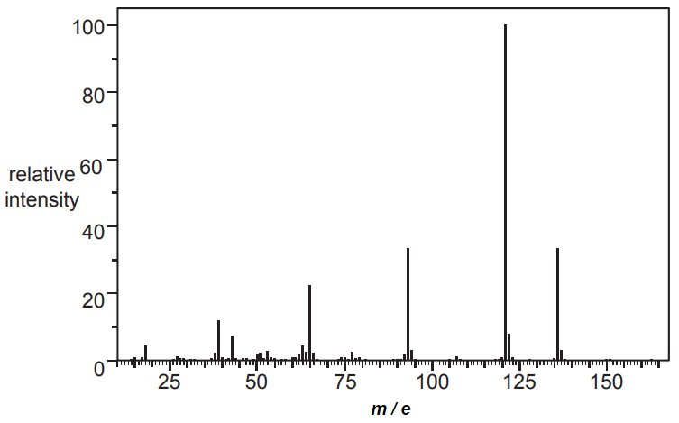
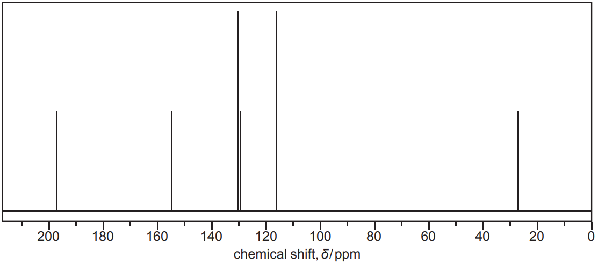
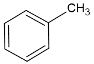
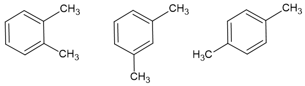
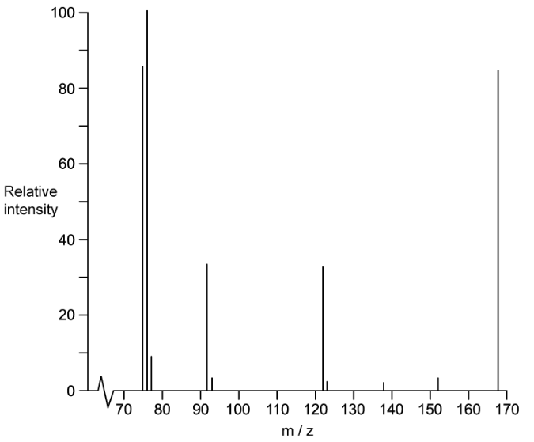
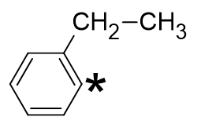

# Exam Questions — Carbon-13 NMR Spectroscopy
**37. Analytical Techniques** · Cambridge (CIE) A-LEVEL chemistry (9701)
> Source: [https://www.savemyexams.com/a-level/chemistry/cie/25/topic-questions/](https://www.savemyexams.com/a-level/chemistry/cie/25/topic-questions/) · 6 questions across 1 sets

## Structured Questions (6 questions)

### Q1 — medium — 12 marks

**Q1** [3 marks]

An unknown alcohol was analysed and found to contain 64.9% carbon, 13.5% hydrogen and the rest oxygen.

The molar mass of the alcohol is 74.12 g mol-1.

Calculate the empirical formula and the molecular formula of the unknown alcohol. Show your working.

**Q1** [6 marks]

**Extract:**

An unknown alcohol was analysed and found to contain 64.9% carbon, 13.5% hydrogen and the rest oxygen.

The molar mass of the alcohol is 74.12 g mol^-1^.

The molecular formula is C4H10O.

Using your answer to part **(a)**, the unknown alcohol can exist as four possible structural isomers.

Complete the table below. Sketch the skeletal formula of each isomer and state the number of peaks expected in the 13C NMR spectrum.

| **Skeletal formula of isomer** | **Number of peaks in ****13****C NMR spectrum** |
|---|---|
|   |   |
|   |   |
|   |   |
|   |   |

**Q1** [3 marks]

**Extract:**

The four structural isomers of C~4~H~10~O and their ^13^C NMR peak counts are:

butan-1-ol: 4 peaks
butan-2-ol: 4 peaks
2-methylpropan-1-ol: 3 peaks
2-methylpropan-2-ol: 2 peaks

The 13C NMR spectrum of one of the isomers is shown in **Fig. 3.1**.

**Fig. 3.1**

Deduce which isomer produced the spectrum shown in **Fig. 3.1**. Use the Data Booklet to explain your answer.

### Q2 — hard — 10 marks

**Q2** [3 marks]

A chemist analyses a naturally occurring compound, **K**.

The percentage composition by mass is carbon 70.58%; hydrogen 5.92% and oxygen 23.50%.

The mass spectrum of the compound is shown in Fig. 5.1.

**Fig. 5.1**

Determine the molecular formula of the compound **K**. Show your working.

**Q2** [4 marks]

The results of qualitative tests performed on compound **K **are shown in Table 5.1.

**Table 5.1**

| **Test** | **Acidity** | **Na****2****CO****3**** (aq)** | **2,4-DNPH** | **Tollens' reagent** |
|---|---|---|---|---|
| Observation | pH 5.0 | No reaction | Orange precipitate | No reaction |

Identify the functional groups present in compound **K**. Explain your answer.

**Q2** [3 marks]

**Extract:**

A chemist analyses a naturally occurring compound, **K**.

The percentage composition by mass is carbon 70.58%; hydrogen 5.92% and oxygen 23.50%.

The molecular formula is C~8~H~8~O~2~

The results of qualitative tests performed on compound **K** are shown in Table 5.1.

**Table 5.1**

| **Test** | **Acidity** | **Na**~**2**~**CO**~**3**~** (aq)** | **2,4-DNPH** | **Tollens' reagent** |
| --- | :---: | :---: | :---: | :---: |
| Observation | pH 5.0 | No reaction | Orange precipitate | No reaction |

The functional groups present in compound K are:
- Phenol / arene with −OH group
- Ketone / carbonyl group (C=O)

The carbon-13 (13C) NMR of compound **K** is shown in Fig. 5.2.

**Fig. 5.2**

Suggest the structure of compound **K** using your answers to **(a)** and **(b)** along with information from Fig. 5.2. Use the Data Booklet to help you. Explain your answer.

### Q3 — hard — 8 marks

**Q3** [3 marks]

Three hydrocarbons, **L**, **M** and **N**, have the molecular formula C8H10. Information about the number of peaks seen in the carbon-13 (13C) NMR spectrum of the three isomers is shown in Table 1.1.

**Table 1.1**

| Hydrocarbon | **Number of **13C NMR **peaks** |
|---|---|
| **L** | 3 |
| **M** | 5 |
| **N** | 4 |

Deduce the structures of compounds **L**, **M** and **N**.

**Q3** [3 marks]

**Extract:**

Three hydrocarbons, **L**, **M** and **N**, have the molecular formula C~8~H~10~. Information about the number of peaks seen in the carbon-13 (^13^C) NMR spectrum of the three isomers is shown in Table 1.1.

{align=center} **Table 1.1**

| Hydrocarbon | **Number of **^13^C NMR **peaks** |
| :---: | :---: |
| **L** | 3 |
| **M** | 5 |
| **N** | 4 |

The structures of L, M and N are:
L is 1,4-dimethylbenzene (3 carbon environments)
M is 1,3-dimethylbenzene (5 carbon environments)
N is 1,2-dimethylbenzene (4 carbon environments)

Complete **Table 1.2** to give details of the proton NMR spectra for isomers **L**, **M** and **N**.

**Table 1.2**

| Hydrocarbon | **Number of ****1****H NMR peaks** | **Relative peak area** |
|---|---|---|
| **L** |   |   |
| **M** |   |   |
| **N** |   |   |

**Q3** [2 marks]

**Extract:**

Three hydrocarbons, **L**, **M** and **N**, have the molecular formula C~8~H~10~. Information about the number of peaks seen in the carbon-13 (^13^C) NMR spectrum of the three isomers is shown in Table 1.1.

**Table 1.1**

| Hydrocarbon | **Number of **^13^C NMR **peaks** |
| :---: | :---: |
| **L** | 3 |
| **M** | 5 |
| **N** | 4 |

The structures of L, M and N are:
L is 1,4-dimethylbenzene (3 carbon environments)
M is 1,3-dimethylbenzene (5 carbon environments)
N is 1,2-dimethylbenzene (4 carbon environments)

Explain which of the three isomers, **L**, **M **or **N **has the highest melting point.

### Q4 — easy — 5 marks

**Q4** [1 mark]

Benzene is analysed using carbon-13 NMR spectroscopy.

Explain why the 13C NMR spectrum of benzene contains only one peak.

**Q4** [1 mark]

Fig. 1.1 shows the skeletal formula of methylbenzene.

**Fig. 1.1**

State the number of peaks that would appear in the low-resolution 1H NMR spectrum of methylbenzene.

**Q4** [3 marks]

There are three isomers of dimethylbenzene shown in Fig. 1.2:

- 1,2-dimethylbenzene
- 1,3-dimethylbenzene
- 1,4-dimethylbenzene

**Fig. 1.2**

Complete Table 1.1 to show the number of expected peaks in the low-resolution 1H NMR and 13C NMR spectra of the three dimethylbenzene isomers.

**Table 1.1**

| **Isomer** | **Number of peaks in ****1****H NMR spectrum** | **Number of peaks in ****13****C NMR spectrum** |
|---|---|---|
| 1,2-dimethylbenzene |   |   |
| 1,3-dimethylbenzene |   |   |
| 1,4-dimethylbenzene |   |   |

### Q5 — medium — 7 marks

**Q5** [1 mark]

Compound **A** is an isomer of dinitrobenzene, C6H4N2O4.

Part of the mass spectrum of **A** is shown in Fig. 2.2.

**Fig. 2.2**

State the formula of the fragment ion responsible for the peak at *m/e* = 76 in Fig. 2.2.

**Q5** [3 marks]

Draw the skeletal formulae of the three structural isomers of dinitrobenzene.

**Q5** [3 marks]

**Extract:**

Compound **A** is an isomer of dinitrobenzene, C~6~H~4~N~2~O~4~.

The three structural isomers of dinitrobenzene are: 1,2-dinitrobenzene, 1,3-dinitrobenzene, and 1,4-dinitrobenzene.

The 13C NMR spectrum of compound **A** contains exactly four peaks.

Deduce which of the three isomers drawn in **(b)** is compound **A**. Explain your reasoning by stating the number of peaks expected in the 13C NMR spectra of the other two isomers.

### Q6 — medium — 6 marks

**Q6** [3 marks]

Tetramethylsilane (TMS) is added as a standard reference chemical when obtaining an NMR spectrum.

i) State the structural formula of TMS.

[1]

ii) State two reasons why TMS is suitable for use as a standard reference chemical in NMR spectroscopy.

[2]

**Q6** [1 mark]

State the number of peaks in the 13C NMR spectrum of 1,3-dichlorobenzene.

**Q6** [2 marks]

i) Deduce the number of peaks that would be present in the 13C NMR spectrum of ethylbenzene, shown in Fig. 1.1.

**Fig. 1.1**

[1]

ii) Use the Data Booklet to state the 13C chemical shift range, δ / ppm, for the carbon atom labelled with an asterisk (*) in Fig. 1.1.

[1]
