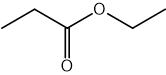
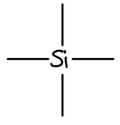
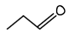
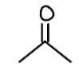
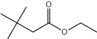
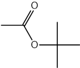
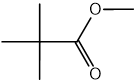

# Mark Schemes — Proton (1H) NMR Spectroscopy
**37. Analytical Techniques** · Cambridge (CIE) A-LEVEL chemistry (9701)

## Structured Questions (8 questions)

### Q1
> **[mark-scheme]**
> The compound used as the reference standard in proton (1H) NMR spectroscopy is:
> 
> - Tetramethylsilane / TMS **[1 mark]**
> 
> Two reasons it is chosen are:
> 
> Any **two** from (1 mark for each point):
> 
> - It gives a single (sharp) peak because all 12 protons are in the same chemical environment
> - Its signal is far to the right / at 0 ppm / upfield (away from other signals)
> - It is chemically inert and does not react with the sample
> - It is volatile / has a low boiling point, so it is easy to remove after analysis
> 
> **[2 marks]**
> **[mark-scheme]**
> i) The functional group in **X** is:
> 
> - Ester / R−COO−R′ **[1 mark]**
> - Absorption at 1745 cm-1 is characteristic of a C=O stretch of an ester (carboxyl C=O range: 1710–1750 cm-1); no O–H absorption (3200–3650 cm-1) confirms the absence of a carboxylic acid **[1 mark]**
> 
> ii) The structural formula of **X** is:
> 
> - CH3COOCH2CH3 (ethyl ethanoate) **[1 mark]**
> 
> Evidence from the 1H NMR spectrum:
> 
> - A triplet at δ 1.3 and a quartet at δ 4.1 indicate an ethyl group, –CH2CH3 **[1 mark]**
> - A singlet at δ 2.0 indicates a methyl group adjacent to a carbonyl, CH3–C=O (no neighbouring H atoms) **[1 mark]**
> - The signal at δ 4.1 indicates the CH2 group is adjacent to an electronegative oxygen, –O–CH2– **[1 mark]**

> **[exam-tip]**
> When using 1H NMR data, start by matching splitting patterns before focusing on chemical shifts. A triplet and quartet pair is a strong indicator of an ethyl group.
> 
> Signals around δ 4 ppm usually suggest protons adjacent to an oxygen atom, while a singlet near δ 2 ppm often indicates a methyl group adjacent to a carbonyl group.
> 
> Only refer to IR evidence if it is explicitly provided in the question.
> **[mark-scheme]**
> i) The halogen present in **Y** is:
> 
> - Bromine / Br **[1 mark]**
> 
> ii) The M+ and [M+2]+ peaks appear in a 1:1 ratio because:
> 
> - Bromine exists as two isotopes, 79Br and 81Br **[1 mark]**
> - These isotopes have an approximately equal natural abundance (~50:50) **[1 mark]**

> **[exam-tip]**
> In mass spectrometry questions, recognise isotopic fingerprints:
> 
> - A **1:1 M****+**** : [M+2]****+**** peak ratio** indicates **bromine** (79Br : 81Br ≈ 50:50)
> - A **3:1 M****+**** : [M+2]****+**** peak ratio** indicates **chlorine** (35Cl : 37Cl ≈ 75:25)
> 
> If you see two peaks two mass units apart with equal height, bromine should be your first conclusion.

### Q2
To calculate the molecular formula of compound **P**:

- Divide each percentage by the relative atomic mass to find the molar ratio:

C = $\frac{58.82}{12.0}$= 4.90

H = $\frac{9.80}{1.0}$= 9.80

O = $\frac{31.38}{16.0}$= 1.96

**[1 mark]**

- Divide by the smallest value (1.96) to find the empirical formula:

C = $\frac{4.90}{1.96}$= 2.5

H = $\frac{9.80}{1.96}$= 5

O = $\frac{1.96}{1.96}$= 1

C : H : O = 2.5 : 5 : 1

multiply by 2

empirical formula = C5H10O2

**[1 mark]**

- Calculate *M*r and confirm using the M+ peak in Fig. 1.1:

*M*r of C5H10O2 = (5 x 12.0) + (10 x 1.0) + (2 x 16.0)

*M*r of C5H10O2 = 102

m/e = 102 peak

molecular formula = **C****5****H****10****O****2**

**[1 mark]**

> **[mark-scheme]**
> 1 mark for correct calculations for C (4.90) **AND** H (9.80) **AND **O (1.96)
> 
> 1 mark for a correct empirical formula of C5H10O2
> 
> 1 mark for a identifying the m/e = 102 peak **AND **stating the correct molecular formula of C5H10O2

> **[exam-tip]**
> Use all available information: the percentage composition gives the empirical formula; the M+ peak at m/e = 102 in the mass spectrum confirms the molecular formula.
> 
> Showing each step of your working helps identify errors and earns partial marks if the final answer is wrong.
> **[mark-scheme]**
> - **P** does not contain a carboxylic acid
> **AND**
> The Na2CO3 (aq) test is negative **[1 mark]**
> - **P** does not contain an aldehyde or ketone
> **AND**
> The 2,4-DNPH test is negative **[1 mark]**
> - **P** does not contain an aldehyde
> **AND**
> The Tollens' reagent test is negative **[1 mark]**
> - **P** could be an ester
> **OR**
> **P** could be an insoluble diol **[1 mark]**

> **[exam-tip]**
> It is often easier to state what functional groups are absent (from negative results) before deducing what is present.
> 
> Negative results are as informative as positive ones:
> 
> - Na2CO3 (aq) no change → no carboxylic acid
> - 2,4-DNPH no change → no carbonyl (aldehyde or ketone)
> - Tollens' no change → no aldehyde
> 
> An ester fits: it contains two oxygens, is insoluble in water and does not respond to any of these tests. A diol is also possible (higher alcohols are poorly soluble), but further evidence is needed to distinguish them.
> **[mark-scheme]**
> The functional group present in compound **P**:
> 
> - Ester **[1 mark]**
> 
> Explanation:
> 
> - The peak at δ = 162 ppm corresponds to the C=O of a carboxyl group (carboxyl range: 160–185 ppm) **[1 mark]**
> - The peak at δ = 63 ppm corresponds to a C–O group (C–O next to oxygen range: 50–70 ppm) **[1 mark]**

> **[exam-tip]**
> Match the observed δ values to the ranges in the Data Booklet:
> 
> - δ = 162 ppm falls in the carboxyl C=O range (160–185 ppm)
> - δ = 63 ppm falls in the C–O range (50–70 ppm)
> 
> An ester is consistent with both peaks, the presence of two oxygens in the molecular formula, and the negative results from parts (a) and (b). It contains a carboxyl C=O and a C–O–C linkage, neither of which reacts with Na2CO3, 2,4-DNPH or Tollens' reagent.
The skeletal formula of compound **P** is:

**[1 mark]**

> **[mark-scheme]**
> 1 mark for the correct skeletal formula of compound **P**
> 
> Explanation:
> 
> Any **two** from (1 mark for each point):
> 
> - The spectrum shows two quartets and two triplets
> - A quartet arises from a –CH2– adjacent to a CH3 (n = 3; n + 1 = 4 → quartet)
> **AND**
> A triplet arises from a –CH3 adjacent to a CH2 (n = 2; n + 1 = 3 → triplet)
> **AND**
> Each quartet/triplet pair identifies an ethyl (–CH2CH3) group
> - Two non-identical ethyl groups are consistent with the structure: one –O–CH2CH3 (ester oxygen side) and one –CO–CH2CH3 (acyl side)
> 
> **[2 marks]**

> **[exam-tip]**
> Several ester isomers share the molecular formula C5H10O2. The splitting patterns in the 1H NMR identify the specific structure.
> 
> A quartet/triplet pair reveals an ethyl group. Two such pairs at different chemical shifts indicate two non-equivalent ethyl groups, which is the distinguishing feature of ethyl propanoate over other C5H10O2 esters.

### Q3
The name and skeletal formula of the compound commonly used as a reference standard in proton (¹H) NMR spectroscopy are:

Tetramethylsilane

> **[mark-scheme]**
> 1 mark for the correct name: tetramethylsilane
> 
> 1 mark for the correct skeletal or displayed formula of TMS
> 
> The abbreviation TMS is not accepted without the full name.
> 
> A partially displayed structure with CH3 groups not shown in full is accepted.

> **[exam-tip]**
> TMS (tetramethylsilane, Si(CH3)4) is the reference standard for both ¹H NMR and ¹³C NMR. You need to be able to name it, draw it, and explain why it is used as a standard.
The completed table is:

| Isomer | Number of peaks in 1H NMR spectrum | Number of peaks in 13C NMR spectrum |
|---|---|---|
| **A** | 3 | 3 |
| **B** | 4 | 4 |
| **C** | 1 | 2 |

**[6 marks]**

> **[mark-scheme]**
> 1 mark for A having 3 peaks in the 1H NMR spectrum
> 
> 1 mark for A having 3 peaks in the 13C NMR spectrum
> 
> 1 mark for B having 4 peaks in the 1H NMR spectrum
> 
> 1 mark for B having 4 peaks in the 13C NMR spectrum
> 
> 1 mark for C having 1 peak in the 1H NMR spectrum
> 
> 1 mark for C having 2 peaks in the 13C NMR spectrum

> **[exam-tip]**
> Count unique chemical environments, not the number of atoms. Use symmetry to spot equivalent atoms as they give a single peak.
> 
> For 1H NMR, look for groups of protons in identical surroundings. For 13C NMR, apply the same logic to carbon atoms.
> 
> In 2,2-dimethylpropane (**C**): all 12 H atoms are equivalent (1 peak in 1H NMR), but there are 2 carbon environments, which are the central carbon and the four equivalent CH3 carbons (2 peaks in 13C NMR).
> **[mark-scheme]**
> - The splitting pattern depends on the number of adjacent / neighbouring protons **[1 mark]**
> - The methyl groups attached to C-2 in isomer **B** are adjacent to one neighbouring proton / a –CH– group
> **AND**
> n + 1 = 1 + 1 = 2 (doublet) **[1 mark]**
> - The methyl groups in isomer **C** have no neighbouring protons / are adjacent to a carbon with no H atoms
> **AND**
> n + 1 = 0 + 1 = 1 (singlet) **[1 mark]**

> **[exam-tip]**
> The n + 1 rule: the number of peaks in a splitting pattern = n + 1, where n is the number of H atoms on adjacent carbon atoms.
> 
> In 2-methylbutane (**B**), the two CH3 groups on C-2 are each adjacent to C-3, which has 1 H. So n = 1 and the splitting is a doublet (2 peaks).
> 
> In 2,2-dimethylpropane (**C**), all four CH3 groups are attached to a central carbon with no H atoms. So n = 0 and the splitting is a singlet (1 peak).

### Q4
The completed Table 2.1:

| Spectrum | Organic compound | Explanation |
|---|---|---|
| **A** | Ethane-1,2-diol | M+ peak at m/e = 62, consistent with Mr of ethane-1,2-diol, C2H6O2 (Mr = 62) |
| **B** | Ethanedioic acid | M+ peak at m/e = 90, consistent with Mr of ethanedioic acid, C2H2O4 (Mr = 90) |

**[2 marks]**

> **[mark-scheme]**
> 1 mark for Spectrum **A** correctly identified as ethane-1,2-diol **AND** correct explanation
> 
> 1 mark for Spectrum **B** correctly identified as ethanedioic acid **AND** correct explanation

> **[exam-tip]**
> The M+ peak appears at m/e equal to the relative molecular mass (for a singly charged ion, z = 1, so m/e = *M*r).
> 
> Tiny peaks at M+ + 1 are sometimes visible due to 13C isotopes (approximately 1% natural abundance); these are only significant in high-resolution mass spectra.
The completed Table 2.2:

| Spectrum | Organic compound | Explanation |
|---|---|---|
| **C** | Ethanedioic acid | Spectrum **C** contains an absorption at 1700–1750 cm-1, matching the C=O stretch of the carboxyl group in ethanedioic acid |
| **D** | Ethane-1,2-diol | Spectrum **D** shows a broad absorption at 3200–3600 cm-1, characteristic of the O–H stretch in an alcohol |

**[2 marks]**

> **[mark-scheme]**
> 1 mark for Spectrum **C** correctly identified as ethanedioic acid **AND** correct explanation
> 
> 1 mark for Spectrum **D** correctly identified as ethane-1,2-diol **AND** correct explanation

> **[exam-tip]**
> Ethanedioic acid is a hydrated solid acid, so O–H absorptions from both the carboxylic acid groups and the water of crystallisation are present. This makes it harder to distinguish from ethane-1,2-diol on O–H alone.
> 
> The clearest distinguishing absorption is the C=O stretch at 1670–1740 cm-1 in ethanedioic acid, which is absent in ethane-1,2-diol.
> **[mark-scheme]**
> - There are two peaks, indicating two unique 1H / proton environments **[1 mark]**
> - The integration ratio of the peaks is 2:1 (CH2 : OH) **[1 mark]**
> - The larger peak corresponds to the –CH2– groups (4H) and the smaller peak to the –OH groups (2H); this is consistent with the structure of ethane-1,2-diol **[1 mark]**

> **[exam-tip]**
> State the ratio of proton environments, not the absolute number of protons. It is incorrect to say ‘two protons in one environment and one in another’ as the integration ratio 4:2 simplifies to 2:1.
> **[mark-scheme]**
> For the proton (1H) NMR spectrum of ethanedioic acid:
> 
> - One peak / signal **[1 mark]**
> - No splitting / singlet **[1 mark]**

> **[exam-tip]**
> Ethanedioic acid (HOOC–COOH) is a highly symmetrical molecule. Both carboxylic acid protons are in identical environments and are the only protons in the molecule, so there is only one 1H environment.
> 
> There are no adjacent C–H groups (the C–C bond connects two carboxyl carbons, which bear no H atoms), so no spin-spin coupling occurs and the peak is a singlet.

### Q5
i) Showing that the empirical formula of compound **X** is C3H6O:

- Divide the percentage by mass of each element by its *A*r:

carbon = $\frac{62.1}{12.0}$  = 5.175

hydrogen = $\frac{10.3}{1.0}$ = 10.3

oxygen = $\frac{27.6}{16.0}$ = 1.725

**[1 mark]**

- Divide each value by the smallest (1.725) to give the simplest whole-number ratio:

carbon = $\frac{5.175}{1.725}$  = 3

hydrogen = $\frac{10.3}{1.725}$ = 5.97

oxygen = $\frac{1.725}{1.725}$ = 1

carbon : hydrogen : oxygen = 3 : 5.97 : 1

**[1 mark]**

- So, the empirical formula is:

**Final answer:** **C****3****H****6****O**

**[1 mark]**

> **[mark-scheme]**
> 1 mark for dividing the percentage by mass by the atomic mass for carbon **AND** hydrogen **AND** oxygen
> 
> 1 mark for the carbon : hydrogen : oxygen ratio ≈ 3 : 5.97 : 1
> 
> 1 mark for the empirical formula C3H6O

> **[mark-scheme]**
> ii) The molecular formula of compound **X** is:
> 
> - C3H6O
> **AND**
> The empirical formula mass (3 x 12.0 + 6 x 1.0 + 16.0 = 58.0) is equal to the *M*r **[1 mark]**

> **[exam-tip]**
> To find the empirical formula:
> 
> - Divide the % by mass of each element by its *A*r
> - → Divide all values by the smallest to give the simplest whole-number ratio
> - → Multiply through if necessary to reach whole numbers
> 
> To find the molecular formula: calculate the empirical formula mass and divide the *M*r by it to find the multiplier. Here the multiplier is 1, so the molecular formula equals the empirical formula.
The skeletal formulae of two structural isomers of compound **X** that contain a carbonyl group are:

**[2 marks]**

> **[mark-scheme]**
> 1 mark for the skeletal formula of propanal
> 
> 1 mark for the skeletal formula of propanone
> 
> Displayed formulae and full structural formulae are also accepted.

> **[exam-tip]**
> The molecular formula of compound **X** is C3H6O. A carbonyl group contains a C=O bond.
> 
> With 3 carbons and a C=O group, only two arrangements are possible:
> 
> - C=O at the end of the chain → propanal (an aldehyde, –CHO)
> - C=O in the middle of the chain → propanone (a ketone, –CO–)
> **[mark-scheme]**
> i) The number of peaks in the 13C NMR spectrum of cyclopropanol is:
> 
> - 2 / two **[1 mark]**
> 
> ii) The substance that can be added is:
> 
> - D2O **[1 mark]**
> 
> The change to the spectrum:
> 
> - The peak due to the –OH proton will disappear **[1 mark]**

> **[exam-tip]**
> For part (i): cyclopropanol has a line of symmetry through the C–OH carbon, making the two CH2 groups equivalent. This gives only 2 carbon environments: the C–OH carbon and the two equivalent CH2 carbons.
> 
> For part (ii): adding D2O causes deuterium to exchange with the labile –OH proton. The replaced proton no longer appears in the 1H NMR spectrum, so the –OH peak disappears. This technique is used to confirm the presence of –OH peaks in 1H NMR spectra.

### Q6
> **[mark-scheme]**
> The number of peaks in the carbon-13 NMR spectrum of lidocaine:
> 
> - Nine / 9 **[1 mark]**

> **[exam-tip]**
> Lidocaine contains two sets of equivalent carbons due to molecular symmetry: the two Ar–CH3 groups on the ring are equivalent, and the two N–CH2CH3 groups are equivalent (giving one environment for the CH2 carbons and one for the CH3 carbons).
> 
> The nine distinct carbon environments are:
> 
> 1. Amide C=O
> 2. N–CH2–CO (methylene between N and carbonyl)
> 3. Aromatic C-1 (bearing –NH–)
> 4. Aromatic C-2/C-6 (bearing –CH3; equivalent pair → one environment)
> 5. Aromatic C-3/C-5 (–CH–; equivalent pair → one environment)
> 6. Aromatic C-4 (–CH–)
> 7. Ar–CH3 (ring methyls; equivalent pair → one environment)
> 8. N–CH2–CH3 (ethyl CH2; equivalent pair → one environment)
> 9. N–CH2–CH3 (ethyl CH3; equivalent pair → one environment)
The completed Table 3.1:

| **δ / ppm** | **environment** **of proton** | **number of **1**H atoms** **responsible for the peak** | **splitting pattern** |
|---|---|---|---|
| **1.2** | terminal methyl groups next to CH2 | 6 | triplet |
| **2.3** | **Final answer:** **methyl groups attached to the aromatic ring** | **Final answer:** **6** | **Final answer:** **singlet** |
| **3.0** | **Final answer:** **CH****2**** next to carbonyl group** | **Final answer:** **2** | **Final answer:** **singlet** |
| **7.1–7.4** | attached to the aromatic ring | 3 | overlapping peaks |
| **9.0** | **Final answer:** **amide N–H** | **Final answer:** **1** | **Final answer:** **singlet** |

**[3 marks]**

> **[mark-scheme]**
> 1 mark for δ 2.3: methyl groups attached to the aromatic ring **AND** 6H **AND** singlet
> 
> 1 mark for δ 3.0: CH2 next to carbonyl group **AND** 2H **AND** singlet
> 
> 1 mark for δ 9.0: amide N–H **AND** 1H **AND** singlet

> **[exam-tip]**
> The answer to part (a) can help guide you when assigning peaks.
> 
> The following proton environments are already given in Table 3.1:
> 
> - δ 7.1–7.4: aromatic ring protons (3H, overlapping peaks)
> - δ 1.2: terminal methyl groups on the ethyl chains (6H, triplet; split by adjacent –CH2–)
> 
> For the blank rows:
> 
> - δ 2.3: the two Ar–CH3 groups are equivalent and have no neighbouring protons → singlet, 6H (alkyl next to aromatic ring: 2.3–3.0 ppm)
> - δ 3.0: the –N–CH2–CO– group has no neighbouring H-bearing carbons → singlet, 2H (alkyl next to C=O: 2.2–3.0 ppm)
> - δ 9.0: the amide N–H has no adjacent H-bearing carbons → singlet, 1H (amide: 5.0–12.0 ppm)
> **[mark-scheme]**
> The absorption at δ 1.2 ppm is a triplet because:
> 
> - There is a neighbouring / adjacent –CH2– group
> **OR**
> There are two protons on the adjacent carbon (n = 2), so n + 1 = 3 (triplet) **[1 mark]**

> **[exam-tip]**
> The two equivalent terminal –CH2CH3 groups each have their CH3 adjacent to a –CH2– (n = 2 neighbouring protons). By the n + 1 rule, the splitting pattern is a triplet.
> 
> Do not confuse the –N–CH2–CO– methylene (singlet, δ 3.0) with the –N–CH2–CH3 ethyl methylenes; they are different environments with different splitting patterns.

### Q7
> **[mark-scheme]**
> The equation, using structural formulae:
> 
> - (CH3CO)2O + CH3CH(OH)CH3 → CH3COOCH(CH3)2 + CH3COOH **[1 mark]**

> **[exam-tip]**
> The reaction of an alcohol with an acid anhydride produces an ester and the corresponding carboxylic acid, not water. The most common mistake is writing water as the second product by analogy with esterification using a carboxylic acid.
> 
> Take care with the structural formulae: isopropyl ethanoate (CH3COOCH(CH3)2) and ethanoic acid (CH3COOH) must both be written correctly.
> **[mark-scheme]**
> i) A liquid stationary phase separates organic compounds by:
> 
> - Their relative solubility in the stationary phase **[1 mark]**
> 
> ii) Deducing relative retention times:
> 
> - Both esters have the same functional groups
> **AND**
> they will have similar retention times **[1 mark]**
> - The alcohol is not soluble in the non-polar alkane stationary phase leading to a short retention time
> **AND**
> the alkane contaminant is highly soluble in the alkane stationary phase leading to a long retention time **[1 mark]**

> **[exam-tip]**
> Separation in GC depends on the relative solubility of compounds in the mobile and stationary phases.
> 
> - Non-polar compounds (e.g. alkanes) are strongly attracted to a non-polar (alkane) stationary phase → longer retention times
> - Polar compounds (e.g. alcohols) are weakly attracted to a non-polar stationary phase → shorter retention times
> - Esters are polar but less so than alcohols; the two esters have the same functional groups so similar solubility → similar retention times
> 
> Without further information you can only state that the two esters will have similar (not identical) retention times.
i) To calculate the molecular formula of the ester:

- Divide each percentage by the relative atomic mass to find the molar ratio:

C = $\frac{66.63}{12.0}$ = 5.55

H = $\frac{11.18}{1.0}$ = 11.18

O = $\frac{22.19}{16.0}$ = 1.39

**[1 mark]**

- Divide by the smallest value (1.39) to find the empirical formula:

C = $\frac{5.55}{1.39}$ = 4

H = $\frac{11.18}{1.39}$ = 8

O = $\frac{1.39}{1.39}$ = 1

- So, the empirical formula:

C4H8O

**[1 mark]**

- Calculate *M*r of the empirical unit:

*M*r of C4H8O = (4 x 12.0) + (8 x 1.0) + 16.0

*M*r of C4H8O = 72.0

- Confirm using the M+ peak in Fig. 2.1:

m/e = 144

144 = 72.0 x 2

molecular formula = **C****8****H****16****O****2**

**[1 mark]**

> **[mark-scheme]**
> 1 mark for the correct molar ratio of C (5.55) **AND** H (11.18) **AND** O (1.39)
> 
> 1 mark for the correct empirical formula of C4H8O
> 
> 1 mark for identifying the peak at m/e = 144 **AND** a correct molecular formula of C8H16O2

ii) To deduce the skeletal formula of the ester:

- δ 3.8 ppm: –O–CH2– (2H, quartet; adjacent CH3 gives n = 3, n + 1 = 4)
- δ 2.2 ppm: –CH2–C=O (2H, singlet; adjacent quaternary carbon bears no H atoms)
- δ 1.3 ppm: –O–CH2–CH3 (3H, triplet; adjacent CH2 gives n = 2, n + 1 = 3)
- δ 0.9 ppm: (CH3)3C– (9H, singlet; integration of 9 confirms three equivalent methyl groups; adjacent quaternary carbon bears no H atoms, confirming tert-butyl group)

The skeletal formula of the ester is:

**[5 marks]**

> **[mark-scheme]**
> 1 mark for identifying δ 3.8 ppm as –O–CH2–, with supporting explanation/information
> 
> 1 mark for identifying δ 2.2 ppm: –CH2–C=O, with supporting explanation/information
> 
> 1 mark for identifying δ 1.3 ppm: –O–CH2–CH3, with supporting explanation/information
> 
> 1 mark for identifying δ 0.9 ppm: (CH3)3C–, with supporting explanation/information
> 
> 1 mark for the correct skeletal formula of ethyl 3,3-dimethylbutanoate

> **[exam-tip]**
> Work through the problem systematically:
> 
> 1. Calculate the empirical formula from % composition
> 2. Confirm the molecular formula using the M+ peak at m/e = 144
> 3. Use the NMR spectrum to identify structural fragments
> 
> For the NMR fragment identification:
> 
> The peaks at δ 3.8 (quartet, 2H) and δ 1.3 (triplet, 3H) together identify an –O–CH2CH3 ethyl ester group (δ 3.2–4.0 ppm = alkyl next to electronegative atom; δ 0.9–1.7 ppm = alkyl).
> 
> The peak at δ 2.2 (singlet, 2H) identifies a –CH2– adjacent to both the ester carbonyl and a quaternary carbon (δ 2.2–3.0 ppm = alkyl next to C=O; singlet because the adjacent quaternary carbon bears no H atoms).
> 
> The peak at δ 0.9 (singlet, 9H) is the key diagnostic for the tert-butyl group. Nine equivalent protons with no adjacent H-bearing carbon means three identical CH3 groups on a quaternary carbon, –C(CH3)3.

### Q8
> **[mark-scheme]**
> i) CDCl3 is used as the solvent instead of CHCl3 because:
> 
> - CDCl3 contains no protons / 1H atoms, so it produces no peak on the spectrum
> **OR**
> CHCl3 contains protons / 1H atoms, so it produces a peak on the spectrum **[1 mark]**
> 
> ii) The purpose of adding TMS:
> 
> - It acts as a reference / reference standard, defining δ = 0 on the chemical shift scale **[1 mark]**

> **[exam-tip]**
> CDCl3 (deuterated chloroform) is used as an NMR solvent because deuterium (2H) resonates at a completely different radio frequency and does not appear in the 1H NMR spectrum.
> 
> TMS (tetramethylsilane, Si(CH3)4) is added as the reference standard. All other chemical shifts are measured relative to its signal at δ = 0.
> **[mark-scheme]**
> The proton environment giving rise to the peak at δ = 3.8 ppm is:
> 
> - The –CH3 group of the –OCH3 / methyl ester group **[1 mark]**
> - It is a singlet because there are no adjacent / neighbouring protons **[1 mark]**
> - A peak area / integration of 3 indicates there are 3 protons in this environment **[1 mark]**

> **[exam-tip]**
> Use three pieces of evidence to identify a peak:
> 
> 1. Chemical shift: δ = 3.8 ppm falls in the range for alkyl groups next to an electronegative atom (3.2–4.0 ppm)
> 2. Splitting pattern: a singlet means no adjacent protons (n + 1 = 1, so n = 0)
> 3. Integration: a value of 3 indicates 3 equivalent protons, consistent with a –CH3 group
> 
> Only the –OCH3 group satisfies all three criteria.
The skeletal formulae of the two ester isomers of C6H12O2 that each produce exactly two singlets in their 1H NMR spectra are:

**[2 marks]**

> **[mark-scheme]**
> 1 mark for the correct structure of methyl 2,2-dimethylpropanoate
> 
> 1 mark for the correct structure of tert-butyl ethanoate

> **[exam-tip]**
> Two singlet peaks with a 3:1 area ratio means two groups of protons in the ratio 3:1 (or 9:3, etc.) where each group has no adjacent protons.
> 
> An ester with –COOC– in the middle can carry a –C(CH3)3 group on one side (9 H, singlet) and –OCH3 on the other (3 H, singlet), giving a 9:3 = 3:1 ratio. Swapping the groups gives the second isomer.
> **[mark-scheme]**
> i) The simplest whole-number ratio of protons in each environment:
> 
> - 2 : 2 : 2 : 3 : 3 **[1 mark]**
> 
> ii) For the peaks at δ = 3.5 and δ = 1.2:
> 
> - δ 3.5 corresponds to a –CH2– group adjacent to an oxygen atom / –O–CH2– **[1 mark]**
> - δ 3.5 is a quartet because there is an adjacent CH3 group (n = 3, so n + 1 = 4) **[1 mark]**
> - δ 1.2 corresponds to an alkyl –CH3 group **[1 mark]**
> - δ 1.2 is a triplet because there is an adjacent –CH2– group (n = 2, so n + 1 = 3) **[1 mark]**

> **[exam-tip]**
> Integration values give the ratio of protons in each environment. The values 0.6, 0.6, 0.6, 0.9, 0.9 simplify to 2 : 2 : 2 : 3 : 3.
> 
> When explaining a splitting pattern, state three things:
> 
> 1. Identify the proton environment from the chemical shift and Table 1.1
> 2. Name the splitting pattern (singlet, doublet, triplet, quartet)
> 3. Justify using the n + 1 rule: state how many protons are on the adjacent carbon
> **[mark-scheme]**
> - **B** **[1 mark]**

> **[exam-tip]**
> The spectrum shows four peaks, corresponding to four different carbon environments. Isomer **B** has exactly four:
> 
> - 30 ppm: three equivalent CH3 groups of the *tert*-butyl group (C–C=O range)
> - Just above 30 ppm: the central quaternary carbon of the *tert*-butyl group (C–O2R range)
> - 50 ppm: the –OCH3 carbon (C–O range)
> - approximately 180 ppm: the ester C=O carbon (RC**O**OR, carboxyl range)
> 
> Count the peaks before assigning environments; this tells you which isomer to focus on.
