# Exam Questions — Proton (1H) NMR Spectroscopy
**37. Analytical Techniques** · Cambridge (CIE) A-LEVEL chemistry (9701)
> Source: [https://www.savemyexams.com/a-level/chemistry/cie/25/topic-questions/](https://www.savemyexams.com/a-level/chemistry/cie/25/topic-questions/) · 8 questions across 1 sets

## Structured Questions (8 questions)

### Q1 — hard — 12 marks

**Q1** [3 marks]

Compound **X** contains carbon, hydrogen and oxygen only. It has a relative molecular mass (*M*r) of 88.

The infra-red spectrum of **X** shows a strong absorption at 1745 cm−1 but no absorption between 3200 cm−1 and 3650 cm−1.

The proton (1H) NMR spectrum of **X** is shown in Fig 8.1

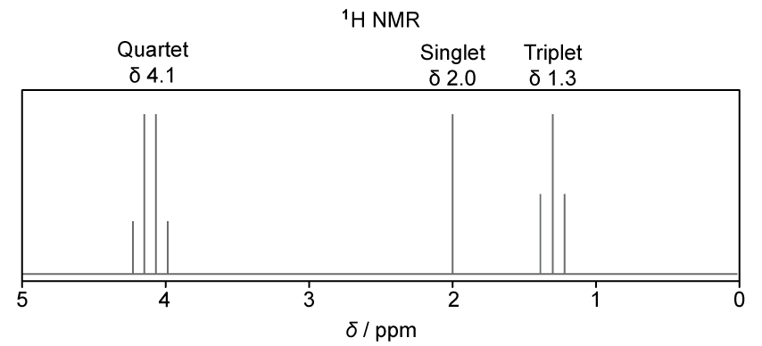

**Fig 8.1**

State the name of the compound used as a reference standard in proton (1H) NMR spectroscopy and state two reasons why it is chosen for this purpose.

**Q1** [6 marks]

**Extract:**

Compound **X** contains carbon, hydrogen and oxygen only. It has a relative molecular mass (*M*~r~) of 88.

The infra-red spectrum of **X** shows a strong absorption at 1745 cm^−1^ but no absorption between 3200 cm^−1^ and 3650 cm^−1^.

The proton (^1^H) NMR spectrum of **X** is shown in Fig 8.1

Proton NMR spectrum with a quartet at 4.1 ppm, a singlet at 2.0 ppm, and a triplet at 1.3 ppm, displayed along a delta scale from 5 to 0 ppm.

i) Using the IR data, identify the functional group present in **X**. Explain your answer.

[2]

ii) Use the proton (1H) NMR spectrum to deduce the structural formula of **X**.

Explain how you reached your conclusion by referring to the chemical shifts and splitting patterns of the peaks.

[4]

**Q1** [3 marks]

A different compound, **Y**, contains a halogen atom. The mass spectrum of **Y** shows two molecular ion peaks, M+ and [M+2]+, of approximately equal height (1:1 ratio).

i) State the identity of the halogen present in **Y**.

[1]

ii) Explain why the M+ and [M+2]+ peaks appear in this ratio.

[2]

### Q2 — hard — 13 marks

**Q2** [3 marks]

Compound **P** is a naturally occurring chemical found in strawberries, apples and Parmesan cheese.

The percentage by mass is carbon 58.82%, hydrogen 9.80% and oxygen 31.38%.

The mass spectrum of compound **P** is recorded in Fig. 1.1.

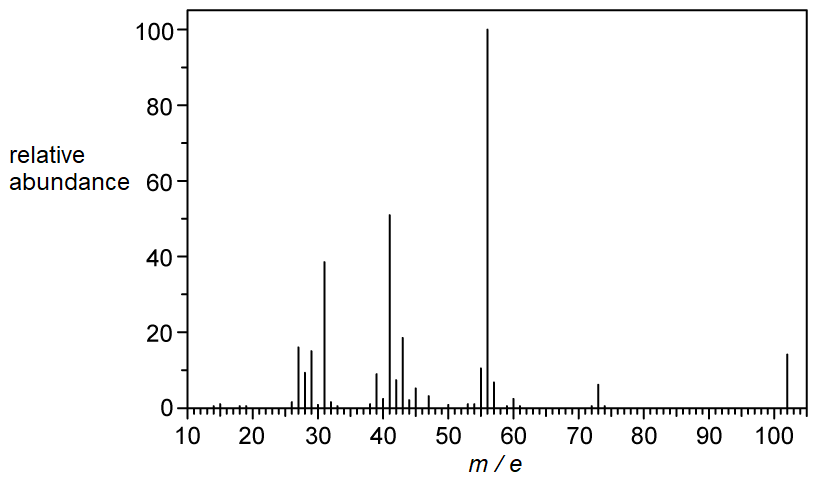

**Fig. 1.1**

Calculate the molecular formula of compound **P**. Show your working.

**Q2** [4 marks]

**Extract:**

Compound **P** is a naturally occurring chemical found in strawberries, apples and Parmesan cheese.

The percentage by mass is carbon 58.82%, hydrogen 9.80% and oxygen 31.38%.

molecular formula = C~5~H~10~O~2~

Table 1.1 shows the results of qualitative tests performed on compound **P**.

**Table 1.1**

| **Test** | **Observation** |
|---|---|
| **Addition of H****2****O** | Forms separate layers |
| **Na****2****CO****3**** (aq)** | No visible change |
| **2,4-DNPH** | No visible change |
| **Tollens' reagent** | No visible change |

Deduce the functional groups present in compound **P**. Explain your answers with reference to Table 1.1.

**Q2** [3 marks]

**Extract:**

Table 1.1 shows the results of qualitative tests performed on compound **P**.

**Table 1.1**

| **Test** | **Observation** |
| :---: | :---: |
| **Addition of H**~**2**~**O** | Forms separate layers |
| **Na**~**2**~**CO**~**3**~** (aq)** | No visible change |
| **2,4-DNPH** | No visible change |
| **Tollens' reagent** | No visible change |

Deduce the functional groups present in compound **P**. Explain your answers with reference to Table 1.1.

The carbon-13 (13C) NMR spectrum of compound **P** is shown in Fig. 1.2.

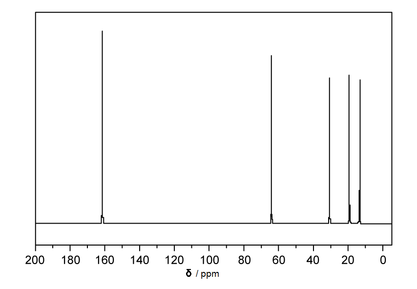

**Fig. 1.2**

Deduce the functional group present in compound **P**, using your answer to **(b)** and information from Fig. 1.2 and the Data Booklet. Explain your answer.

**Q2** [3 marks]

**Extract:**

Compound P is a naturally occurring chemical found in strawberries, apples and Parmesan cheese.

The percentage by mass is carbon 58.82%, hydrogen 9.80% and oxygen 31.38%.

Molecular formula = C5H10O2

Table 1.1 shows the results of qualitative tests performed on compound P.

Table 1.1
| Test | Observation |
| Addition of H2O | Forms separate layers |
| Na2CO3 (aq) | No visible change |
| 2,4-DNPH | No visible change |
| Tollens' reagent | No visible change |

P could be an ester or an insoluble diol.

The functional group present in compound P is an ester. The peak at δ = 162 ppm corresponds to the C=O of a carboxyl group (carboxyl range: 160–185 ppm). The peak at δ = 63 ppm corresponds to a C–O group (C–O next to oxygen range: 50–70 ppm).

The high-resolution proton (1H) NMR spectrum of compound **P** is shown in Fig. 1.3.

**Fig. 1.3**

Deduce the skeletal formula of compound **P**, using your answers to **(a)**, **(b)** and **(c)** and information from Fig. 1.3 and the Data Booklet. Explain your answer.

### Q3 — easy — 11 marks

**Q3** [2 marks]

State the name and draw the skeletal formula of the compound commonly used as a reference standard in proton (1H) NMR spectroscopy.

**Q3** [6 marks]

Fig. 1.1 shows the skeletal formulae of three isomers of pentane, **A**, **B** and **C**.

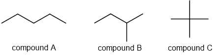

**Fig. 1.1**

Complete Table 1.1 to state the number of peaks that would be present in the low-resolution proton (1H) NMR and carbon-13 (13C) NMR spectra of isomers **A**, **B** and **C**.

**Table 1.1**

| Isomer | Number of peaks in 1H NMR spectrum | Number of peaks in 13C NMR spectrum |
|---|---|---|
| **A** |   |   |
| **B** |   |   |
| **C** |   |   |

**Q3** [3 marks]

**Extract:**

Fig. 1.1 shows the skeletal formulae of three isomers of pentane, **A**, **B** and **C**.

In the high-resolution 1H NMR spectrum of isomer **B**, the two methyl groups attached to carbon-2 give a doublet splitting pattern. The methyl groups in isomer **C** give a singlet splitting pattern.

Explain these splitting patterns in terms of neighbouring protons.

### Q4 — medium — 9 marks

**Q4** [2 marks]

Ethane-1,2-diol, C2H6O2, and ethanedioic acid, C2H2O4, can be distinguished using mass spectrometry, infrared spectroscopy and proton NMR spectroscopy.

Fig. 2.1 (spectrum **A**) and Fig. 2.2 (spectrum **B**) show the mass spectra of ethane-1,2-diol and ethanedioic acid.

**Fig. 2.1** (spectrum **A**)

**Fig. 2.2** (spectrum **B**)

Complete Table 2.1. Deduce which compound is responsible for each spectrum and explain your answer.

**Table 2.1**

| Spectrum | Organic compound | Explanation |
|---|---|---|
| **A** |   |   |
| **B** |   |   |

**Q4** [2 marks]

The IR spectra of ethane-1,2-diol, C2H6O2, and ethanedioic acid dihydrate, C2H2O4.2H2O, are shown in Fig. 2.3 (spectrum **C**) and Fig. 2.4 (spectrum **D**).

**Fig. 2.3** (spectrum **C**)

**Fig. 2.4** (spectrum **D**)

Use the Data Booklet to complete Table 2.2. Deduce which compound is responsible for each spectrum and explain your answer.

**Table 2.2**

| Spectrum | Organic compound | Explanation |
|---|---|---|
| **C** |   |   |
| **D** |   |   |

**Q4** [3 marks]

The proton (1H) NMR spectrum of ethane-1,2-diol is shown in Fig. 2.5.

**Fig. 2.5**

Use the spectrum to deduce the two proton environments in ethane-1,2-diol. State the number of peaks, their integration ratio and identify each environment.

**Q4** [2 marks]

State the number of peaks and the splitting pattern in the proton (1H) NMR spectrum of ethanedioic acid.

### Q5 — easy — 9 marks

**Q5** [4 marks]

Compound **X** contains 62.1% C, 10.3% H and 27.6% O by mass.

i) Show that the empirical formula of compound **X** is C3H6O.

[3]

ii) The *M*r of compound **X** is 58.0. Deduce the molecular formula of compound **X**. Explain your reasoning.

[1]

**Q5** [2 marks]

**Extract:**

Compound **X** contains 62.1% C, 10.3% H and 27.6% O by mass.

i) Show that the empirical formula of compound **X** is C~3~H~6~O.

ii) The *M*~r~ of compound **X** is 58.0. Deduce the molecular formula of compound **X**.

There are several possible isomers of compound **X**.

Draw the skeletal formulae of two structural isomers of compound **X** that contain a carbonyl group.

**Q5** [3 marks]

A sample of a different isomer of compound **X** is cyclopropanol, which was analysed by NMR spectroscopy.

i) State the number of peaks in the carbon-13 (13C) NMR spectrum of cyclopropanol.

[1]

ii) Cyclopropanol was dissolved in CDCl3 and the proton (1H) NMR spectrum of this solution was recorded as shown in Fig. 2.1.

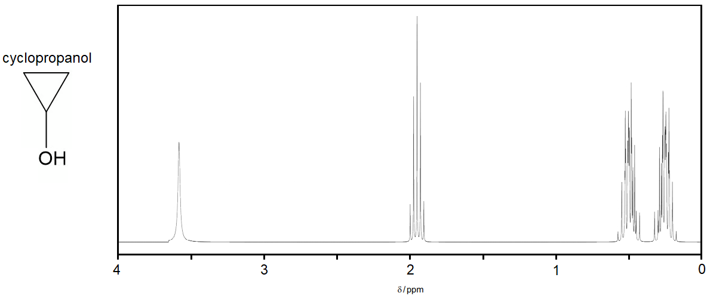

**Fig. 2.1**

State the identity of a substance that can be added to the solution to identify the peak due to the –OH proton. State how the 1H NMR spectrum will change.

[2]

### Q6 — medium — 5 marks

**Q6** [1 mark]

Lidocaine is used as a local anaesthetic. The structure of lidocaine is shown in Fig. 3.1.

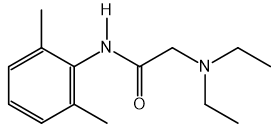

**Fig. 3.1**

A sample of lidocaine was analysed by carbon-13 NMR spectroscopy.

Deduce the number of peaks in the carbon-13 NMR spectrum of lidocaine.

**Q6** [3 marks]

**Extract:**

Lidocaine is used as a local anaesthetic. The structure of lidocaine is shown in Fig. 3.1.

Lidocaine was dissolved in CDCl3 and the proton NMR spectrum of this solution was recorded as shown in Fig. 3.2.

**Fig. 3.2**

Use the Data Booklet to complete Table 3.1 for the chemical shifts at δ 2.3 ppm, 3.0 ppm and 9.0 ppm.

**Table 3.1**

| **δ / ppm** | **environment** **of proton** | **number of **1**H atoms** **responsible for the peak** | **splitting pattern** |
|---|---|---|---|
| **1.2** | terminal methyl groups next to CH2 | 6 | triplet |
| **2.3** |   |   |   |
| **3.0** |   |   |   |
| **7.1 - 7.4** | attached to the aromatic ring | 3 | overlapping peaks |
| **9.0** |   |   |   |

**Table 3.2**

| **Environment of proton** | **Example** | **chemical shift range, δ / ppm** |
|---|---|---|
| alkane | –C**H**3, –C**H**2–, >C**H**– | 0.9 – 1.7 |
| alkyl next to C=O | C**H**3–C=O, –C**H**2–C=O, >C**H**–C=O | 2.2 – 3.0 |
| alkyl next to aromatic ring | C**H**3–Ar, –C**H**2–Ar, >C**H**–Ar | 2.3 – 3.0 |
| alkyl next to electronegative atom | C**H**3–O, –C**H**2–O, –C**H**2–Cl | 3.2 – 4.0 |
| attached to alkene | =C**H**R | 4.5 – 6.0 |
| attached to aromatic ring | **H**–Ar | 6.0 – 9.0 |
| aldehyde | **H**COR | 9.3 – 10.5 |
| alcohol | RO**H** | 0.5 – 6.0 |
| phenol | Ar–O**H** | 4.5 – 7.0 |
| carboxylic acid | RCOO**H** | 9.0 – 13.0 |
| alkyl amine | R–N**H**– | 1.0 – 5.0 |
| aryl amine | Ar–N**H**2 | 3.0 – 6.0 |
| amide | RCON**H**R | 5.0 – 12.0 |

**Q6** [1 mark]

**Extract:**

Lidocaine was dissolved in CDCl~3~ and the proton NMR spectrum of this solution was recorded as shown in Fig. 3.2.

Table 3.1

| **δ / ppm** | **environment** **of proton** | **number of **^1^**H atoms** **responsible for the peak** | **splitting pattern** |
| :---: | :---: | :---: | :---: |
| **1.2** | terminal methyl groups next to CH~2~ | 6 | triplet |

Explain why the absorption at δ 1.2 ppm is a triplet.

### Q7 — hard — 12 marks

**Q7** [1 mark]

A chemist prepares and analyses some esters.

The chemist prepares an ester by reacting propan-2-ol with ethanoic anhydride.

Using structural formulae, construct an equation for the reaction of propan-2-ol with ethanoic anhydride.

**Q7** [3 marks]

A sample contains a mixture of two esters contaminated with an alkane and an alcohol.

The chemist attempts to separate the four organic compounds in the mixture using gas chromatography. The stationary phase in the gas chromatograph column is a liquid alkane.

i) Explain how a liquid stationary phase separates organic compounds in a mixture.

[1]

ii) Deduce the relative retention times of these four compounds using the alkane stationary phase. Explain your answer.

[2]

**Q7** [8 marks]

An ester is isolated from a perfume and analysed.

The percentage by mass of the ester is: carbon 66.63%, hydrogen 11.18% and oxygen 22.19%.

The mass spectrum and proton (1H) NMR spectrum of the ester are shown in Fig. 2.1 and Fig. 2.2 respectively.

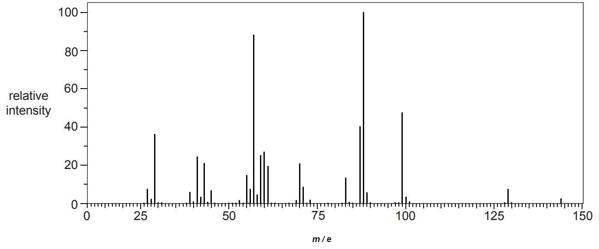

**Fig. 2.1**

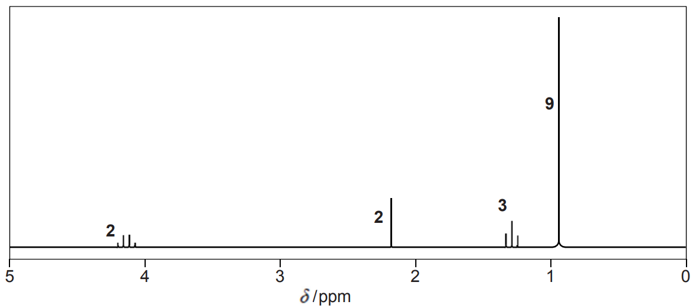

**Fig. 2.2**

i) Calculate the molecular formula of the ester. Show your working.

[3]

ii) Use Fig. 2.1, Fig. 2.2 and the Data Booklet to deduce the skeletal formula of the ester. Explain your reasoning.

[5]

### Q8 — medium — 13 marks

**Q8** [2 marks]

The proton (1H) NMR spectrum of methyl cinnamate, C10H10O2, recorded using CDCl3 as a solvent is shown in Fig. 1.1.

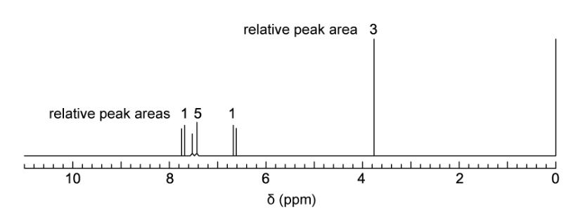

**Fig. 1.1**

i) Explain why CDCl3 is used as the solvent instead of CHCl3.

[1]

ii) State the purpose of adding tetramethylsilane (TMS) to the sample.

[1]

**Q8** [3 marks]

**Extract:**

The proton (^1^H) NMR spectrum of methyl cinnamate, C~10~H~10~O~2~, recorded using CDCl~3~ as a solvent is shown in Fig. 1.1.

The skeletal formula of methyl cinnamate is shown in Fig. 1.2.

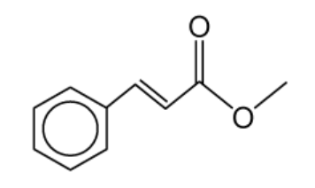

**Fig. 1.2**

Use Table 1.1 to deduce the proton environment that gives rise to the peak at δ = 3.8 ppm in Fig. 1.1. Explain your reasoning using the chemical shift, integration, and splitting pattern.

**Table 1.1**

| Environment of proton | Example | Chemical shift range, δ / ppm |
|---|---|---|
| alkane | –C**H**3, –C**H**2–, >C**H**– | 0.9 – 1.7 |
| alkyl next to C=O | C**H**3–C=O, –C**H**2–C=O, >C**H**–C=O | 2.2 – 3.0 |
| alkyl next to aromatic ring | C**H**3–Ar, –C**H**2–Ar, >C**H**–Ar | 2.3 – 3.0 |
| alkyl next to electronegative atom | C**H**3–O, –C**H**2–O, –C**H**2–Cl | 3.2 – 4.0 |
| attached to alkene | =C**H**R | 4.5 – 6.0 |
| attached to aromatic ring | **H**–Ar | 6.0 – 9.0 |
| aldehyde | **H**COR | 9.3 – 10.5 |
| alcohol | RO**H** | 0.5 – 6.0 |
| phenol | Ar–O**H** | 4.5 – 7.0 |
| carboxylic acid | RCOO**H** | 9.0 – 13.0 |
| alkyl amine | R–N**H**– | 1.0 – 5.0 |
| aryl amine | Ar–N**H**2 | 3.0 – 6.0 |
| amide | RCON**H**R | 5.0 – 12.0 |

**Q8** [2 marks]

Draw the skeletal formulae of the two ester isomers of C6H12O2 that each produce exactly two peaks, both singlets, in their 1H NMR spectra. The relative peak areas are 3:1 for both esters.

**Q8** [5 marks]

**Extract:**

Table 1.1

| Environment of proton | Example | Chemical shift range, δ / ppm |
| --- | :---: | :---: |
| alkane | –CH3, –CH2–, >CH– | 0.9 – 1.7 |
| alkyl next to C=O | CH3–C=O, –CH2–C=O, >CH–C=O | 2.2 – 3.0 |
| alkyl next to aromatic ring | CH3–Ar, –CH2–Ar, >CH–Ar | 2.3 – 3.0 |
| alkyl next to electronegative atom | CH3–O, –CH2–O, –CH2–Cl | 3.2 – 4.0 |
| attached to alkene | =CHR | 4.5 – 6.0 |
| attached to aromatic ring | H–Ar | 6.0 – 9.0 |
| aldehyde | HCOR | 9.3 – 10.5 |
| alcohol | ROH | 0.5 – 6.0 |
| phenol | Ar–OH | 4.5 – 7.0 |
| carboxylic acid | RCOOH | 9.0 – 13.0 |
| alkyl amine | R–NH– | 1.0 – 5.0 |
| aryl amine | Ar–NH2 | 3.0 – 6.0 |
| amide | RCONHR | 5.0 – 12.0 |

The proton (1H) NMR spectrum of another isomer of C6H12O2 is shown in Fig. 1.3.

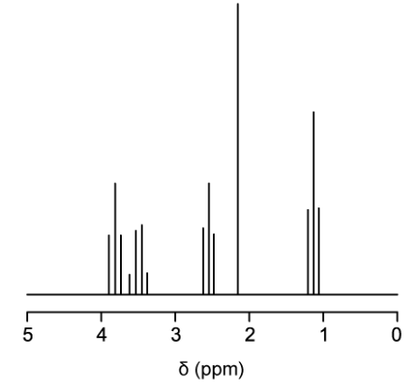

**Fig. 1.3**

The integration values for the peaks are given in Table 1.2.

**Table 1.2**

| **Chemical shift, δ / ppm** | 3.8 | 3.5 | 2.6 | 2.2 | 1.2 |
|---|---|---|---|---|---|
| **Integration value** | 0.6 | 0.6 | 0.6 | 0.9 | 0.9 |
| **Splitting pattern** | triplet | quartet | triplet | singlet | triplet |

i) Deduce the simplest whole-number ratio of the number of protons in each environment.

[1]

ii) Use Table 1.1 to explain the chemical shift and splitting pattern of the peaks at δ = 3.5 and δ = 1.2.

[4]

**Q8** [1 mark]

Four isomers of C6H12O2, **A**, **B**, **C** and **D**, are shown in Fig. 1.4.

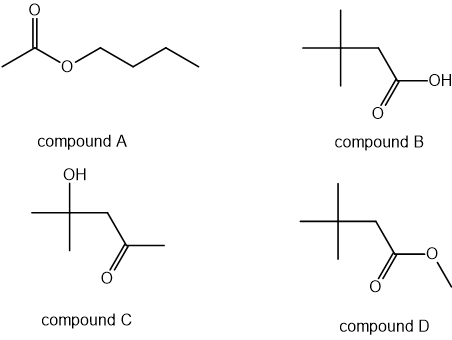

**Fig. 1.4**

The 13C NMR spectrum of one of these four isomers is shown in Fig. 1.5.

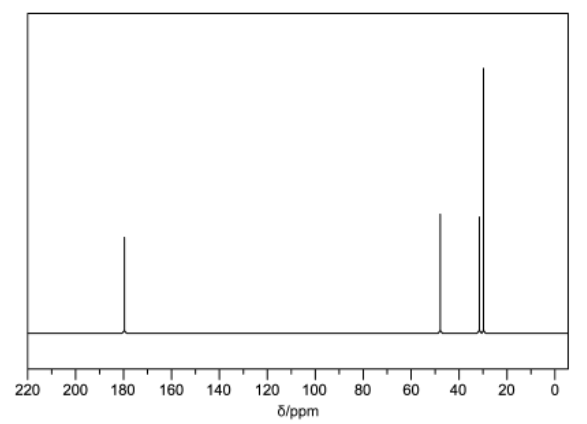

**Fig. 1.5**

**Table 1.3**

| Hybridisation of the carbon atom | Environment of carbon atom | Example | Chemical shift range δ/ppm |
|---|---|---|---|
| sp3 | alkyl | **C**H3–, **C**H2–, –**C**H<, >**C**< | 0 – 50 |
| sp3 | next to alkene / arene | –**C**–C=C, –**C**–Ar | 25 – 50 |
| sp3 | next to carbonyl / carboxyl | **C**–COR, **C**–O2R | 30 – 65 |
| sp3 | next to halogen | **C**–X | 30 – 60 |
| sp3 | next to oxygen | **C**–O | 50 – 70 |
| sp2 | alkene or arene | >**C**=**C**< | 110 – 160 |
| sp2 | carboxyl | R−**C**OOH, R−**C**OOR | 160 – 185 |
| sp2 | carbonyl | R−**C**HO, R−**C**O−R | 190 – 220 |
| sp | nitrile | R−**C**≡N | 100 – 125 |

Use Table 1.3 to deduce which of the four isomers **A**, **B**, **C** or **D** produced the 13C NMR spectrum shown in Fig. 1.5.
