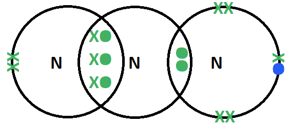
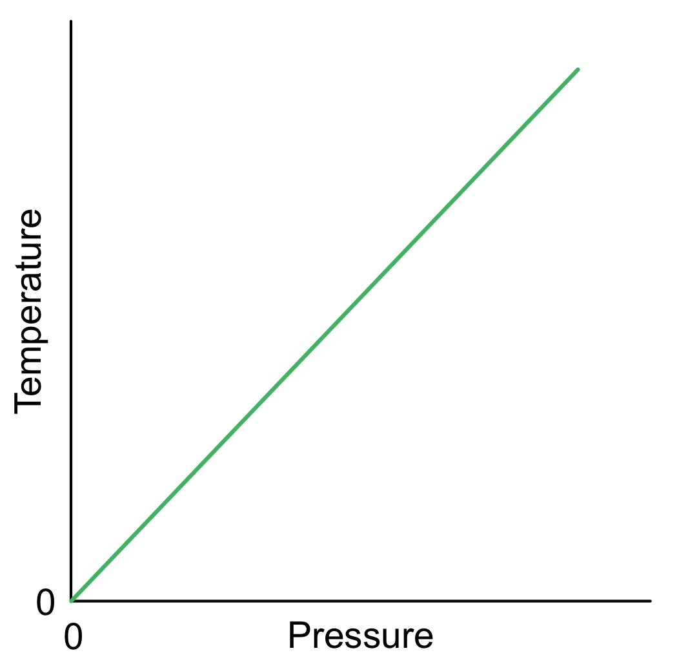

# Mark Schemes — The Gaseous State: Ideal & Real Gases & pV = nRT
**4. States of Matter** · Cambridge (CIE) A-LEVEL chemistry (9701)

## Multiple Choice Questions (25 questions)

### Q1
**Final answer:** **The correct answer is C**

- For one mole of gas (*n* = 1), the ideal gas equation *pV = nRT* becomes:

*pV* = *RT*

- Comparing with *y* = *mx* + *c*, a graph of *pV* against *T* has:

| Term | Identity |
|---|---|
| Gradient (*m*) | *R* |
| Intercept (*c*) | 0 |

**A** is incorrect as 1/*R* would be the gradient of a *T* against *pV* graph (axes swapped).

**B** is incorrect as *p* is not a constant when temperature varies.

**D** is incorrect as *V* is not a constant when temperature varies.

### Q2
**Final answer:** **The correct answer is D**

- When the valve opens, the gas expands from *V* (container X) into a total volume of 4*V* (X + Y) at constant temperature.
- Applying Boyle's Law:

*P*1*V*1 = *P*2*V*2

(1 × 105) × *V* = *P*2 × 4*V*

*P*2 = 25000 Pa

- The temperature then rises from 298 K to 433 K.
- Applying the pressure–temperature relationship at constant volume:

$\frac{P_{2}}{T_{1}} = \frac{P_{3}}{T_{2}}$

$\frac{25000}{298} = \frac{P_{3}}{433}$

*P*3 = **3.63 × 10****4**** Pa**

**A** is incorrect as 2.13 × 105 Pa would result if no volume change were applied.

**B** is incorrect as 3.60 × 105 Pa confuses the direction of the volume ratio.

**C** is incorrect as 4.24 × 104 Pa results from an error in the temperature conversion.

### Q3
**Final answer:** **The correct answer is C**

- The ideal gas equation is:

*pV = nRT*

- Where *p* is pressure (Pa), *V* is the volume (m3), *n* is the number of moles, *R* is the gas constant (8.31 J K−1 mol−1), and *T* is the temperature (K).
- **Avogadro's law**:

  - For a confined gas, the volume (*V*) and the number of moles (*n*) are directly proportional if the pressure and temperature both remain constant.

**A** is incorrect as the presence of intermolecular forces is not a gas law. An ideal gas will have no intermolecular forces between the molecules.

**B** is incorrect as in an ideal gas particles need to collide elastically (i.e. not lose momentum).

**D** is incorrect as the temperature is in °C, not kelvin. **Charles's law** states that the volume of a given amount of gas is directly proportional to its temperature on the kelvin scale when the pressure is held constant.

### Q4
**Final answer:** **The correct answer is A**

- Write the balanced symbol equation:

2Ca + O2 → 2CaO

- Work out the number of moles of oxygen (using molar volume: 1 mol = 24 000 cm3 at r.t.p.):

n(O2) = $\frac{599}{24000}$ = 0.0250 mol

- Calculate the number of moles of calcium:

n(Ca) = $\frac{2.0}{40.1}$ = 0.0499 mol

- Ratio Ca:O2 = 0.0499:0.0250 ≈ 2:1, which matches the balanced equation and confirms calcium.

**B** is incorrect as for Mg (2Mg + O2 → 2MgO): n(Mg) = 2.0/24.3 = 0.082 mol; ratio 0.082:0.025 ≈ 3.3:1, not 2:1.

**C** is incorrect as for K (4K + O2 → 2K2O): n(K) = 2.0/39.1 = 0.051 mol; ratio 0.051:0.025 ≈ 2.0:1, not 4:1.

**D** is incorrect as for Na (4Na + O2 → 2Na2O): n(Na) = 2.0/23.0 = 0.087 mol; ratio 0.087:0.025 ≈ 3.5:1, not 4:1.

### Q5
**Final answer:** **The correct answer is C**

- Rearranging *pV = nRT* for number of moles:

n = $\frac{pV}{RT}$

- Known quantities:

  - Pressure; 75 kPa = 75000 Pa
  - Volume; 5.27 × 10−5 m3
  - Temperature; 60 °C = 333 K
- Substitution:

n = $\frac{75000\times(5.27\times10^{-5})}{8.31\times333}$

n = 0.00143 mol

- Mass of ammonia (NH3, *M*r = 17):

*mass* = 0.00143 × 17 = **2.4 × 10****-2**** g**

**A** is incorrect as 2.4 × 10-5 g results from using pressure in kPa rather than Pa.

**B** is incorrect as 2.5 × 10-4 g results from an error in the pressure or temperature unit conversion.

**D** is incorrect as 2.5 × 10-1 g results from a moles calculation error giving approximately 10 times too many moles.

### Q6
**Final answer:** **The correct answer is C**

- At r.t.p., 1 mol of gas occupies 24.0 dm3, so n(H2) = 0.960 ÷ 24.0 = 0.0400 mol
- From the equation, 2 mol Na produces 1 mol H2, so n(Na) = 2 × 0.0400 = 0.0800 mol
- Mass of sodium = 0.0800 × 23.0 = 1.84 g

**A** is incorrect because it halves the amount of hydrogen instead of doubling it: 0.0200 × 23.0

**B** is incorrect because it assumes a 1 : 1 ratio of Na to H2: 0.0400 × 23.0

**D** is incorrect because it treats sodium as Na2 and uses 46.0: 0.0800 × 46.0

### Q7
**Final answer:** **The correct answer is C**

- Rearranging *pV = nRT* for pressure:

p = $\frac{nRT}{V}$

- Known quantities and unit conversions:

  - Volume; 2 dm3 = 2 × 10−3 m3
  - Temperature; 275 °C + 273 = 548 K
  - Number of moles; 1.5 × 10−2 mol
- Substituting:

p = $\frac{(1.5\times10^{-2})\times8.31\times(275+273)}{2\times10^{-3}}$

**A** is incorrect as it uses 275 K (Celsius value not converted to kelvin) and 2 × 10−6 m3 (treating dm3 as cm3).

**B** is incorrect as the volume used is 2 × 10−6 m3 rather than 2 × 10−3 m3 (treating dm3 as cm3).

**D** is incorrect as 275 is used directly as temperature without converting °C to K.

### Q8
**Final answer:** **The correct answer is A**

- The molar mass of a gas can be derived from the ideal gas law, *pV = nRT*.
- The definition of molar mass is used to replace *n* in the equation.
- The *M*r of a substance is the mass of 6.02 x 1023 molecules (one mole), therefore:

*n* = $\frac{m}{M_{r}}$

- Substituting for *n* in the ideal gas law equation:

*pV* = $\frac{m}{M_{r}} \times R T$

- Rearranging for *M*r:

*M*r = $\frac{mRT}{pV}$

### Q9
**Final answer:** **The correct answer is A**

- Using the molar volume at r.t.p. (1 mol = 24 dm3):

n = $\frac{3}{24}$ = 0.125 mol

- Check each option at 0.125 mol:
- Option **A:**

(CH4, *M*r = 16): *mass* = 0.125 × 16 = 2.0 g

- Option **B:**

(He, *A*r = 4): 4.0 ÷ 4 = 1.0 mol ≠ 0.125 mol

- Option **C:**

(CO2, *M*r = 44): 4.4 ÷ 44 = 0.10 mol ≠ 0.125 mol

- Option **D:**

(N2, *M*r = 28): 7.0 ÷ 28 = 0.25 mol ≠ 0.125 mol

- Only option **A** gives exactly 0.125 mol.

### Q10
**Final answer:** **The correct answer is D**

- The ideal gas equation is:

*pV = nRT*

- Rearranged for number of moles:

n = $\frac{pV}{RT}$

- Known quantities:

  - Pressure; 102 kPa = 102000 Pa
  - Volume; 5.25 dm3 = 0.00525 m3
  - Temperature; 50 °C = 323 K
- Substitution into the equation:

n = $\frac{102000\times0.00525}{8.31\times323}$

n = 0.199 mol

- Mass of methane (CH4, *M*r = 16):

mass *= n × M*r

mass = 0.199 × 16

mass = 3.19 g = 3.2 g (2 s.f.)

**A**, **B**, and **C** are incorrect as they result from errors in unit conversion; pressure must be in Pa, volume in m3, and temperature in K before substituting into *pV = nRT*.

### Q11
**Final answer:** **The correct answer is A**

- Ideal behaviour is seen with identical particles with no internal structure, no volume, random motion, no intermolecular forces and elastic collisions (no loss of momentum).
- Ammonia has strong intermolecular forces (hydrogen bonding), so it deviates most from ideal behaviour.

**B** is incorrect as carbon dioxide only experiences instantaneous dipole-induced dipole forces, which are weaker than hydrogen bonds.

**C** is incorrect as helium behaves most like an ideal gas at room temperature due to its weak instantaneous dipole-induced dipole forces and small atomic radius.

**D** is incorrect as hydrogen only experiences instantaneous dipole-induced dipole forces, which are weaker than hydrogen bonds.

### Q12
**Final answer:** **The correct answer is D**

- The ideal gas equation *pV = nRT* rearranges to:

*pV* = (*RT*) × *n*

- At constant *p* and *T*, this is in the form *y = mx*: a straight line through the origin with gradient *RT*.
- **D** shows a straight line through the origin, showing a directly proportional relationship between *pV* and *n*.

**A** is incorrect as the line does not pass through the origin, implying *pV* is non-zero when *n* = 0.

**B** is incorrect as the line is curved, inconsistent with *pV* being directly proportional to *n*.

**C** is incorrect as a horizontal line implies *pV* is constant as *n* increases. This would mean adding more moles at constant *p* and *T* does not change the volume, which contradicts *pV = nRT*.

### Q13
**Final answer:** **The correct answer is A**

- For *pV = nRT* to give an accurate *M*r, the gas must behave as close to ideal as possible.

- At **low pressure**, molecules are widely spaced, which means that molecular volume is negligible relative to the container volume, and intermolecular forces are negligible.

- At **high temperature**, kinetic energy far outweighs intermolecular forces between molecules, so the gas approximates ideal behaviour.

**B** is incorrect as low temperature means kinetic energy is small relative to intermolecular forces, causing greater deviation from ideal behaviour.

**C** is incorrect as high pressure causes significant molecular volume and intermolecular force effects.

**D** is incorrect as high pressure and low temperature both promote non-ideal behaviour.

### Q14
**Final answer:** **The correct answer is C**

- Ideal gas behaviour requires: no intermolecular forces, negligible molecular volume, and elastic collisions.

- Check whether Boyle's Law (*P*1*V*1 = *P*2*V*2) holds:

*P*1*V*1 = 101 × 50.0 = 5050 kPa cm3

*P*2*V*2 = 300 × 17.5 = 5250 kPa cm3

- Since *P*1*V*1 ≠ *P*2*V*2, Boyle's Law does not hold exactly.

  - The gas is not behaving ideally.

- At high pressure, the volume of the gas molecules becomes a significant fraction of the total volume, and intermolecular repulsive forces become significant.

  - Both effects cause the *pV* product to exceed the ideal value.

**A** is incorrect as gas molecules are not adsorbed on to the vessel walls; deviation arises from molecular volume and intermolecular force effects.

**B** is incorrect as ideal behaviour requires *P*1*V*1 = *P*2*V*2, which does not hold here (5050 ≠ 5250 kPa cm3).

**D** is incorrect as the gas is not partially liquefied. It is behaving non-ideally due to molecular volume and intermolecular force effects.

### Q15
**Final answer:** **The correct answer is B**

- A temperature of 298 K is room temperature (25 °C) and a pressure of 101 kPa is 1 atmosphere.
- Chloroethane has a polar C–Cl bond, giving rise to permanent dipole-permanent dipole forces and instantaneous dipole-induced dipole forces.

  - These are weaker than hydrogen bonds.
- So, chloroethane has a boiling point below 298 K and is a gas at room temperature.

**A** is incorrect as 1-aminopropane has an N–H bond which allows hydrogen bonding between molecules, making it a liquid at 298 K.

**C** is incorrect as ethane-1,2-diol has two O–H bonds and forms extensive hydrogen bonding, so it is a liquid at 298 K.

**D** is incorrect as propan-1-ol has an O–H bond and forms hydrogen bonds between molecules, so it is a liquid at 298 K.

### Q16
**Final answer:** **The correct answer is A**

- At constant temperature, Boyle's Law applies.

  - Since both pressures are in kPa, no unit conversion is needed:

*P*1*V*1 = *P*2*V*2

*V*2 = $\frac{P_{1}}{P_{2}}$ × *V*1 = $\frac{101}{2020}$ × 200 = **10 cm****3**

**B** is incorrect as 200 cm3 would imply no change in volume, requiring equal pressures.

**C** is incorrect as 100 cm3 results from an arithmetic error in the pressure ratio.

**D** is incorrect as 4000 cm3 results from applying the ratio in the wrong direction: *P*2/*P*1 × *V*1 = 2020/101 × 200 = 4000 cm3.

### Q17
**Final answer:** **The correct answer is B**

- Rearrange *pV = nRT* where *n = m/M*r:

*M*r = $\frac{mRT}{pV}$

- Known quantities:

  - Mass; 1.02 × 10−3 kg = 1.02 g
  - Temperature; 27 °C = 300 K
  - Pressure; 101 kPa = 101000 Pa
  - Volume; 0.3 dm3 = 0.0003 m3
- Substitution:

*M*r = $\frac{1.02\times8.31\times300}{101000\times0.0003}$

*M*r = 83.9

- *M*r = 83.9 is consistent with krypton (*A*r = 83.8).

**A** is incorrect as helium has *A*r = 4, not 83.9.

**C** is incorrect as neon has *A*r = 20.2, not 83.9.

**D** is incorrect as oxygen is not a noble gas **AND** its *M*r = 32 is also inconsistent with the calculated value.

### Q18
**Final answer:** **The correct answer is B**

- Write the balanced symbol equation:

4Li + O2 → 2Li2O

- Work out the number of moles of oxygen using the ideal gas equation (*pV = nRT*, *R* = 8.31 J K−1 mol−1):

n(O2) = $\frac{pV}{RT}$

n(O2) = $\frac{22000\times0.005}{8.31\times441}$ = 0.030 mol

- Calculate the number of moles of lithium:

n(Li) = $\frac{0.84}{7}$ = 0.12 mol

- Ratio Li:O2 = 0.12:0.030 = 4:1, which matches the balanced equation and confirms lithium.

**A** is incorrect as for Al (4Al + 3O2 → 2Al2O3): n(Al) = 0.84/27 = 0.031 mol; ratio 0.031:0.030 ≈ 1:1, not 4:3.

**C** is incorrect as for Mg (2Mg + O2 → 2MgO): n(Mg) = 0.84/24.3 = 0.035 mol; ratio 0.035:0.030 ≈ 1.2:1, not 2:1.

**D** is incorrect as for Na (4Na + O2 → 2Na2O): n(Na) = 0.84/23 = 0.037 mol; ratio 0.037:0.030 ≈ 1.2:1, not 4:1.

### Q19
**Final answer:** **The correct answer is A**

- By Dalton's law of partial pressures, each gas occupies the total combined volume after connection.
- The total amount of gas (expressed as *pV*) is conserved:

(*P*Q × *V*Q) + (*P*R × *V*R) = *P*final × (*V*Q + *V*R)

- Known quantities:

  - Volume of Q, *V*Q = 4 dm3
  - Volume of R, *V*R = 10 dm3
  - Pressure in Q, *P*Q = 10 kPa
  - Pressure in R, *P*R = 5 kPa
- Substitution:

(4 × 10) + (10 × 5) = (4 + 10) × *P*final

*P*final = $\frac{90}{14}$ = **6.4 kPa**

**B** is incorrect as 7.5 kPa is the arithmetic mean of the two pressures, not the weighted average.

**C** is incorrect as 9.0 kPa results from using only flask Q's gas and the combined volume.

**D** is incorrect as 15 kPa results from adding the two pressures directly, ignoring the volume change.

### Q20
**Final answer:** **The correct answer is D**

- The density of a gas is proportional to its average molar mass at constant temperature and pressure.
- The gases listed have the following molar masses:

  - Hydrogen, *M*r = 2
  - Helium, *A*r = 4
  - Methane, *M*r = 16
- Average molar mass = Σ (fraction × molar mass)
- **Uranus:**

$( \frac{81.5}{100} \times 2 )$ + $( \frac{16.2}{100} \times 4 )$ + $( \frac{2.3}{100} \times 16 )$ = **2.646**

**A** is incorrect as Jupiter = $( \frac{89.6}{100} \times 2 )$ + $( \frac{10.4}{100} \times 4 )$ = 2.208

**B** is incorrect as Neptune = $( \frac{81}{100} \times 2 )$ + $( \frac{18}{100} \times 4 )$ + $( \frac{1.0}{100} \times 16 )$ = 2.500

**C** is incorrect as Saturn = $( \frac{96.2}{100} \times 2 )$ + $( \frac{3.5}{100} \times 4 )$ + $( \frac{0.25}{100} \times 16 )$ = 2.104

### Q21
**Final answer:** **The correct answer is B**

- The ideal gas equation is *pV = nRT*

- Rearranged for pressure:

p = $\frac{nRT}{V}$

- Number of moles of hydrogen (H2, *M*r = 2):

n = $\frac{0.96}{2}$ = 0.48 mol

- Known quantities:

  - Number of moles; 0.48 mol
  - Volume; 7.0 × 10−3 m3
  - Temperature; 303 K
- Substitution into the equation:

p = $\frac{0.48\times8.31\times303}{7.0\times10^{-3}}$

p = 172700 Pa ≈ 173 kPa

**A** is incorrect as 172.7 Pa results from using the volume as 7.0 m3 rather than 7.0 × 10−3 m3, a factor-of-1000 error.

**C** is incorrect as 345 kPa results from using the relative atomic mass of hydrogen (*A*r = 1) rather than the molecular mass of H2 (*M*r = 2), doubling the number of moles and the pressure.

**D** is incorrect as 691.1 kPa results from using *A*r = 1 for hydrogen combined with a further factor-of-two error in the moles calculation.

### Q22
**Final answer:** **The correct answer is D**

- The ideal gas equation is:

*pV = nRT*

- Rearranged for number of moles:

n = $\frac{pV}{RT}$

- Known quantities:

  - Pressure; 103 kPa = 103000 Pa
  - Volume; 5370 cm3 = 0.00537 m3
  - Temperature; 60 °C = 333 K
- Substitution into the equation:

n = $\frac{103000\times0.00537}{8.31\times333}$

n = 0.1999 mol

- Mass of oxygen (O2, *M*r = 32):

*mass = n × M*r = 0.1999 × 32 = 6.4 g

**A** is incorrect as 1.8 g results from using *M*r = 18 (for water) instead of *M*r = 32 for oxygen.

**B** is incorrect as 3.2 g results from using the relative atomic mass of oxygen (*A*r = 16) rather than the molecular mass of O2 (*M*r = 32), giving half the correct mass.

**C** is incorrect as 3.6 g results from an error in the volume unit conversion.

### Q23
**Final answer:** **The correct answer is A**

- Rearrange *pV = nRT* where *n = m/M*r:

*M*r = $\frac{mRT}{pV}$

- Known quantities:

  - Mass; 0.8 g
  - Temperature; 340 K
  - Pressure; 101 kPa = 101000 Pa
  - Volume; 560 cm3 = 0.00056 m3
- Substitution:

*M*r = $\frac{0.8\times8.31\times340}{101000\times0.00056}$

*M*r = 40.0

- *M*r = 40.0 is consistent with argon (*A*r = 39.9).

**B** is incorrect as helium has *A*r = 4, not 40.0.

**C** is incorrect as krypton has *A*r = 83.8, not 40.0.

**D** is incorrect as neon has *A*r = 20.2, not 40.0.

### Q24
**Final answer:** **The correct answer is B**

- The ideal gas equation is *pV = nRT*

- Rearranged for temperature:

*T* = $\frac{pV}{nR}$

- Number of moles of Cl2 (*M*r = 71):

n = $\frac{5.35}{71}$ = 0.075 mol

- Known quantities:

  - Pressure; 1.00 × 105 Pa.
  - Volume; 1.247 × 10−3 m3.
  - Number of moles; 0.075 mol.
- Substitution into the equation:

*T* = `\frac{\left(\right. 1 . 0 \times 10^{5} \left.\right) \times \left(\right. 1 . 247 \times 10^{- 3} \left.\right)}{0 . 075 \times 8 . 31}`

*T* = 200 K

**A** is incorrect as 100 K results from using the relative atomic mass of chlorine (*A*r = 35.5) rather than the molecular mass of Cl2 (*M*r = 71), doubling the number of moles and halving the temperature.

**C** is incorrect as 250 K results from an error in the moles calculation.

**D** is incorrect as 300 K results from a molar mass error in the calculation.

### Q25
**Final answer:** **The correct answer is C**

- For an ideal gas, the *pV* product is constant at all pressures (Boyle's law).
- Real gases deviate due to intermolecular forces and molecular volume.
- **Hydrogen (X)**:

  - A small molecule with very weak instantaneous dipole-induced dipole forces.
  - Deviates slightly but the line stays closest to the ideal gas line.
- **Nitrogen (W)**:

  - Diatomic molecule with weak instantaneous dipole-induced dipole forces, but larger than hydrogen.
  - Deviates more than hydrogen.
- **Ammonia (Y)**:

  - Molecules form hydrogen bonds, which is a much stronger intermolecular force.
  - Deviates most from ideal gas behaviour.

**A** is incorrect as it assigns H2 to line W but N2 to line X, reversing the deviation order.

**B** is incorrect as it places NH3 as line X, which shows only moderate deviation.

**D** is incorrect as it assigns NH3 to line W and N2 to line Y, inconsistent with their intermolecular force strengths.

## Structured Questions (8 questions)

### Q1
The dot-and-cross diagram for the azide ion is:

**[2 marks]**

> **[mark-scheme]**
> 1 mark for a triple bond (3 shared pairs) between the left and central nitrogen atoms, and a dative covalent bond (1 shared pair, both electrons from the central nitrogen) from the central to the right-hand nitrogen
> 
> 1 mark for 1 lone pair on the left-hand nitrogen, 0 lone pairs on the central nitrogen, and 3 lone pairs on the right-hand nitrogen, with one electron on the right-hand nitrogen clearly shown as a different symbol to indicate the extra electron from the ionic bond with sodium

> **[exam-tip]**
> Count the total valence electrons first:
> 
> 3 nitrogen atoms x 5 electrons + 1 (negative charge) = 16 electrons.
> 
> Place a triple bond (3 shared pairs) between the left and central nitrogen atoms, and a dative covalent bond (1 shared pair, both electrons donated by the central nitrogen) to the right-hand nitrogen. This accounts for 8 bonding electrons.
> 
> The remaining 8 electrons form lone pairs:
> 
> - 1 lone pair on the left-hand nitrogen
> - 0 on the central nitrogen
> - 3 lone pairs on the right-hand nitrogen.
> 
> The extra electron from the negative charge appears on the right-hand nitrogen and must be drawn using a different symbol (e.g. a cross if the other electrons are shown as dots).
> **[mark-scheme]**
> **Three** properties of sodium azide are:
> 
> Any **three** from (1 mark for each property and explanation pair):
> 
> - Hard / strong
> **AND**
> Due to strong electrostatic forces of attraction between oppositely charged ions
> 
> - High melting point / boiling point
> **AND**
> Due to strong electrostatic forces of attraction between oppositely charged ions
> 
> - Soluble in water
> **AND**
> Ion-dipole interactions can form between Na+ / N3- ions and water molecules
> 
> - Conducts electricity <u>when molten / dissolved</u>
> **AND**
> Ions are free to move / mobile
> 
> **OR**
> 
> - Does not conduct electricity <u>when solid</u>
> **AND**
> No ions that are free to move
> 
> **[3 marks]**

> **[exam-tip]**
> Sodium azide is an ionic compound, with Na+ and N3- ions held together in a giant ionic lattice by strong electrostatic forces. This underpins its physical properties as ionic lattices:
> 
> - Are typically hard
> - Have high melting points
> - Dissolve in polar solvents such as water.
> 
> Electrical conductivity requires mobile ions, which are only present when the compound is molten or dissolved.
To construct the equation and calculate the mass of sodium amide required:

- Construct the balanced equation:

2NaNH2 + N2O → NaN3 + NaOH + NH3 **[1 mark]**

- Calculate the theoretical (100% yield) mass of NaN3:

theoretical mass = $\frac{550}{95.0}$ x 100 = 578.95 g **[1 mark]**

- Calculate the *M*r of NaN3:

*M*r(NaN3) = 23.0 + (14.0 x 3) = 65.0 g mol-1

- Calculate the moles of NaN3:

*n*(NaN3) = $\frac{578.95}{65.0}$ = 8.907 mol **[1 mark]**

- Use the molar ratio (2 NaNH2 : 1 NaN3) to find moles of NaNH2:

*n*(NaNH2) = 8.907 x 2 = 17.81 mol **[1 mark]**

- Calculate the mass of NaNH2:

*M*r(NaNH2) = 23.0 + 14.0 + (1.0 x 2) = 39.0 g mol-1

mass = 17.81 x 39.0 = **695 g** **[1 mark]**

> **[mark-scheme]**
> Allow error carried forward from the equation if the method is correct.
> 
> State symbols are not required in the equation.

> **[exam-tip]**
> The balanced equation is needed before you can use the molar ratio. The ratio is 2 mol NaNH2 per 1 mol NaN3, so twice as many moles of sodium amide are required.
> 
> Remember: the 550 g is the actual yield (95.0%), so divide by 0.950 to find the theoretical 100% yield mass before calculating moles.
To calculate the mass of sodium azide that must decompose:

- Convert pressure and temperature to SI units:

*p* = 150 x 1000 = 150 000 Pa

*T* = 35.0 + 273 = 308 K

**[1 mark]**

- Rearrange *pV* = *nRT* to calculate moles of N2:

*n*(N2) = $\frac{pV}{RT}$

*n*(N2) = $\frac{150000\times7.50\times10^{-2}}{8.31\times308}$ = 4.395 mol

**[1 mark]**

- Use the molar ratio (3 N2 : 2 NaN3) to find moles of NaN3:

*n*(NaN3) = $\frac{4.395\times2}{3}$ = 2.930 mol

**[1 mark]**

- Calculate the mass of NaN3:

mass = moles x *M*r

mass of NaN3 = 2.930 x 65.0

mass of NaN3 = **190 g (to 3 s.f.)**

**[1 mark]**

> **[mark-scheme]**
> 1 mark for correct conversions of pressure **AND **temperature to SI units
> 
> 1 mark for correctly calculating the moles of N2
> 
> 1 mark for determining the moles of NaN3
> 
> 1 mark for calculating the mass of NaN3
> 
> Allow error carried forward from moles of N2 if the method is correct.

> **[exam-tip]**
> The volume is already given in m3, so only temperature (add 273) and pressure (multiply kPa x 1000) need converting. Use the molar ratio from the equation: 3 mol N2 is produced per 2 mol NaN3, so multiply moles of N2 by 2/3 to get moles of NaN3. *M*r(NaN3) = 23.0 + (14.0 x 3) = 65.0 g mol-1.
i) The balanced equation is:

2NaN3 + 2HNO2 + 2HCl → 3N2 + 2NO + 2NaCl + 2H2O

**[2 marks]**

> **[mark-scheme]**
> 1 mark for 2HNO2 + 2HCl (correct coefficients for the acid reactants)
> 
> 1 mark for 3N2 + 2NO + 2NaCl (correct coefficients for the remaining products)

ii) To calculate the total volume of gas released:

- Calculate the moles of NaN3:

*n*(NaN3) = $\frac{75.0}{65.0}$ = 1.154 mol **[1 mark]**

- Calculate total moles of gaseous products using the molar ratio (2 NaN3 → 5 mol gas):

total *n*(gas) = 1.154 x $\frac{5}{2}$ = 2.885 mol

**[1 mark]**

- Calculate the volume at room conditions (1 mol = 24.0 dm3):

volume = moles x molar volume

*V* = 2.885 x 24.0 = **69.2 dm****3** **[1 mark]**

> **[mark-scheme]**
> Answers in the range 69.1–69.2 dm3 are accepted
> 
> Allow error carried forward from moles of NaN3 if the method is correct.

> **[exam-tip]**
> Both N2 and NO are gaseous products.
> 
> From the balanced equation, 2 mol NaN3 produces 3 mol N2 plus 2 mol NO, giving a total of 5 mol of gas per 2 mol NaN3.
> 
> The molar volume at room conditions is 24.0 dm3 mol-1.

### Q2
To calculate the amount, in mol, of hydrogen gas produced:

- Convert the units:

*p* = 100 kPa = 100 000 Pa

*V* = 103 cm3 = 1.03 x 10-4 m3

*T* = 25.0 + 273 = 298 K

**[1 mark]**

- Rearrange *pV* = *nRT* to find *n* and substitute:

*n* = $\frac{pV}{RT}$

*n* = $\frac{100000\times1.03\times10^{-4}}{8.31\times298}$ **[1 mark]**

*n* = **4.16 x 10****-3**** mol** **[1 mark]**

> **[mark-scheme]**
> 1 mark for correctly converting all three units: *p* in Pa, *V* in m3, *T* in K
> 
> 1 mark for correct rearrangement and substitution into *n* = *pV*/*RT*
> 
> 1 mark for correct final answer: 4.16 x 10-3 mol
> 
> Allow error carried forward if there are unit conversion errors

> **[exam-tip]**
> When using the ideal gas equation *pV* = *nRT*, convert all values to SI units before substituting. The three conversions needed here are:
> 
> - Pressure: kPa → Pa (multiply by 1000)
> - Volume: cm3 → m3 (multiply by 10-6)
> - Temperature: °C → K (add 273)
> 
> Always show each conversion explicitly as a mark is typically awarded for getting all units correct.
To calculate the volume of 0.150 mol dm-3 HCl needed:

- Find moles of HCl using the molar ratio:

Ratio H2 : HCl = 1 : 2

*n*(HCl) = 4.16 x 10-3 x 2

*n*(HCl) = 8.32 x 10-3 mol **[1 mark]**

- Calculate the volume:

volume = $\frac{n}{c}$

volume = $\frac{8.32\times10^{-3}}{0.150}$

volume = 0.05547 dm3

- Convert volume to cm3:

volume = 0.05547 x 1000 = **55.5 cm****3** **[1 mark]**

> **[mark-scheme]**
> 1 mark for *n*(HCl) = 8.32 x 10-3 mol
> 
> 1 mark for volume = 55.5 cm3
> 
> Allow error carried forward from an incorrect number of moles in part (a)

> **[exam-tip]**
> Always check the molar ratio from the equation before calculating moles of a second species. Here, 1 mol H2 requires 2 mol HCl, so the moles of HCl is double the moles of H2.
> 
> The formula volume = *n*/*c* gives volume in dm3 when concentration is in mol dm-3. Since the question asks for cm3, multiply by 1000 to convert.
To calculate the mass of magnesium chloride produced:

- Calculate the moles of Mg:

moles = $\frac{\mathrm{mass}}{A_{r}}$

*n*(Mg) = $\frac{3.75}{24.3}$

*n*(Mg) = 0.1543 mol **[1 mark]**

- Use the 1:1 molar ratio to find mass of MgCl2:

*n*(MgCl2) = 0.1543 mol

mass = moles x *M*r

mass of MgCl2 = 0.1543 x 95.3

mass of MgCl2 = **14.7 g** **[1 mark]**

> **[mark-scheme]**
> 1 mark for *n*(Mg) = 0.154 mol
> 
> 1 mark for mass of MgCl2 = 14.7 g

> **[exam-tip]**
> For mass-to-mass stoichiometry calculations, follow these steps:
> 
> 1. Convert mass to moles using *n* = mass / *A*r (for elements) or mass / *M*r (for compounds)
> 2. Use the molar ratio from the balanced equation to find moles of the product (here Mg : MgCl2 = 1:1)
> 3. Convert moles back to mass using mass = *n* x *M*r
> 
> *A*r of Mg = 24.3; *M*r of MgCl2 = 24.3 + (2 x 35.5) = 95.3

### Q3
> **[mark-scheme]**
> Helium comes very close to ideal gas behaviour because:
> 
> - It exists as single atoms
> **OR**
> It has a full outer shell so does not form bonds with other atoms **[1 mark]**
> - (It only has two electrons so) it has very weak intermolecular forces of attraction / London dispersion forces / van der Waals' forces **[1 mark]**

> **[exam-tip]**
> The question tells you the two assumptions of ideal gas behaviour. Your answer should relate helium's properties directly to each of these assumptions:
> 
> - Assumption 1 (zero particle volume):
> 
>   - Helium is mono-atomic, i.e. it exists as single atoms rather than molecules.
>   - This means its particle volume is negligible compared to the volume of the container.
> - Assumption 2 (no intermolecular forces):
> 
>   - Helium has only two electrons, giving it very low polarisability.
>   - This means the London dispersion forces between helium atoms are extremely weak and effectively negligible.
> **[mark-scheme]**
> The meaning and SI units of *p*, *V*, and *T* in the ideal gas equation:
> 
> - *p* = pressure of the gas **AND** Pa / N m-2 **[1 mark]**
> - *V* = volume of the gas / vessel **AND** m3 **[1 mark]**
> - *T* = (absolute) temperature of the gas **AND** K / kelvin **[1 mark]**

> **[exam-tip]**
> When using the ideal gas equation *pV* = *nRT*, you must use SI units that match the value of *R* (8.31 J K-1 mol-1):
> 
> - Pressure (*p*) in pascals (Pa): to convert from kPa, multiply by 1000
> - Volume (*V*) in cubic metres (m3): to convert from dm3, divide by 1000; from cm3, divide by 106
> - Temperature (*T*) in kelvin (K): to convert from °C, add 273
> 
> Using kPa or dm3 without converting first is the most common error when applying the ideal gas equation.
To calculate the volume of one mole of helium gas:

- Convert the units:

*p* = 92.0 x 103 = 92 000 Pa

*T* = 10.0 + 273 = 283 K

**[1 mark]**

- Rearrange and substitute into *pV* = *nRT*:

*V* = $\frac{nRT}{p}$

*V* = $\frac{1\times8.31\times283}{92000}$

*V *= 0.02556 m3 **[1 mark]**

- Convert to dm3:

*V* = 0.02556 x 1000

*V *= **25.6 dm****3** **[1 mark]**

> **[mark-scheme]**
> 1 mark for correctly converting *p* to Pa **AND** *T* to K
> 
> 1 mark for calculating *V* in m3 using *pV* = *nRT*
> 
> 1 mark for converting to dm3 and expressing to 3 sf

> **[exam-tip]**
> The ideal gas equation calculates volume in m3, but this question asks for the answer in dm3. To convert m3 to dm3, multiply by 1000.
> 
> Always convert temperature to kelvin and pressure to pascals before substituting. Using values in °C or kPa without converting gives an incorrect final answer.
> 
> Your answer should be to 3 significant figures. Both pieces of raw data (92.0 kPa and 10.0 °C) are given to 3 sf, so your answer should match.

### Q4
To calculate the mass, in g, of oxygen formed:

- Convert all data to SI units:

*p* = 303 x 1000 = 303 000 Pa

*V* = 95.0 x 10-6 m3

*T* = 28.0 + 273 = 301 K

**[1 mark]**

- Rearrange *pV* = *nRT* for *n*:

*n*(O2) = $\frac{pV}{RT}$

- Calculate moles of O2:

*n*(O2) = $\frac{303000\times95.0\times10^{-6}}{8.31\times301}$

*n*(O2) = 0.01151 mol

**[1 mark]**

- Calculate the mass of oxygen:

mass = moles x *M*r

mass of oxygen = 0.01151 x 32.0

mass of oxygen = **0.368 g**

**[1 mark]**

> **[mark-scheme]**
> 1 mark for correct conversions of pressure **AND **temperature **AND **volume to SI units
> 
> 1 mark for correctly calculating the moles of oxygen, O2
> 
> 1 mark for correctly calculating the mass of oxygen, O2

> **[exam-tip]**
> Before substituting into *pV* = *nRT*, always convert pressure to Pa (kPa x 1000), volume to m3 (cm3 x 10-6), and temperature to K (°C + 273). The molar mass of O2 is 2 x 16.0 = 32.0 g mol-1.
To calculate the number of electrons involved in the bonding:

- O2 contains a double bond; 4 moles of electrons are involved in bonding per mole of O2:

*n*(electrons) = 0.01151 x 4 = 0.04604 mol **[1 mark]**

- Apply Avogadro's constant to find the number of electrons:

number of electrons = 0.04604 x 6.022 x 1023

number of electrons = **2.77 x 10****22** **[1 mark]**

> **[exam-tip]**
> The oxygen molecule has a double bond (O=O), which involves 4 electrons in total. Multiply the moles of O2 by 4 to find the moles of bonding electrons, then multiply by Avogadro's constant (6.022 x 1023 mol-1) to convert to a number of particles.
> **[mark-scheme]**
> At very high pressures, O2 (g) deviates more because:
> 
> - The volume / size of the O2 molecules becomes significant / non-negligible
> **OR**
> Intermolecular forces become significant / non-negligible **[1 mark]**
> 
> At very low temperatures, O2 (g) deviates more because:
> 
> - Intermolecular forces become significant / non-negligible **[1 mark]**

> **[exam-tip]**
> Ideal gases are assumed to have:
> 
> 1. Zero molecular volume
> 2. No intermolecular forces
> 
> At very high pressures, molecules are packed closely together so their actual size becomes significant relative to the total volume.
> 
> At very low temperatures, molecules move slowly and intermolecular (van der Waals) forces have a greater effect, pulling molecules together and causing the gas to deviate from ideal behaviour.
To determine the molecular formula of **X** and construct its combustion equation:

- Convert all data to SI units:

*p* = 300 x 1000 = 300 000 Pa

*V* = 2.00 x 10-3 m3

*T* = 20.0 + 273 = 293 K

**[1 mark]**

- Rearrange *pV* = *nRT* using *n* = *m*/*M*r:

*M*r = $\frac{mRT}{pV}$

*M*r = $\frac{10.84\times8.31\times293}{300000\times2.00\times10^{-3}}$

*M*r = 44.0

**[1 mark]**

- Apply the alkane general formula CnH2n+2;

*M*r 44 corresponds to C3H8 (propane)

**X** = C3H8

**[1 mark]**

- Construct the balanced equation for complete combustion:

C3H8 + 5O2 → 3CO2 + 4H2O

**[1 mark]**

> **[mark-scheme]**
> 1 mark for correct conversions of pressure **AND **temperature **AND **volume to SI units
> 
> 1 mark for correctly calculating the *M*r of **X** as 44.0
> 
> 1 mark for deducing that **X** is C3H8
> 
> 1 mark for the correctly balanced combustion equation
> 
> Allow equation using multiples or fractions of coefficients.
> 
> Allow error carried forward from the identification of **X** if the combustion equation is correctly balanced for that formula.

> **[exam-tip]**
> Substituting *n* = *m*/*M*r into *pV* = *nRT* gives *M*r = *mRT*/*pV*, letting you calculate *M*r in one step. *M*r = 44 corresponds to C3H8 (propane), the third member of the alkane series. For the combustion equation: 3 carbons give 3CO2, 8 hydrogens give 4H2O — giving 10 oxygens on the right, so 5O2 on the left.

### Q5
> **[mark-scheme]**
> For PH3 (g):
> 
> - Pyramidal / trigonal pyramidal **[1 mark]**
> - 107 ° **[1 mark]**

> **[exam-tip]**
> PH3 has three P-H bonding pairs and one lone pair on the phosphorus atom. The lone pair repels bonding pairs more strongly than bonding pairs repel each other, compressing the H-P-H bond angle to approximately 107 ° from the tetrahedral angle of 109.5 °. This gives PH3 its characteristic pyramidal shape.
To calculate the volume, in cm3, of phosphine gas produced:

- Determine the moles of PH3 produced using the molar ratio (4 H3PO3 : 1 PH3):

*n*(PH3) = $\frac{3.45\times10^{-2}}{4}$ = 8.625 x 10-3 mol **[1 mark]**

- Convert temperature and pressure to SI units:

*T* = 210 + 273 = 483 K

*p* = 100 x 1000 = 100 000 Pa

**[1 mark]**

- Rearrange *pV* = *nRT* for *V* and calculate:

*V* = $\frac{nRT}{p}$

*V* = $\frac{8.625\times10^{-3}\times8.31\times483}{100000}$ = 3.46 x 10-4 m3

*V* = 3.46 x 10-4 x 106 = **346 cm****3**

**[1 mark]**

> **[mark-scheme]**
> Allow error carried forward from the moles of PH3 if the method is correct.

> **[exam-tip]**
> Always convert temperature to kelvin (K) and pressure to pascals (Pa) before substituting into *pV* = *nRT*. A common error is leaving pressure in kPa, which gives a volume in dm3 rather than m3. Once *V* is in m3, multiply by 106 to convert to cm3.
To show by calculation which reagent is in excess:

- Calculate the moles of each reactant:

*n*(P4) = $\frac{1.85}{124.0}$

*n*(P4) = 0.01492 mol

*n*(OH-) = 1.25 x 0.07500

*n*(OH-) = 0.09375 mol

**[1 mark]**

- Apply the molar ratio (1 P4 : 3 OH-) to find OH- required:

OH- required = 0.01492 x 3

OH- required = 0.04476 mol

**[1 mark]**

- Since 0.04476 mol OH- is required but 0.09375 mol is available:

**Final answer:** **NaOH / OH****-**** is in excess**

**[1 mark]**

> **[mark-scheme]**
> 1 mark for correctly calculating both moles of reactant
> 
> 1 mark for correctly calculating the moles of OH- required
> 
> 1 mark for stating that NaOH / OH- is in excess
> 
> Allow error carried forward if both moles are calculated and the comparison method is correct.
> 
> Alternative comparison: 0.09375 ÷ 3 = 0.03125 mol P4 would be required to react with all the OH-; since only 0.01492 mol P4 is available, NaOH / OH- is in excess.

> **[exam-tip]**
> To identify which reagent is in excess, calculate the moles of each reactant and use the molar ratio from the equation to compare.
> 
> Either approach works: calculate how much OH- is needed for all the P4, or how much P4 is needed for all the OH-.
> 
> The excess reagent is whichever has more moles available than required.
To calculate the volume, in cm3, of phosphine produced at room conditions:

- Moles of PH3 = moles of P4 = 0.01492 mol (from part (c))

- Calculate the volume using the molar volume at room conditions (24 000 cm3 mol-1):

*V* = *n* x 24 000

*V* = 0.01492 x 24 000 = 358.1 cm3

*V* = **358 cm****3**** (to 3 s.f.)** **[1 mark]**

> **[mark-scheme]**
> Answers must be given to 3 significant figures
> 
> Allow error carried forward from part (c) if the method is correct.

> **[exam-tip]**
> At room conditions, 1 mole of any ideal gas occupies 24.0 dm3 or equivalently 24 000 cm3. Using 24 000 cm3 mol-1 directly avoids needing to convert the final answer from dm3 to cm3.

### Q6
> **[mark-scheme]**
> Two basic assumptions of the kinetic theory applied to an ideal gas:
> 
> Any **two** from (1 mark for each point):
> 
> - Gas molecules have no / negligible volume
> - There are no intermolecular forces of attraction between gas molecules
> - Collisions between gas molecules are perfectly elastic / no kinetic energy is lost in collisions
> - Gas molecules are in constant random motion
> - The temperature of the gas is proportional to the average kinetic energy of the molecules
> 
> **[2 marks]**

> **[exam-tip]**
> This is a commonly tested question. The two core assumptions stated in the 9701 syllabus are:
> 
> - Gas molecules have negligible / zero volume
> - There are no intermolecular forces of attraction between gas molecules
> 
> Other assumptions that are also accepted include: collisions are perfectly elastic (no kinetic energy is lost), molecules are in constant random motion, and temperature is proportional to the average kinetic energy of the molecules. You may be asked to state more than two in some questions, so it is worth learning the full list.
> **[mark-scheme]**
> Two conditions under which the behaviour of a real gas approaches that of an ideal gas:
> 
> - High temperature **[1 mark]**
> - Low pressure **[1 mark]**

> **[exam-tip]**
> At high temperature and low pressure, real gases behave more like ideal gases because both ideal gas assumptions are more closely satisfied:
> 
> - High temperature: molecules have more kinetic energy, move faster, and are further apart. Intermolecular forces and molecular volume become negligible relative to the total volume.
> - Low pressure: molecules are further apart, so intermolecular forces are negligible and the volume of the molecules is negligible compared to the total volume of the gas.
> **[mark-scheme]**
> The order of decreasing ideal gas behaviour is:
> 
> - Neon, nitrogen, ammonia (in decreasing order of ideal behaviour) **[1 mark]**
> - Nitrogen has stronger London dispersion forces / instantaneous dipole-induced dipole forces than neon (due to more electrons / greater polarisability) **[1 mark]**
> - Ammonia has hydrogen bonding in addition to London dispersion forces, which are stronger than London forces alone **[1 mark]**

> **[exam-tip]**
> The closer a gas is to ideal behaviour, the weaker its intermolecular forces and the smaller its molecular volume:
> 
> - Neon:
> 
>   - Mono-atomic, 10 electrons, very weak London forces
>   - Most ideal
> - Nitrogen:
> 
>   - Diatomic (N2), 14 electrons, slightly stronger London forces than neon, no permanent dipole
> - Ammonia:
> 
>   - Hydrogen bonding (N–H...N) in addition to London forces, strongest intermolecular forces
>   - Least ideal
> 
> You must be specific about the type of intermolecular force. Using the generic term "van der Waals' forces" without naming the specific type may not gain the mark for comparisons involving London forces.
> **[mark-scheme]**
> A liquid changes into a gas when temperature is increased because:
> 
> - The kinetic energy of the molecules increases **[1 mark]**
> - (The molecules have enough energy so that) the intermolecular forces are overcome / broken **[1 mark]**

> **[exam-tip]**
> The two marks correspond to the two frameworks named in the question:
> 
> - Kinetic energy: increasing temperature means molecules have more kinetic energy and move faster
> - Intermolecular forces: when the kinetic energy is sufficient to overcome the intermolecular forces of attraction between molecules, they separate and enter the gaseous state
> 
> Note that intermolecular forces are not permanently destroyed in the gas phase. They still act at close range, but molecules have enough energy to escape them.

### Q7
> **[mark-scheme]**
> i) Three assumptions of the kinetic theory applied to an ideal gas are:
> 
> - Gas molecules have negligible volume (compared to the volume of the container) **[1 mark]**
> - There are no intermolecular forces of attraction between the gas molecules **[1 mark]**
> - Collisions between gas molecules are perfectly elastic / no kinetic energy is lost in collisions **[1 mark]**
> 
> ii) A gas exerts a pressure because:
> 
> - Gas molecules collide with the walls of the container **[1 mark]**

> **[exam-tip]**
> For part i), the two core assumptions of ideal gas behaviour are:
> 
> - The volume of the gas molecules is negligible compared to the total volume of the gas
> - There are no intermolecular forces of attraction between the gas molecules
> 
> A third commonly tested assumption is that collisions between molecules are perfectly elastic, meaning no kinetic energy is lost during collisions.
> 
> A common error is to describe physical properties of gases (such as "particles are far apart" or "particles move randomly") rather than the specific assumptions of ideal behaviour. These descriptions may be true of all gases, but they are not kinetic theory assumptions about ideal gases.
> 
> For part ii), make sure you specify that collisions are with the walls of the container. Stating "gas molecules collide with each other" does not gain the mark.
> **[mark-scheme]**
> The relationship between the volume of gas and pressure at constant temperature shown in Fig. 1.1 is:
> 
> - Inversely proportional **[1 mark]**

> **[exam-tip]**
> A straight line on a graph shows that the two plotted variables are directly proportional to each other.
> 
> Since Fig. 1.1 plots volume against 1/pressure, the straight line shows that volume is directly proportional to 1/pressure. This means volume is inversely proportional to pressure.
> 
> This relationship is Boyle's Law: at constant temperature, the pressure of an ideal gas is inversely proportional to its volume (*pV* = constant). If volume had been plotted directly against pressure, the graph would show a curve (a rectangular hyperbola), not a straight line.
The completed sketch is:

**[2 marks]**

> **[mark-scheme]**
> 1 mark for a straight line with a positive gradient
> 
> 1 mark for the line starting at the origin

> **[exam-tip]**
> This graph demonstrates Charles's Law: at constant pressure, the volume of an ideal gas is directly proportional to its absolute temperature (*V* ∝ *T*).
> 
> A directly proportional relationship is shown by a straight line starting from the origin. If your line has a positive gradient but does not start at the origin, this only shows a positive correlation, not direct proportionality.
> 
> Temperature must be in kelvin (K) for this relationship to hold. If the x-axis were labelled in degrees Celsius rather than kelvin, the line would not pass through the origin.

### Q8
> **[mark-scheme]**
> Two basic assumptions of the kinetic theory applied to an ideal gas:
> 
> Any **two** from (1 mark for each point):
> 
> - Gas molecules have negligible / zero volume
> - There are no intermolecular forces of attraction between gas molecules
> - Collisions between gas molecules are perfectly elastic / no kinetic energy is lost in collisions
> - Gas molecules are in constant random motion
> 
> **[2 marks]**

> **[exam-tip]**
> The two core assumptions you need to know are:
> 
> - Gas molecules have negligible volume (compared to the volume of the container)
> - There are no intermolecular forces of attraction between gas molecules
> 
> These two assumptions are explicitly stated in the 9701 syllabus. Other assumptions that are also accepted include: collisions are perfectly elastic (no kinetic energy is lost), and gas molecules are in constant random motion.
> 
> Note that these are idealisations — no real gas satisfies them exactly, which is why real gases deviate from ideal behaviour at high pressures and low temperatures.
> **[mark-scheme]**
> One reason why CO2 does not behave as an ideal gas:
> 
> - There are intermolecular forces of attraction between CO2 molecules
> **OR**
> CO2 molecules have non-negligible volume **[1 mark]**

> **[exam-tip]**
> For a gas to behave ideally, two conditions must hold: the molecules must have zero volume, and there must be no intermolecular forces between them. CO2 fails both conditions:
> 
> - CO2 molecules have a finite (non-negligible) volume
> - CO2 molecules experience London dispersion forces
> 
> Either of these reasons is worth the mark. You do not need to name the specific type of intermolecular force for this question, but it is good practice to do so.
> **[mark-scheme]**
> CO2 is a gas at room temperature because:
> 
> - CO2 has weak London dispersion forces / instantaneous dipole-induced dipole forces / van der Waals' forces between molecules **[1 mark]**
> - These forces require little energy to overcome / CO2 has a low boiling point (below room temperature) **[1 mark]**

> **[exam-tip]**
> A complete answer needs two steps:
> 
> 1. Identify the type of intermolecular force (London dispersion forces / van der Waals' forces between CO2 molecules)
> 2. Explain why this leads to a gaseous state (these forces are weak, so little thermal energy is needed to overcome them, giving CO2 a low boiling point below room temperature)
> 
> Simply naming the intermolecular force without explaining why it leads to a gaseous state will only gain 1 mark out of 2.
> **[mark-scheme]**
> The effect of decreasing the temperature of the carbon dioxide on the pressure inside the life jacket is:
> 
> - The pressure inside the life jacket decreases **[1 mark]**
> - The molecules have less / lower kinetic energy **[1 mark]**
> - There are fewer collisions between the molecules and the walls of the life jacket / the collisions occur with less force **[1 mark]**

> **[exam-tip]**
> This question asks you to both state the outcome (pressure decreases) and explain it using kinetic theory. Make sure you cover both:
> 
> - State: the pressure decreases
> - Explain: temperature is related to the average kinetic energy of the molecules. Lower temperature means less kinetic energy, so molecules move more slowly and collide with the walls less frequently and with less force, resulting in lower pressure.
> 
> Always refer to collisions with the walls of the container (the life jacket) when explaining pressure as collisions between molecules do not contribute to pressure.
