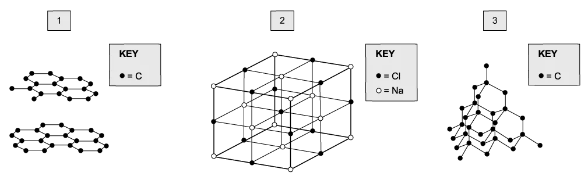

# Exam Questions — Bonding & Structure
**4. States of Matter** · Cambridge (CIE) A-LEVEL chemistry (9701)
> Source: [https://www.savemyexams.com/a-level/chemistry/cie/25/topic-questions/](https://www.savemyexams.com/a-level/chemistry/cie/25/topic-questions/) · 10 questions across 1 sets

## Multiple Choice Questions (10 questions)

### Q1 — medium — 1 marks

**Q1** [1 mark]

Which row gives the physical states where sodium chloride can conduct electricity?

|   | **solid** | **molten** | **aqueous** |
|---|---|---|---|
| **A** | ✓ | ✓ | ✗ |
| **B** | ✓ | ✗ | ✓ |
| **C** | ✗ | ✓ | ✓ |
| **D** | ✗ | ✗ | ✓ |

### Q2 — medium — 1 marks

**Q2** [1 mark]

Which substance has the highest melting point?

### Q3 — hard — 1 marks

**Q3** [1 mark]

Which sequence shows the metal oxides in order of decreasing melting point?

### Q4 — easy — 1 marks

**Q4** [1 mark]

Each diagram shows a type of giant lattice structure.

Which row gives the type of lattice shown in each diagram?

|   | **Diagram 1** | **Diagram 2** | **Diagram 3** |
|---|---|---|---|
| **A** | giant covalent | giant ionic | giant covalent |
| **B** | giant covalent | giant covalent | giant ionic |
| **C** | giant ionic | giant ionic | giant covalent |
| **D** | giant ionic | giant covalent | giant ionic |

### Q5 — easy — 1 marks

**Q5** [1 mark]

Three substances, **R**, **S** and **T**, have the physical properties shown.

| substance | melting point / °C | boiling point / °C | electrical conductivity of liquid |
|---|---|---|---|
| **R** | 772 | 1407 | good |
| **S** | 114 | 183 | poor |
| **T** | 1610 | 2205 | poor |

Which row gives the most likely lattice structure for each substance?

|   | **R** | **S** | **T** |
|---|---|---|---|
| **A** | giant molecular | simple molecular | ionic |
| **B** | ionic | giant molecular | simple molecular |
| **C** | ionic | simple molecular | giant molecular |
| **D** | simple molecular | ionic | giant molecular |

### Q6 — easy — 1 marks

**Q6** [1 mark]

Which solid has a giant covalent lattice structure?

### Q7 — easy — 1 marks

**Q7** [1 mark]

The table shows the physical properties of four substances, **A**, **B**, **C** and **D**.

Which substance has a giant ionic lattice?

| substance | melting point / °C | boiling point / °C | electrical conductivity of solid | electrical conductivity of liquid | electrical conductivity of aqueous solution |
|---|---|---|---|---|---|
| **A** | −119 | 39 | poor | poor | insoluble |
| **B** | −115 | −85 | poor | poor | good |
| **C** | 993 | 1695 | poor | good | good |
| **D** | 1610 | 2230 | poor | poor | insoluble |

### Q8 — hard — 1 marks

**Q8** [1 mark]

Which row gives the properties of hydrogen fluoride?

|   | **contains localised covalent bonds** | **highly soluble in polar solvents** | **lowest bond energy of the hydrogen halides** | **highest boiling point of the hydrogen halides** |
|---|---|---|---|---|
| **A** | ✗ | ✓ | ✗ | ✓ |
| **B** | ✓ | ✓ | ✗ | ✓ |
| **C** | ✗ | ✓ | ✓ | ✓ |
| **D** | ✗ | ✗ | ✓ | ✗ |

### Q9 — medium — 1 marks

**Q9** [1 mark]

Three substances, **X**, **Y** and **Z**, have the physical properties shown.

| substance | melting point / °C | boiling point / °C | electrical conductivity of solid | electrical conductivity of liquid |
|---|---|---|---|---|
| **X** | 801 | 1413 | poor | good |
| **Y** | 2852 | 3600 | poor | good |
| **Z** | 3550 | 4827 | good | not known |

Which row gives the identities of substances **X**, **Y** and **Z**?

|   | **X** | **Y** | **Z** |
|---|---|---|---|
| **A** | CaF2 | KCl | Cu |
| **B** | NaCl | MgO | C (graphite) |
| **C** | NaBr | CaO | C (diamond) |
| **D** | NaBr | BaO | SiO2 |

### Q10 — hard — 1 marks

**Q10** [1 mark]

Which compounds form a giant ionic lattice in the solid state?

|   | **silicon dioxide** | **ammonium sulfate** | **potassium iodide** |
|---|---|---|---|
| **A** | ✓ | ✓ | ✗ |
| **B** | ✓ | ✗ | ✓ |
| **C** | ✗ | ✓ | ✓ |
| **D** | ✗ | ✗ | ✓ |
