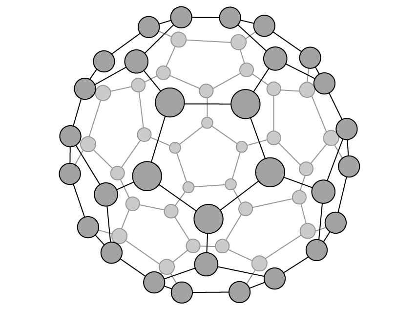
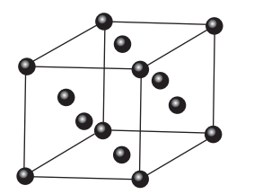

# Exam Questions — Bonding & Structure
**4. States of Matter** · Cambridge (CIE) A-LEVEL chemistry (9701)
> Source: [https://www.savemyexams.com/a-level/chemistry/cie/25/topic-questions/](https://www.savemyexams.com/a-level/chemistry/cie/25/topic-questions/) · 18 questions across 2 sets

## Multiple Choice Questions (10 questions)

### Q1 — medium — 1 marks

**Q1** [1 mark]

Which row gives the physical states where sodium chloride can conduct electricity?

|   | **solid** | **molten** | **aqueous** |
|---|---|---|---|
| **A** | ✓ | ✓ | ✗ |
| **B** | ✓ | ✗ | ✓ |
| **C** | ✗ | ✓ | ✓ |
| **D** | ✗ | ✗ | ✓ |

### Q2 — medium — 1 marks

**Q2** [1 mark]

Which substance has the highest melting point?

### Q3 — hard — 1 marks

**Q3** [1 mark]

Which sequence shows the metal oxides in order of decreasing melting point?

### Q4 — easy — 1 marks

**Q4** [1 mark]

Each diagram shows a type of giant lattice structure.

Which row gives the type of lattice shown in each diagram?

|   | **Diagram 1** | **Diagram 2** | **Diagram 3** |
|---|---|---|---|
| **A** | giant covalent | giant ionic | giant covalent |
| **B** | giant covalent | giant covalent | giant ionic |
| **C** | giant ionic | giant ionic | giant covalent |
| **D** | giant ionic | giant covalent | giant ionic |

### Q5 — easy — 1 marks

**Q5** [1 mark]

Three substances, **R**, **S** and **T**, have the physical properties shown.

| substance | melting point / °C | boiling point / °C | electrical conductivity of liquid |
|---|---|---|---|
| **R** | 772 | 1407 | good |
| **S** | 114 | 183 | poor |
| **T** | 1610 | 2205 | poor |

Which row gives the most likely lattice structure for each substance?

|   | **R** | **S** | **T** |
|---|---|---|---|
| **A** | giant molecular | simple molecular | ionic |
| **B** | ionic | giant molecular | simple molecular |
| **C** | ionic | simple molecular | giant molecular |
| **D** | simple molecular | ionic | giant molecular |

### Q6 — easy — 1 marks

**Q6** [1 mark]

Which solid has a giant covalent lattice structure?

### Q7 — easy — 1 marks

**Q7** [1 mark]

The table shows the physical properties of four substances, **A**, **B**, **C** and **D**.

Which substance has a giant ionic lattice?

| substance | melting point / °C | boiling point / °C | electrical conductivity of solid | electrical conductivity of liquid | electrical conductivity of aqueous solution |
|---|---|---|---|---|---|
| **A** | −119 | 39 | poor | poor | insoluble |
| **B** | −115 | −85 | poor | poor | good |
| **C** | 993 | 1695 | poor | good | good |
| **D** | 1610 | 2230 | poor | poor | insoluble |

### Q8 — hard — 1 marks

**Q8** [1 mark]

Which row gives the properties of hydrogen fluoride?

|   | **contains localised covalent bonds** | **highly soluble in polar solvents** | **lowest bond energy of the hydrogen halides** | **highest boiling point of the hydrogen halides** |
|---|---|---|---|---|
| **A** | ✗ | ✓ | ✗ | ✓ |
| **B** | ✓ | ✓ | ✗ | ✓ |
| **C** | ✗ | ✓ | ✓ | ✓ |
| **D** | ✗ | ✗ | ✓ | ✗ |

### Q9 — medium — 1 marks

**Q9** [1 mark]

Three substances, **X**, **Y** and **Z**, have the physical properties shown.

| substance | melting point / °C | boiling point / °C | electrical conductivity of solid | electrical conductivity of liquid |
|---|---|---|---|---|
| **X** | 801 | 1413 | poor | good |
| **Y** | 2852 | 3600 | poor | good |
| **Z** | 3550 | 4827 | good | not known |

Which row gives the identities of substances **X**, **Y** and **Z**?

|   | **X** | **Y** | **Z** |
|---|---|---|---|
| **A** | CaF2 | KCl | Cu |
| **B** | NaCl | MgO | C (graphite) |
| **C** | NaBr | CaO | C (diamond) |
| **D** | NaBr | BaO | SiO2 |

### Q10 — hard — 1 marks

**Q10** [1 mark]

Which compounds form a giant ionic lattice in the solid state?

|   | **silicon dioxide** | **ammonium sulfate** | **potassium iodide** |
|---|---|---|---|
| **A** | ✓ | ✓ | ✗ |
| **B** | ✓ | ✗ | ✓ |
| **C** | ✗ | ✓ | ✓ |
| **D** | ✗ | ✗ | ✓ |

## Structured Questions (8 questions)

### Q1 — easy — 9 marks

**Q1** [2 marks]

Sodium ions and chloride ions form a giant ionic lattice in solid form. Sodium ions are smaller than chloride ions.

Complete the diagram to show the location of the ions in the lattice of solid sodium chloride.

**Q1** [2 marks]

Explain why MgF2 has a higher melting point than NaCl.

**Q1** [3 marks]

Magnesium fluoride is another compound that forms a giant ionic lattice in solid form.

Predict the electrical conductivity of magnesium fluoride in each of the following states:

| **State** | **Electrical conductivity (Y / N)** |
|---|---|
| Solid |   |
| Liquid |   |
| Aqueous |   |

**Q1** [2 marks]

Explain why sodium chloride dissolves in water.

### Q2 — hard — 19 marks

**Q2** [4 marks]

This question is about the melting points of different chemicals.

The melting and boiling points of calcium and chlorine are given in Table 4.1.

**Table 4.1**

| **Element** | **Melting point / K** | **Boiling point / K** |
|---|---|---|
| Chlorine | 172 | 239 |
| Calcium | 1115 | 1757 |

i) In terms of structure and bonding, compare the boiling points of chlorine and calcium.

[3]

ii) Explain why calcium can conduct electricity but chlorine cannot.

[1]

**Q2** [5 marks]

Sulfur dioxide and magnesium oxide are both oxides. The melting point of sulfur dioxide is –72 oC and the melting point of magnesium oxide is 2852 oC.

i) Explain, with reference to structure and bonding, the difference in the melting points of sulfur dioxide and magnesium oxide.

[3]

ii) Hydrogen fluoride, HF, and hydrogen chloride, HCl, both have simple molecular structures. The melting point of HF is −83.6 oC and the melting point of HCl is −114.2 oC.

Explain why HF has a higher melting point than HCl.

[2]

**Q2** [5 marks]

Silver chloride is used in photography films as well as having antiseptic properties.

i) Describe the structure and bonding in silver chloride.

[2]

ii) Explain why silver chloride has a relatively high melting point.

[3]

**Q2** [5 marks]

Diamond and ice are types of crystals.

i) Describe the structure and bonding in diamond.

[2]

ii) Describe the structure and bonding in ice.

[1]

iii) Explain why diamond has a much higher melting point than ice.

[2]

### Q3 — easy — 11 marks

**Q3** [5 marks]

This question is about crystalline solids.

Iodine and diamond are crystalline solids at room temperature.

Explain why diamond has a much higher melting temperature than iodine.

*Source: Oct 2021 8CHO/01 Q5A*

**Q3** [2 marks]

Graphite is also a crystalline solid at room temperature.

Unlike diamond, graphite conducts electricity.

Explain, in terms of structure and bonding, why graphite conducts electricity.

*Source: Oct 2021 8CHO/01 Q5B*

**Q3** [4 marks]

State the type of structure that is likely to be present in the following:

i) Crystalline solid that conducts electricity, is malleable and has a melting point of 900 °C.

[1]

ii) Crystalline solid that does not conduct electricity and has a melting point of 92 °C.

[1]

iii) Crystalline solid that does not conduct electricity and has a melting point of more than 3100 °C.

[1]

iv) Crystalline solid that does not conduct electricity and has a melting point of 790 °C. When molten it becomes a conductor.

[1]

### Q4 — hard — 16 marks

**Q4** [3 marks]

Mercury is a naturally occurring element that is a liquid at room temperature and pressure. Some of its physical properties are shown in Table 5.1.

**Table 5.1**

| **Appearance at room temperature** | shiny silver liquid |
|---|---|
| **Melting point / ****o****C** | -38.8 |
| **Boiling point / ****o****C** | 356.7 |
| **Electrical conductivity** | good |

Compare and explain the electrical conductivity of mercury and sodium chloride in both the solid state and when melted.

**Q4** [2 marks]

The strength of ionic bonding in different compounds can be compared by using the amount of energy required to separate the ions, as shown in Table 5.2.

**Table 5.2**

| **Compound** | **Amount of energy required to separate the ions / kJ mol****-1** |
|---|---|
| LiF | 1031 |
| NaF | 787 |
| MgF2 | 2962 |

Using the data from Table 5.2, explain how changes in the cation affect the strength of ionic bonding in an ionic compound.

**Q4** [7 marks]

Sodium chloride and iodine are both solids. Sodium chloride does not melt until it reaches a temperature of 1074 K yet iodine sublimes when heated gently, giving off purple vapours. Sodium chloride will conduct electricity when molten and iodine is a very poor conductor of electricity.

i) State the type of structure and bonding of iodine and sodium chloride.

[2]

ii) Explain why iodine is volatile.

[2]

iii) Explain the differences in electrical conductivity of sodium chloride and iodine.

[3]

**Q4** [4 marks]

Graphene, graphite and diamond are all forms of solid carbon.

Explain, in terms of structure and bonding, why graphene and graphite are good electrical conductors but diamond is a poor electrical conductor.

### Q5 — easy — 8 marks

**Q5** [4 marks]

Carbon and silicon are both in Group 14.

Diamond and graphite are two forms of the element carbon.

Explain the difference in hardness between diamond and graphite in terms of their structure and bonding.

**Q5** [2 marks]

Two of the oxides of silicon and carbon are carbon dioxide, CO2, and silicon(IV) oxide.

Suggest **two** differences in the physical properties of these two oxides.

**Q5** [2 marks]

**Extract:**

Two of the oxides of silicon and carbon are carbon dioxide, CO~2~, and silicon(IV) oxide.

Explain why silicon(IV) oxide does not dissolve in water.

### Q6 — medium — 11 marks

**Q6** [4 marks]

Until 1985, carbon was thought to exist in only two structural forms or allotropes. In 1985 another form, buckminsterfullerene, was discovered, in which the carbon exists as spherical molecules.

The other two forms of carbon have very different structures.

i) Name these two forms.

[1]

ii) Give **three** differences in physical properties between these two forms.

[3]

**Q6** [2 marks]

The diagram shows the structure of buckminsterfullerene.

The molecule of buckminsterfullerene contains 60 carbon atoms.

Suggest a reason why buckminsterfullerene reacts with hydrogen under suitable conditions and give a formula for the product.

**Q6** [3 marks]

In 2010, two scientists from the University of Manchester were awarded the Nobel Prize for Physics for their work on graphene, a 'nano-material' and new structural form of carbon.

i) Graphene is in the form of sheets of carbon one atom thick.

Calculate the number of carbon atoms present in a sheet of graphene with a mass of one thousandth of a gram (0.001 g). Show your working.

[1]

ii) The number of hexagons in a large sheet of graphene can be assumed to be one half of the number of carbon atoms. Each hexagon has an area of 690 nm2.

Calculate the area of the sheet of graphene in (i). Show your working.

[2]

**Q6** [2 marks]

**Extract:**

Until 1985, carbon was thought to exist in only two structural forms or allotropes. In 1985 another form, buckminsterfullerene, was discovered, in which the carbon exists as spherical molecules.

The molecule of buckminsterfullerene contains 60 carbon atoms.

Graphene is in the form of sheets of carbon one atom thick.

Explain whether you would expect samples of graphene and buckminsterfullerene to be electrical conductors.

### Q7 — medium — 19 marks

**Q7** [6 marks]

Carbon and silicon are elements in Group 14.

i) Describe in simple terms the structure of solid C60.

[2]

ii) C60 sublimes (turns directly from solid to gas) at approximately 800 K.

C60 (s) → C60 (g)

Diamond also sublimes but only above 3800 K.

Cdiamond (s) → C (g)

Explain why C60 and diamond sublime at such different temperatures.

[4]

*Source: 2022 Specimen Paper 2 Q2A*

**Q7** [3 marks]

C60 forms hydrocarbons with similar chemical properties to those of alkenes. One such hydrocarbon is C60H18.

i) Define hydrocarbon.

[1]

ii) C60H18 is an alkene.
State a test to indicate the presence of double bonds between carbon atoms in alkene molecules.

[1]

iii) State the observations seen when the test in **(b)(ii)** is carried out on an alkene.

[1]

*Source: 2022 Specimen Paper 2 Q3A*

**Q7** [7 marks]

0.144 g of C60 is placed in a 100 cm3 container of hydrogen gas at a temperature of 20 °C and a pressure of 1.00 × 105 Pa.

The container is heated to make the C60 and hydrogen gas react. The reaction occurs as shown in the equation.

C60 (s) + xH2 (g) → C60H2x (s)

After the reaction, the container is allowed to cool to 20 °C. The pressure decreases to 2.21 × 104 Pa. All of the C60 has reacted.

i) Name the type of reaction that occurs.

[1]

ii) Calculate the amount, in moles, of C60 that reacts. Show your working.

[1]

iii) Calculate the amount, in moles, of hydrogen gas that reacted with the C60. Show your working.

[3]

iv) Use your answers from (c)(ii) and (c)(iii) to deduce the molecular formula of the hydrocarbon, C60H2x. Show your working.

[2]

*Source: 2022 Specimen Paper 2 Q2C*

**Q7** [3 marks]

Silicon shows the same type of bonding and structure as diamond.

Silicon reacts with magnesium to form Mg2Si.

Solid Mg2Si reacts with dilute hydrochloric acid to form gaseous SiH4 and a solution of magnesium chloride.

i) Construct an equation for this reaction. Include state symbols.

[2]

ii) Predict the shape of the SiH4 molecule.

[1]

*Source: 2022 Specimen Paper 2 Q2D*

### Q8 — medium — 12 marks

**Q8** [2 marks]

Copper and iodine are both solids which have different physical and chemical properties.

Each element has the same face-centred crystal structure which is shown below.

The particles present in such a crystal may be atoms, molecules, anions or cations. In the diagram above, the particles present are represented by the black balls.

Which type of particles are present in the iodine crystal? Give their formula.

**Q8** [2 marks]

When separate samples of copper or iodine are heated to 50 °C, the copper remains as a solid while the iodine turns into a vapour.

Explain, in terms of the forces present in the solid structure, why copper remains a solid at 50 °C.

**Q8** [2 marks]

**Extract:**

When separate samples of copper or iodine are heated to 50 °C, the copper remains as a solid while the iodine turns into a vapour.

Explain, in terms of the forces present in the solid structure, why iodine turns into a vapour when heated to 50 °C.

**Q8** [4 marks]

Calculate the volume, in cm3, that 5.00 g of iodine vapour occupies at 185 °C and a pressure of 100 kPa.

Assume iodine vapour behaves as an ideal gas.

The gas constant *R* = 8.31 J K-1 mol-1

Show your working. Give your answer to 3 significant figures.

**Q8** [2 marks]

Although copper is a relatively unreactive metal, when it is heated to a high temperature in an excess of chlorine, copper(II) chloride is formed.

i) State the role of chlorine in this reaction.

[1]

ii) When a mixture of copper and iodine is heated to a high temperature, no reaction occurs. Suggest a reason for this difference.

[1]
