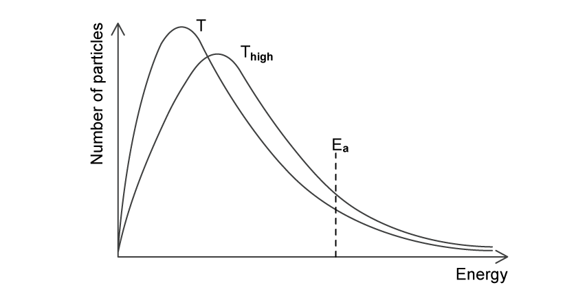
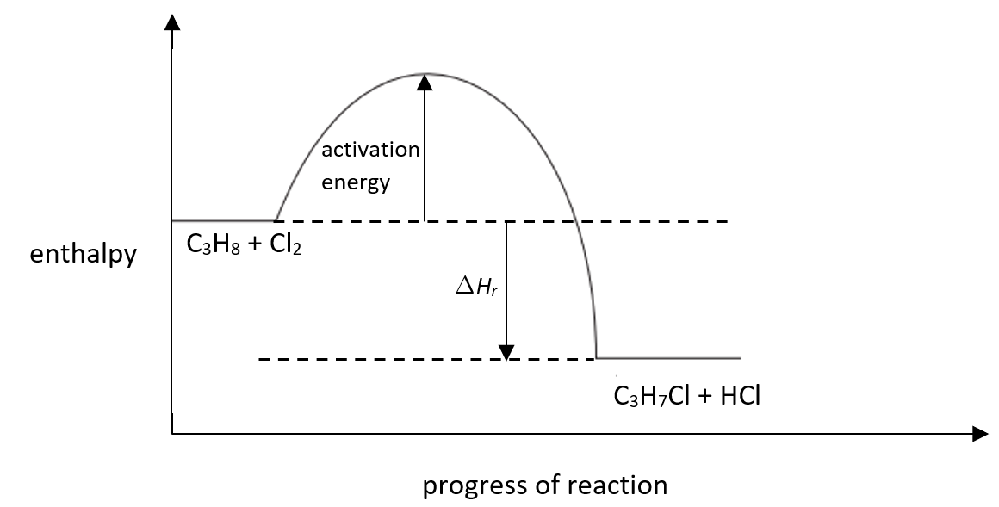
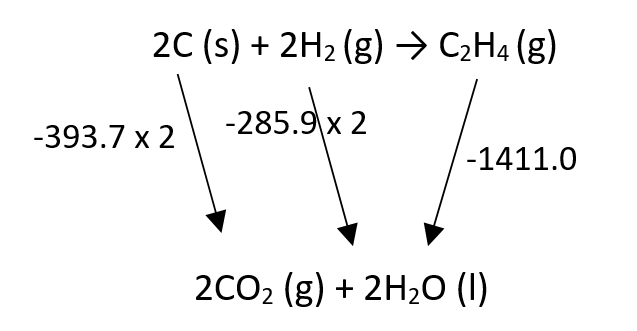
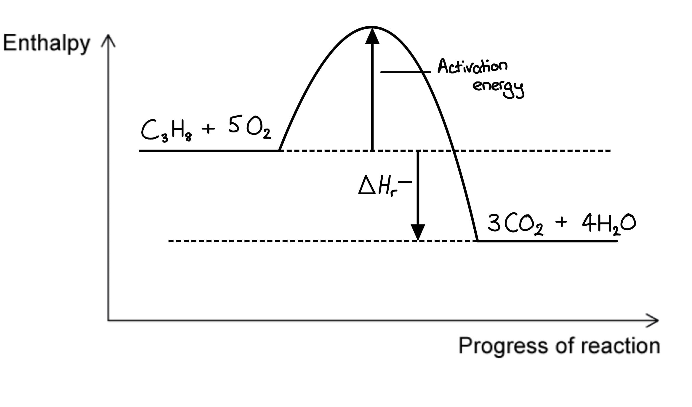
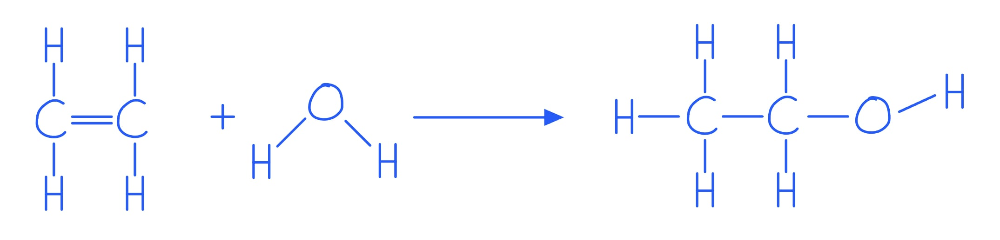
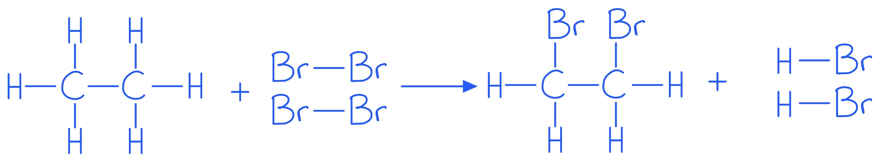

# Mark Schemes — Enthalpy Change, ΔH
**5. Chemical Energetics** · Cambridge (CIE) A-LEVEL chemistry (9701)

## Multiple Choice Questions (19 questions)

### Q1
**Final answer:** **The correct answer is B**

- The standard enthalpy of formation requires the reactant elements to be in their **standard states** at standard conditions (298 K, 101 kPa), and exactly **one mole** of product to be formed
- **Carbon standard state:**

  - Graphite, not diamond
  - Both graphite and diamond are solid carbon, but graphite is the more stable allotrope at standard conditions, so row **C** is incorrect
- **Hydrogen standard state:**

  - H2 (g) as gaseous molecules, not gaseous atoms
  - Gaseous atoms (H) represent the enthalpy of atomisation, not the standard state of hydrogen, so row **A** is incorrect
- **Moles of product:**

  - The definition of Δ*H*f⦵ requires exactly 1 mole of compound to be formed
  - Row **D** describes forming 2 moles of ethanol, which would represent 2 × Δ*H*f⦵, not Δ*H*f⦵ itself

### Q2
**Final answer:** **The correct answer is D**

- For bond energy calculations, always use:

Δ*H *=* *∑(bonds broken)−∑(bonds formed)

- Bonds broken:

  - 1 × H−H = 436 kJ mol−1
  - 1 × X−X = E(X−X)
  - Σ(bonds broken) = 436 + E(X−X)
- Bonds formed:

  - 2 × H−X = 2 × 432 = 864 kJ mol−1
- Substituting into the formula:

−184 = (436 + E(X−X)) − 864

−184 = E(X−X) − 428

E(X−X) = 428 − 184 = **244 kJ mol****−1**

**A**, **B** and **C** are incorrect as they result from errors in setting up or rearranging the bond energy equation. Check that the correct number of bonds broken and formed are identified, and that Δ*H* = Σ(bonds broken) − Σ(bonds formed) is applied correctly.

### Q3
**Final answer:** **The correct answer is C**

- Reactants: 2N atoms and 6F atoms

  - All individual gaseous atoms with no bonds to break
- Products: 2 molecules of NF3
- Each NF3 molecule contains 3 N–F bonds, so total bonds formed = 2 × 3 = 6 N–F bonds
- Using the bond energy formula:

Δ*H* = Σ(bond energies of bonds broken) − Σ(bond energies of bonds formed)

- Since the reactants are individual atoms, there are no bonds broken:

Δ*H* = 0 − 6 × E(N–F)

−1776 = −6 × E(N–F)

E(N–F) = $\frac{1776}{6}$ = **+296 kJ mol****−1**

- Bond energies are always positive as energy is always required to break a bond

**A** is incorrect as this uses only 3 N–F bonds (one NF3 molecule) instead of 6, and assigns a negative value. Bond energies are always positive.

**B** is incorrect as this uses only 3 N–F bonds (one NF3 molecule) instead of the 6 N–F bonds formed across both product molecules.

**D** is incorrect as bond energies are always positive values. A negative bond energy has no physical meaning.

### Q4
**Final answer:** **The correct answer is B**

- The energy transferred as heat is given by *q* = *mc*Δ*T*

  - Where *q* is heat transferred (J), *m* is the mass of the solution (g), *c* is the specific heat capacity (J g−1 K−1), and Δ*T* is the temperature change (K)
- Known quantities:

  - Total volume of solution = 75 + 75 = 150 cm3
  - Mass of solution = 150 × 1.00 = 150 g
  - Temperature change = 14 oC = 14 K
  - Specific heat capacity = 4.18 J g−1 K−1
- Calculate the energy transferred:

*q* = 150 × 4.18 × 14 = 8778 J

- Calculate the moles of HCl (or KOH):

*n* = 3.00 × (75/1000) = 0.225 mol

- HCl and KOH react in a 1:1 molar ratio at equal concentrations, so the moles of one reactant equals the moles of water formed
- Calculate the molar enthalpy change:

Δ*H* = −*q*/*n* = −8778 / 0.225 = −39 013 J mol−1

- Convert to kJ mol−1: **−39.0 kJ mol****−1**

**A** is incorrect as only 75 g (one solution) was used to calculate *q* instead of the total mass of 150 g.

**C** is incorrect as the temperature rises, so the reaction is exothermic and Δ*H* must be negative.

**D** is incorrect as only 75 g was used to calculate *q*, and the total moles of both reactants (0.450 mol) was used instead of the moles of one reactant.

### Q5
**Final answer:** **The correct answer is C**

- Using Δ*H* = Σ(bonds broken) − Σ(bonds formed):
- W: Br2 (g) → 2Br (g):

Δ*H* = +194 − 0 = +194 kJ mol−1

- X: 2Cl (g) → Cl2 (g):

Δ*H* = 0 − 247 = −247 kJ mol−1

- Y: CH3 (g) + Cl (g) → CH3Cl (g):

Δ*H* = 0 − 338 = −338 kJ mol−1

- Z: CH4 (g) → CH3 (g) + H (g):

Δ*H* = +412 − 0 = +412 kJ mol−1

- In each case only one bond is broken or formed

  - So, the enthalpy change equals the relevant bond energy (positive for breaking, negative for forming)
- Ordering from most negative to most positive:

  - Y (−338), X (−247), W (+194), Z (+412)
  - Y, X, W, Z

### Q6
**Final answer:** **The correct answer is D**

- The energy transferred as heat is given by *q* = *mc*Δ*T*

  - Where *q* is heat transferred (J), *m* is the mass of the solution (g), *c* is the specific heat capacity (J g−1 K−1), and Δ*T* is the temperature change (K)
- Known quantities:

  - Total volume of solution = 30.0 + 30.0 = 60.0 cm3
  - Mass of solution = 60.0 × 1.00 = 60.0 g
  - Temperature change = 0.50 oC = 0.50 K
  - Specific heat capacity = 4.18 J g−1 K−1

- Calculate the energy transferred:

*q* = *mc*Δ*T* = 60.0 × 4.18 × 0.50 = 125.4 J

- Calculate the moles of KOH (or HNO~3~):

*n* = 0.0250 × (30.0/1000) = 7.50 × 10−4 mol

- KOH and HNO3 react in a 1:1 molar ratio at equal concentrations, so the moles of one reactant equals the moles of water formed
- Calculate the enthalpy change of neutralisation:

Δ*H* = −*q*/*n* = −125.4 / (7.50 × 10−4) = −167 200 J mol-1

- Convert to kJ mol-1: **−167.2 kJ mol****-1**

**A** is incorrect as only 30.0 g was used to calculate *q* instead of the total mass of 60.0 g, and the total moles of both reactants (1.50 × 10−3 mol) was used instead of the moles of one reactant.

**B** is incorrect as the total moles of both reactants (1.50 × 10−3 mol) was used instead of the moles of one reactant (7.50 × 10−4 mol). The enthalpy change of neutralisation is expressed per mole of water formed, so only the moles of one reactant should be used.

**C** is incorrect as the temperature rises, so the reaction is exothermic and Δ*H* must be negative.

### Q7
**Final answer:** **The correct answer is A**

- Since S can be isolated, it exists as a stable intermediate in an energy well between the two stages of the reaction
- The reaction profile therefore shows two separate activation energy peaks, with S sitting in a valley between them
- The reaction R → S is endothermic (Δ*H* is positive), so S is at a higher energy level than R
- The reaction S → T is exothermic (Δ*H* is negative), so T is at a lower energy level than S
- The energy profile diagrams for each stage are shown below:

- Combining these two steps gives a profile that rises from R to the first activation energy peak, falls to S in an energy valley, rises again to a second activation energy peak, then falls to T
- This two-hump profile with S in the valley is option **A**

### Q8
**Final answer:** **The correct answer is B**

- The bond energy of the H–I bond is the energy required to break one mole of H–I bonds in the gas phase.
- Bond breaking is an endothermic process, so it is always defined as energy **required**, not released

**A** is incorrect as bond energy is defined per **mole** of bonds (kJ mol−1), not for a single individual bond

**C** is incorrect as bond energy is defined as the energy required to **break** one mole of bonds, not the energy released when bonds form. Bond forming is exothermic; bond breaking is endothermic

**D** is incorrect as 'energy stored' is not the correct thermodynamic definition. Bond energy specifically describes the energy input needed to break bonds, not energy stored within them

### Q9
**Final answer:** **The correct answer is C**

- **Standard enthalpy of formation** (Δ*H*fθ):

  - The enthalpy change when one mole of a compound is formed from its elements in their standard states under standard conditions
  - Enthalpy changes of formation can be either exothermic (negative) or endothermic (positive), so the sign is + / −
  - For example, Δ*H*fθ[CO2] = −393 kJ mol−1 (exothermic), whereas Δ*H*fθ[NO] = +90 kJ mol−1 (endothermic)
- **Standard enthalpy of combustion** (Δ*H*cθ):

  - The enthalpy change when one mole of a substance burns completely in excess oxygen under standard conditions
  - Combustion reactions always release energy to the surroundings, so Δ*H*cθ is always negative (−)
- **Standard enthalpy of neutralisation** (Δ*H*neutθ):

  - The enthalpy change when one mole of water is formed from the reaction of an acid with an alkali under standard conditions
  - Neutralisation reactions are always exothermic, so Δ*H*neutθ is always negative (−)

### Q10
**Final answer:** **The correct answer is D**

- The standard enthalpy change of formation is the enthalpy change when one mole of a compound is formed from its elements in their standard states under standard conditions

  - The only reactions that start with elements in their standard states are **B** and **D**
- The standard enthalpy change of combustion is the enthalpy change when one mole of a substance reacts completely with oxygen under standard conditions

  - The only reaction showing one mole of a substance reacting with oxygen is **D**

**A** is incorrect as this does not represent formation because the products are not being formed from the elements

**B** is incorrect as this represents formation (one mole of Na2O is formed from its elements) but does not represent combustion as 2 moles of sodium are reacting

**C** is incorrect as this represents the enthalpy change of neutralisation, not formation or combustion

### Q11
**Final answer:** **The correct answer is D**

- Bond energy is defined as the energy required to break one mole of a covalent bond in the gaseous phase to give gaseous atoms
- For Y−Z bond energy = Δ*H*/*n*, the equation must break exactly *n* Y−Z bonds and produce separate gaseous atoms of Y and Z
- **YZ****n**** (g) → Y (g) + *****n *****Z (g)** breaks all *n* Y−Z bonds in one step, giving one Y atom and *n* isolated Z atoms
- Dividing the enthalpy change by *n* gives the energy per mole of Y−Z bonds broken

**A** is incorrect as the products include Z2 molecules, not gaseous Z atoms. The energy to form the Z−Z bond in Z2 is included in Δ*H*, so dividing by *n* would not give the Y−Z bond energy directly.

**B** is incorrect as YZ appears on both sides of the equation. No net bonds are broken, so Δ*H*/*n* cannot give the bond energy.

**C** is incorrect as YZn is shown as a liquid, not a gas. Bond energy calculations require all species to be in the gaseous state. Using a liquid reactant would include the enthalpy of vaporisation, not just the bond energy.

### Q12
**Final answer:** **The correct answer is B**

- Using the bond energy formula:

Δ*H* = Σ(bonds broken) − Σ(bonds formed)

- Bonds broken:

  - PCl5 contains 5 P−Cl bonds
  - 5 × P−Cl = 5 × 328 = 1640 kJ mol−1
- Bonds formed:

  - PCl3 contains 3 P−Cl bonds; Cl2 contains 1 Cl−Cl bond
  - 3 × P−Cl = 3 × 328 = 984 kJ mol−1
  - 1 × Cl−Cl = 241 kJ mol−1
  - Σ(bonds formed) = 1225 kJ mol−1
- Applying the formula:

Δ*H* = 1640 − 1225 = **+415 kJ mol****−1**

- The positive value confirms the reaction is endothermic as more energy is required to break the P−Cl bonds in PCl5 than is released when forming the bonds in PCl3 and Cl2

**A** is incorrect as the sign is reversed. Breaking more bonds than are formed requires a net energy input, so Δ*H* is positive.

**C** is incorrect as the Cl−Cl bond formed in Cl2 was not included in the bonds formed calculation. Both the P−Cl bonds in PCl3 and the Cl−Cl bond in Cl2 must be counted.

**D** is incorrect as only 3 P−Cl bonds were counted as broken, matching PCl3, instead of the 5 P−Cl bonds present in PCl5.

### Q13
**Final answer:** **The correct answer is C**

- The activation energy is the minimum energy required to reach the transition state (the peak of the energy profile), measured as the energy difference from the reactants' energy level

- For the **reverse** reaction, the reactants are the products on the right side of the diagram.
- The energy difference from the right energy level to the transition state is +20 kJ mol–1

**A** is incorrect as +90 kJ mol–1 is the activation energy of the **forward** reaction, not the reverse reaction

**B** is incorrect as the forward activation energy is measured from the left energy level to the transition state: 70 + 20 = +90 kJ mol–1, not +20 kJ mol–1

**D** is incorrect as the forward reaction is endothermic (products at higher energy than reactants), so Δ*H* must be positive

### Q14
**Final answer:** **The correct answer is D**

- The heat energy transferred to the water is found using *q* = *mc*Δ*T*
- Known quantities:

  - Mass of water = 150.00 − 50.0 = 100 g
  - Temperature change = 54 − 21 = 33 °C
  - Specific heat capacity, *c* = 4.18 J g−1 °C−1
- Calculate the heat energy transferred:

*q* = *mc*Δ*T* = 100 x 4.18 x 33 = **13 794 J**

**A** is incorrect as this uses the mass of the empty glass beaker (50.0 g) instead of the mass of water alone: 50.0 x 4.18 x 33 = 6897 J

**B** is incorrect as this uses the combined mass of beaker and water (150.0 g) instead of the mass of water alone: 150.0 x 4.18 x 33 = 20 691 J

**C** is incorrect as this uses the final temperature (54 °C) rather than the temperature change (Δ*T* = 33 °C): 100 x 4.18 x 54 = 22 572 J

### Q15
**Final answer:** **The correct answer is A**

- The activation energy is the minimum energy required for a collision to be successful, measured from the reactants' energy level to the transition state (the peak of the energy profile)

- For the forward reaction, this is the energy difference from the reactants (left energy level) to the peak = +90 kJ mol–1

**B** is incorrect as the activation energy of the reverse reaction is measured from the products (right energy level) to the peak. As the forward reaction is endothermic (Δ*H* = +30 kJ mol–1), the reverse Ea = 90 − 30 = +60 kJ mol–1, not +90 kJ mol–1

**C** is incorrect as the products are at higher energy than the reactants, so the forward reaction is endothermic and Δ*H* = +30 kJ mol–1. The value −30 kJ mol–1 is the enthalpy change of the **reverse** reaction

**D** is incorrect as the products are at a higher energy level than the reactants, meaning energy is absorbed from the surroundings. The forward reaction is endothermic

### Q16
**Final answer:** **The correct answer is C**

- Known quantities:

  - Mass of water = 500 g
  - Temperature change = 68.0 − 25.0 = 43.0 oC = 43.0 K
  - Specific heat capacity = 4.18 J g−1 K−1
- Energy absorbed by the water:

*q* = *mc*Δ*T* = 500 × 4.18 × 43.0 = 89 870 J

- This represents only 30% of the total energy released by the fuel
- Total energy released:

Total = 89 870 × $\frac{100}{30}$ = 299 567 J

- Energy per gram of fuel:

Energy per gram = 299 567 / 2.50 = 119 827 J g−1 = **120 kJ g****−1**

**A** is incorrect as *q* was multiplied by (30/100) instead of (100/30). Since *q* is only 30% of the total energy, multiplying by (100/30) is needed to recover the total.

**B** is incorrect as the 30% efficiency factor was not applied. *q* represents only 30% of the energy released, so the total must be found using *q* × (100/30).

**D** is incorrect as the total energy was not divided by the mass of fuel (2.50 g). The question asks for energy per gram of fuel.

### Q17
**Final answer:** **The correct answer is B**

- The bond energy formula is:

Δ*H* = Σ(bond energies of bonds broken) − Σ(bond energies of bonds formed)

- Bonds broken:

  - 2 × C−H = 2 × 390 = 780 kJ mol−1
  - 1 × C≡C = 870 kJ mol−1
  - 2½ × O=O = 2.5 × 489 = 1222.5 kJ mol−1
  - Σ(bonds broken) = 2872.5 kJ mol−1
- Bonds formed:

  - 2 × O−H = 2 × 510 = 1020 kJ mol−1
  - 4 × C=O = 4 × 790 = 3160 kJ mol−1
  - Σ(bonds formed) = 4180 kJ mol−1
- Applying the formula:

Δ*H* = 2872.5 − 4180 = **−1307.5 kJ mol****−1**

**A** is incorrect as the sign is reversed. The temperature rises during combustion, indicating an exothermic reaction, so Δ*H* must be negative.

**C** is incorrect as a coefficient of 2 was used for O=O instead of 2½. The balanced equation requires 2½ mol of O2 per mol of C2H2.

**D** is incorrect as the O−C bond energy (290 kJ mol−1) was used for the O−H bonds in water instead of the O−H bond energy (510 kJ mol−1).

### Q18
**Final answer:** **The correct answer is C**

- Cyclobutane, C4H8, contains 4 C−C bonds (ring) and 8 C−H bonds
- The balanced equation for formation from elements is:

4C (s) + 4H2 (g) → C4H8 (g)

- Using Δ*H* = Σ(bonds broken) − Σ(bonds formed):
- Bonds broken:

  - 4 × C (graphite) → C (g): 4 × 712 = 2848 kJ mol−1
  - 4 × H−H: 4 × 429 = 1716 kJ mol−1
  - Σ(bonds broken) = 4564 kJ mol−1
- Bonds formed:

  - 8 × C−H: 8 × 390 = 3120 kJ mol−1
  - 4 × C−C: 4*x* kJ mol−1
  - Σ(bonds formed) = 3120 + 4*x*
- Applying the formula:

75.1 = 4564 − (3120 + 4*x*)

75.1 = 1444 − 4*x*

4*x* = 1444 − 75.1 = 1368.9

*x* = **342 kJ mol****−1**

**A** is incorrect as Δ*H*f was not incorporated (effectively set to zero). This gives (4564 − 3120) / 4 = 361 kJ mol−1.

**B** is incorrect as +75.1 kJ mol−1 was added rather than subtracted in the Hess equation. This sign error gives (4564 − 3120 + 75.1) / 4 ≈ 380 kJ mol−1.

**D** is incorrect as only 4 C−H bonds were included in bonds formed instead of 8. Cyclobutane has 2 C−H bonds per carbon atom, giving 8 C−H bonds in total.

### Q19
**Final answer:** **The correct answer is A**

- According to Le Chatelier's Principle, increasing the temperature shifts the position of equilibrium in the endothermic direction.

  - As the yield of products increases when temperature rises, the forward reaction is **endothermic**

- In PCl3, the phosphorus atom forms 3 bonding pairs (one to each chlorine) and has 1 lone pair.

  - According to VSEPR theory, lone pair–bond pair repulsion is greater than bond pair–bond pair repulsion, pushing the bonds closer together

- This gives PCl3 a **trigonal pyramidal** shape (bond angle approximately 107°)

**B** is incorrect as the reaction is endothermic, not exothermic. An exothermic forward reaction would shift equilibrium to the left at higher temperatures, decreasing product yield

**C** is incorrect as a trigonal planar shape requires 3 bonding pairs and no lone pairs (e.g. BCl3). The lone pair on phosphorus produces a trigonal pyramidal shape

**D** is incorrect as the reaction is endothermic and the shape is trigonal pyramidal, not trigonal planar

## Structured Questions (10 questions)

### Q1
To calculate the relative molecular mass, *M*r, of **A**:

- Convert units to SI:

*V* = 116 cm3 = 116 × 10-6 m3

*T* = 80.0 °C = 353 K

*p* = 101 kPa = 101 000 Pa

**[1 mark]**

- Calculate the number of moles, *n*, using *pV* = *nRT*:

*n* = $\frac{pV}{RT}$

*n* = $\frac{101000\times(116\times10^{-6})}{8.31\times353}$

*n* = 3.99 × 10-3 mol

**[1 mark]**

- Calculate *M*r:

*M*r = $\frac{\mathrm{mass}}{\mathrm{moles}}$

*M*r = $\frac{0.240}{3.99\times10^{-3}}$

*M*r = **60.1 (to 3 s.f.)**

**[1 mark]**

> **[mark-scheme]**
> 1 mark for correct conversions of volume, temperature **AND **pressure to SI units
> 
> Answers given to more than 3 significant figures are accepted, if supported by workings

> **[exam-tip]**
> Watch units carefully.
> 
> If you use *R* = 8.31, you must use SI units. This means converting **kPa to Pa**, **cm****3**** to m****3**, and **°C to K** before substituting into *pV* = *nRT*.
> 
> A missed conversion (especially pressure or volume) is the most common reason these questions lose marks.
> **[mark-scheme]**
> i) Standard enthalpy change of formation is:
> 
> - The enthalpy change when one mole / 1 mol of a compound is formed from its elements **[1 mark]**
> - In their standard states under standard conditions **[1 mark]**

ii) To calculate the standard enthalpy change of formation, Δ*H*θf, of liquid methyl methanoate:

- State the relationship used:

Δ*H*θf + Δ*H*θc(compound) = Δ*H*θc(reactants)  **[1 mark]**

- Calculate the total enthalpy of combustion of the reactants:

Δ*H*θc(reactants) = (2 x C) + (2 x H2)

Δ*H*θc(reactants) = (2 x -394) + (2 x -286)

Δ*H*θc(reactants) = −1360 kJ mol-1 **[1 mark]**

- Calculate Δ*H*θf:

Δ*H*θf = −1360 − (−975)

Δ*H*θf = **−385 kJ mol****-1** **[1 mark]**

> **[mark-scheme]**
> 1 mark for Δ*H*θf + Δ*H*θc(compound) = Δ*H*θc(reactants)
> 
> 1 mark for Δ*H*θc(reactants) = (2 x C) + (2 x H2) **OR** Δ*H*θc(reactants) = (2 x 394) + (2 x -286) **OR** Δ*H*θc(reactants) = −1360 kJ mol-1
> 
> 1 mark for a final negative Δ*H*θf value = −385 kJ mol-1
> 
> 3 marks can be awarded for a correct final answer with or without working
> 
> Only 1 mark is awarded for a final answer of +385 kJ mol-1

> **[exam-tip]**
> In formation definitions, do not forget the two precision points:
> 
> 1. One mole / 1 mol
> 2. Standard states under standard conditions.
> 
> In the Hess calculation, the most common error is missing the stoichiometry from the formation equation. Multiply the combustion values by the coefficients first (here, 2 for C and 2 for H2) before combining them with the ester’s combustion value.
To calculate the enthalpy change for this reaction:

- The reactants are gaseous atoms, so there are no bonds to break:

Δ*H*(bonds broken) = 0

- Identify the bonds formed in HCOOCH3 (g):

1 × C=O

2 × C–O

4 × C–H

**[1 mark]**

- Use bond energies from the Data Booklet to calculate the total energy of bonds formed:

Δ*H*(bonds formed) = −(C=O + (2 × C–O) + (4 × C–H))

Δ*H*(bonds formed) = −((740) + (2 × 360) + (4 × 410))

Δ*H*(bonds formed) = **−3100 kJ mol****-1**

**[1 mark]**

> **[mark-scheme]**
> 1 mark for correct identification of all bonds formed in HCOOCH3(g): 1 × C=O, 2 × C–O, 4 × C–H
> 
> 1 mark for a final negative Δ*H*(bonds formed) value = - 3100 (kJ mol-1)
> 
> 2 marks can be awarded for a correct final answer with or without working

> **[exam-tip]**
> Since the reactants are gaseous atoms, this is a bond formation only question as there are no bonds to break. The enthalpy change is the negative of the total bond energies for all bonds formed.
> 
> The most common mistakes are:
> 
> - Treating it like a normal bond energy cycle and trying to “break” bonds in the reactants
> - Missing one of the C–O bonds in the ester group
> - Forgetting the negative sign
i) The Boltzmann distribution curve for the reactant molecules at temperature *T*high is:

**[2 marks]**

> **[mark-scheme]**
> 1 mark for *T*high curve with lower peak, shifted to the right, crossing the original curve once
> 
> 1 mark for activation energy *E*a marked on the x-axis and curve clearly labelled *T*high

> **[exam-tip]**
> For Boltzmann distribution sketches, accuracy of shape and labels matters more than artistic quality.
> 
> Make sure the curve starts at the origin and does not touch the x-axis again.

> **[mark-scheme]**
> ii) At a higher temperature, the rate of reaction is greater because:
> 
> - A greater proportion / fraction / percentage of molecules have energy greater than or equal to the activation energy (*E* ≥ *E*a) **[1 mark]**
> - There is an increase in the frequency of successful / effective collisions per unit time **[1 mark]**

> **[exam-tip]**
> When explaining the effect of temperature, avoid vague statements like “particles move faster.”
> 
> The marks are for linking:
> 
> - Higher temperature
> - → larger fraction of molecules above *E*a
> - → more successful collisions
> - → faster rate

### Q2
i) To calculate the enthalpy change for this reaction:

- List the bond energies broken:

E(C–H) = 410 kJ mol-1

E(Cl–Cl) = 242 kJ mol-1

Total bonds broken = +652 kJ mol-1 **[1 mark]**

- List the bond energies formed:

E(C–Cl) = 340 kJ mol-1

E(H–Cl) = 431 kJ mol-1

Total bonds formed = −771 kJ mol-1 **[1 mark]**

- Calculate the enthalpy change:

Δ*H* = Σ bond energies broken + Σ bond energies formed

Δ*H* = +652 + (−771)

Δ*H* = **−119 kJ mol****-1** **[1 mark]**

> **[mark-scheme]**
> ii) The conditions needed for this reaction to occur are:
> 
> - UV light / sunlight 
> **OR**
> High temperature **[1 mark]**

> **[exam-tip]**
> Take a methodical approach to bond energy calculations by listing bonds broken and bonds formed separately before calculating the totals.
> 
> Check whether more than one of the same type of bond is broken or formed.
> 
> Bonds broken require energy (positive value); bonds formed release energy (negative value).
The completed reaction pathway diagram for the reaction in part (a) is:

**[3 marks]**

> **[mark-scheme]**
> 1 mark for correct location of reactants and products
> 
> 1 mark for upward arrow labelled as activation energy
> 
> 1 mark for downward arrow labelled as Δ*H*r / enthalpy change

> **[exam-tip]**
> There is no need to add the numerical values for the enthalpy changes from part (a) as the diagram only requires the relative starting and finishing positions of the reactants and products.
> **[mark-scheme]**
> The difference in enthalpy change for the two reactions:
> 
> - There is no / little difference in enthalpy change for the reactions **[1 mark]**
> - The same number and type of bonds are broken and formed in both reactions **[1 mark]**

> **[exam-tip]**
> Bond energies are average values obtained from a range of similar compounds.
> 
> There may be a very slight difference in bond energy between compounds, as the presence of other atoms and bonds can have a small influence on bond strength. However, this difference is too small to affect the calculated value significantly.
> **[mark-scheme]**
> Whether the sum of bonds broken would be larger or smaller compared to propane reacting with chlorine:
> 
> - Smaller **[1 mark]**
> - Bromine is a larger atom than chlorine
> **AND**
> The Br–Br bond is (longer and) weaker than Cl–Cl **[1 mark]**

> **[exam-tip]**
> Atomic radius increases down Group 17, so Br–Br bonds are longer than Cl–Cl bonds.
> 
> Longer covalent bonds are weaker than shorter bonds, so less energy is required to break Br–Br compared to Cl–Cl.

### Q3
i) The equation for the standard enthalpy change of combustion of butan-1-ol is:

C4H9OH (l) + 6O2 (g) → 4CO2 (g) + 5H2O (l)

**[2 marks]**

> **[mark-scheme]**
> 1 mark for correct products (4CO2 and 5H2O with state symbols)
> 
> 1 mark for correct balancing and all state symbols correct

> **[mark-scheme]**
> ii) The purpose of the copper spiral and small electric heater in the apparatus:
> 
> - The copper spiral ensures complete heat exchange with the surrounding water / conducts heat from the combustion products to the water **[1 mark]**
> - To ignite (and vaporise) the butan-1-ol **[1 mark]**

> **[exam-tip]**
> Be careful when balancing combustion reactions of alcohols as the oxygen atom in the alcohol itself is easy to miss.
> 
> Stating that the heater only vaporises the alcohol is not enough for the second mark as the key idea is that combustion (burning) occurs.
To calculate the energy change, *q*:

- Write the equation and substitute known values:

*q* = *mc*Δ*T*

*q* = 875 x 4.18 x 2.5 **[1 mark]**

- Calculate *q* and convert to kJ:

*q* = $\frac{9143.75}{1000}$

*q* = **9.1 kJ (to 2 s.f.) ****[1 mark]**

> **[mark-scheme]**
> An answer in J only, without conversion to kJ, is not accepted

> **[exam-tip]**
> The unit in the answer space is kJ, so make sure to divide your answer in J by 1000.
> 
> Failing to round to two significant figures will lose the final mark.
To determine the enthalpy of combustion of butan-1-ol:

- Calculate the moles of butan-1-ol burned:

*n* = $\frac{mass}{M_{r}}$

moles of butan-1-ol burned = $\frac{2.20}{74.12}$

moles of butan-1-ol burned = 0.02968 mol **[1 mark]**

- Calculate Δ*H*:

Δ*H* = $\frac{q}{n}$

Δ*H* = $\frac{9143.75}{0.02968}$

Δ*H* = 308077.8 J mol-1 **[1 mark]**

- Convert to kJ mol-1 and apply sign:

Δ*H*c = $\frac{308077.8}{1000}$

Δ*H*c = **−308 kJ mol****-1**** (to 3 s.f.) ****[1 mark]**

> **[mark-scheme]**
> Values given to 3 (or more) significant figures during the working steps are accepted; but any values given to 2 (or less) significant figures are not accepted
> 
> Allow error carried forward from part (b) if the method is correct
> 
> A correct final answer, including the negative sign, with no working shown still gains full marks.

> **[exam-tip]**
> Do not round intermediate values. Use *q* = 9143.75 J (not 9100 J) to avoid accumulating rounding errors.
> 
> Using *q* = 9100 J from part (b) gives −307 kJ mol-1 and loses the final mark.

### Q4
To calculate the enthalpy change of reaction for the hydrogenation of propene:

- Construct the equation for the hydrogenation:

CH3CH=CH2 (g) + H2 (g) → C3H8 (g)

**[1 mark]**

- Identify and calculate bonds broken:

Bonds broken = 1 × C=C + 1 × H–H

Bonds broken = 619 + 435

Bonds broken = +1054 kJ mol-1

- Identify and calculate bonds formed:

Bonds formed = 1 × C–C + 2 × C–H

Bonds formed = 347 + 2(413)

Bonds formed = −1173 kJ mol-1

**[1 mark]**

- Calculate Δ*H*r:

Δ*H*r = +1054 + (−1173)

Δ*H*r = **−119 kJ mol****-1**

**[1 mark]**

> **[mark-scheme]**
> 1 mark for correct hydrogenation equation: CH3CH=CH2 + H2 → C3H8
> 
> 1 mark for bonds broken = +1054 kJ mol-1 (C=C + H–H) **AND** bonds formed = −1173 kJ mol-1 (C–C + 2 × C–H)
> 
> 1 mark for Δ*H*r = −119 kJ mol-1
> 
> Allow the full bond energy approach (using all bonds in propene and propane) for full marks if method and answer are correct

> **[exam-tip]**
> Only bonds that change in the reaction need to be counted. In the hydrogenation of propene, the C=C becomes C–C and H–H is broken while two new C–H bonds form. Bonds in CH3 groups are identical on both sides and cancel out.
> **[mark-scheme]**
> The polymerisation of propene is
> 
> - Exothermic 
> **OR**
> There is a net release of energy **[1 mark]**
> - One C=C bond is broken and two C–C bonds are formed
> **OR**
> One C=C bond is weaker than two C–C bonds (619 kJ mol-1 vs 2 × 347 = 694 kJ mol-1) **[1 mark]**

> **[exam-tip]**
> For each repeat unit of the polymer, one C=C bond breaks and two new C–C bonds form.
> 
> The energy released in forming two C–C bonds (2 × 347 = 694 kJ mol-1) is greater than the energy required to break one C=C bond (619 kJ mol-1), giving a net release of energy.
To calculate the standard enthalpy change of formation, Δ*H*θf, of ethene:

- Apply Hess’s Law:

Δ*H*θf = 2Δ*H*θc(C) + 2Δ*H*θc(H2) − Δ*H*θc(C2H4) **[1 mark]**

- Substitute values and calculate:

Δ*H*θf = 2(−393.7) + 2(−285.9) − (−1411.0)

Δ*H*θf = −787.4 − 571.8 + 1411.0

Δ*H*θf = **+51.8 kJ mol****-1** **[1 mark]**

> **[mark-scheme]**
> 1 mark for applying Hess’s Law correctly: Δ*H*θf = 2Δ*H*θc(C) + 2Δ*H*θc(H2) − Δ*H*θc(C2H4)
> 
> Allow 1 mark for a correctly labelled Hess cycle showing the correct route
> 
> 
> 
> 1 mark for a final positive Δ*H*θf value = +51.8 kJ mol-1

> **[exam-tip]**
> Use Hess’s Law: the enthalpy change for the direct route (formation of ethene from its elements) equals the enthalpy change via combustion.
> 
> Construct the formation equation from the definition. 1 mole of compound formed from its elements in their standard states:
> 
> 2C (s) + 2H2 (g) → C2H4 (g)
> 
> Remember to multiply the combustion values by the stoichiometric coefficients in the formation equation before combining them.

### Q5
i) The completed table showing the oxidation number of nitrogen in each compound:

| **Compound** | **NO** | **NO****2** |
|---|---|---|
| oxidation number of N | **Final answer:** **+2** | **Final answer:** **+4** |

**[1 mark]**

> **[mark-scheme]**
> 1 mark for both oxidation numbers correct: +2 (NO) and +4 (NO2)

> **[mark-scheme]**
> ii) The equations for the formation of NO2:
> 
> - ½N2 (g) + O2 (g) → NO2 (g)
> **OR**
> N2 (g) + 2O2 (g) → 2NO2 (g) **[1 mark]**
> 
> - NO (g) + ½O2 (g) → NO2 (g)
> **OR**
> 2NO (g) + O2 (g) → 2NO2 (g) **[1 mark]**
> 
> State symbols are not required

> **[exam-tip]**
> For oxidation numbers in neutral compounds, the sum of all oxidation numbers must equal zero.
> 
> For NO: oxygen = −2, so nitrogen = +2.
> 
> For NO2: two oxygen atoms give −4 total, so nitrogen = +4.
To calculate the bond energy of the N=O bond:

- The equation for the reaction is:

N2 (g) + 2O2 (g) → 2NO2 (g)

- Calculate the total energy for bonds broken:

1 × N≡N = 941 kJ mol-1

2 × O=O = 2 × 495 = 990 kJ mol-1

Total bonds broken = +1931 kJ mol-1 **[1 mark]**

- Set up the Δ*H*r equation:

Δ*H*r = Σ(bonds broken) − Σ(bonds formed)

+497 = +1931 − 4(N=O) **[1 mark]**

- Solve for the bond energy of N=O:

4(N=O) = 1931 − 497

4(N=O) = 1434

N=O = $\frac{1434}{4}$

N=O = **358.5 kJ mol****-1** **[1 mark]**

> **[exam-tip]**
> The reaction equation is N2 (g) + 2O2 (g) → 2NO2 (g), so 1 N≡N bond and 2 O=O bonds are broken, and 4 N=O bonds are formed.
> 
> Work step by step:
> 
> - Find the total bond energy for bonds broken
> - Set up the Δ*H*r equation
> - Solve for the N=O bond energy
> **[mark-scheme]**
> A reason for the difference in boiling points between carbon dioxide and nitrogen dioxide:
> 
> - The van der Waals / intermolecular forces are (much) stronger in NO2 / weaker in CO2 **[1 mark]**
> 
> Plus, any **one** from:
> 
> - NO2 has permanent dipole-dipole attractions between molecules; CO2 does not
> - NO2 is polar but CO2 is not
> - In CO2 the molecule is symmetrical and the dipoles cancel out / there is no net dipole
> 
> **[1 mark]**

> **[exam-tip]**
> The C=O bond is actually more polar than the N=O bond (greater electronegativity difference), but NO2 has a lone pair on nitrogen that makes it a bent molecule, whereas CO2 is linear.
> 
> The linear shape of CO2 causes the bond dipoles to cancel, giving no net dipole. So, CO2 only has weaker dispersion (London) forces, resulting in a much lower boiling point.
> **[mark-scheme]**
> The equation for the standard enthalpy change of formation of nitrogen monoxide, NO:
> 
> - ½N2 (g) + ½O2 (g) → NO (g) **[1 mark]**
> 
> State symbols are required

> **[exam-tip]**
> The standard enthalpy change of formation requires exactly 1 mole of product to be formed.
> 
> Writing N2 (g) + O2 (g) → 2NO (g) is a common error. This produces 2 moles of NO rather than 1, so it does not represent the standard enthalpy change of formation.

### Q6
To calculate the energy change, *q*, in J:

- Calculate the moles of ammonium chloride:

moles = $\frac{\mathrm{mass}}{M_{r}}$

*n*(NH4Cl) = $\frac{12.04}{53.5}$

*n*(NH4Cl) = 0.2250 mol **[1 mark]**

- Convert Δ*H*sol from kJ mol-1 to J mol-1:

Δ*H*sol = 15.1 x 1000

Δ*H*sol = 15100 J mol-1

- Calculate the energy change:

*q* = *n* x Δ*H*sol

*q* = 0.2250 x 15 100

*q* = **3397.5 J** (to 3 s.f.) **[1 mark]**

> **[mark-scheme]**
> The final answer must be given to 2 or more significant figures
> 
> Δ*H*sol must be converted from kJ mol-1 to J mol-1 (×1000) to score the second mark

> **[exam-tip]**
> Work backwards from Δ*H*sol to find the energy change for the actual amount used (0.225 mol, not 1 mol).
To calculate the final temperature of the solution:

- Calculate the temperature change:

*q* = *mc*Δ*T*

Δ*T* = $\frac{q}{mc}$

Δ*T* = $\frac{3398}{125.0\times4.18}$

Δ*T* = 6.5 °C **[1 mark]**

- The dissolution is endothermic, so the temperature decreases:

*T*final = 19.5 °C − 6.5 °C

*T*final = **13.0 °C** **[1 mark]**

> **[mark-scheme]**
> Allow error carried forward from part (a) if method is correct

> **[exam-tip]**
> The positive enthalpy of solution (+15.1 kJ mol-1) tells you that dissolution is endothermic. Heat is absorbed from the surroundings, so the temperature of the solution decreases.
> 
> Subtract the temperature change from the initial temperature to find the final temperature.

### Q7
To calculate the minimum mass of propane needed:

- Calculate the energy required to heat the water:

*q* = *mc*Δ*T*

*q* = 150 x 4.18 x 75

*q* = 47025 J

- Convert from J to kJ:

*q* = $\frac{47025}{1000}$

*q* = 47.025 kJ **[1 mark]**

- Rearrange the Δ*H* equation for *n*:

Δ*H* = $\frac{q}{n}$

*n* = $\frac{q}{ΔH}$

- Calculate the moles of propane required:

*n* = $\frac{47.025}{2219.2}$

*n* = 0.02119 mol **[1 mark]**

- Calculate the *M*r of propane:

*M*r of propane = (3 × 12) + (8 × 1)

*M*r of propane = 44.0 g mol-1

- Calculate the mass of propane:

mass = moles × *M*r

mass of propane = 0.02119 x 44.0

mass of propane = **0.93 g** **[1 mark]**

> **[mark-scheme]**
> Allow error carried forward if method is correct

> **[exam-tip]**
> *q* is calculated in J, so you must divide by 1000 to convert to kJ before using the enthalpy of combustion value (in kJ mol-1).
> **[mark-scheme]**
> More propane may be required than calculated in part (a) because:
> 
> - Some of the heat / energy is lost to the surroundings **[1 mark]**

> **[exam-tip]**
> Draw on your practical experience of calorimetry experiments. Heat loss to the surroundings is the most common source of error.
The completed reaction pathway diagram is:

**[3 marks]**

> **[mark-scheme]**
> 1 mark for correct location and stoichiometry of reactants and products
> 
> 1 mark for upward arrow labelled as activation energy
> 
> 1 mark for downward arrow labelled as Δ*H*r / enthalpy change / Δ*H*c

> **[exam-tip]**
> The combustion of propane is exothermic, so the products must be at a lower energy level than the reactants.
> 
> Write the reactants and products as balanced equations on the diagram.

### Q8
To calculate the standard enthalpy change of reaction, Δ*H*°r:

- State the relationship:

Δ*H*°r = ΣΔ*H*°f (products) − ΣΔ*H*°f (reactants)

- Substitute the values from Table 2.1:

Δ*H*°r = [(–284.1) + (–92.3)] − [(–103.2) + (–273.3)] **[1 mark]**

Δ*H*°r = –376.4 − (–376.5)

Δ*H*°r = **+0.1 kJ mol****–1** **[1 mark]**

> **[mark-scheme]**
> 1 mark for correct substitution: [(–284.1) + (–92.3)] − [(–103.2) + (–273.3)]
> 
> 1 mark for correct final answer: +0.1 kJ mol–1 (allow 0.1 kJ mol–1)

> **[exam-tip]**
> The formula for calculating the standard enthalpy change of reaction using standard enthalpies of formation is:
> 
> Δ*H*°r = ΣΔ*H*°f (products) − ΣΔ*H*°f (reactants)
> 
> All four values in the table are negative. Be careful with the signs when subtracting a group of negative values — use brackets around each set of products and reactants to avoid sign errors.
> 
> The answer is very close to zero (+0.1 kJ mol–1), meaning the reaction is approximately thermoneutral. This affects how you draw the reaction pathway diagram in part (b): the two horizontal lines should be at almost the same height.
The completed reaction pathway diagram is:

**[2 marks]**

> **[mark-scheme]**
> 1 mark for a correctly drawn reaction profile with reactants and products labelled and at approximately the same energy level (Δ*H*°r ≈ 0), with a smooth curve showing a hump
> 
> 1 mark for activation energy *E*a correctly labelled as an upward arrow from the reactants energy level to the peak of the curve

> **[exam-tip]**
> Since the standard enthalpy change of reaction from part (a) is +0.1 kJ mol–1, which is very close to zero, the reactants and products should be drawn at almost identical heights. If you draw them far apart, you have not correctly applied the calculated value.
> 
> The activation energy is always shown as an arrow from the energy level of the reactants up to the peak of the curve. It represents the minimum energy that reactant particles must have to react.
> **[mark-scheme]**
> The definition of activation energy is:
> 
> - The minimum energy required for a reaction to occur / the minimum energy that colliding particles must possess for a successful collision **[1 mark]**

> **[exam-tip]**
> The activation energy, *E*a, is shown on a reaction pathway diagram as an arrow from the energy level of the reactants to the peak of the curve. It represents the energy barrier that reacting particles must overcome for the reaction to proceed.

### Q9
> **[mark-scheme]**
> i) The standard enthalpy change of formation is:
> 
> - The enthalpy change when one mole of a compound is formed from its elements **[1 mark]**
> - In their standard states, under standard conditions (298 K and 100 kPa) **[1 mark]**
> 
> ii) The equation representing the standard enthalpy change of formation of ammonia is:
> 
> - ½N2 (g) + 1½H2 (g) → NH3 (g) **[1 mark]**
> 
> Equations using integers (e.g. N2 (g) + 3H2 (g) → 2NH3 (g)) are not accepted as they do not represent the formation of one mole of NH3

> **[exam-tip]**
> For part i), both marking points must be included to score both marks. The enthalpy change involves forming one mole of a compound from its elements, and the elements must be in their standard states — the most stable form of each element at 298 K and 100 kPa. For example, the standard state of carbon is graphite (not diamond), and the standard state of bromine is liquid Br2 (not gas).
> 
> For part ii), CIE accepts fractional coefficients in enthalpy of formation equations. The equation must produce exactly one mole of NH3. Using N2 (g) + 3H2 (g) → 2NH3 (g) does not score the mark because it represents the formation of two moles.
> **[mark-scheme]**
> Standard conditions in enthalpy measurements are:
> 
> - A temperature of 298 K
> **AND**
> A pressure of 100 kPa **[1 mark]**

> **[exam-tip]**
> A common error is to give the temperature in degrees Celsius (25 °C) rather than kelvin. CIE requires the temperature in kelvin (298 K) and the pressure in kPa (100 kPa).
> **[mark-scheme]**
> The enthalpy change does not represent the standard enthalpy change of neutralisation because:
> 
> - The standard enthalpy change of neutralisation is defined as the enthalpy change when one mole of water is formed from the reaction of an acid and a base **[1 mark]**
> - This reaction produces two moles of water / the equation must be halved so that only one mole of water is produced **[1 mark]**

> **[exam-tip]**
> The key criterion for the standard enthalpy change of neutralisation is that exactly one mole of water must be formed. The identity of the acid and base does not matter.
> 
> Always check the coefficient of water in any neutralisation equation. If it is not 1, the equation does not directly represent the standard enthalpy change of neutralisation.

### Q10
> **[mark-scheme]**
> The definition of bond energy is:
> 
> - The energy required to break one mole of a specified bond **[1 mark]**
> - In a gaseous molecule, averaged over a range of similar compounds **[1 mark]**

> **[exam-tip]**
> The definition must include both marking points:
> 
> - Bond energy relates to breaking one mole of a specific bond
> - It is an average value taken from a variety of gaseous molecules.
> 
> The average is necessary because the exact energy depends on the molecular environment. A C–H bond in methane has a slightly different energy from a C–H bond in ethanol. Bond energies are always positive (endothermic) because breaking bonds always requires an input of energy.
> **[mark-scheme]**
> The calculated value may differ from the experimental value because:
> 
> - Bond energies are average values (taken over a range of compounds and molecular environments) and not exact values for the specific bonds in the molecules **[1 mark]**

> **[exam-tip]**
> Bond energy data tables list average values calculated from many different compounds. For example, the C–H bond energy is an average of the C–H bond energy in methane, ethane, ethanol, and many other molecules. The actual C–H bond energy in a specific molecule may differ slightly from this average, introducing a small error into the calculated enthalpy change.
To calculate the enthalpy change for the hydration of ethene:

- List the bonds broken (endothermic) in the reactants:

E(C=C) = 1 x 614 = 614 kJ mol-1

E(C–H) = 4 x 414 = 1656 kJ mol-1

E(O–H) = 2 x 463 = 926 kJ mol-1

Total bonds broken = 614 + 1656 + 926 = 3196 kJ mol-1 **[1 mark]**

- List the bonds formed (exothermic) in the products:

E(C–C) = 1 x 346 = 346 kJ mol-1

E(C–H) = 5 x 414 = 2070 kJ mol-1

E(C–O) = 1 x 358 = 358 kJ mol-1

E(O–H) = 1 x 463 = 463 kJ mol-1

Total bonds formed = 346 + 2070 + 358 + 463 = 3237 kJ mol-1 **[1 mark]**

- Calculate the enthalpy change:

Δ*H*r = total bonds broken − total bonds formed

Δ*H*r = 3196 − 3237

Δ*H*r = **−41 kJ mol****−1** **[1 mark]**

> **[mark-scheme]**
> 1 mark for correct total bonds broken: 3196 kJ mol-1
> 
> 1 mark for correct total bonds formed: 3237 kJ mol-1
> 
> 1 mark for correct final answer: −41 kJ mol-1

> **[exam-tip]**
> Drawing out the full structural formulae of the reactants and products helps you identify every bond.
> 
> 
> 
> In ethene (CH2=CH2), there are four C–H bonds and one C=C bond. Water (H2O) has two O–H bonds.
> 
> In ethanol (CH3CH2OH), there are five C–H bonds, one C–C bond, one C–O bond, and one O–H bond.
To calculate the enthalpy change for the reaction of ethane with bromine:

- Construct the balanced equation:

CH3CH3 (g) + 2Br2 (g) → CH2BrCH2Br (g) + 2HBr (g) **[1 mark]**

- List the bonds broken (endothermic) in the reactants:

E(C–C) = 1 x 346 = 346 kJ mol-1

E(C–H) = 6 x 414 = 2484 kJ mol-1

E(Br–Br) = 2 x 193 = 386 kJ mol-1

Total bonds broken = 346 + 2484 + 386 = 3216 kJ mol-1 **[1 mark]**

- List the bonds formed (exothermic) in the products:

E(C–C) = 1 x 346 = 346 kJ mol-1

E(C–H) = 4 x 414 = 1656 kJ mol-1

E(C–Br) = 2 x 285 = 570 kJ mol-1

E(H–Br) = 2 x 366 = 732 kJ mol-1

Total bonds formed = 346 + 1656 + 570 + 732 = 3304 kJ mol-1 **[1 mark]**

- Calculate the enthalpy change:

Δ*H*r = total bonds broken − total bonds formed

Δ*H*r = 3216 − 3304

Δ*H*r = **−88 kJ mol****−1** **[1 mark]**

> **[mark-scheme]**
> 1 mark for a correctly balanced equation: CH3CH3 (g) + 2Br2 (g) → CH2BrCH2Br (g) + 2HBr (g)
> 
> 1 mark for correct total bonds broken: 3216 kJ mol-1
> 
> 1 mark for correct total bonds formed: 3304 kJ mol-1
> 
> 1 mark for correct final answer: −88 kJ mol-1

> **[exam-tip]**
> Drawing out the structural formulae helps identify all the bonds in each molecule.
> 
> 
> 
> Ethane (CH3CH3) has one C–C bond and six C–H bonds.
> 
> The product 1,2-dibromoethane (CH2BrCH2Br) has one C–C bond, four C–H bonds, and two C–Br bonds. Notice that the C–C bond appears on both sides of the calculation and effectively cancels out as it has not changed during the reaction.
