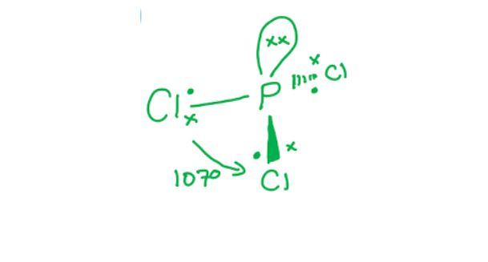

# Mark Schemes — Enthalpy Change, ΔH
**5. Chemical Energetics** · Cambridge (CIE) A-LEVEL chemistry (9701)

## Multiple Choice Questions (19 questions)

### Q1
**Final answer:** **The correct answer is B**

- The standard enthalpy of formation requires the reactant elements to be in their **standard states** at standard conditions (298 K, 101 kPa), and exactly **one mole** of product to be formed
- **Carbon standard state:**

  - Graphite, not diamond
  - Both graphite and diamond are solid carbon, but graphite is the more stable allotrope at standard conditions, so row **C** is incorrect
- **Hydrogen standard state:**

  - H2 (g) as gaseous molecules, not gaseous atoms
  - Gaseous atoms (H) represent the enthalpy of atomisation, not the standard state of hydrogen, so row **A** is incorrect
- **Moles of product:**

  - The definition of Δ*H*f⦵ requires exactly 1 mole of compound to be formed
  - Row **D** describes forming 2 moles of ethanol, which would represent 2 × Δ*H*f⦵, not Δ*H*f⦵ itself

### Q2
**Final answer:** **The correct answer is D**

- For bond energy calculations, always use:

Δ*H *=* *∑(bonds broken)−∑(bonds formed)

- Bonds broken:

  - 1 × H−H = 436 kJ mol−1
  - 1 × X−X = E(X−X)
  - Σ(bonds broken) = 436 + E(X−X)
- Bonds formed:

  - 2 × H−X = 2 × 432 = 864 kJ mol−1
- Substituting into the formula:

−184 = (436 + E(X−X)) − 864

−184 = E(X−X) − 428

E(X−X) = 428 − 184 = **244 kJ mol****−1**

**A**, **B** and **C** are incorrect as they result from errors in setting up or rearranging the bond energy equation. Check that the correct number of bonds broken and formed are identified, and that Δ*H* = Σ(bonds broken) − Σ(bonds formed) is applied correctly.

### Q3
**Final answer:** **The correct answer is C**

- Reactants: 2N atoms and 6F atoms

  - All individual gaseous atoms with no bonds to break
- Products: 2 molecules of NF3
- Each NF3 molecule contains 3 N–F bonds, so total bonds formed = 2 × 3 = 6 N–F bonds
- Using the bond energy formula:

Δ*H* = Σ(bond energies of bonds broken) − Σ(bond energies of bonds formed)

- Since the reactants are individual atoms, there are no bonds broken:

Δ*H* = 0 − 6 × E(N–F)

−1776 = −6 × E(N–F)

E(N–F) = $\frac{1776}{6}$ = **+296 kJ mol****−1**

- Bond energies are always positive as energy is always required to break a bond

**A** is incorrect as this uses only 3 N–F bonds (one NF3 molecule) instead of 6, and assigns a negative value. Bond energies are always positive.

**B** is incorrect as this uses only 3 N–F bonds (one NF3 molecule) instead of the 6 N–F bonds formed across both product molecules.

**D** is incorrect as bond energies are always positive values. A negative bond energy has no physical meaning.

### Q4
**Final answer:** **The correct answer is B**

- The energy transferred as heat is given by *q* = *mc*Δ*T*

  - Where *q* is heat transferred (J), *m* is the mass of the solution (g), *c* is the specific heat capacity (J g−1 K−1), and Δ*T* is the temperature change (K)
- Known quantities:

  - Total volume of solution = 75 + 75 = 150 cm3
  - Mass of solution = 150 × 1.00 = 150 g
  - Temperature change = 14 oC = 14 K
  - Specific heat capacity = 4.18 J g−1 K−1
- Calculate the energy transferred:

*q* = 150 × 4.18 × 14 = 8778 J

- Calculate the moles of HCl (or KOH):

*n* = 3.00 × (75/1000) = 0.225 mol

- HCl and KOH react in a 1:1 molar ratio at equal concentrations, so the moles of one reactant equals the moles of water formed
- Calculate the molar enthalpy change:

Δ*H* = −*q*/*n* = −8778 / 0.225 = −39 013 J mol−1

- Convert to kJ mol−1: **−39.0 kJ mol****−1**

**A** is incorrect as only 75 g (one solution) was used to calculate *q* instead of the total mass of 150 g.

**C** is incorrect as the temperature rises, so the reaction is exothermic and Δ*H* must be negative.

**D** is incorrect as only 75 g was used to calculate *q*, and the total moles of both reactants (0.450 mol) was used instead of the moles of one reactant.

### Q5
**Final answer:** **The correct answer is C**

- Using Δ*H* = Σ(bonds broken) − Σ(bonds formed):
- W: Br2 (g) → 2Br (g):

Δ*H* = +194 − 0 = +194 kJ mol−1

- X: 2Cl (g) → Cl2 (g):

Δ*H* = 0 − 247 = −247 kJ mol−1

- Y: CH3 (g) + Cl (g) → CH3Cl (g):

Δ*H* = 0 − 338 = −338 kJ mol−1

- Z: CH4 (g) → CH3 (g) + H (g):

Δ*H* = +412 − 0 = +412 kJ mol−1

- In each case only one bond is broken or formed

  - So, the enthalpy change equals the relevant bond energy (positive for breaking, negative for forming)
- Ordering from most negative to most positive:

  - Y (−338), X (−247), W (+194), Z (+412)
  - Y, X, W, Z

### Q6
**Final answer:** **The correct answer is D**

- The energy transferred as heat is given by *q* = *mc*Δ*T*

  - Where *q* is heat transferred (J), *m* is the mass of the solution (g), *c* is the specific heat capacity (J g−1 K−1), and Δ*T* is the temperature change (K)
- Known quantities:

  - Total volume of solution = 30.0 + 30.0 = 60.0 cm3
  - Mass of solution = 60.0 × 1.00 = 60.0 g
  - Temperature change = 0.50 oC = 0.50 K
  - Specific heat capacity = 4.18 J g−1 K−1

- Calculate the energy transferred:

*q* = *mc*Δ*T* = 60.0 × 4.18 × 0.50 = 125.4 J

- Calculate the moles of KOH (or HNO~3~):

*n* = 0.0250 × (30.0/1000) = 7.50 × 10−4 mol

- KOH and HNO3 react in a 1:1 molar ratio at equal concentrations, so the moles of one reactant equals the moles of water formed
- Calculate the enthalpy change of neutralisation:

Δ*H* = −*q*/*n* = −125.4 / (7.50 × 10−4) = −167 200 J mol-1

- Convert to kJ mol-1: **−167.2 kJ mol****-1**

**A** is incorrect as only 30.0 g was used to calculate *q* instead of the total mass of 60.0 g, and the total moles of both reactants (1.50 × 10−3 mol) was used instead of the moles of one reactant.

**B** is incorrect as the total moles of both reactants (1.50 × 10−3 mol) was used instead of the moles of one reactant (7.50 × 10−4 mol). The enthalpy change of neutralisation is expressed per mole of water formed, so only the moles of one reactant should be used.

**C** is incorrect as the temperature rises, so the reaction is exothermic and Δ*H* must be negative.

### Q7
**Final answer:** **The correct answer is A**

- Since S can be isolated, it exists as a stable intermediate in an energy well between the two stages of the reaction
- The reaction profile therefore shows two separate activation energy peaks, with S sitting in a valley between them
- The reaction R → S is endothermic (Δ*H* is positive), so S is at a higher energy level than R
- The reaction S → T is exothermic (Δ*H* is negative), so T is at a lower energy level than S
- The energy profile diagrams for each stage are shown below:

- Combining these two steps gives a profile that rises from R to the first activation energy peak, falls to S in an energy valley, rises again to a second activation energy peak, then falls to T
- This two-hump profile with S in the valley is option **A**

### Q8
**Final answer:** **The correct answer is B**

- The bond energy of the H–I bond is the energy required to break one mole of H–I bonds in the gas phase.
- Bond breaking is an endothermic process, so it is always defined as energy **required**, not released

**A** is incorrect as bond energy is defined per **mole** of bonds (kJ mol−1), not for a single individual bond

**C** is incorrect as bond energy is defined as the energy required to **break** one mole of bonds, not the energy released when bonds form. Bond forming is exothermic; bond breaking is endothermic

**D** is incorrect as 'energy stored' is not the correct thermodynamic definition. Bond energy specifically describes the energy input needed to break bonds, not energy stored within them

### Q9
**Final answer:** **The correct answer is C**

- **Standard enthalpy of formation** (Δ*H*fθ):

  - The enthalpy change when one mole of a compound is formed from its elements in their standard states under standard conditions
  - Enthalpy changes of formation can be either exothermic (negative) or endothermic (positive), so the sign is + / −
  - For example, Δ*H*fθ[CO2] = −393 kJ mol−1 (exothermic), whereas Δ*H*fθ[NO] = +90 kJ mol−1 (endothermic)
- **Standard enthalpy of combustion** (Δ*H*cθ):

  - The enthalpy change when one mole of a substance burns completely in excess oxygen under standard conditions
  - Combustion reactions always release energy to the surroundings, so Δ*H*cθ is always negative (−)
- **Standard enthalpy of neutralisation** (Δ*H*neutθ):

  - The enthalpy change when one mole of water is formed from the reaction of an acid with an alkali under standard conditions
  - Neutralisation reactions are always exothermic, so Δ*H*neutθ is always negative (−)

### Q10
**Final answer:** **The correct answer is D**

- The standard enthalpy change of formation is the enthalpy change when one mole of a compound is formed from its elements in their standard states under standard conditions

  - The only reactions that start with elements in their standard states are **B** and **D**
- The standard enthalpy change of combustion is the enthalpy change when one mole of a substance reacts completely with oxygen under standard conditions

  - The only reaction showing one mole of a substance reacting with oxygen is **D**

**A** is incorrect as this does not represent formation because the products are not being formed from the elements

**B** is incorrect as this represents formation (one mole of Na2O is formed from its elements) but does not represent combustion as 2 moles of sodium are reacting

**C** is incorrect as this represents the enthalpy change of neutralisation, not formation or combustion

### Q11
**Final answer:** **The correct answer is D**

- Bond energy is defined as the energy required to break one mole of a covalent bond in the gaseous phase to give gaseous atoms
- For Y−Z bond energy = Δ*H*/*n*, the equation must break exactly *n* Y−Z bonds and produce separate gaseous atoms of Y and Z
- **YZ****n**** (g) → Y (g) + *****n *****Z (g)** breaks all *n* Y−Z bonds in one step, giving one Y atom and *n* isolated Z atoms
- Dividing the enthalpy change by *n* gives the energy per mole of Y−Z bonds broken

**A** is incorrect as the products include Z2 molecules, not gaseous Z atoms. The energy to form the Z−Z bond in Z2 is included in Δ*H*, so dividing by *n* would not give the Y−Z bond energy directly.

**B** is incorrect as YZ appears on both sides of the equation. No net bonds are broken, so Δ*H*/*n* cannot give the bond energy.

**C** is incorrect as YZn is shown as a liquid, not a gas. Bond energy calculations require all species to be in the gaseous state. Using a liquid reactant would include the enthalpy of vaporisation, not just the bond energy.

### Q12
**Final answer:** **The correct answer is B**

- Using the bond energy formula:

Δ*H* = Σ(bonds broken) − Σ(bonds formed)

- Bonds broken:

  - PCl5 contains 5 P−Cl bonds
  - 5 × P−Cl = 5 × 328 = 1640 kJ mol−1
- Bonds formed:

  - PCl3 contains 3 P−Cl bonds; Cl2 contains 1 Cl−Cl bond
  - 3 × P−Cl = 3 × 328 = 984 kJ mol−1
  - 1 × Cl−Cl = 241 kJ mol−1
  - Σ(bonds formed) = 1225 kJ mol−1
- Applying the formula:

Δ*H* = 1640 − 1225 = **+415 kJ mol****−1**

- The positive value confirms the reaction is endothermic as more energy is required to break the P−Cl bonds in PCl5 than is released when forming the bonds in PCl3 and Cl2

**A** is incorrect as the sign is reversed. Breaking more bonds than are formed requires a net energy input, so Δ*H* is positive.

**C** is incorrect as the Cl−Cl bond formed in Cl2 was not included in the bonds formed calculation. Both the P−Cl bonds in PCl3 and the Cl−Cl bond in Cl2 must be counted.

**D** is incorrect as only 3 P−Cl bonds were counted as broken, matching PCl3, instead of the 5 P−Cl bonds present in PCl5.

### Q13
**Final answer:** **The correct answer is C**

- The activation energy is the minimum energy required to reach the transition state (the peak of the energy profile), measured as the energy difference from the reactants' energy level

- For the **reverse** reaction, the reactants are the products on the right side of the diagram.
- The energy difference from the right energy level to the transition state is +20 kJ mol–1

**A** is incorrect as +90 kJ mol–1 is the activation energy of the **forward** reaction, not the reverse reaction

**B** is incorrect as the forward activation energy is measured from the left energy level to the transition state: 70 + 20 = +90 kJ mol–1, not +20 kJ mol–1

**D** is incorrect as the forward reaction is endothermic (products at higher energy than reactants), so Δ*H* must be positive

### Q14
**Final answer:** **The correct answer is D**

- The heat energy transferred to the water is found using *q* = *mc*Δ*T*
- Known quantities:

  - Mass of water = 150.00 − 50.0 = 100 g
  - Temperature change = 54 − 21 = 33 °C
  - Specific heat capacity, *c* = 4.18 J g−1 °C−1
- Calculate the heat energy transferred:

*q* = *mc*Δ*T* = 100 x 4.18 x 33 = **13 794 J**

**A** is incorrect as this uses the mass of the empty glass beaker (50.0 g) instead of the mass of water alone: 50.0 x 4.18 x 33 = 6897 J

**B** is incorrect as this uses the combined mass of beaker and water (150.0 g) instead of the mass of water alone: 150.0 x 4.18 x 33 = 20 691 J

**C** is incorrect as this uses the final temperature (54 °C) rather than the temperature change (Δ*T* = 33 °C): 100 x 4.18 x 54 = 22 572 J

### Q15
**Final answer:** **The correct answer is A**

- The activation energy is the minimum energy required for a collision to be successful, measured from the reactants' energy level to the transition state (the peak of the energy profile)

- For the forward reaction, this is the energy difference from the reactants (left energy level) to the peak = +90 kJ mol–1

**B** is incorrect as the activation energy of the reverse reaction is measured from the products (right energy level) to the peak. As the forward reaction is endothermic (Δ*H* = +30 kJ mol–1), the reverse Ea = 90 − 30 = +60 kJ mol–1, not +90 kJ mol–1

**C** is incorrect as the products are at higher energy than the reactants, so the forward reaction is endothermic and Δ*H* = +30 kJ mol–1. The value −30 kJ mol–1 is the enthalpy change of the **reverse** reaction

**D** is incorrect as the products are at a higher energy level than the reactants, meaning energy is absorbed from the surroundings. The forward reaction is endothermic

### Q16
**Final answer:** **The correct answer is C**

- Known quantities:

  - Mass of water = 500 g
  - Temperature change = 68.0 − 25.0 = 43.0 oC = 43.0 K
  - Specific heat capacity = 4.18 J g−1 K−1
- Energy absorbed by the water:

*q* = *mc*Δ*T* = 500 × 4.18 × 43.0 = 89 870 J

- This represents only 30% of the total energy released by the fuel
- Total energy released:

Total = 89 870 × $\frac{100}{30}$ = 299 567 J

- Energy per gram of fuel:

Energy per gram = 299 567 / 2.50 = 119 827 J g−1 = **120 kJ g****−1**

**A** is incorrect as *q* was multiplied by (30/100) instead of (100/30). Since *q* is only 30% of the total energy, multiplying by (100/30) is needed to recover the total.

**B** is incorrect as the 30% efficiency factor was not applied. *q* represents only 30% of the energy released, so the total must be found using *q* × (100/30).

**D** is incorrect as the total energy was not divided by the mass of fuel (2.50 g). The question asks for energy per gram of fuel.

### Q17
**Final answer:** **The correct answer is B**

- The bond energy formula is:

Δ*H* = Σ(bond energies of bonds broken) − Σ(bond energies of bonds formed)

- Bonds broken:

  - 2 × C−H = 2 × 390 = 780 kJ mol−1
  - 1 × C≡C = 870 kJ mol−1
  - 2½ × O=O = 2.5 × 489 = 1222.5 kJ mol−1
  - Σ(bonds broken) = 2872.5 kJ mol−1
- Bonds formed:

  - 2 × O−H = 2 × 510 = 1020 kJ mol−1
  - 4 × C=O = 4 × 790 = 3160 kJ mol−1
  - Σ(bonds formed) = 4180 kJ mol−1
- Applying the formula:

Δ*H* = 2872.5 − 4180 = **−1307.5 kJ mol****−1**

**A** is incorrect as the sign is reversed. The temperature rises during combustion, indicating an exothermic reaction, so Δ*H* must be negative.

**C** is incorrect as a coefficient of 2 was used for O=O instead of 2½. The balanced equation requires 2½ mol of O2 per mol of C2H2.

**D** is incorrect as the O−C bond energy (290 kJ mol−1) was used for the O−H bonds in water instead of the O−H bond energy (510 kJ mol−1).

### Q18
**Final answer:** **The correct answer is C**

- Cyclobutane, C4H8, contains 4 C−C bonds (ring) and 8 C−H bonds
- The balanced equation for formation from elements is:

4C (s) + 4H2 (g) → C4H8 (g)

- Using Δ*H* = Σ(bonds broken) − Σ(bonds formed):
- Bonds broken:

  - 4 × C (graphite) → C (g): 4 × 712 = 2848 kJ mol−1
  - 4 × H−H: 4 × 429 = 1716 kJ mol−1
  - Σ(bonds broken) = 4564 kJ mol−1
- Bonds formed:

  - 8 × C−H: 8 × 390 = 3120 kJ mol−1
  - 4 × C−C: 4*x* kJ mol−1
  - Σ(bonds formed) = 3120 + 4*x*
- Applying the formula:

75.1 = 4564 − (3120 + 4*x*)

75.1 = 1444 − 4*x*

4*x* = 1444 − 75.1 = 1368.9

*x* = **342 kJ mol****−1**

**A** is incorrect as Δ*H*f was not incorporated (effectively set to zero). This gives (4564 − 3120) / 4 = 361 kJ mol−1.

**B** is incorrect as +75.1 kJ mol−1 was added rather than subtracted in the Hess equation. This sign error gives (4564 − 3120 + 75.1) / 4 ≈ 380 kJ mol−1.

**D** is incorrect as only 4 C−H bonds were included in bonds formed instead of 8. Cyclobutane has 2 C−H bonds per carbon atom, giving 8 C−H bonds in total.

### Q19
**Final answer:** **The correct answer is A**

- According to Le Chatelier's Principle, increasing the temperature shifts the position of equilibrium in the endothermic direction.

  - As the yield of products increases when temperature rises, the forward reaction is **endothermic**

- In PCl3, the phosphorus atom forms 3 bonding pairs (one to each chlorine) and has 1 lone pair.

  - According to VSEPR theory, lone pair–bond pair repulsion is greater than bond pair–bond pair repulsion, pushing the bonds closer together

- This gives PCl3 a **trigonal pyramidal** shape (bond angle approximately 107°)

**B** is incorrect as the reaction is endothermic, not exothermic. An exothermic forward reaction would shift equilibrium to the left at higher temperatures, decreasing product yield

**C** is incorrect as a trigonal planar shape requires 3 bonding pairs and no lone pairs (e.g. BCl3). The lone pair on phosphorus produces a trigonal pyramidal shape

**D** is incorrect as the reaction is endothermic and the shape is trigonal pyramidal, not trigonal planar
