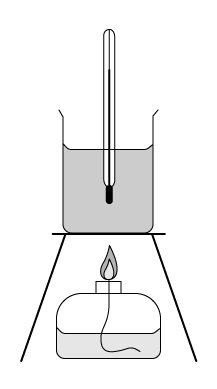
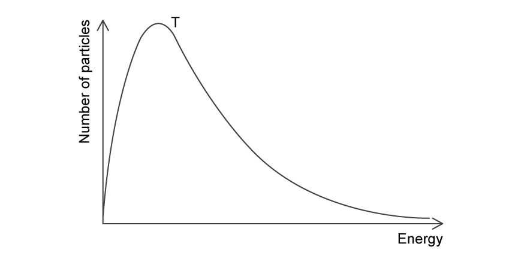
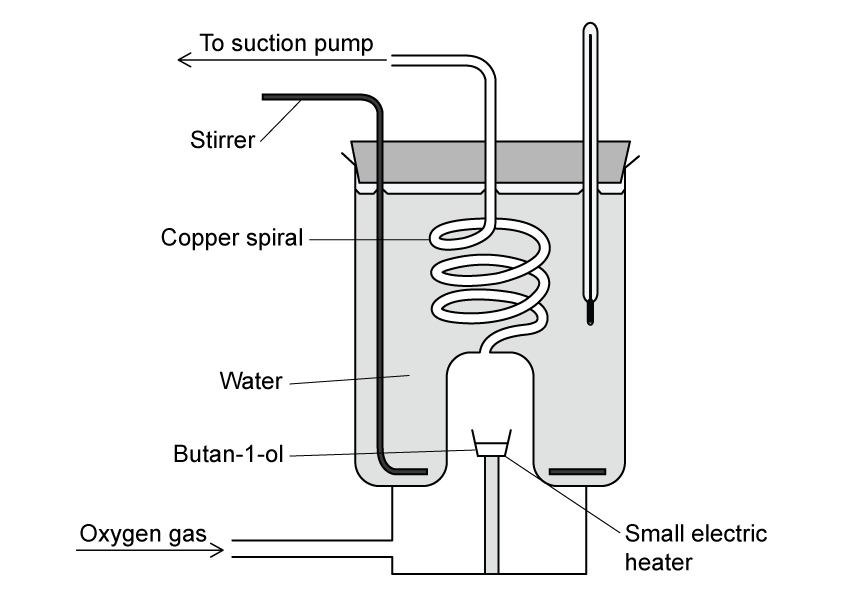

# Exam Questions — Enthalpy Change, ΔH
**5. Chemical Energetics** · Cambridge (CIE) A-LEVEL chemistry (9701)
> Source: [https://www.savemyexams.com/a-level/chemistry/cie/25/topic-questions/](https://www.savemyexams.com/a-level/chemistry/cie/25/topic-questions/) · 29 questions across 2 sets

## Multiple Choice Questions (19 questions)

### Q1 — medium — 1 marks

**Q1** [1 mark]

Which row in the table correctly identifies the requirements for the standard enthalpy of formation of liquid ethanol, C2H5OH (l)?

|   | **Standard state of carbon** | **Standard state of hydrogen** | **Moles of ethanol formed** |
|---|---|---|---|
| **A** | graphite | gaseous atoms | 1 |
| **B** | graphite | gaseous molecules | 1 |
| **C** | diamond | gaseous molecules | 1 |
| **D** | graphite | gaseous molecules | 2 |

### Q2 — medium — 1 marks

**Q2** [1 mark]

The enthalpy change for the reaction H2 (g) + X2 (g) → 2HX (g) is -184 kJ mol-1.

Bond energies: H-H = 436 kJ mol-1; H-X = 432 kJ mol-1

What is the bond energy of X-X?

### Q3 — medium — 1 marks

**Q3** [1 mark]

The standard enthalpy change *∆H**θ* for the below reaction is -1776 kJ.

2N (g) + 6F (g) → 2NF3 (g)

What is the bond energy of the N–F bond?

### Q4 — medium — 1 marks

**Q4** [1 mark]

An experiment was carried out to determine the approximate value for the molar enthalpy change of neutralisation.

75 cm3 of 3.00 mol dm−3 hydrochloric acid was placed in a polystyrene cup of negligible heat capacity. Its temperature was recorded, then 75 cm3 of 3.00 mol dm−3 potassium hydroxide at the same temperature was quickly added and the solution was stirred.

The temperature rose by 14 oC. The resulting solution may be considered to have a specific heat capacity of 4.18 J g−1 K−1. Assume the density of the mixture is 1.00 g cm−3.

What is the molar enthalpy change of neutralisation?

### Q5 — hard — 1 marks

**Q5** [1 mark]

Some bond energy values are listed below.

| **Bond** | **Bond energy / kJ mol****-1** |
|---|---|
| Br−Br | 194 |
| Cl−Cl | 247 |
| C−H | 412 |
| C−Cl | 338 |

These bond energy values relate to the following four reactions:

| W | Br2 (g) → 2Br (g) |
|---|---|
| X | 2Cl (g) → Cl2 (g) |
| Y | CH3 (g) + Cl (g) → CH3Cl (g) |
| Z | CH4 (g) → CH3 (g) + H (g) |

What is the correct order of enthalpy changes of the above reactions from most negative to most positive?

### Q6 — medium — 1 marks

**Q6** [1 mark]

A student mixed 30.0 cm3 of 0.0250 mol dm-3 potassium hydroxide solution with 30.0 cm3 of 0.0250 mol dm-3 nitric acid. The temperature rose by 0.50 oC. Assume no heat was lost to the surroundings.

The specific heat capacity of the mixture is 4.18 J g-1 K-1. Assume the mixture has a density of 1.00 g cm-3.

What is the enthalpy change of neutralisation?

### Q7 — medium — 1 marks

**Q7** [1 mark]

In a reaction converting compound *R* into compound *T*, it was found that the reaction proceeded by way of compound *S*, which could be isolated. The following steps were involved.

*R* → *S*;   Δ*H* is positive

*S* → *T*;   Δ*H* is negative

Which reaction profile fits these data?

![Four reaction profile diagrams labelled A to D, each with energy on the y-axis and progress of reaction on the x-axis. A: two-hump profile with R at low energy, S as a stable intermediate in an energy valley between two activation energy peaks, and T at the lowest energy. B: single-hump profile with R at medium energy, S at the top of the peak, and T at low energy. C: monotonically rising profile with R at the lowest energy, S at intermediate energy, and T at the highest energy. D: profile showing R at the highest energy, falling to S in a low-energy valley, then rising slightly to T at medium energy.](assets/001-four-reaction-profile-diagrams-labelled-a-to-d-e.jpg)

### Q8 — easy — 1 marks

**Q8** [1 mark]

Which statement describes the bond energy of the H–I bond?

### Q9 — medium — 1 marks

**Q9** [1 mark]

The table shows three types of standard enthalpy change:

'+' means that this type of standard enthalpy change can only have positive values.

'–' means that this type of standard enthalpy change can only have negative values.

'+ / –' means that either positive or negative values are possible.

Which row is correct?

|   | **Formation** | **Combustion** | **Neutralisation** |
|---|---|---|---|
| **A** | + | + | + / – |
| **B** | + / – | + | + / – |
| **C** | + / – | – | – |
| **D** | – | – | + |

### Q10 — easy — 1 marks

**Q10** [1 mark]

Which equation can represent both an enthalpy change of formation and combustion?

### Q11 — hard — 1 marks

**Q11** [1 mark]

Which equation shows how the bond energy for the covalent bond Y-Z can be calculated by dividing Δ*H* by n?

### Q12 — hard — 1 marks

**Q12** [1 mark]

In the gas phase, phosphorus pentachloride can be thermally decomposed into gaseous phosphorus trichloride and chlorine.

PCl5 (g) → PCl3 (g) + Cl2 (g)

The table below gives the relevant bond energies.

| **Bond** | **Bond energy / kJ mol^−1^** |
|---|---|
| P−Cl (in both chlorides) | 328 |
| Cl−Cl | 241 |

What is the enthalpy change for this reaction?

### Q13 — easy — 1 marks

**Q13** [1 mark]

The reaction pathway for a reversible reaction is shown below:

Which statement is correct?

### Q14 — easy — 1 marks

**Q14** [1 mark]

A student carried out an experiment to determine the enthalpy change for the combustion of ethanol.

The following results were obtained by the student. The specific heat capacity of water is 4.18 J g−1 °C−1.

| Start temperature of the water | 21 °C |
|---|---|
| Final temperature of the water | 54 °C |
| Mass of spirit burner before burning | 259.75 g |
| Mass of spirit burner after burning | 259.18 g |
| Mass of glass beaker plus water | 150.00 g |
| Mass of glass beaker | 50.0 g |

How much heat energy is transferred to the water?

### Q15 — easy — 1 marks

**Q15** [1 mark]

The energy profile for a reversible reaction is shown below.

Which statement is correct?

### Q16 — hard — 1 marks

**Q16** [1 mark]

In a calorimetric experiment 2.50 g of a fuel is burnt in oxygen. 30% of the energy released during the combustion is absorbed by 500 g of water, the temperature of which rises from 25.0 oC to 68.0 oC.

The specific heat capacity of water is 4.18 J g−1 K−1.

What is the total energy released per gram of fuel burnt?

### Q17 — medium — 1 marks

**Q17** [1 mark]

The complete combustion of ethyne, C2H2, is shown in the equation below.

H−C≡C−H + 2½ O=O → H−O−H + 2O=C=O

| **Bond** | **Bond energy / kJ mol**-1 |
|---|---|
| C−H | 390 |
| C≡C | 870 |
| O=O | 489 |
| C=O | 790 |
| O−H | 510 |
| O−C | 290 |

Using the bond energies given in the table, what is the enthalpy change of combustion of ethyne?

### Q18 — hard — 1 marks

**Q18** [1 mark]

The diagram shows the skeletal formula of cyclobutane.

The enthalpy change of formation of cyclobutane is +75.1 kJ mol– 1, and the enthalpy change of atomisation of graphite is +712 kJ mol–1.

The bond energy of C–H is 390 kJ mol–1 and of H–H is 429 kJ mol–1.

What is the average bond energy of the C–C bond in cyclobutane, rounded to the nearest whole number?

### Q19 — easy — 1 marks

**Q19** [1 mark]

PCl5 (g) dissociates as follows.

PCl5 (g) ⇌ PCl3 (g) + Cl2 (g)

The yield of the products increases as the temperature is raised from 80 °C to 110 °C.

Which row gives the PCl3 molecule and the forward reaction?

|   | **Shape of PCl****3**** molecule** | **The reaction is** |
|---|---|---|
| **A** | Trigonal pyramidal | Endothermic |
| **B** | Trigonal pyramidal | Exothermic |
| **C** | Trigonal planar | Endothermic |
| **D** | Trigonal planar | Exothermic |

## Structured Questions (10 questions)

### Q1 — hard — 14 marks

**Q1** [3 marks]

Compound **A** is a liquid containing carbon, hydrogen and oxygen. Quantitative analysis shows that **A** has the empirical formula CH2O.

A sample of **A** with a mass of 0.240 g is vaporised. At 80.0 °C and 101 kPa, the vapour occupies a volume of 116 cm3.

Calculate the relative molecular mass, *M*r, of **A**.

Show your working.

*M*r = .............

**Q1** [5 marks]

Methyl methanoate, HCOOCH3, is a liquid ester.

i) Define the term standard enthalpy change of formation.

[2]

ii) The standard enthalpy changes of combustion, Δ*H*θc, in **Table 2.1** are for complete combustion to CO2 (g) and H2O (l) under standard conditions.

**Table 2.1**

| Substance | Standard enthalpy change of combustion, Δ*H*θc / kJ mol-1 |
|---|---|
| C (s) | –394 |
| H2 (g) | –286 |
| HCOOCH3 (l) | –975 |

The enthalpy of formation of methyl methanoate refers to the reaction:

2C (s) + 2H2 (g) + O2 (g) → HCOOCH3 (l)

Use the data in Table 2.1 to calculate the standard enthalpy change of formation, Δ*H*θf, of liquid methyl methanoate.

Show your working.

Δ*H*θf = ........................ kJ mol-1

[3]

**Q1** [2 marks]

The equation for the formation of gaseous methyl methanoate from gaseous atoms is shown.

2C (g) + 4H (g) + 2O (g) → HCOOCH3 (g)

Use bond energy data from the Data Booklet to calculate the enthalpy change for this reaction.

Show your working.

**Q1** [4 marks]

A student investigates the rate of reaction of methyl methanoate with dilute hydrochloric acid.

i) A Boltzmann distribution curve for the reactant molecules at temperature ***T**** *is shown.

On the same axes, sketch the Boltzmann distribution curve for the reactant molecules at a higher temperature, ***T*****high**.

Label the curve ***T*****high** and mark the activation energy, *E*a, on the x-axis.

[2]

ii) Use your Boltzmann distribution curves to explain why the rate of reaction is greater at **T****high**.

[2]

### Q2 — medium — 11 marks

**Q2** [4 marks]

Propane reacts with chlorine to form chloropropane.

C3H8 (g) + Cl2 (g) → C3H7Cl (g) + HCl (g)

i) Use bond energies from Table 1.1 to calculate the enthalpy change for this reaction.

Show your working.

**Table 1.1**

| **Bond** | **Bond Energy / kJ mol****-1** |
|---|---|
| C-H | 410 |
| C-Cl | 340 |
| Cl-Cl | 242 |
| H-Cl | 431 |

Include a sign in your answer.

enthalpy change = ................................. kJ mol–1

[3]

ii) State the conditions needed for this reaction to occur.

[1]

**Q2** [3 marks]

**Extract:**

Propane reacts with chlorine to form chloropropane.

C₃H₈ (g) + Cl₂ (g) → C₃H₇Cl (g) + HCl (g)

Using Fig. 1.1, sketch a labelled reaction pathway diagram for the reaction in part **(a)** including the activation energy.

**Fig. 1.1**

**Q2** [2 marks]

**Extract:**

Propane reacts with chlorine to form chloropropane.

C₃H₈ (g) + Cl₂ (g) → C₃H₇Cl (g) + HCl (g)

i) Use bond energies from Table 1.1 to calculate the enthalpy change for this reaction.

Table 1.1

| Bond | Bond Energy / kJ mol⁻¹ |
| :---: | :---: |
| C-H | 410 |
| C-Cl | 340 |
| Cl-Cl | 242 |
| H-Cl | 431 |

ii) State the conditions needed for this reaction to occur.

The conditions needed for this reaction to occur are: UV light / sunlight OR High temperature

Ethane and chlorine will also react together under the same conditions.

State and explain the difference in enthalpy change for the two reactions

**Q2** [2 marks]

**Extract:**

Propane reacts with chlorine to form chloropropane.

C₃H₈ (g) + Cl₂ (g) → C₃H₇Cl (g) + HCl (g)

**Table 1.1**

| **Bond** | **Bond Energy / kJ mol⁻¹** |
| :---: | :---: |
| C-H | 410 |
| C-Cl | 340 |
| Cl-Cl | 242 |
| H-Cl | 431 |

Propane will react with bromine in a similar reaction to part **(a)**.

Suggest, with a reason, whether the sum of the bonds broken would be larger or smaller compared to the reaction between propane and chlorine.

### Q3 — medium — 9 marks

**Q3** [4 marks]

The apparatus shown in **Fig. 2.1** can be used to determine the enthalpy of combustion of butan-1-ol, C4H9OH (*M*r = 74.12 g mol-1).

**Fig. 2.1**

i) Construct an equation to represent the standard enthalpy change of combustion of butan-1-ol.

Include state symbols.

[2]

ii) Suggest the purpose of the copper spiral and small electric heater in the apparatus.

[2]

**Q3** [2 marks]

An experiment was carried out and the following measurements were recorded in Table 2.1

**Table 2.1**

| Mass of butan-1-ol / g | 2.20 |
|---|---|
| Volume of water / cm3 | 875 |
| Initial temperature of water / °C | 22.5 |
| Final temperature of water / °C | 25.0 |

(Specific heat capacity of water = 4.18 J g-1 K-1)

Use the data to calculate the energy change, *q*, for the reaction.

Show your working.

Give your answer to two significant figures.

*q* = ........................................... kJ

**Q3** [3 marks]

**Extract:**

butan-1-ol, C~4~H~9~OH (*M*~r~ = 74.12 g mol^-1^)

**Table 2.1**

| Mass of butan-1-ol / g | 2.20 |
| --- | :---: |
| Volume of water / cm^3^ | 875 |
| Initial temperature of water / °C | 22.5 |
| Final temperature of water / °C | 25.0 |

(Specific heat capacity of water = 4.18 J g^-1^ K^-1^)

Use the data to calculate the energy change, *q*, for the reaction.

Determine the enthalpy of combustion of butan-1-ol using Table 2.1 and your answer to part **(b)**.

Show your working.

Give your answer to three significant figures.

Δ*H* = ..................... kJ mol-1

### Q4 — hard — 7 marks

**Q4** [3 marks]

Use the data in Table 2.1 to calculate the enthalpy change of reaction for the hydrogenation of propene.

Show your working.

**Table 2.1**

| **Bond** | **Bond energy / kJ mol****-1** |
|---|---|
| H–H | 435 |
| C–H | 413 |
| C–C | 347 |
| C=C | 619 |

Enthalpy of hydrogenation, Δ*H*r = ................................. kJ mol–1

**Q4** [2 marks]

**Extract:**

**Table 2.1**

| **Bond** | **Bond energy / kJ mol**^**-1**^ |
| :---: | :---: |
| H–H | 435 |
| C–H | 413 |
| C–C | 347 |
| C=C | 619 |

Use the data in Table 2.1 to suggest, with a reason, whether the polymerisation of propene is exothermic or endothermic

**Q4** [2 marks]

Carbon, hydrogen and ethene each undergo complete combustion in oxygen.

| Equation | Δ*H*θc / kJ mol–1 |
|---|---|
| C (s) + O2 (g) → CO2 (g) | −393.7 |
| H2 (g) + ½O2 (g) → H2O (l) | −285.9 |
| C2H4 (g) + 3O2 (g) → 2CO2 (g) + 2H2O (l) | −1411.0 |

Use the data to calculate the standard enthalpy change of formation, Δ*H**θ*f, in kJ mol–1, of ethene at 298 K.

Show your working.

Δ*H*θf = ................................. kJ mol–1

*Source: 2007 2 Q1E*

### Q5 — medium — 9 marks

**Q5** [3 marks]

Two common oxides of nitrogen are nitrogen monoxide, NO, and nitrogen dioxide, NO2.

i) Complete Table 3.1 to show the oxidation number of nitrogen in each compound.

**Table 3.1**

| **Compound** | **NO** | **NO****2** |
|---|---|---|
| oxidation number of N |   |   |

[1]

ii) Construct equations for the formation of NO2 by:

- The reaction of N2 with O2

- The reaction of NO with O2

[2]

**Q5** [3 marks]

Molecules of NO2 can be formed by the reaction between N2 and O2. The bond between the N and O atoms in NO2 is a double covalent bond.

The enthalpy change of reaction for this reaction is +497 kJ mol–1. Calculate the bond energy, in kJ mol–1, of the N=O bond.

Show your working.

Use relevant data from **Table 3.2**.

**Table 3.2**

| **Bond** | **Bond energy / kJ mol****-1** |
|---|---|
| N≡N | 941 |
| O=O | 495 |

Bond energy of the N=O bond = ............................. kJ mol–1

**Q5** [2 marks]

The boiling points of carbon dioxide and nitrogen dioxide are -78.5 oC and 21 oC respectively.

Suggest a reason for the difference.

**Q5** [1 mark]

Construct an equation that represents the standard enthalpy change of formation of nitrogen monoxide, NO.

Include state symbols.

### Q6 — hard — 4 marks

**Q6** [2 marks]

The enthalpy change of solution for ammonium chloride can be measured using calorimetry. 12.04 g of ammonium chloride is dissolved in 125.0 cm3 of water at 19.5 °C.

The standard enthalpy change of solution of ammonium chloride is +15.1 kJ mol-1. Calculate the energy change, *q*, in J, when 12.04 g of ammonium chloride is dissolved in 125.0 cm3 of water.

Show your working.

*q* = ................................. J

**Q6** [2 marks]

**Extract:**

The enthalpy change of solution for ammonium chloride can be measured using calorimetry. 12.04 g of ammonium chloride is dissolved in 125.0 cm^3^ of water at 19.5 °C.

The standard enthalpy change of solution of ammonium chloride is +15.1 kJ mol^-1^.

Use your answer to part (a) to calculate the final temperature, in °C, of the solution.

The specific heat capacity of the solution is 4.18 J g-1 K-1.

Show your working.

Final temperature = ................................. °C

### Q7 — medium — 7 marks

**Q7** [3 marks]

Propane gas is used widely as a fuel which can be used in camping gas stoves. The enthalpy of combustion for propane is −2219.2 kJ mol-1.

Calculate the minimum mass of fuel needed to bring 150 cm3 of water from 25.0°C to its boiling point of 100.0°C.

Show your working.

................... g

**Q7** [1 mark]

**Extract:**

Propane gas is used widely as a fuel which can be used in camping gas stoves. The enthalpy of combustion for propane is −2219.2 kJ mol^-1^.

Calculate the minimum mass of fuel needed to bring 150 cm^3^ of water from 25.0°C to its boiling point of 100.0°C.

Suggest why more propane may be required than calculated in part **(a)**.

**Q7** [3 marks]

**Extract:**

Propane gas is used widely as a fuel which can be used in camping gas stoves. The enthalpy of combustion for propane is −2219.2 kJ mol^-1^.

Using Fig. 5.1, Sketch a labelled reaction pathway diagram for the reaction in part **(a)** including the activation energy.

**Fig. 5.1**

### Q8 — easy — 5 marks

**Q8** [2 marks]

Freon 21 is a hydrochlorofluorocarbon that was used as a propellant and refrigerant but later withdrawn from use because of its effect on ozone depletion. The formula is CHCl2F.

Freon 21 is produced by reacting hydrogen fluoride with trichloromethane in the following reaction:

CHCl3 (g) + HF (g) → CHCl2F (g) + HCl (g)

Use the data in Table 2.1 to calculate the standard enthalpy change of reaction, Δ*H*°r, for this reaction. Show your working.

| Compound | Standard enthalpy change of formation, Δ*H*°f / kJ mol–1 |
|---|---|
| CHCl3 (g) | –103.2 |
| CHCl2F (g) | –284.1 |
| HF (g) | –273.3 |
| HCl (g) | –92.3 |

**Table 2.1**

**Q8** [2 marks]

**Extract:**

Freon 21 is a hydrochlorofluorocarbon that was used as a propellant and refrigerant but later withdrawn from use because of its effect on ozone depletion. The formula is CHCl₂F.

Freon 21 is produced by reacting hydrogen fluoride with trichloromethane in the following reaction:

CHCl₃ (g) + HF (g) → CHCl₂F (g) + HCl (g)

ΔH°r = +0.1 kJ mol⁻¹

On Fig. 2.1, sketch a reaction pathway diagram for this reaction. Label the diagram to show the enthalpy change of reaction, Δ*H*°r, and the activation energy, *E*a.

**Fig. 2.1**

**Q8** [1 mark]

Define the term activation energy.

### Q9 — easy — 6 marks

**Q9** [3 marks]

Standard enthalpy changes include enthalpy of formation, enthalpy of combustion and enthalpy of neutralisation.

i) Define the term standard enthalpy change of formation.

[2]

ii) Construct an equation that represents the standard enthalpy change of formation of ammonia, NH3. Include state symbols.

[1]

**Q9** [1 mark]

State what is meant by standard conditions in enthalpy measurements.

**Q9** [2 marks]

The equation for the reaction between dilute sulfuric acid and aqueous sodium hydroxide is shown.

H2SO4 (aq) + 2NaOH (aq) → Na2SO4 (aq) + 2H2O (l)

Explain why the enthalpy change for this reaction does not represent the standard enthalpy change of neutralisation.

### Q10 — easy — 10 marks

**Q10** [2 marks]

Define the term bond energy.

**Q10** [1 mark]

Suggest why the value of Δ*H*r calculated using bond energies may differ from the value obtained by experiment.

**Q10** [3 marks]

Use the data given in Table 3.1 to calculate the enthalpy change for the hydration of ethene to form ethanol. Show your working.

CH2=CH2 (g) + H2O (g) → CH3CH2OH (l)

**Table 3.1**

| Bond | Bond energy / kJ mol-1 |
|---|---|
| C–C | 346 |
| C=C | 614 |
| C–H | 414 |
| C–O | 358 |
| O–H | 463 |

**Q10** [4 marks]

Ethane reacts with bromine to form 1,2-dibromoethane and hydrogen bromide.

Construct an equation for this reaction. Hence, use the data in Table 3.2 to calculate the enthalpy change for this reaction. Show your working.

| Bond | Bond enthalpy / kJ mol-1 |
|---|---|
| C–C | 346 |
| C–H | 414 |
| C–Br | 285 |
| H–Br | 366 |
| Br–Br | 193 |

**Table 3.2**
