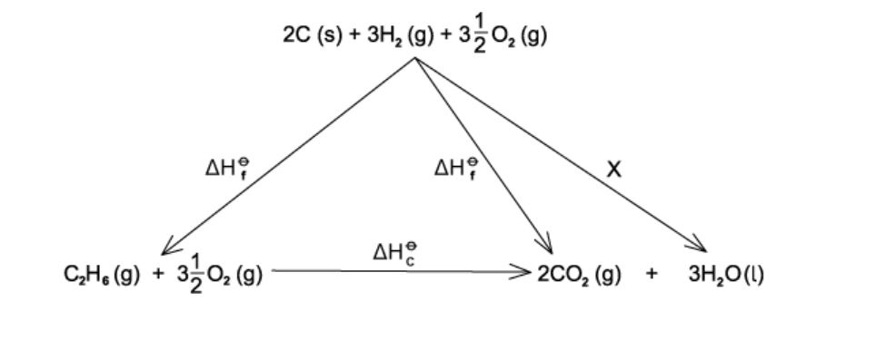

# Exam Questions — Hess’s Law
**5. Chemical Energetics** · Cambridge (CIE) A-LEVEL chemistry (9701)
> Source: [https://www.savemyexams.com/a-level/chemistry/cie/25/topic-questions/](https://www.savemyexams.com/a-level/chemistry/cie/25/topic-questions/) · 12 questions across 1 sets

## Multiple Choice Questions (12 questions)

### Q1 — easy — 1 marks

**Q1** [1 mark]

The diagram shows a Hess's law cycle for the conversion of graphite to diamond.

Which equation represents ΔHr?

### Q2 — hard — 1 marks

**Q2** [1 mark]

A student calculated the standard enthalpy change of formation of propane, C3H8, using the standard enthalpy changes of combustion shown.

| **Substance** | Δ*H**c*θ** / kJ mol****-1** |
|---|---|
| C3H8 (g) | −2220 |
| H2 (g) | −286 |
| C (s) | Y |

The student used an incorrect value, Y, for the standard enthalpy change of combustion of carbon but performed the calculation correctly. The final answer obtained was −158 kJ mol−1.

What value did the student use for the standard enthalpy change of combustion of carbon?

### Q3 — medium — 1 marks

**Q3** [1 mark]

The first stage in the industrial production of nitric acid from ammonia can be represented by the following equation.

4NH3 (g) + 5O2 (g) ⇌ 4NO (g) + 6H2O (g)

Using the following standard enthalpy change of formation data, what is the standard enthalpy change of reaction, Δ*H*rθ, for this reaction?

| **Compound** | ***∆H*****f****θ**** /kJ mol****–1** |
|---|---|
| NH3 (g) | −51.3 |
| NO (g) | +92.2 |
| H2O (g) | −239.6 |

### Q4 — medium — 1 marks

**Q4** [1 mark]

The combustion of ethanol is increasingly being used to fuel cars.

| **Substance** | Δ*H*fθ** / kJ mol****-1** |
|---|---|
| CO2 (g) | −382 |
| H2O (g) | −275 |
| C2H5OH (l) | −266 |

What is the standard enthalpy change of combustion, Δ*H*cθ, of ethanol?

### Q5 — hard — 1 marks

**Q5** [1 mark]

Iodine trichloride, ICl3, is made by reacting iodine with chlorine.

I2 (s) + Cl2 (g) → 2ICl (s)   Δ*H*θ = +14 kJ mol–1

ICl (s) + Cl2 (g) → ICl3 (s)   Δ*H*θ = –88 kJ mol–1

What is the standard enthalpy change of formation, Δ*H*fθ, of solid iodine trichloride?

### Q6 — easy — 1 marks

**Q6** [1 mark]

Which equation calculates enthalpy of reaction using enthalpy of formation data?

### Q7 — hard — 1 marks

**Q7** [1 mark]

Given the following standard enthalpy changes,

I2 (s) → I2 (g)   ∆HƟ = +38 kJ mol–1

I2 (g) + 3Cl2 (g) → 2ICl3 (s)   ∆HƟ = –214 kJ mol–1

What is the standard enthalpy change of formation, Δ*H*fθ, of ICl3 (s)?

### Q8 — medium — 1 marks

**Q8** [1 mark]

Titanium occurs naturally as the mineral rutile, TiO2. One possible method of extraction of titanium is to reduce it by heating with carbon.

TiO2 (s) + 2C (s) → Ti (s) + 2CO (g)

The standard enthalpy changes of formation of TiO2 (s) and CO (g) are –890 kJ mol−1 and –105 kJ mol−1 respectively.

What is the standard enthalpy change of reaction, Δ*H*rθ, for this reaction?

### Q9 — medium — 1 marks

**Q9** [1 mark]

What is the standard enthalpy change of formation, Δ*H*fθ, of propan-1-ol, C3H8O?

| **Substance** | Δ*H*cθ** / kJ mol****-1** |
|---|---|
| C (s) | −394 |
| H2 (g) | −286 |
| C3H8O (l) | −1816 |

### Q10 — hard — 1 marks

**Q10** [1 mark]

The equations for the formation of two sulfur oxides are shown.

S (s) + O2 (g) → SO2 (g)     *∆H*fθ = –297 kJ mol–1

S (s) + 1.5O2 (g) → SO3 (g)    *∆H*fθ = –395 kJ mol–1

What is the standard enthalpy change of reaction, Δ*H*rθ, for 2SO2 (g) + O2 (g) → 2SO3 (g)?

### Q11 — easy — 1 marks

**Q11** [1 mark]

Which enthalpy change is indicated by X in the enthalpy cycle shown?

### Q12 — hard — 1 marks

**Q12** [1 mark]

The following standard enthalpy changes are given.

CO (g) + $\frac{1}{2}$ O2 (g)   → CO2 (g)   ∆*H*θ  = –283 kJ mol–1

H2 (g) + $\frac{1}{2}$ O2 (g)   → H2O (I)   ∆*H*θ  = –286 kJ mol–1

H2O (g)   → H2O (I)   ∆*H*θ = –44 kJ mol–1

What is the standard enthalpy change, Δ*H*θ, for the following reaction?

CO2 (g) + H2 (g) → CO (g) + H2O (g)
