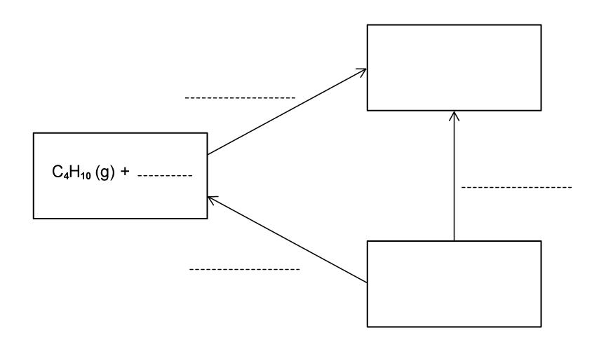
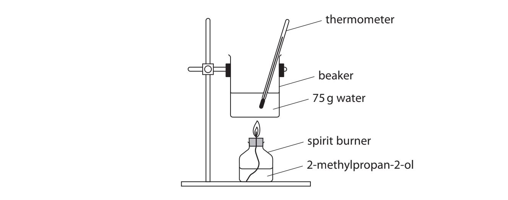
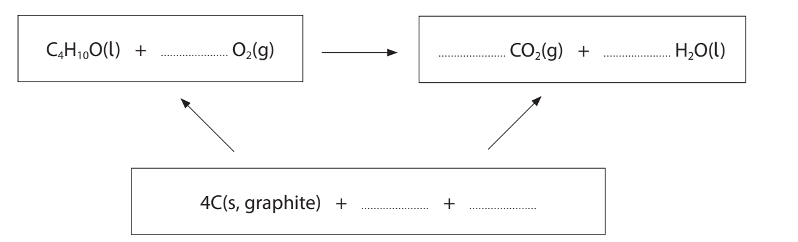

# Exam Questions — Hess’s Law
**5. Chemical Energetics** · Cambridge (CIE) A-LEVEL chemistry (9701)
> Source: [https://www.savemyexams.com/a-level/chemistry/cie/25/topic-questions/](https://www.savemyexams.com/a-level/chemistry/cie/25/topic-questions/) · 17 questions across 2 sets

## Multiple Choice Questions (12 questions)

### Q1 — easy — 1 marks

**Q1** [1 mark]

The diagram shows a Hess's law cycle for the conversion of graphite to diamond.

Which equation represents ΔHr?

### Q2 — hard — 1 marks

**Q2** [1 mark]

A student calculated the standard enthalpy change of formation of propane, C3H8, using the standard enthalpy changes of combustion shown.

| **Substance** | Δ*H**c*θ** / kJ mol****-1** |
|---|---|
| C3H8 (g) | −2220 |
| H2 (g) | −286 |
| C (s) | Y |

The student used an incorrect value, Y, for the standard enthalpy change of combustion of carbon but performed the calculation correctly. The final answer obtained was −158 kJ mol−1.

What value did the student use for the standard enthalpy change of combustion of carbon?

### Q3 — medium — 1 marks

**Q3** [1 mark]

The first stage in the industrial production of nitric acid from ammonia can be represented by the following equation.

4NH3 (g) + 5O2 (g) ⇌ 4NO (g) + 6H2O (g)

Using the following standard enthalpy change of formation data, what is the standard enthalpy change of reaction, Δ*H*rθ, for this reaction?

| **Compound** | ***∆H*****f****θ**** /kJ mol****–1** |
|---|---|
| NH3 (g) | −51.3 |
| NO (g) | +92.2 |
| H2O (g) | −239.6 |

### Q4 — medium — 1 marks

**Q4** [1 mark]

The combustion of ethanol is increasingly being used to fuel cars.

| **Substance** | Δ*H*fθ** / kJ mol****-1** |
|---|---|
| CO2 (g) | −382 |
| H2O (g) | −275 |
| C2H5OH (l) | −266 |

What is the standard enthalpy change of combustion, Δ*H*cθ, of ethanol?

### Q5 — hard — 1 marks

**Q5** [1 mark]

Iodine trichloride, ICl3, is made by reacting iodine with chlorine.

I2 (s) + Cl2 (g) → 2ICl (s)   Δ*H*θ = +14 kJ mol–1

ICl (s) + Cl2 (g) → ICl3 (s)   Δ*H*θ = –88 kJ mol–1

What is the standard enthalpy change of formation, Δ*H*fθ, of solid iodine trichloride?

### Q6 — easy — 1 marks

**Q6** [1 mark]

Which equation calculates enthalpy of reaction using enthalpy of formation data?

### Q7 — hard — 1 marks

**Q7** [1 mark]

Given the following standard enthalpy changes,

I2 (s) → I2 (g)   ∆HƟ = +38 kJ mol–1

I2 (g) + 3Cl2 (g) → 2ICl3 (s)   ∆HƟ = –214 kJ mol–1

What is the standard enthalpy change of formation, Δ*H*fθ, of ICl3 (s)?

### Q8 — medium — 1 marks

**Q8** [1 mark]

Titanium occurs naturally as the mineral rutile, TiO2. One possible method of extraction of titanium is to reduce it by heating with carbon.

TiO2 (s) + 2C (s) → Ti (s) + 2CO (g)

The standard enthalpy changes of formation of TiO2 (s) and CO (g) are –890 kJ mol−1 and –105 kJ mol−1 respectively.

What is the standard enthalpy change of reaction, Δ*H*rθ, for this reaction?

### Q9 — medium — 1 marks

**Q9** [1 mark]

What is the standard enthalpy change of formation, Δ*H*fθ, of propan-1-ol, C3H8O?

| **Substance** | Δ*H*cθ** / kJ mol****-1** |
|---|---|
| C (s) | −394 |
| H2 (g) | −286 |
| C3H8O (l) | −1816 |

### Q10 — hard — 1 marks

**Q10** [1 mark]

The equations for the formation of two sulfur oxides are shown.

S (s) + O2 (g) → SO2 (g)     *∆H*fθ = –297 kJ mol–1

S (s) + 1.5O2 (g) → SO3 (g)    *∆H*fθ = –395 kJ mol–1

What is the standard enthalpy change of reaction, Δ*H*rθ, for 2SO2 (g) + O2 (g) → 2SO3 (g)?

### Q11 — easy — 1 marks

**Q11** [1 mark]

Which enthalpy change is indicated by X in the enthalpy cycle shown?

### Q12 — hard — 1 marks

**Q12** [1 mark]

The following standard enthalpy changes are given.

CO (g) + $\frac{1}{2}$ O2 (g)   → CO2 (g)   ∆*H*θ  = –283 kJ mol–1

H2 (g) + $\frac{1}{2}$ O2 (g)   → H2O (I)   ∆*H*θ  = –286 kJ mol–1

H2O (g)   → H2O (I)   ∆*H*θ = –44 kJ mol–1

What is the standard enthalpy change, Δ*H*θ, for the following reaction?

CO2 (g) + H2 (g) → CO (g) + H2O (g)

## Structured Questions (5 questions)

### Q1 — medium — 10 marks

**Q1** [3 marks]

Complete the following Hess's law energy cycle relating butane to its standard enthalpy change of formation, Δ*H*ϴf, and standard enthalpy change of combustion, Δ*H*ϴc.

On your diagram:

- include the relevant species in the two empty boxes
- label each enthalpy change with its appropriate symbol
- complete the remaining two arrows to show the correct direction of enthalpy change

**Q1** [2 marks]

Use the data in Table 1.1 to calculate the standard enthalpy change of combustion of butane, Δ*H*ϴc. Show your working.

**Table 1.1**

| **Substance** | **Standard enthalpy change of formation, **Δ*H*ϴf** / kJ mol****-1** |
|---|---|
| CO2 (g) | −393.5 |
| C4H10 (g) | −125 |
| H2O (l) | −286 |

Δ*H*ϴc (C4H10) = .........................................kJ mol-1

**Q1** [3 marks]

Use the bond energies given in Table 1.2 to calculate the standard enthalpy change of combustion of butane. Show your working.

**Table 1.2**

| **Bond** | **Bond energy / kJ mol****-1** |
|---|---|
| C−C | 348 |
| C−H | 410 |
| C=O | 743 |
| H−O | 463 |
| O=O | 495 |

Δ*H*ϴc (C4H10) = .........................................kJ mol-1

**Q1** [2 marks]

**Extract:**

Use the data in Table 1.1 to calculate the standard enthalpy change of combustion of butane, Δ*H*^ϴ^~c~. Show your working.

**Table 1.1**

| **Substance** | **Standard enthalpy change of formation, **Δ*H*^ϴ^~f~** / kJ mol**^**-1**^ |
| :---: | :---: |
| CO~2~ (g) | −393.5 |
| C~4~H~10~ (g) | −125 |
| H~2~O (l) | −286 |

Use the bond energies given in Table 1.2 to calculate the standard enthalpy change of combustion of butane. Show your working.

**Table 1.2**

| **Bond** | **Bond energy / kJ mol**^**-1**^ |
| :---: | :---: |
| C−C | 348 |
| C−H | 410 |
| C=O | 743 |
| H−O | 463 |
| O=O | 495 |

Suggest, with a reason, which of the two values for the standard enthalpy change of combustion from parts **(b)** and **(c)** is more accurate.

### Q2 — medium — 12 marks

**Q2** [5 marks]

Enthalpy changes of combustion can be determined using calorimetry or calculated using Hess cycles.

Fig. 3.1 shows the equipment used to determine the standard enthalpy change of combustion, Δ*H*ϴc, of 2-methylpropan-2-ol, C4H9OH, using a calorimeter containing 75.0 g of water.

**Fig. 3.1**

Table 3.1 shows the results of the experiment.

**Table 3.1**

|   | **Initial** | **Final** | **Change** |
|---|---|---|---|
| **Mass of spirit burner / g** | 267.35 | 266.78 |   |
| **Temperature of water / °C** | 19.5 | 65.3 |   |

Calculate the standard enthalpy change of combustion, Δ*H*ϴc, of 2-methylpropan-2-ol. Include the sign and units. Show your working.

*Source: Jan 2022 WCH12/01 Q21A*

**Q2** [5 marks]

The standard enthalpy change of combustion, Δ*H*ϴc, of 2-methylpropan-2-ol can be calculated using the data shown in Table 3.2.

**Table 3.2**

| **Compound** | Δ*H*ϴf** / kJ mol****-1** |
|---|---|
| 2-methylpropan-2-ol (l) | −359 |
| CO2 (g) | −394 |
| H2O (l) | −286 |

i) State why the standard enthalpy change of formation of oxygen gas, O2 (g), is zero.

[1]

ii) Complete Fig. 3.2, showing the Hess's law energy cycle for the combustion of 2-methylpropan-2-ol.

**Fig. 3.2**

[2]

iii) Use the data in Table 3.2 to calculate the standard enthalpy change of combustion of 2-methylpropan-2-ol. Show your working.

[2]

*Source: Jan 2022 WCH12/01 Q21B*

**Q2** [2 marks]

**Extract:**

Enthalpy changes of combustion can be determined using calorimetry or calculated using Hess cycles.

Fig. 3.1 shows the equipment used to determine the standard enthalpy change of combustion, ΔH°c, of 2-methylpropan-2-ol, C4H9OH, using a calorimeter containing 75.0 g of water.

Table 3.1 shows the results of the experiment.

Table 3.1

|   | Initial | Final | Change |
| --- | :---: | :---: | :---: |
| Mass of spirit burner / g | 267.35 | 266.78 |   |
| Temperature of water / °C | 19.5 | 65.3 |   |

The value for Δ*H*ϴc obtained in part **(a)** is much less exothermic than Δ*H*ϴc calculated in **(b)(iii)**.

Suggest **two** reasons for this, other than non-standard conditions.

*Source: Jan 2022 WCH12/01 Q21C*

### Q3 — hard — 8 marks

**Q3** [3 marks]

Urea, CO(NH2)2, is a naturally occurring substance which can be hydrolysed with water to form ammonia and carbon dioxide.

The standard enthalpy changes of formation of relevant species are given in Table 1.1.

**Table 1.1**

| **compound** | Δ*H*ϴf** / kJ mol****-1** |
|---|---|
| H2O (l) | −285.8 |
| CO(NH2)2 (aq) | −320.5 |
| CO2 (g) | −393.5 |
| NH3 (aq) | −81.0 |
| CO(NH2)2 (s) | −333.1 |

i) Construct an equation for the hydrolysis of aqueous urea. Include state symbols.

[1]

ii) Construct a Hess's law energy cycle for the hydrolysis of aqueous urea.

[2]

**Q3** [2 marks]

**Extract:**

Urea, CO(NH~2~)~2~, is a naturally occurring substance which can be hydrolysed with water to form ammonia and carbon dioxide.

The standard enthalpy changes of formation of relevant species are given in Table 1.1.

**Table 1.1**

| **compound** | Δ*H*^ϴ^~f~** / kJ mol**^**-1**^ |
| :---: | :---: |
| H~2~O (l) | −285.8 |
| CO(NH~2~)~2~ (aq) | −320.5 |
| CO~2~ (g) | −393.5 |
| NH~3~ (aq) | −81.0 |
| CO(NH~2~)~2~ (s) | −333.1 |

Use the data in Table 1.1 to calculate the standard enthalpy change of reaction, Δ*H*ϴr, for the hydrolysis of aqueous urea. Show your working.

**Q3** [3 marks]

**Extract:**

Urea, CO(NH~2~)~2~, is a naturally occurring substance which can be hydrolysed with water to form ammonia and carbon dioxide.

The standard enthalpy changes of formation of relevant species are given in Table 1.1.

**Table 1.1**

| **compound** | Δ*H*^ϴ^~f~** / kJ mol**^**-1**^ |
| :---: | :---: |
| H~2~O (l) | −285.8 |
| CO(NH~2~)~2~ (aq) | −320.5 |
| CO~2~ (g) | −393.5 |
| NH~3~ (aq) | −81.0 |
| CO(NH~2~)~2~ (s) | −333.1 |

Use the data in Table 1.1 to calculate the standard enthalpy change of combustion, Δ*H*ϴc, of solid urea, given the following equation. Show your working.

2CO(NH2)2 (s) + 3O2 (g) → 2CO2 (g) + 2N2 (g) + 4H2O (l)

### Q4 — medium — 10 marks

**Q4** [2 marks]

Define the term *standard enthalpy of combustion*, Δ*H*ϴc.

**Q4** [2 marks]

Construct an equation for the complete combustion of propan-1-ol, CH3CH2CH2OH (l). Include state symbols.

**Q4** [3 marks]

**Extract:**

Construct an equation for the complete combustion of propan-1-ol, CH~3~CH~2~CH~2~OH (l). Include state symbols.

The equation for the complete combustion of propan-1-ol is:

2CH~3~CH~2~CH~2~OH (l) + 9O~2~ (g) → 6CO~2~ (g) + 8H~2~O (l)

OR

CH~3~CH~2~CH~2~OH (l) + 4.5O~2~ (g) → 3CO~2~ (g) + 4H~2~O (l)

Construct a Hess's law cycle for the complete combustion of propan-1-ol.

**Q4** [3 marks]

**Extract:**

Construct an equation for the complete combustion of propan-1-ol, CH~3~CH~2~CH~2~OH (l). Include state symbols.

The equation for the complete combustion of propan-1-ol is:

CH~3~CH~2~CH~2~OH (l) + 4.5O~2~ (g) → 3CO~2~ (g) + 4H~2~O (l)

OR

2CH~3~CH~2~CH~2~OH (l) + 9O~2~ (g) → 6CO~2~ (g) + 8H~2~O (l)

Use the enthalpy of formation data given in Table 4.1 to calculate the standard enthalpy change of combustion of propan-1-ol, Δ*H*ϴc. Show your working.

**Table 4.1**

| ** ** | **propan-1-ol, CH****3****CH****2****CH****2****OH (l)** | **CO****2**** (g)** | **H****2****O (l)** |
|---|---|---|---|
| **Δ*****H*****ϴ****f**** / kJ mol****-1** | −303 | −393.5 | −285.8 |

### Q5 — medium — 6 marks

**Q5** [2 marks]

Propane gas is commonly used as a fuel for outdoor cooking. It can be produced in a number of ways, including from the addition reaction of propyne gas with hydrogen. Propyne has the formula CHCCH3 and includes a triple bond.

Construct an equation for the formation of propane from propyne. Include state symbols.

**Q5** [3 marks]

**Extract:**

Propane gas is commonly used as a fuel for outdoor cooking. It can be produced in a number of ways, including from the addition reaction of propyne gas with hydrogen. Propyne has the formula CHCCH3 and includes a triple bond.

The equation for the formation of propane from propyne is:

CHCCH3 (g) + 2H2 (g) → CH3CH2CH3 (g)

Table 2.1 lists the relevant standard enthalpy change of combustion data for the formation of propane from propyne.

**Table 2.1**

|   | **Standard enthalpy change of combustion, **Δ*H*ϴc** / kJ mol****-1** |
|---|---|
| **Hydrogen** | −285.8 |
| **Propane** | −2220 |
| **Propyne** | −1940 |

Calculate the standard enthalpy change of reaction, Δ*H*ϴr, for the formation of propane from propyne. Show your working.

Δ*H*ϴr = .........................................kJ mol-1

**Q5** [1 mark]

Suggest why a calculated bond energy value is often different to the Data Booklet value.
