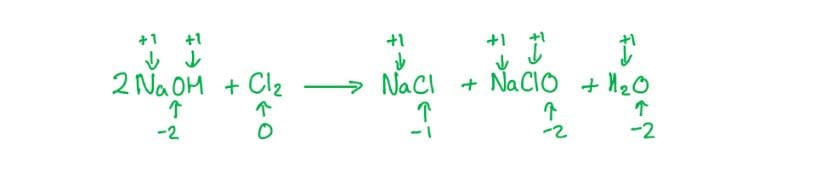
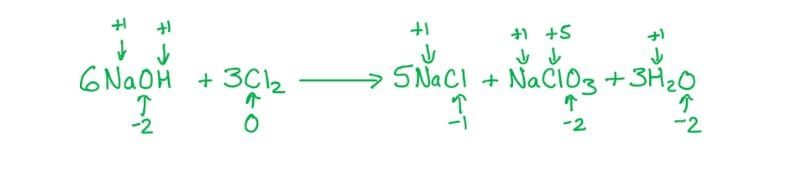
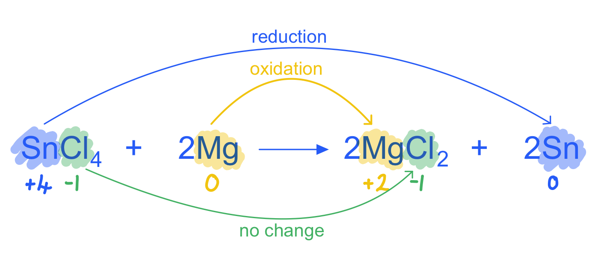
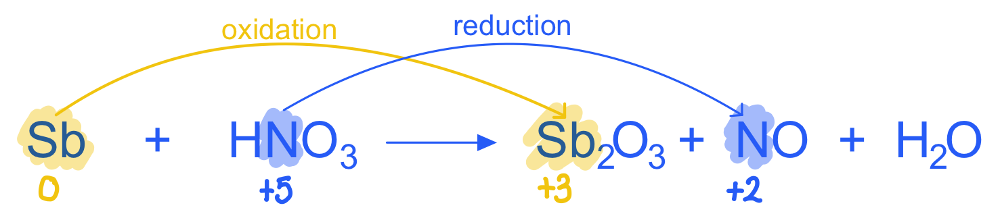

# Mark Schemes — Redox Processes: Electron Transfer & Changes in Oxidation Number (Oxidation State)
**6. Electrochemistry** · Cambridge (CIE) A-LEVEL chemistry (9701)

## Multiple Choice Questions (31 questions)

### Q1
**Final answer:** **The correct answer is D**

- Exam questions often ask you to identify ions that contain the same oxidation numbers
- To do this confidently, you must apply two key rules:

  - Oxygen almost always has an oxidation number of −2 (except in peroxides)
  - The sum of all oxidation numbers in an ion must equal the overall charge of that ion
- To find the correct match, calculate the oxidation number of the central atom in each ion
- Oxidation numbers of manganese (Mn)
- In MnO4- (permanganate):

  - Let the oxidation number of Mn be x.

x + 4(−2) = −1

x − 8 = −1

x = +7

- In MnO42- (manganate):

x + 4(−2) = −2

x − 8 = −2

x = +6

- Oxidation numbers of chlorine (Cl)
- In ClO4- (perchlorate):

  - Let the oxidation number of Cl be y:

y + 4(−2) = −1

y − 8 = −1

y = +7

- In ClO3- (chlorate):

y + 3(−2) = −1

y − 6 = −1

y = +5

- In ClO2- (chlorite):

y + 2(−2) = −1

y − 4 = −1

y = +3

- In Row **D**, both have an oxidation number of +7
- Manganese in MnO4-, and chlorine in ClO4-

### Q2
**Final answer:** **The correct answer is C**

- In reaction 1, the bromide ions reduce the sulfuric acid to sulfur dioxide gas.

  - This decreases the oxidation number of the sulfur from +6 in the sulfuric acid to +4 in the sulfur dioxide.
  - A change in the oxidation number of 2.
- In reaction 2, the reduction of sulfuric acid (oxidation number +6) is more complex.
- The first stage is to sulfur dioxide (sulfur oxidation number +4).

  - Then to sulfur (oxidation number 0).
  - And then to hydrogen sulfide (sulfur oxidation number −2).
  - This makes the greatest change in oxidation number in this reaction 8 (from +6 to −2).
- In reaction 3, there is no change in the oxidation number of sulfur.

  - Both hydrogen and potassium have an oxidation number of +1 meaning that the sulfur oxidation number in these compounds is +6.

**A**, **B** & **D** are incorrect as these answers do not correspond to the actual changes in oxidation number involved.

### Q3
**Final answer:** **The correct answer is B**

- The equation for the reaction is:

2H2O (l) + SO2 (aq) + I2 (aq) → 2HI (aq) + H2SO4 (aq)

- The oxidation number of sulfur in SO2 is **+4**: each oxygen is −2, so (+4) + (2 × (−2)) = 0.

- The oxidation number of sulfur in H2SO4 is **+6**: each hydrogen is +1 and each oxygen is −2, so (2 × (+1)) + (+6) + (4 × (−2)) = 0.

**A**, **C** & **D** are incorrect as these options do not correspond to the actual changes in oxidation number of sulfur.

### Q4
**Final answer:** **The correct answer is D**

- In N2O4, the oxidation number of nitrogen is +4:

(4 × (−2)) + (2 × (+4)) = 0

- This is correct for a neutral compound.

**A** is incorrect as in N2O the oxidation number of nitrogen is +1.

**B** is incorrect as in NO the oxidation number of nitrogen is +2.

**C** is incorrect as in NaNO2 the oxidation number of nitrogen is +3.

### Q5
**Final answer:** **The correct answer is A**

- In NaI, the oxidation number of iodine is −1.

- In I2, iodine has an oxidation number of 0.

- Iodine is **oxidised**: its oxidation number increases from −1 to 0 (loss of electrons).

**B** is incorrect as the oxidation number of S in SO42− is unchanged in NaHSO4 (+6 in both); only the S in H2S has been reduced to −2.

**C** is incorrect as the oxidation number of Na+ does not change (+1 throughout).

**D** is incorrect as the oxidation number of H+ does not change (+1 throughout).

### Q6
**Final answer:** **The correct answer is B**

- Oxidising agents gain electrons and are themselves reduced.
- In reaction B:

  - Fe2+ (aq) oxidises Mg (s) from 0 to +2
  - Fe2+ is itself reduced from +2 to 0.

**A**, **C** & **D** are incorrect as in these reactions the bold species each undergo oxidation, so they cannot be acting as oxidising agents.

### Q7
**Final answer:** **The correct answer is B**

- Concentrated sulfuric acid can act as both an acid and an oxidising agent when mixed with halide ions.

- With both halides and both acids, a colourless acidic gas (HCl or HI) is produced by an acid-base reaction.

- With concentrated H2SO4 and iodide ions, the purple vapour confirms that I2 is produced: the iodide ions are **oxidised** to iodine by the sulfuric acid.

2I− (aq) → I2 (aq) + 2e−

- The iodide ions reduce the sulfuric acid further:

  - First to sulfur dioxide (oxidation number of sulfur: +4)
  - Then to sulfur (oxidation number: 0)
  - Then to hydrogen sulfide (oxidation number: −2)

**A** is incorrect as concentrated sulfuric acid is not a strong enough oxidising agent to oxidise chloride ions.

**C** & **D** are incorrect as phosphoric acid is not an oxidising agent, so no redox reaction occurs with either halide.

### Q8
**Final answer:** **The correct answer is C**

- Concentrated sulfuric acid can act as both an acid and an oxidising agent when mixed with halide ions.

- Concentrated sulfuric acid is **not a strong enough oxidising agent** to oxidise chloride ions.

- With chloride ions, it therefore reacts as an acid only, producing HCl gas.

### Q9
**Final answer:** **The correct answer is C**

- For the [ICl2]+ cation:

  - Two chlorine atoms give a total of −2
  - The overall charge is +1
  - So, the oxidation number of iodine must be +3.

- For the [SbCl6]− anion:

  - Six chlorine atoms give a total of −6
  - The overall charge is −1
  - So, the oxidation number of antimony must be +5.

**A** & **B** are incorrect as the oxidation number of iodine in [ICl2]+ is +3, not +1.

**D** is incorrect as the oxidation number of antimony in [SbCl6]− is +5, not +7.

### Q10
**Final answer:** **The correct answer is B**

- Propanal (CH3CH2CHO) is an aldehyde and is oxidised by Fehling's reagent to propanoic acid.

- The Cu2+ ions in Fehling's solution gain electrons and are reduced to Cu2O (brick-red precipitate).

- Fehling's solution is therefore reduced in reaction 2.

**A** is incorrect as propanone (CH3COCH3) is a ketone and does not react with Tollens' reagent. No oxidation occurs.

**C** is incorrect as bromine is reduced in reaction 3. Its oxidation number decreases from 0 in Br2 to −1 in CH2BrCH2Br.

**D** is incorrect as reaction 3 also involves changes in oxidation number. Carbon changes from −2 in C2H4 to −1 in CH2BrCH2Br.

### Q11
**Final answer:** **The correct answer is C**

- In TiO2, oxygen has an oxidation number of −2.

- In O2, oxygen has an oxidation number of 0.

- Oxygen is **oxidised** as its oxidation number increases from −2 to 0.

**A** is incorrect as the oxidation number of bromine **decreases** from +3 in BrF3 to 0 in Br2.

**B** is incorrect as the oxidation number of fluorine does not change (−1 in both BrF3 and TiF4).

**D** is incorrect as the oxidation number of titanium does not change (+4 in both TiO2 and TiF4).

### Q12
**Final answer:** **The correct answer is C**

- In ilmenite (FeTiO3), the oxidation number of titanium is **+4**: each oxygen is −2 (3 × (−2) = −6) and iron is +2, so (+2) + (+4) + (−6) = 0.

- In titanium dioxide (TiO2), the oxidation number of titanium is also **+4**: each oxygen is −2 (2 × (−2) = −4), so (+4) + (−4) = 0.

- The oxidation number of titanium does not change.

**A**, **B** & **D** are incorrect as there is no change in the oxidation number of titanium.

### Q13
**Final answer:** **The correct answer is A**

- The reaction between chlorine and cold sodium hydroxide solution with oxidation states:

- We can see that this is a **disproportionation reaction** in which chlorine is both oxidised and reduced.

  - Oxidation – change in oxidation number Cl: 0 to +1 in NaClO
  - Reduction – change in oxidation number Cl: 0 to −1 in NaCl
- The reaction between chlorine and hot sodium hydroxide solution with oxidation states:

- This is also a **disproportionation reaction**:

  - Oxidation – change in oxidation number Cl: 0 to +5 in NaClO3
  - Reduction – change in oxidation number Cl: 0 to −1 in NaCl
- Therefore the correct option is **A.**

**B**, **C** & **D** are incorrect as these answers do not correspond to the actual oxidation numbers of chlorine.

### Q14
**Final answer:** **The correct answer is C**

- In HClO, the oxidation number of hydrogen is +1 and the oxidation number of chlorine is also +1, so they are the same.

- Oxygen is −2, hydrogen is +1 and chlorine is +1.

  - The sum is 0, consistent with a neutral compound.

**A** is incorrect as in Mg(OH)2, the oxidation numbers are: Mg = +2, O = −2, H = +1 (all different).

**B** is incorrect as in Na2SO4, the oxidation numbers are: Na = +1, S = +6, O = −2 (all different).

**D** is incorrect as in NH4Cl, the oxidation numbers are: N = −3, H = +1, Cl = −1 (all different).

### Q15
**Final answer:** **The correct answer is B**

- In terms of electron transfer, oxidation refers to the **loss of electrons** and reduction refers to the **gain of electrons**.

- In terms of oxidation number, the oxidation number **increases** when oxidation has occurred and **decreases** when reduction has occurred.

**A** is incorrect as oxidation involves the loss of electrons, not gain.

**C** is incorrect as when oxidation occurs, the oxidation number increases not decreases; the pattern for C is reversed.

**D** is incorrect as both the electron transfer and oxidation number changes are the wrong way around.

### Q16
**Final answer:** **The correct answer is A**

- In ClO-, the oxidation number of the **chlorine atom** is +1.

  - Oxygen is −2 and the overall ion charge is −1, so (+1) + (−2) = −1.

- In ClO3-, the oxidation number of the **chlorine atom** is +5.

  - Three oxygen atoms give −6 and the overall ion charge is −1, so (+5) + (−6) = −1.

- In Cl-, the oxidation number is −1.

  - It is a monoatomic ion with a −1 charge.

**B** is incorrect as the oxidation number of chlorine in ClO3- is +5, not +3.

**C** is incorrect as the oxidation number of chlorine in ClO- is +1, not −1.

**D** is incorrect as the oxidation numbers of chlorine in both ClO- and ClO3- are wrong.

### Q17
**Final answer:** **The correct answer is A**

- The oxidation number of chlorine changes in two ways:

  - One Cl atom per Cl2 is reduced: 0 → −1 in Cl− (change = −1).
  - The other Cl atom is oxidised: 0 → +5 in ClO3− (change = +5).
- To balance the changes: 5 Cl atoms must be reduced for every 1 Cl atom oxidised, giving 6 Cl atoms total, or 3 Cl2 molecules (*p* = 3).
- Balancing O and H by adding 6 OH− and 3 H2O gives the full balanced equation:

3Cl2 (g) + 6OH− (aq) → 5Cl− (aq) + ClO3− (aq) + 3H2O (l)

- Therefore *r* = 5 and *s* = 1.

**B**, **C** & **D** are incorrect as these options do not give the correctly balanced equation.

### Q18
**Final answer:** **The correct answer is D**

- The oxidation number of nitrogen in reaction D changes from +2 in NO to +4 in NO2, so an overall change of +2.

**A** is incorrect as the oxidation number of nitrogen changes from −2 in N2H4 to +4 in NO2, a change of 6.

**B** is incorrect as the oxidation number of nitrogen changes from 0 in N2 to −3 in Mg3N2, a change of 3.

**C** is incorrect as the oxidation number of nitrogen changes from −3 in NH3 to +2 in NO, a change of 5.

### Q19
**Final answer:** **The correct answer is C**

- In MnO4-, the oxidation number of Mn is +7: (4 × (−2)) + (+7) = −1, matching the −1 charge on the ion.
- The Mn2+ ion has an oxidation number of +2.
- The oxidation number of Mn has gone from +7 to +2, a change of 5, which is the largest.

**A** is incorrect as the oxidation number of Cr goes from +6 to +3 (change = 3); the oxidation number of Fe goes from +2 to +3 (change = 1).

**B** is incorrect as the largest change in oxidation number in this reaction is 4 (Cl from +1 to +5).

**D** is incorrect as the oxidation number of Pb goes from +4 to +2 (change = 2); the oxidation number of Sn goes from +2 to +4 (change = 2).

### Q20
**Final answer:** **The correct answer is D**

- In NO2–, nitrogen has an oxidation number of +3.
- In NO, nitrogen has an oxidation number of +2, reduced from +3.
- In NO2, nitrogen has an oxidation number of +4, oxidised from +3.
- Some nitrogen atoms are reduced (+3 to +2) and some are oxidised (+3 to +4), which is a **disproportionation** reaction.

**A** is incorrect as the oxidation number of hydrogen does not change. It is +1 in H+ and +1 in H2O.

**B** is incorrect as some nitrogen atoms are oxidised (+3 to +4 in NO2), not only reduced.

**C** is incorrect as H+ is consumed in the reaction and is not a catalyst.

### Q21
**Final answer:** **The correct answer is B**

- Vanadium(V) is present as the VO2+ ion.

- For a feasible reaction, *E*°cell must be positive. Thiosulfate ions act as the reducing agent, so the thiosulfate half-equation is reversed.

- Reduction of V(V) to V(IV):

4VO2+ (aq) + 4H+ (aq) + 2S2O32− (aq) ⇌ 2VO2+ (aq) + 2H2O (l) + S4O62− (aq)

*E*°cell = +1.00 − 0.09 = +0.91 V

feasible

- Reduction of V(IV) to V(III):

2VO2+ (aq) + 4H+ (aq) + 2S2O32− (aq) ⇌ 2V3+ (aq) + 2H2O (l) + S4O62− (aq)

*E*°cell = +0.34 − 0.09 = +0.25 V

feasible

- Reduction of V(III) to V(II):

2V3+ (aq) + 2S2O32− (aq) ⇌ 2V2+ (aq) + S4O62− (aq)

*E*°cell = −0.26 − 0.09 = −0.35 V

not feasible

- Thiosulfate can reduce vanadium as far as +3 but no further.

**A** is incorrect as V(III) to V(II) gives a negative *E*°cell (−0.35 V).

**C** & **D** are incorrect as V(IV) to V(III) is feasible (+0.25 V), so the reduction goes further than +4.

### Q22
**Final answer:** **The correct answer is D**

- In reaction 1:

  - Br2 (oxidation number 0) forms both HBr (oxidation number −1) and HBrO (oxidation number +1).
  - Bromine is simultaneously reduced (0 to −1) and oxidised (0 to +1), which is **disproportionation**.

- In reaction 2:

  - HBrO (oxidation number +1) forms both Br2 (oxidation number 0) and BrO3– (oxidation number +5).
  - Bromine is simultaneously reduced (+1 to 0) and oxidised (+1 to +5), which is also **disproportionation**.

- Bromine therefore undergoes disproportionation in both reactions.

**A** is incorrect as bromine is both reduced and oxidised in reaction 1, not reduced only.

**B** is incorrect as chlorine changes from 0 in Cl2 to −1 in Cl–. It is reduced, not oxidised.

**C** is incorrect as bromine is both reduced and oxidised in reaction 2, not oxidised only.

### Q23
**Final answer:** **The correct answer is A**

- Oxidising agents are substances that oxidise other species, gain electrons and are themselves reduced.

- In equation **A**:

  - Hydrogen oxidises Na(0) to Na+ (+1)
  - Hydrogen is itself reduced from H(0) to H-(-1).

**B**, **C** & **D** are incorrect as hydrogen is acting as a reducing agent in all the other reactions shown; this means that it is losing electrons.

### Q24
**Final answer:** **The correct answer is C**

- Chlorine dissolves in water to produce hydrochloric acid and chloric(I) acid:

Cl2 (aq) + H2O (l) → HCl (aq) + HClO (aq)

- Analysing the half-equations shows this is a **disproportionation reaction** in which chlorine is both oxidised and reduced
- Oxidation:

½Cl2 + H2O → HClO + H+ + e− (Cl: 0 → +1)

- Reduction:

½Cl2 + e− → Cl− (Cl: 0 → −1)

**A** & **D** are incorrect as the oxidising power in **Group 17 increases moving up** the group, with fluorine being the most powerful oxidising agent.

**B** is incorrect as the reducing power of the halide ions **increases moving down** Group 17 due to increasing atomic radius and shielding. Iodide ions are therefore the **strongest** reducing agents, not the weakest.

### Q25
**Final answer:** **The correct answer is D**

- When chlorine reacts with hot concentrated NaOH, it undergoes **disproportionation**: chlorine is both oxidised and reduced simultaneously.

- The equation for the reaction is:

3Cl2 (g) + 6NaOH (aq) → 5NaCl (aq) + NaClO3 (aq) + 3H2O (l)

- In NaClO3, the oxidation number of chlorine is +5: sodium is +1 and each oxygen is −2 (3 × (−2) = −6), so (+1) + (*x*) + (−6) = 0, giving *x* = +5.

**A** is incorrect as concentrated H2SO4 does not react with elemental chlorine to produce a +5 compound.

**B** is incorrect as AgNO3 followed by NH3 forms AgCl then [Ag(NH3)2]+ Cl−, where the chlorine remains at −1 throughout.

**C** is incorrect as cold NaOH gives the +1 compound NaClO, not the +5 compound NaClO3: 2NaOH (aq) + Cl2 (g) → NaCl (aq) + NaClO (aq) + H2O (l).

### Q26
**Final answer:** **The correct answer is C**

- In HIO, iodine has an oxidation number of +1. In I2, it is 0 (a decrease of 1). In HIO3, it is +5 (an increase of 4).

- To balance the changes in oxidation number, 4 moles of HIO are reduced for every 1 mole oxidised, giving *q* = 5.

- The balanced equation is:

5HIO (aq) → 2I2 (aq) + HIO3 (aq) + 2H2O (l)

- Therefore *r* = 2 and *s* = 1.

**A**, **B** & **D** are incorrect as these options do not correctly balance the equation.

### Q27
**Final answer:** **The correct answer is D**

- The sum of all the oxidation numbers in a compound is **zero**.

- For MgSO4, the oxidation numbers are:

  - Mg is +2
  - O is −2
  - S is +6

- Adding them together: (+2) + (+6) + (4 × (−2)) = 0.

**A**, **B** & **C** are incorrect as the sum of all the oxidation numbers in MgSO4 is 0.

### Q28
**Final answer:** **The correct answer is A**

- The oxidising power **decreases** moving down **Group 17**.

- Iodine sits below bromine so is unable to oxidise the bromide ion and displace it, so no reaction occurs.

**B** is incorrect as the bromide ions are not oxidised and no reaction occurs.

**C** is incorrect as the iodine molecules are not oxidised and no reaction occurs.

**D** is incorrect as no reaction occurs, so there are no changes in oxidation numbers.

### Q29
**Final answer:** **The correct answer is C**

- Sulfur is **oxidised**

  - Its oxidation number increases from +4 in SO2 to +6 in SO3.

- Fluorine is **oxidised**

  - Its oxidation number increases from −1 in OF2 to 0 in F2.
  - Fluorine is the most electronegative element and always has an oxidation number of −1 in compounds.

- Oxygen is **reduced**

  - Its oxidation number decreases from +2 in OF2 to −2 in SO3.
  - Oxygen has an unusual positive oxidation number in OF2 because fluorine, being more electronegative, forces oxygen into a +2 state.

**A**, **B** & **D** are incorrect as these options do not correctly describe the changes in the reaction.

### Q30
**Final answer:** **The correct answer is D**

- Fluorine is the **most electronegative** element and its oxidation number is always −1 in compounds.

- The most common oxidation number of oxygen is −2, except in **peroxides** (−1) or when bonded to **fluorine** (positive, e.g. +2 in OF2).

- Hydrogen has an oxidation number of +1 in most compounds, except in **metal hydrides** where it is −1 (e.g. NaH).

**A** is incorrect as fluorine cannot have an oxidation number of +7. It is always −1 in compounds.

**B** is incorrect as fluorine is −1 not +1, and the most common oxidation number of oxygen is −2 not +2.

**C** is incorrect as the most common oxidation numbers of oxygen and hydrogen are −2 and +1 respectively, not −1 and −1.

### Q31
**Final answer:** **The correct answer is A**

- In the NH4+ ion, the oxidation number of nitrogen is −3.
- In the NO3- ion, the oxidation number of nitrogen is +5.
- In N2O, the oxidation number of oxygen is −2, so each nitrogen must have an oxidation number of +1.
- The changes in oxidation number are therefore:

  - From −3 in NH4+ to +1 in N2O: a change of +4.
  - From +5 in NO3- to +1 in N2O: a change of −4.

**B**, **C** & **D** are incorrect as these options do not match the actual changes in oxidation number.

## Structured Questions (10 questions)

### Q1
> **[mark-scheme]**
> i) The conditions required for NaClO to be produced:
> 
> - Cold / 15 °C **[1 mark]**
> 
> ii) The systematic name of NaClO:
> 
> - Sodium chlorate(I) **[1 mark]**
> 
> iii) The formula of sodium chlorate(V):
> 
> - NaClO3 **[1 mark]**

> **[exam-tip]**
> NaClO and NaClO3 are both produced when Cl2 reacts with NaOH, but under different conditions:
> 
> - Cold / dilute NaOH (approximately 15 °C) → NaClO (sodium chlorate(I))
> - Hot / concentrated NaOH (approximately 70 °C) → NaClO3 (sodium chlorate(V))
> 
> The Roman numerals indicate the oxidation number of chlorine:
> 
> - In NaClO: Na = +1, O = −2, so Cl = +1, shown by (I)
> - In NaClO3: Na = +1, three O = −6, so Cl = +5, shown by (V)
> 
> To deduce the formula of sodium chlorate(V): chlorate(V) means the ClOxn- ion with Cl in oxidation state +5. With Cl = +5 and three O atoms (3 × −2 = −6), the ion charge is +5 − 6 = −1, giving ClO3-. Combined with Na+: NaClO3.
> **[mark-scheme]**
> i) The ionic equation for this reaction is:
> 
> - Cl2 + 2OH- → Cl- + ClO- + H2O **[1 mark]**
> 
> State symbols are not required.
> 
> ii) This is a disproportionation reaction because:
> 
> - The same species / element is both oxidised and reduced **[1 mark]**
> - Cl is oxidised from 0 (in Cl2) to +1 (in ClO-)
> **AND**
> Cl is reduced from 0 (in Cl2) to −1 (in NaCl / Cl-) **[1 mark]**

> **[exam-tip]**
> For part (i), to write the ionic equation:
> 
> 1. Replace all soluble ionic compounds with their separated ions
> 2. Cancel spectator ions (those unchanged on both sides)
> 
> Na+ is a spectator ion and cancels out, giving:
> 
> Cl2 + 2OH- → Cl- + ClO- + H2O
> 
> For part (ii), the two marks require:
> 
> 1. A statement that the same element (Cl) is both oxidised and reduced
> 2. Specific oxidation number evidence for both the oxidation AND the reduction
> 
> Both the oxidation and reduction with their oxidation number values must be stated to score the second mark.
> **[mark-scheme]**
> Chlorine has been reduced in this reaction because:
> 
> - The oxidation number of Cl decreases from +1 (in NaClO) to −1 (in NaCl) **[1 mark]**

> **[exam-tip]**
> To show reduction using oxidation numbers, state:
> 
> 1. The oxidation number of the element in the reactant
> 2. The oxidation number of the element in the product
> 3. That the oxidation number has decreased (meaning the species has been reduced)
> 
> A decrease in oxidation number = reduction. In this case, Cl goes from +1 to −1 (a decrease of 2), confirming reduction. Note also that hydrogen peroxide is oxidised in this reaction: O goes from −1 in H2O2 to 0 in O2 (an increase in oxidation number).
To calculate the concentration of NaClO in the bleach:

- List the known values:

- volume of O2 collected = 108 cm3
- molar gas volume = 24.0 dm3 mol-1 = 24 000 cm3 mol-1
- volume of bleach = 10.0 cm3 = 0.0100 dm3
- *M*r (NaClO) = 23.0 + 35.5 + 16.0 = 74.5 g mol-1

- Calculate the moles of O2:

*n*(O2) = V (cm3) ÷ 24 000

*n*(O2) = 108 ÷ 24 000

*n*(O2) = **4.50 x 10****-3** mol **[1 mark]**

- Deduce the moles of NaClO from the 1:1 molar ratio in the equation:

*n*(NaClO) = *n*(O2)

*n*(NaClO) = **4.50 x 10****-3** mol **[1 mark]**

- Calculate the concentration of NaClO in mol dm-3:

concentration = $\frac{n}{V}$

concentration = $\frac{4.50\times10^{-3}}{0.0100}$

concentration = **0.450 mol dm****-3** **[1 mark]**

- Calculate the concentration in g dm-3:

concentration (g dm-3) = concentration (mol dm-3) x *M*r(NaClO)

= 0.450 x 74.5

= **33.5 g dm****-3** **[1 mark]**

- Convert to g per 100 cm3:

concentration (g per 100 cm3) = 33.5 ÷ 10

= **3.35 g per 100 cm****3** **[1 mark]**

> **[mark-scheme]**
> 1 mark for *n*(O2) = 4.50 × 10-3 mol
> 
> 1 mark for *n*(NaClO) = 4.50 × 10-3 mol
> 
> 1 mark for concentration = 0.450 mol dm-3
> 
> 1 mark for mass concentration = 33.5 g dm-3
> 
> 1 mark for 3.35 g per 100 cm3
> 
> Allow error carried forward if an earlier calculation is incorrect.

> **[exam-tip]**
> This question requires several unit conversions:
> 
> - Volume of gas: divide by 24 000 (not 24) to convert from cm3 to mol using the molar gas volume in dm3 mol-1; alternatively, divide by 1000 first to get dm3, then divide by 24.0
> - Volume of bleach: divide 10.0 cm3 by 1000 to get 0.0100 dm3 before calculating concentration in mol dm-3
> - Final conversion: 33.5 g dm-3 means 33.5 g in 1000 cm3; divide by 10 to get g per 100 cm3
> 
> The molar ratio of NaClO to O2 is 1:1 from the equation, so moles of NaClO equal moles of O2 directly.

### Q2
> **[mark-scheme]**
> The oxidation number of sulfur in SCl2 is:
> 
> - +2 **[1 mark]**

> **[exam-tip]**
> To find the oxidation number of S in SCl2, use the rules:
> 
> - Cl has oxidation number −1 in compounds
> - The sum of oxidation numbers in a neutral compound = 0
> 
> S + (2 × −1) = 0, so S = +2
> **[mark-scheme]**
> i) How the oxidation number of sulfur changes:
> 
> - (Half the) sulfur goes from +2 to 0 (a decrease of 2) **[1 mark]**
> - (The other half of the) sulfur goes from +2 to +4 (an increase of 2) **[1 mark]**
> 
> ii) The type of reaction and explanation:
> 
> - Disproportionation **[1 mark]**
> - The same species (sulfur) is both oxidised and reduced; its oxidation number both increases (from +2 to +4) and decreases (from +2 to 0) **[1 mark]**

> **[exam-tip]**
> Disproportionation is a specific type of redox reaction in which the same element is simultaneously oxidised and reduced in a single reaction.
> 
> In this reaction, sulfur in SCl2 has oxidation number +2. After the reaction:
> 
> - Some sulfur goes to 0 in the yellow precipitate of elemental S — this is reduction (decrease in oxidation number)
> - Some sulfur goes to +4 in SO2 — this is oxidation (increase in oxidation number)
> 
> Since the same element (S) is both oxidised and reduced, this is disproportionation.
> **[mark-scheme]**
> i) The identity of compound **B**:
> 
> - HCl **[1 mark]**
> 
> ii) The equation for the reaction between SCl2 and water:
> 
> - 2SCl2 (aq) + 2H2O (l) → S (s) + SO2 (g) + 4HCl (aq) **[1 mark]**
> 
> State symbols are not required.

> **[exam-tip]**
> The question provides most of the information needed:
> 
> - Reactants: SCl2 and H2O (water)
> - Products: yellow precipitate of sulfur (S), SO2, and compound **B**
> 
> The remaining elements in the products are H and Cl from the reactants, so compound **B** must be HCl. Once you identify HCl, write the unbalanced equation and then balance it by inspection:
> 
> 2SCl2 + 2H2O → S + SO2 + 4HCl
> 
> Note: identifying HCl in part (i) directly gives you the key product needed for the equation in part (ii).
> **[mark-scheme]**
> i) Observations when each reagent is added to solution **A**:
> 
> - AgNO3 (aq): white precipitate / ppt forms **[1 mark]**
> - Acidified K2Cr2O7 (aq): (turns from) orange to green **[1 mark]**
> 
> ii) The systematic name of KMnO4:
> 
> - Potassium manganate(VII) **[1 mark]**

> **[exam-tip]**
> For part (i):
> 
> - Solution **A** contains SO2 (aq) and HCl (aq). The AgNO3 reacts with Cl- ions to form a white precipitate of AgCl: Ag+ (aq) + Cl- (aq) → AgCl (s)
> - Acidified K2Cr2O7 is an oxidising agent. SO2 is a reducing agent that reduces the orange Cr2O72- ions to green Cr3+ ions. This colour change from orange to green is also seen when K2Cr2O7 is used to oxidise alcohols.
> 
> For part (ii): in MnO4-, the oxidation number of Mn is found from: Mn + (4 × −2) = −1, so Mn = +7, shown by the Roman numeral (VII).

### Q3
i) The completed table and balanced equation are:

| Element | Initial oxidation number | Final oxidation number |
|---|---|---|
| **Mn** | **Final answer:** **+7** | **Final answer:** **+2** |
| **S** | **Final answer:** **+4** | **Final answer:** **+6** |

2**Mn**O4- + 5**S**O2 + 2H2O → 2**Mn**2+ + 5**S**O42- + 4H+

**[2 marks]**

> **[mark-scheme]**
> 1 mark for Mn = +7 and +2 **AND** S = +4 and +6 (all four oxidation numbers correct)
> 
> 1 mark for the correctly balanced equation: 2MnO4- + 5SO2 + 2H2O → 2Mn2+ + 5SO42- + 4H+

ii) The completed table and balanced equation are:

| Element | Initial oxidation number | Final oxidation number |
|---|---|---|
| **Cr** | **Final answer:** **+6** | **Final answer:** **+3** |
| **N** | **Final answer:** **+4** | **Final answer:** **+5** |

**Cr**2O72- + 6**N**O2 + 2H+ → 2**Cr**3+ + 6**N**O3- + H2O

**[2 marks]**

> **[mark-scheme]**
> 1 mark for Cr = +6 and +3 **AND** N = +4 and +5 (all four oxidation numbers correct)
> 
> 1 mark for the correctly balanced equation: Cr2O72- + 6NO2 + 2H+ → 2Cr3+ + 6NO3- + H2O

> **[exam-tip]**
> To balance a redox equation using oxidation numbers, follow these steps:
> 
> 1. Assign oxidation numbers to the redox-active elements
> 2. Identify which element is oxidised and which is reduced, and by how much
> 3. Multiply coefficients to balance total electron transfer (total oxidation = total reduction)
> 4. Balance remaining atoms using H2O (for O) and H+ (for H)
> 5. Check that charge is balanced on both sides
> 
> For part (i): Mn gains 5 electrons (+7 → +2); S loses 2 electrons (+4 → +6). To balance: 2 × Mn (10 electrons gained) and 5 × S (10 electrons lost). Then balance O and H.
> 
> For part (ii): Each Cr gains 3 electrons (+6 → +3), but Cr2O72- contains 2 Cr atoms (6 electrons gained total). N loses 1 electron (+4 → +5), so 6 NO2 are needed to balance the 6 electrons gained.
> **[mark-scheme]**
> What is observed during the reaction in (a)(ii):
> 
> - (Solution turns from) orange **[1 mark]**
> - To green **[1 mark]**

> **[exam-tip]**
> The dichromate ion, Cr2O72-, is orange. In the reaction, it is reduced to Cr3+ ions, which are green. This colour change (orange to green) is the characteristic observation whenever an acidified dichromate solution acts as an oxidising agent — you will also see this colour change when K2Cr2O7 is used to oxidise alcohols in organic chemistry.
> **[mark-scheme]**
> i) The equation for the reaction between zinc and copper(II) sulfate:
> 
> - Zn (s) + CuSO4 (aq) → ZnSO4 (aq) + Cu (s) **[1 mark]**
> 
> ii) Why this is a redox reaction, using oxidation numbers:
> 
> - The oxidation number of Zn increases from 0 (in Zn) to +2 (in ZnSO4); Zn is oxidised **[1 mark]**
> - The oxidation number of Cu decreases from +2 (in CuSO4) to 0 (in Cu); Cu is reduced **[1 mark]**

> **[exam-tip]**
> The equation is a standard displacement reaction — Zn displaces Cu, so the products are ZnSO4 and Cu metal.
> 
> When explaining why a reaction is a redox reaction, always give:
> 
> 1. Which element is oxidised and its oxidation number change (increase)
> 2. Which element is reduced and its oxidation number change (decrease)
> 
> A bare statement like "oxidation numbers change" will not score full marks — you must identify the specific elements and show the before and after values.
> **[mark-scheme]**
> The oxidising agent and supporting half-equation:
> 
> - Cu2+ / CuSO4 is the oxidising agent **[1 mark]**
> - Cu2+ + 2e- → Cu **[1 mark]**

> **[exam-tip]**
> The oxidising agent is the species that is itself reduced — it oxidises another species by accepting electrons.
> 
> In this reaction:
> 
> - Cu2+ accepts 2 electrons and is reduced to Cu (the oxidising agent)
> - Zn donates 2 electrons and is oxidised to Zn2+ (the reducing agent)
> 
> The half-equation for the oxidising agent shows reduction: Cu2+ + 2e- → Cu.

### Q4
The two ionic half-equations for the processes involved in the darkening are:

Cl– (aq) → Cl (aq) + e–

Ag+ (aq) + e– → Ag (s)

- The first reaction is oxidation; chloride ions lose electrons (oxidation number of Cl increases from −1 to 0)
- The second reaction is reduction; silver ions gain electrons (oxidation number of Ag decreases from +1 to 0)

**[2 marks]**

> **[mark-scheme]**
> 1 mark for both ionic half-equations correct
> 
> 1 mark for correctly identifying the Cl– half-equation as oxidation (Cl– loses electrons / oxidation number increases from −1 to 0) **AND** the Ag+ half-equation as reduction (Ag+ gains electrons / oxidation number decreases from +1 to 0)
> 
> The dissociation AgCl → Ag+ + Cl– is not a redox process and should not be included as a half-equation

> **[exam-tip]**
> Use OIL RIG to classify the half-equations:
> 
> - Oxidation Is Loss: Cl– loses one electron per ion (Cl– → Cl + e–); this is oxidation
> - Reduction Is Gain: Ag+ gains one electron per ion (Ag+ + e– → Ag); this is reduction
> 
> The dissociation of AgCl into ions (AgCl → Ag+ + Cl–) is described in the stem but is not a redox process as there is no transfer of electrons and no change in oxidation numbers.
> **[mark-scheme]**
> The oxidising agent in the darkening process described in part (a):
> 
> - Ag+ / silver(I) ions **[1 mark]**
> - The oxidation number of silver decreases from +1 in Ag+ to 0 in Ag; a decrease in oxidation number indicates reduction, so Ag+ gains electrons and acts as the oxidising agent **[1 mark]**

> **[exam-tip]**
> The oxidising agent is the species that causes oxidation in another — it does so by accepting electrons and is itself reduced. In this reaction, Ag+ ions are reduced (oxidation number +1 → 0, gaining electrons to form Ag atoms), so Ag+ is the oxidising agent.
> 
> The reducing agent is Cl–, which loses electrons and is itself oxidised (oxidation number −1 → 0).
The two equations for the reactions that cause the lens to lighten are:

CuCl + Cl → CuCl2

CuCl2 + Ag → CuCl + AgCl

**[2 marks]**

> **[mark-scheme]**
> 1 mark for CuCl + Cl → CuCl2
> **OR**
> Cu+ + Cl → Cu2+ + Cl–
> 
> 1 mark for CuCl2 + Ag → CuCl + AgCl
> **OR**
> Cu2+ + Ag → Cu+ + Ag+
> 
> State symbols are not required

> **[exam-tip]**
> The available species are CuCl, Cl atoms (from Part (a)), and Ag atoms (from Part (a)).
> 
> - Step 1: CuCl reacts with Cl atoms. Cu+ is oxidised to Cu2+ and Cl atoms are reduced from 0 to −1, producing CuCl2.
> - Step 2: CuCl2 reacts with Ag atoms. Cu2+ is reduced to Cu+ (accepting electrons from Ag), and Ag is oxidised from 0 to +1, producing AgCl.
> 
> Note: silver cannot displace copper from CuCl because copper is above silver in the reactivity series.
> **[mark-scheme]**
> i) The equation for the reaction, including state symbols:
> 
> - CuO (s) + Cu (s) + 2HCl (aq) → 2CuCl (s) + H2O (l) **[1 mark]**
> 
> ii) Whether the student is correct:
> 
> - The student is not correct; this is not a disproportionation reaction **[1 mark]**
> - Disproportionation requires a single element in one reactant to be simultaneously oxidised and reduced; in this reaction, copper in CuO (+2) is reduced to +1 and copper in Cu (0) is oxidised to +1, but these are two different reactants **[1 mark]**

> **[exam-tip]**
> For part (i): HCl is aqueous, not liquid — include (aq) not (l) for hydrochloric acid. All state symbols are required by the question.
> 
> For part (ii): disproportionation is a type of redox reaction in which the same element in a single substance is simultaneously oxidised and reduced. In this reaction, Cu2+ (from CuO, oxidation number +2) is reduced to +1 and Cu (copper turnings, oxidation number 0) is oxidised to +1. Since the two copper species come from two different reactants, this is comproportionation, not disproportionation.

### Q5
> **[mark-scheme]**
> Reduction in terms of electrons and oxidation number:
> 
> - Gain / addition of electrons **[1 mark]**
> - Decrease in oxidation number **[1 mark]**

> **[exam-tip]**
> You need to know both definitions as examiners may ask for either or both in different questions.
> 
> Loss of oxygen is an older definition of reduction that is still acceptable in some contexts, but questions that specify "in terms of electrons and oxidation number" require the two definitions above.
The completed table is:

| **Species** | **Oxidation number** |
|---|---|
| vanadium in VO2+ | **Final answer:** **+5** |
| sulfur in H2SO3 | **Final answer:** **+4** |
| lead in PbO2 | **Final answer:** **+4** |
| antimony in SbCl3 | **Final answer:** **+3** |

**[2 marks]**

> **[mark-scheme]**
> 1 mark for two or three values correct
> 
> 1 mark for all four values correct: vanadium = +5, sulfur = +4, lead = +4, antimony = +3

> **[exam-tip]**
> To find the oxidation number, use the standard rules and set up an equation:
> 
> - Oxygen is always -2 in compounds (except OF2)
> - Hydrogen is always +1 in compounds (except in hydrides)
> - Halogens (Cl, Br, I) are always -1 in compounds (except when bonded to a more electronegative element)
> - Oxidation numbers must sum to the overall charge of the species
> 
> Work through each species:
> 
> - VO2+: V + 2(-2) = +1, so V = +5
> - H2SO3: 2(+1) + S + 3(-2) = 0, so S = +4
> - PbO2: Pb + 2(-2) = 0, so Pb = +4
> - SbCl3: Sb + 3(-1) = 0, so Sb = +3
The completed table is:

| **Compound** | **Formula** |
|---|---|
| copper(I) oxide | **Final answer:** **Cu****2****O** |
| iron(III) chloride | **Final answer:** **FeCl****3** |
| tin(IV) chloride | **Final answer:** **SnCl****4** |
| vanadium(II) oxide | **Final answer:** **VO** |

**[3 marks]**

> **[mark-scheme]**
> 1 mark for one formula correct
> 
> 1 mark for two or three formulae correct
> 
> 1 mark for all four formulae correct: Cu2O, FeCl3, SnCl4, VO

> **[exam-tip]**
> To deduce the formula from a systematic name, use the Roman numeral as the oxidation number of the metal, then find the ratio of ions that balances the charges to zero:
> 
> - copper(I) oxide: Cu is +1, O is -2. Need 2 Cu (+2) for 1 O (-2), so the formula is Cu2O
> - iron(III) chloride: Fe is +3, Cl is -1. Need 3 Cl (-3) for 1 Fe (+3), so the formula is FeCl3
> - tin(IV) chloride: Sn is +4, Cl is -1. Need 4 Cl (-4) for 1 Sn (+4), so the formula is SnCl4
> - vanadium(II) oxide: V is +2, O is -2. Charges balance 1:1, so the formula is VO

### Q6
The completed table is:

| **Chemical** | **Formed by** |
|---|---|
| NaHSO4 | **Final answer:** **Neither** |
| SO2 | **Final answer:** **Reduction** |
| Na2SO4 | **Final answer:** **Neither** |
| I2 | **Final answer:** **Oxidation** |
| HI | **Final answer:** **Neither** |
| S | **Final answer:** **Reduction** |
| H2O | **Final answer:** **Neither** |
| H2S | **Final answer:** **Reduction** |

**[3 marks]**

> **[mark-scheme]**
> 1 mark for all three reduction products correctly identified: SO2, S and H2S
> 
> 1 mark for I2 correctly identified as formed by oxidation
> 
> 1 mark for NaHSO4, Na2SO4, HI and H2O all correctly identified as neither oxidation nor reduction

> **[exam-tip]**
> Identify which elements could change oxidation number:
> 
> - Sulfur in H2SO4 (reactant) = +6; iodine in NaI (reactant) = −1
> - I2: I = 0; increases from −1 → oxidation product
> - SO2: S = +4; decreases from +6 → reduction product
> - S: oxidation number = 0; decreases from +6 → reduction product
> - H2S: S = −2; decreases from +6 → reduction product
> 
> NaHSO4, Na2SO4, HI and H2O are formed by acid-base (proton transfer) reactions. There is no change in oxidation numbers, so they are neither oxidation nor reduction products.
> **[mark-scheme]**
> The reducing agent and oxidising agent in this reaction:
> 
> - Reducing agent = sulfur dioxide / SO2; the oxidation number of sulfur increases from +4 in SO2 to +6 in H2SO4 **[1 mark]**
> - Oxidising agent = Cu2+ ions / CuCl2; the oxidation number of copper decreases from +2 in CuCl2 to +1 in CuCl **[1 mark]**

> **[exam-tip]**
> Using oxidation numbers, only sulfur and copper change oxidation state in this reaction:
> 
> - Sulfur: +4 in SO2 → +6 in H2SO4 (increase = oxidation)
> - Copper: +2 in CuCl2 → +1 in CuCl (decrease = reduction)
> 
> The reducing agent is oxidised (it causes reduction in another species by donating electrons). Sulfur is oxidised, so SO2 is the reducing agent.
> 
> The oxidising agent is reduced (it causes oxidation in another species by accepting electrons). Copper is reduced, so CuCl2 / Cu2+ is the oxidising agent.
> **[mark-scheme]**
> i) The change in oxidation number of iodine in this reaction:
> 
> - Decreases from +5 in IO3– to 0 in I2 **[1 mark]**
> 
> ii) The role of the hydrogensulfite ion:
> 
> - Reducing agent / reductant **[1 mark]**
> - The oxidation number of sulfur increases from +4 in HSO3– to +6 in HSO4– and SO42–; an increase in oxidation number indicates oxidation, so HSO3– loses electrons and acts as the reducing agent **[1 mark]**

> **[exam-tip]**
> For part (i):
> 
> To find the oxidation number of I in IO3–, O = −2 and the ion has a charge of −1. So I + 3(−2) = −1, giving I = +5. In I2, I = 0. The decrease from +5 to 0 indicates reduction of iodine.
> 
> For part (ii):
> 
> To find the oxidation number of S in HSO3–, H = +1, O = −2, overall charge = −1. So 1 + S + 3(−2) = −1, giving S = +4. In both HSO4– and SO42–, S = +6. The increase in oxidation number of sulfur from +4 to +6 indicates oxidation. The species that is oxidised is the reducing agent, so HSO3– acts as the reducing agent.

### Q7
> **[mark-scheme]**
> A disproportionation reaction is one in which:
> 
> - A single species is simultaneously oxidised **AND **reduced **[1 mark]**

> **[exam-tip]**
> Both parts of the definition must be present for the mark: the same species must be both oxidised and reduced, and this must happen simultaneously. Stating only that oxidation and reduction occur is not enough. You must specify that it is the same species involved in both processes.
> **[mark-scheme]**
> For the displacement reaction between copper(II) ions and magnesium:
> 
> - This is not a disproportionation reaction **[1 mark]**
> - The oxidation number of Cu2+ decreases from +2 to 0 (reduction) and Mg increases from 0 to +2 (oxidation), so different species are oxidised and reduced
> **OR**
> Reduction and oxidation do not happen to the same species **[1 mark]**

> **[exam-tip]**
> For a reaction to be a disproportionation reaction, the same species must be both oxidised and reduced. In this reaction, Cu2+ is reduced (oxidation number +2 → 0) and Mg is oxidised (oxidation number 0 → +2), but these are two different species. Because reduction and oxidation happen to different species, this is not disproportionation.
> 
> Be careful not to confuse *dis*placement with *dis*proportionation as they are unrelated terms.
> **[mark-scheme]**
> i) The equation for the reaction of copper(I) oxide with sulfuric acid is:
> 
> - H2SO4 + Cu2O → Cu + CuSO4 + H2O **[1 mark]**
> 
> ii) The element that undergoes disproportionation is:
> 
> - Copper / Cu **[1 mark]**

> **[exam-tip]**
> The only element that could undergo disproportionation is copper:
> 
> - In copper(I) oxide, Cu has oxidation number +1
> - In copper (the product), Cu has oxidation number 0 (reduced from +1 to 0)
> - In copper(II) sulfate, Cu has oxidation number +2 (oxidised from +1 to +2)
> 
> Copper is simultaneously reduced and oxidised from the same starting oxidation number (+1), confirming it undergoes disproportionation.
> **[mark-scheme]**
> i) The equation for the reaction of nitrogen dioxide with water is:
> 
> - 2NO2 + H2O → HNO3 + HNO2 **[1 mark]**
> 
> ii) The element that undergoes disproportionation is:
> 
> - Nitrogen / N **[1 mark]**

> **[exam-tip]**
> Nitrogen is the only element that could undergo disproportionation in this reaction:
> 
> - In nitrogen dioxide (NO2), N has oxidation number +4
> - In nitric acid (HNO3), N has oxidation number +5 (oxidised from +4 to +5)
> - In nitrous acid (HNO2), N has oxidation number +3 (reduced from +4 to +3)
> 
> Nitrogen is simultaneously oxidised and reduced from the same starting oxidation number (+4), confirming this is a disproportionation reaction.

### Q8
> **[mark-scheme]**
> The oxidation number of sulfur in S4O62–:
> 
> - +2.5 **[1 mark]**
> - This is an average value; the tetrathionate ion contains sulfur atoms with two different oxidation numbers
> **OR**
> The oxidation number is not a whole number because the sulfur atoms exist in different bonding environments **[1 mark]**

> **[exam-tip]**
> To calculate the oxidation number of S in S4O62–:
> 
> - Each oxygen atom has an oxidation number of −2, giving a total of −12
> - The overall charge on the ion is −2
> - The sum of the oxidation numbers of all atoms must equal the ionic charge, so the four sulfur atoms together contribute +10
> - Average oxidation number per sulfur = +10 ÷ 4 = +2.5
> 
> Non-integer oxidation numbers arise when an element exists in two different bonding environments within the same ion or molecule, giving an average value. Do not round to a whole number as +2.5 is the expected answer.
i) The equation for the reaction between sodium thiosulfate and iodine is:

2Na2S2O3 (aq) + I2 (aq) → Na2S4O6 (aq) + 2NaI (aq)

**[2 marks]**

> **[mark-scheme]**
> 1 mark for correct formula for sodium tetrathionate, Na2S4O6, **AND** NaI as the other product
> 
> 1 mark for correctly balanced equation **AND** all four correct state symbols
> 
> ii) The oxidising agent in this reaction:
> 
> - I2 / iodine **[1 mark]**
> 
> iii) The colour change observed when this reaction goes to completion:
> 
> - Orange-brown / brown / red-brown to colourless **[1 mark]**
> 
> 'Red' is not accepted without 'brown'

> **[exam-tip]**
> For part (i): the formula of sodium tetrathionate is derived from the tetrathionate ion S4O62– in Part (a). Two Na+ ions balance the 2− charge to give Na2S4O6. The other product, NaI, forms because iodine is reduced from I2 (oxidation number 0) to I– (oxidation number −1), which combines with Na+.
> 
> For part (ii): the oxidising agent accepts electrons and is itself reduced. Iodine, I2, gains electrons to form I– ions (oxidation number decreases 0 → −1), so I2 is the oxidising agent.
> 
> For part (iii): aqueous iodine (I2) is orange-brown. As iodine is consumed by the reaction with thiosulfate, the colour disappears and the solution becomes colourless. This is the same colour change used as an endpoint signal in iodine-thiosulfate titrations.
> **[mark-scheme]**
> Whether this reaction is a disproportionation reaction:
> 
> - This reaction is not a disproportionation reaction; disproportionation requires a single element in one reactant to be simultaneously oxidised and reduced **[1 mark]**
> - Oxidation number of S in NaHSO3 = +4 and is reduced to +2.5; oxidation number of S in S2Cl2 = +1 and is oxidised to +2.5; the sulfur species undergoing oxidation and reduction are in different reactants **[1 mark]**

> **[exam-tip]**
> To find the oxidation number of S in NaHSO3: Na = +1, H = +1, each O = −2; the compound is neutral, so S + 1 + 1 + (3 x −2) = 0, giving S = +4.
> 
> To find the oxidation number of S in S2Cl2: each Cl = −1; the compound is neutral, so 2S + 2(−1) = 0, giving S = +1.
> 
> The average oxidation number of S in Na2S4O6 = +2.5 (from Part (a)).
> 
> In this reaction, sulfur from NaHSO3 (S = +4) and sulfur from S2Cl2 (S = +1) both change to +2.5 in the product. This is comproportionation — two species of the same element at different oxidation numbers converge to form a product at an intermediate oxidation number. Since oxidation and reduction occur in two different reactant species, this cannot be described as disproportionation.

### Q9
The completed table is:

| **Compound** | **Oxidation number** |
|---|---|
| SO2 | **Final answer:** **+4** |
| SO3 | **Final answer:** **+6** |
| H2SO4 | **Final answer:** **+6** |
| SF4 | **Final answer:** **+4** |

**[2 marks]**

> **[mark-scheme]**
> 1 mark for two or three of the values correct
> 
> 1 mark for all four values correct: +4 (SO2), +6 (SO3), +6 (H2SO4), +4 (SF4)

> **[exam-tip]**
> To find the oxidation number of sulfur, apply the standard rules:
> 
> - Oxygen is always -2 in compounds (except in OF2)
> - Hydrogen is always +1 in compounds (except in hydrides)
> - Fluorine is always -1 in compounds
> - Oxidation numbers in a neutral compound must sum to zero
> 
> Work through each compound:
> 
> - SO2: S + 2(-2) = 0, so S = +4
> - SO3: S + 3(-2) = 0, so S = +6
> - H2SO4: 2(+1) + S + 4(-2) = 0, so S = +6
> - SF4: S + 4(-1) = 0, so S = +4
> **[mark-scheme]**
> The oxidation number of sulfur in S8 is:
> 
> - Zero / 0 **[1 mark]**

> **[exam-tip]**
> Any element in its pure elemental form has an oxidation number of 0. This applies regardless of the allotrope, so S8, S2, and S all have an oxidation number of 0.
> **[mark-scheme]**
> i) The change in oxidation number of magnesium is:
> 
> - 0 to +2 **[1 mark]**
> 
> ii) The change in oxidation number of tin is:
> 
> - +4 to 0 **[1 mark]**
> 
> iii) The reducing agent is:
> 
> - Magnesium / Mg **[1 mark]**

> **[exam-tip]**
> Use the changes in oxidation numbers to identify the oxidising and reducing agents:
> 
> When a species increases in oxidation number, it has been oxidised and acts as the reducing agent. When a species decreases in oxidation number, it has been reduced and acts as the oxidising agent.
> 
> 
> 
> In this reaction, magnesium increases from 0 to +2 (oxidised), so magnesium is the reducing agent. Tin decreases from +4 to 0 (reduced), so tin(IV) chloride is the oxidising agent.
> **[mark-scheme]**
> i) The change in oxidation number of antimony is:
> 
> - 0 to +3 **[1 mark]**
> 
> ii) The change in oxidation number of nitrogen is:
> 
> - +5 to +2 **[1 mark]**
> 
> iii) The oxidising agent is:
> 
> - Nitric acid / HNO3 **[1 mark]**

> **[exam-tip]**
> Use the changes in oxidation numbers to identify the oxidising and reducing agents:
> 
> 
> 
> Antimony increases in oxidation number from 0 to +3. An increase means oxidation has occurred, so antimony is the reducing agent.
> 
> Nitrogen decreases in oxidation number from +5 to +2. A decrease means reduction has occurred, so nitric acid is the oxidising agent.

### Q10
> **[mark-scheme]**
> In terms of electron transfer and oxidation numbers, the oxidised and reduced species, and the reducing agent:
> 
> - Ca / calcium has been oxidised; it loses electrons and its oxidation number increases from 0 to +2 **[1 mark]**
> - Fe2+ / iron has been reduced; it gains electrons and its oxidation number decreases from +2 to 0 **[1 mark]**
> - Ca / calcium is the reducing agent **[1 mark]**
> - Its oxidation number increases from 0 to +2
> **OR**
> it loses 2 electrons **[1 mark]**

> **[exam-tip]**
> In a redox reaction, oxidation and reduction always occur simultaneously. Use OIL RIG to remember:
> 
> - Oxidation Is Loss of electrons; the oxidation number increases
> - Reduction Is Gain of electrons; the oxidation number decreases
> 
> The reducing agent is the species that is itself oxidised as it causes reduction in another species by donating electrons.
> 
> In this reaction, Ca loses electrons (oxidation number 0 → +2) and acts as the reducing agent, while Fe2+ gains electrons (oxidation number +2 → 0) and acts as the oxidising agent.
> **[mark-scheme]**
> The systematic name of Fe(NO3)2 is:
> 
> - Iron(II) nitrate(V) **[1 mark]**

> **[exam-tip]**
> Roman numerals in systematic names indicate the oxidation number of the element:
> 
> - Fe is +2 in Fe(NO3)2: two NO3- ions each carry a −1 charge, so Fe must be +2 for the compound to be neutral
> - N is +5 in NO3-: N + (3 × −2) = −1, so N = +5, shown by the Roman numeral (V)
> 
> The Roman numeral for nitrate is often omitted in everyday language, but when asked for the systematic name it must be included.
> **[mark-scheme]**
> i) The species that has been reduced:
> 
> - Co has been reduced **[1 mark]**
> - From +3 (in Co2O3) to +2 (in CoCl2) **[1 mark]**
> 
> ii) Whether the student is correct:
> 
> - The student is not correct; disproportionation requires the same species to be simultaneously oxidised and reduced **[1 mark]**
> - Cl is only oxidised (from −1 in HCl to 0 in Cl2); the Cl in CoCl2 remains at −1 and is not reduced **[1 mark]**

> **[exam-tip]**
> For part (i), give the oxidation number of the species in both the reactant and product to show the change. A bare statement like "Co is reduced" without the oxidation numbers will not score the second mark.
> 
> For part (ii), disproportionation requires the same element to be both oxidised and reduced in the same reaction. To gain both marks:
> 
> 1. State whether the reaction is disproportionation
> 2. Justify using oxidation numbers
> 
> In this reaction, chlorine goes from −1 in HCl to 0 in Cl2 (oxidised only — it is not reduced anywhere in the equation). Cobalt is reduced, not the same element as the one oxidised, so the reaction is not disproportionation.
i) The completed table is:

|   | MgO | HNO3 | Mg(NO3)2 |
|---|---|---|---|
| Mg | **Final answer:** **+2** | – | **Final answer:** **+2** |
| N | – | **Final answer:** **+5** | **Final answer:** **+5** |

**[2 marks]**

> **[mark-scheme]**
> 1 mark for Mg = +2 in MgO **AND** Mg = +2 in Mg(NO3)2
> 
> 1 mark for N = +5 in HNO3 **AND** N = +5 in Mg(NO3)2
> 
> ii) Whether the reaction is a redox reaction:
> 
> - It is not a redox reaction; the oxidation numbers of all species remain unchanged
> **OR**
> Neither Mg nor N changes oxidation number **[1 mark]**

> **[exam-tip]**
> For part (i), use the charge neutrality rule to work out each oxidation number:
> 
> - In MgO: O is −2 and the compound is neutral, so Mg = +2
> - In HNO3: H is +1, each O is −2, so N + 1 + (3 × −2) = 0, giving N = +5
> - In Mg(NO3)2: Mg is always +2 in its compounds; the NO3- group retains the same structure, so N = +5
> 
> For part (ii), a redox reaction requires at least one element to change oxidation number. Since both Mg and N have identical oxidation numbers in the reactants and products, no electron transfer has occurred and this is not a redox reaction.
