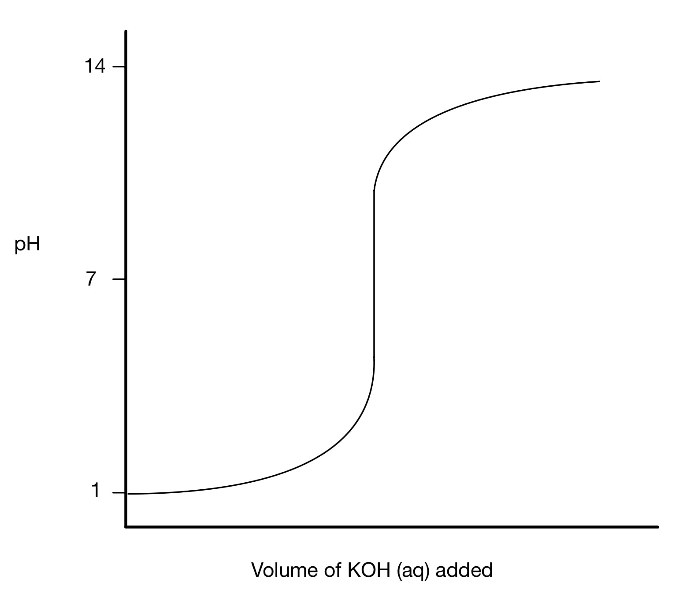
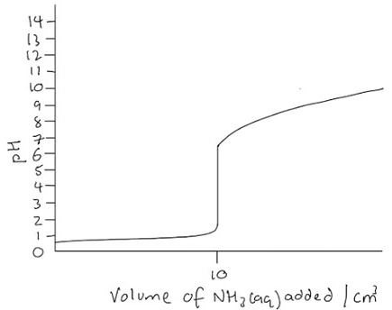
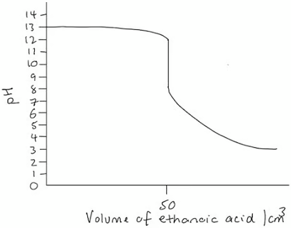
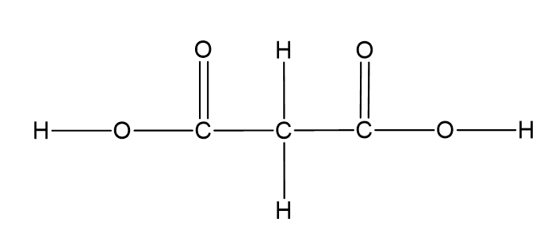
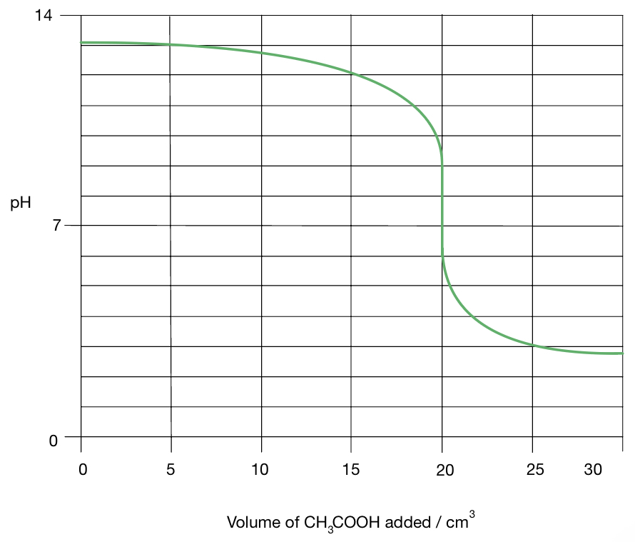

# Mark Schemes — Brønsted–Lowry Theory of Acids & Bases
**7. Equilibria** · Cambridge (CIE) A-LEVEL chemistry (9701)

## Multiple Choice Questions (10 questions)

### Q1
**Final answer:** **The correct answer is B**

- A Brønsted–Lowry base is defined as a species that accepts a proton (H+)

**A** is incorrect as a species that accepts a pair of electrons to form a dative covalent bond is acting as an electrophile, not a Brønsted–Lowry base.

**C** is incorrect as this is the definition of a Brønsted–Lowry acid (a proton donor), not a base.

**D** is incorrect as this describes an alkali, which releases OH- ions specifically in aqueous solution. The Brønsted–Lowry definition is broader and applies to any proton-transfer reaction, not only aqueous systems.

### Q2
**Final answer:** **The correct answer is C**

- The pH starts high and decreases, showing that acid is being added from the burette to a strong base in the flask
- The equivalence point (midpoint of the steep vertical section) is above pH 7, which occurs when a weak acid reacts with a strong base

**A** is incorrect as a strong acid–strong base titration has an equivalence point at exactly pH 7.

**B** is incorrect as a strong acid–weak base titration has an equivalence point below pH 7.

**D** is incorrect as a weak acid–weak base titration produces a very short vertical section with no clearly defined equivalence point.

### Q3
**Final answer:** **The correct answer is C**

- Ammonia accepts a proton (H+) from water to form the ammonium ion (NH4+), acting as a proton acceptor:

NH3 (aq) + H2O (l) ⇌ NH4+ (aq) + OH- (aq)

**A** is incorrect as ammonia actively participates in proton-transfer reactions and is not chemically neutral.

**B** is incorrect as ammonia does not donate a proton in aqueous reactions and therefore cannot act as a Brønsted–Lowry acid.

**D** is incorrect as an amphoteric species can act as both a proton donor and a proton acceptor. Ammonia only accepts protons in standard aqueous chemistry and does not act as a proton donor.

### Q4
**Final answer:** **The correct answer is C**

- A 2.0 mol dm-3 strong acid would have pH ≈ −0.3; a 2.0 mol dm-3 strong base would have pH ≈ 14.3
- Neither P (pH 9.0) nor Q (pH 6.0) reaches these extremes, so both are partially dissociated

- Known values:

  - Concentration = 2.0 mol dm-3
  - pH(P) = 9.0
  - pH(Q) = 6.0

- Calculate the extent of dissociation of P (weak base, pOH = 14 − 9 = 5):

[OH-] = 10-5 mol dm-3

extent of dissociation = $\frac{10^{-5}}{2.0}$

extent of dissociation = 5 x 10-6

- Calculate the extent of dissociation of Q (weak acid):

[H+] = 10-6 mol dm-3

extent of dissociation = $\frac{10^{-6}}{2.0}$

extent of dissociation = 5 x 10-7

- 5 x 10-7 < 5 x 10-6, so the extent of dissociation is lower in Q than in P

**A** is incorrect as P has a pH of 9.0. A 2.0 mol dm-3 strong base would have a pH well above 14.

**B** is incorrect as Q has a pH of 6.0, close to neutral. A 2.0 mol dm-3 strong acid would have pH ≈ −0.3.

**D** is incorrect as P and Q have the same concentration but different pH values, so their extents of dissociation must be different.

### Q5
**Final answer:** **The correct answer is A**

- CH3COOH is a weak acid and only partially dissociates in solution
- [H+] is therefore much less than 0.01 mol dm-3, so the pH is greater than 2

**B** is not the answer as [H+] must be much less than 0.01 mol dm-3 for a weak acid. This statement is correct.

**C** is not the answer as CH3COOH dissociates as CH3COOH ⇌ CH3COO- + H+, producing equal concentrations of each ion. This statement is correct.

**D** is not the answer as CH3COOH is a weak acid and only partially dissociates. This statement is correct.

### Q6
**Final answer:** **The correct answer is B**

- A Brønsted–Lowry acid is a proton (H+) donor
- In the forward reaction, H2PO4- donates a proton to CN-, becoming HPO42-
- In the reverse reaction, HCN donates a proton to HPO42-, becoming CN-

**A** is incorrect as CN- and HPO42- are the two Brønsted–Lowry bases (proton acceptors) in this reaction.

**C** is incorrect as H2PO4- and HPO42- form a conjugate acid-base pair. HPO42- acts as a base (proton acceptor) in the reverse reaction, not an acid.

**D** is incorrect as HCN and CN- form a conjugate acid-base pair. CN- acts as a base (proton acceptor) in the forward reaction, not an acid.

### Q7
**Final answer:** **The correct answer is D**

- A Brønsted–Lowry base is defined as a proton (H+) acceptor
- HNO3 gains a proton to become H2NO3+, so it acts as a Brønsted–Lowry base
- In the reverse reaction, HSO4- gains a proton to become H2SO4, so it also acts as a Brønsted–Lowry base

H2SO4 and H2NO3+ is incorrect as both species act as Brønsted–Lowry acids in this reaction. H2SO4 donates a proton to HNO3, and H2NO3+ donates a proton in the reverse reaction.

H2SO4 and HSO4- is incorrect as these form a conjugate acid–base pair. H2SO4 acts as a Brønsted–Lowry acid in the forward reaction, not a base.

HNO3 and H2NO3+ is incorrect as these form a conjugate acid–base pair. H2NO3+ acts as a Brønsted–Lowry acid in the reverse reaction, not a base.

### Q8
**Final answer:** **The correct answer is C**

- A Brønsted–Lowry acid is a proton (H+) donor
- A Brønsted–Lowry base is a proton (H+) acceptor
- Forward reaction:

  - H2SO4 donates a proton to HNO3
  - So, H2SO4 acts as the acid and HNO3 acts as the base
- Reverse reaction:

  - H2NO3+ donates a proton to HSO4-
  - So, H2NO3+ acts as the acid and HSO4- acts as the base

**A** is incorrect as it assigns HNO3 as an acid. HNO3 accepts a proton from H2SO4 in the forward reaction and acts as the base.

**B** is incorrect as it assigns H2SO4 as a base. H2SO4 donates a proton to HNO3 in the forward reaction and acts as the acid.

**D** is incorrect as it correctly identifies the forward reaction roles but incorrectly assigns HSO4- as an acid. HSO4- accepts a proton to reform H2SO4 in the reverse reaction, acting as a base.

### Q9
**Final answer:** **The correct answer is B**

- This titration involves a strong acid (hydrochloric acid) and a weak base (ammonia)
- The equivalence point in this type of titration is below pH 7
- Methyl orange changes colour in the range pH 3.2–4.4, which includes the equivalence point

**A** is incorrect as it changes colour in the range pH 6.0–7.6, which is above the equivalence point for a strong acid–weak base titration.

**C **is incorrect as it changes colour in the range pH 8.2–10.0, which is above pH 7 and not suitable for this titration.

**D **is incorrect as it changes colour in the range pH 1.2–2.8, which is too low for a strong acid–weak base titration.

### Q10
**Final answer:** **The correct answer is D**

- A Brønsted–Lowry acid is a proton (H+) donor
- In the forward reaction, H3PO4 donates a proton to OH-, becoming H2PO4-
- In the reverse reaction, H2O donates a proton to H2PO4-, becoming OH-

**A** is incorrect as H2PO4- acts as a Brønsted–Lowry base (proton acceptor) in the reverse reaction, not an acid.

**B** is incorrect as OH- acts as a Brønsted–Lowry base (proton acceptor) in the forward reaction.

**C** is incorrect as H3PO4 and H2PO4- form a conjugate acid-base pair. H2PO4- acts as a base in the reverse reaction, not an acid.

> **[exam-tip]**
> In this reaction, there are two conjugate acid-base pairs:
> 
> - H3PO4 / H2PO4-:
> 
>   - H3PO4 is the acid
>   - H2PO4- is the conjugate base
> - H2O / OH-:
> 
>   - H2O is the acid
>   - OH- is the conjugate base
> 
> A conjugate acid-base pair differs by exactly one proton.

## Structured Questions (7 questions)

### Q1
> **[mark-scheme]**
> i) A Brønsted–Lowry base is a species that:
> 
> - Accepts a proton / H+ **[1 mark]**
> 
> ii) A weak acid is:
> 
> - A proton / H+ donor **[1 mark]**
> - That only partially ionises / dissociates in water (to give H+) **[1 mark]**

> **[exam-tip]**
> These definitions are frequently examined. For a Brønsted–Lowry base, the key word is “accepts” a proton. For a weak acid, you need both parts of the definition: it is a proton donor AND it only partially dissociates in water. Missing out either part will lose a mark.
> **[mark-scheme]**
> The curves that represent each acid-base combination are:
> 
> i) Ammonia and ethanoic acid:
> 
> - X **[1 mark]**
> 
> ii) Ammonia and nitric acid:
> 
> - Z **[1 mark]**
> 
> iii) Sodium hydroxide and propanoic acid:
> 
> - Y **[1 mark]**

> **[exam-tip]**
> Look at the starting pH to identify the base (strong base starts pH 11–13; weak base starts pH 7–10) and the ending pH to identify the acid (strong acid ends pH 0–3; weak acid ends pH 4–7). Matching both gives the correct curve.
> 
> Curve X:
> 
> - Weak base (NH3) + weak acid (CH3CO2H)
> - Starts pH 7–10, ends pH 4–7.
> 
> Curve Z:
> 
> - Weak base (NH3) + strong acid (HNO3)
> - Starts pH 7–10, ends pH 0–3.
> 
> Curve Y:
> 
> - Strong base (NaOH) + weak acid (CH3CH2CO2H)
> - Starts pH 11–13, ends pH 4–7.
> **[mark-scheme]**
> The most suitable indicator for curve Z is:
> 
> - Methyl orange **[1 mark]**
> - Curve Z is a strong acid–weak base titration, so the equivalence point is below pH 7
> **OR**
> Methyl orange changes colour between pH 3.1–4.4, which covers the equivalence point **[1 mark]**

> **[exam-tip]**
> Curve Z represents nitric acid (strong acid) added to ammonia (weak base), where the equivalence point is below pH 7.
> 
> The indicator must change colour within the steep section of the curve. Methyl orange (pH 3.1–4.4) is the only indicator in Table 5.2 with a range below pH 7.
> **[mark-scheme]**
> i) The equation for the reaction of water with ammonia is:
> 
> - H2O (l) + NH3 (aq) ⇌ NH4+ (aq) + OH- (aq) **[1 mark]**
> 
> The equilibrium arrow (⇌) must be used since this is a reversible reaction.
> 
> State symbols are not required.
> 
> ii) A species that is amphoteric:
> 
> - Can behave as both a Brønsted–Lowry acid and a Brønsted–Lowry base **[1 mark]**

> **[exam-tip]**
> In the equation for part (i), water acts as a Brønsted–Lowry acid because it donates a proton to ammonia.
> 
> Water is amphoteric because it can also accept a proton (acting as a base, as in its reaction with acids).

### Q2
The completed pH curve is:

**[3 marks]**

> **[mark-scheme]**
> 1 mark for the curve starting between pH 0–3
> 
> 1 mark for the equivalence point at pH 7
> 
> 1 mark for the curve ending between pH 12–14

> **[exam-tip]**
> HCl is a strong acid (starting pH 0–3) and KOH is a strong base (finishing pH 12–14).
> 
> The equivalence point for a strong acid–strong base titration is at pH 7.
> 
> The steep vertical section should be centred on pH 7. So, make sure the point of inflection is at this value.
> **[mark-scheme]**
> i) The equation for this reaction is:
> 
> - CH3CO2H (aq) + NaOH (aq) → CH3CO2Na (aq) + H2O (l) **[1 mark]**
> 
> State symbols are not required.
> 
> ii) A suitable indicator for this titration is:
> 
> - Cresol purple **[1 mark]**

> **[exam-tip]**
> The salt formed in this reaction is sodium ethanoate, CH3CO2Na, which partially hydrolyses in water to give an alkaline solution.
> 
> This means the equivalence point is above pH 7. Therefore, any indicator that changes colour in the acidic or neutral range would give an inaccurate endpoint. Cresol purple (pH 7.6–9.2) is the only indicator in Table 6.1 whose range covers the alkaline equivalence point.
> **[mark-scheme]**
> Any **one** of the following sets (1 mark for each point):
> 
> Set 1
> 
> - Test the electrical conductivity of each acid
> - Hydrochloric acid conducts electricity better / has a lower resistance than ethanoic acid
> 
> **OR**
> 
> Set 2
> 
> - Add a reactive metal / carbonate / hydrogen carbonate to each acid
> - Hydrochloric acid shows greater effervescence / faster rate of reaction than ethanoic acid
> 
> **OR**
> 
> Set 3
> 
> - Add the same volume of sodium hydroxide solution to each acid and measure the temperature change
> - Hydrochloric acid produces a greater temperature rise than ethanoic acid
> 
> **[2 marks]**
> 
> Describing a titration method for Set 3 is not accepted.

> **[exam-tip]**
> Any method that produces a measurable difference between the two acids is valid, but you must state both the test and the expected observation for each acid to gain both marks.
> 
> HCl is fully dissociated (strong acid) while CH3CO2H is only partially dissociated (weak acid) at the same concentration. This difference in [H+] drives all of these observations.

### Q3
The completed pH curve is:

**[3 marks]**

> **[mark-scheme]**
> 1 mark for the initial pH between 0–2
> 
> 1 mark for the vertical section at 10 cm3
> 
> 1 mark for the curve tailing off between pH 9–11

> **[exam-tip]**
> HCl is a strong acid, which means that the initial pH should be between 0–2.
> 
> Ammonia is a weak base, which means that the curve tails off between pH 9–11.
> 
> Both solutions are 0.200 mol dm-3, so equal volumes react: the equivalence point is at 10 cm3 of ammonia added. This is a strong acid–weak base titration, so the equivalence point is below pH 7 (approximately pH 5).
> **[mark-scheme]**
> Methyl red is a suitable indicator for this titration but phenolphthalein is not because:
> 
> - Methyl red changes colour at the equivalence point / where the sharpest pH change occurs **[1 mark]**
> - Phenolphthalein changes colour between pH 8.2–10.0, which does not correspond to the equivalence point / steepest part of the curve **[1 mark]**

> **[exam-tip]**
> For a strong acid–weak base titration, the equivalence point is below pH 7 (approximately pH 5).
> 
> A suitable indicator must change colour within the steep section of the curve. Check whether the indicator's pH range in Table 1.1 overlaps with the equivalence point.
The completed pH curve is:

**[3 marks]**

> **[mark-scheme]**
> 1 mark for the initial pH between 12–14
> 
> 1 mark for the vertical section at 50 cm3
> 
> 1 mark for the curve tailing off between pH 3–5

> **[exam-tip]**
> NaOH is a strong base, which means that the initial pH should be between 12–14.
> 
> Ethanoic acid is a weak acid, which means that the curve tails off between pH 3–5.
> 
> The concentration of NaOH (0.200 mol dm-3) is double that of ethanoic acid (0.100 mol dm-3), so double the volume of ethanoic acid is needed for neutralisation: the equivalence point is at 50 cm3.
> **[mark-scheme]**
> Phenolphthalein is a suitable indicator for this titration but methyl red is not because:
> 
> - Phenolphthalein changes colour at the equivalence point / where the sharpest pH change occurs **[1 mark]**
> - Methyl red changes colour between pH 4.2–6.3, which does not correspond to the equivalence point / steepest part of the curve **[1 mark]**

> **[exam-tip]**
> For a weak acid–strong base titration, the equivalence point is above pH 7.
> 
> Phenolphthalein (pH 8.2–10.0) changes colour in the alkaline range and is suitable; methyl red (pH 4.2–6.3) changes colour in the acidic range and would give an incorrect endpoint.
> **[mark-scheme]**
> The equivalence points differ because of the salts formed:
> 
> For the titration in part (a):
> 
> - The salt formed at the equivalence point is ammonium chloride, NH4Cl **[1 mark]**
> - NH4+ is a weak acid that partially hydrolyses in water, producing an acidic solution **[1 mark]**
> 
> For the titration in part (c):
> 
> - The salt formed at the equivalence point is sodium ethanoate, CH3CO2Na **[1 mark]**
> - CH3CO2- is a weak base that partially hydrolyses in water, producing an alkaline solution **[1 mark]**

> **[exam-tip]**
> At the equivalence point, all the acid and base have been neutralised. The pH is determined by the salt formed:
> 
> - If the cation is from a weak base (e.g. NH4+ from NH3), it partially hydrolyses to give H+, making the solution acidic.
> - If the anion is from a weak acid (e.g. CH3CO2- from CH3CO2H), it partially hydrolyses to give OH-, making the solution alkaline.

### Q4
> **[mark-scheme]**
> A Brønsted–Lowry acid is:
> 
> - A species that donates a proton / H+ **[1 mark]**

> **[exam-tip]**
> A Brønsted–Lowry acid is a proton / H+ donor. A Brønsted–Lowry base is a proton / H+ acceptor. Remember that in an equilibrium, both the forward and reverse reactions involve Brønsted–Lowry acid–base pairs.
> **[mark-scheme]**
> The two species that act as Brønsted–Lowry bases are:
> 
> - HSO4-
> **AND**
> H2O **[1 mark]**

> **[exam-tip]**
> In an equilibrium reaction, each direction involves a Brønsted–Lowry acid and a Brønsted–Lowry base.
> 
> In the forward reaction:
> 
> - HSO4- accepts a proton from H3O+ to form H2SO4
> - So, HSO4- is the Brønsted–Lowry base.
> 
> In the reverse reaction:
> 
> - H2O accepts a proton from H2SO4 to form H3O+
> - So, H2O is the Brønsted–Lowry base.
> **[mark-scheme]**
> The species that acts as a Brønsted–Lowry acid is:
> 
> - HCO3- **[1 mark]**

> **[exam-tip]**
> A Brønsted–Lowry acid is a proton donor.
> 
> In the reverse reaction, HCO3- donates H+ to form CO32-, making it the Brønsted–Lowry acid. In the forward reaction, H+ is the proton donor.
> 
> The question asks which species in the equilibrium acts as an acid, and identifying HCO3- shows understanding of the reverse reaction direction.
> **[mark-scheme]**
> Propanoic acid dissociates as follows:
> 
> - CH3CH2CO2H (aq) ⇌ CH3CH2COO- (aq) + H+ (aq)
> **OR** CH3CH2CO2H (aq) + H2O (l) ⇌ CH3CH2COO- (aq) + H3O+ (aq) **[1 mark]**
> 
> The equilibrium arrow (⇌) must be used; a single-headed arrow (→) is not accepted.
> 
> State symbols are not required.

> **[exam-tip]**
> Propanoic acid is a weak acid, which means that it only partially dissociates in aqueous solution.
> 
> Use the reversible arrow ⇌, not a single-headed arrow →.
> 
> Either form of the equation is accepted: with H+ or with H3O+ for the hydrogen ion in solution.

### Q5
> **[mark-scheme]**
> One difference that would be observed is:
> 
> - Slower rate of reaction with glycolic acid than with sulfuric acid
> **OR**
> Less effervescence / fewer bubbles with glycolic acid than with sulfuric acid
> **OR**
> A smaller temperature rise with glycolic acid than with sulfuric acid **[1 mark]**
> 
> This is because:
> 
> - Glycolic acid is a weak acid / only partially dissociates in water, giving a lower [H+] than sulfuric acid at the same concentration **[1 mark]**

> **[exam-tip]**
> Organic acids are generally weak acids, which means that they only partially ionise in water.
> 
> At the same concentration, a weak acid has a lower [H+] than a strong acid, so its reaction rate with CaCO3 is slower. Both the observation (slower reaction / less effervescence) and the reason (weak acid / partial dissociation) are required for full marks.
To calculate the ratio of [H+] in hydrochloric acid to [H+] in carbonic acid:

- Convert pH to [H+] using [H+] = 10-pH:

For HCl: [H+] = 10-1 mol dm-3

For H2CO3: [H+] = 10-5 mol dm-3

**[1 mark]**

- Calculate the ratio:

10-1 ÷ 10-5 = 104

Ratio = **10 000 : 1** **[1 mark]**

> **[mark-scheme]**
> 1 mark for both [H+] values
> 
> 1 mark the correct ratio
> 
> Accept 104 : 1 for the ratio.
> 
> The ratio must be expressed as HCl : H2CO3, so the answer 1 : 10 000 is not accepted.

> **[exam-tip]**
> To convert pH to [H+], use [H+] = 10-pH.
> 
> In part (ii), take care with the direction of the ratio as the question asks for HCl : H2CO3, so HCl (lower pH, higher [H+]) must come first. 10-1 is 104 times larger than 10-5, giving a ratio of 10 000 : 1.
> **[mark-scheme]**
> Any **two** of the following sets (1 mark for the method, 1 mark for the observation):
> 
> Set 1
> 
> - Add a named reactive metal (e.g. magnesium) to each solution
> - The metal reacts faster / produces more bubbles with HCl than with H2CO3 / the metal does not react noticeably with H2CO3
> 
> **OR**
> 
> Set 2
> 
> - Add solid sodium carbonate / sodium hydrogen carbonate to each solution
> - More vigorous effervescence with HCl / the carbonate does not dissolve noticeably in H2CO3
> 
> **OR**
> 
> Set 3
> 
> - Test the electrical conductivity of each solution
> - HCl has greater conductivity / lower resistance than H2CO3
> 
> **[4 marks]**
> 
> You would not be expected to know specific reactions of carbonic acid; comparison of strong vs. weak acid behaviour is sufficient.

> **[exam-tip]**
> For each method, you must state both the test and the expected observation for each acid to gain both marks.
> 
> HCl is a strong acid (fully dissociated, higher [H+]) while H2CO3 is a weak acid (partially dissociated, lower [H+]). This difference drives all the observable distinctions.

### Q6
i) The stronger acid is **A** **[1 mark]**

To calculate [H+] for each solution using [H+] = 10-pH:

[H+]A = 10-3 mol dm-3

[H+]B = 10-6 mol dm-3

**[1 mark]**

> **[mark-scheme]**
> 1 mark for identifying **A** as the stronger acid
> 
> 1 mark for both [H+] values.

ii) To calculate the ratio [H+]A : [H+]B:

10-3 ÷ 10-6 = 103 = 1000

Ratio = **1000 : 1** **[1 mark]**

> **[mark-scheme]**
> Accept 103 : 1 for the ratio in part (ii).

> **[exam-tip]**
> The stronger acid has the lower pH at the same concentration, indicating a higher [H+] and greater dissociation.
> 
> To convert pH to [H+], use [H+] = 10-pH.
> 
> Take care with the direction of the ratio in part (ii) as the question asks for [H+]A : [H+]B, so the answer is 1000 : 1. Note that 10-3 is 1000 times larger than 10-6, not smaller.
> **[mark-scheme]**
> From Fig. 2.1, the identities of the acids are:
> 
> - Acid **1** is the strong acid
> **AND**
> Acid **2** is the weak acid **[1 mark]**
> 
> The reasoning is:
> 
> Any **two** from (1 mark for each point):
> 
> - Acid **1** shows a linear relationship between concentration and conductivity
> - The number of ions in Acid **1** is proportional to its concentration / doubling the concentration of Acid **1** doubles the number of ions present
> - Acid **1** is fully ionised at all concentrations shown
> - Acid **2** reaches a maximum conductivity at low concentration
> - Doubling the concentration of Acid **2** does not double the number of ions present
> 
> **[2 marks]**
> 
> The reverse arguments (describing Acid **2** as the weak acid) are equally acceptable.

> **[exam-tip]**
> A strong acid fully ionises at all concentrations. So, conductivity increases linearly with concentration (more ions = higher conductivity).
> 
> A weak acid only partially ionises, and the degree of ionisation decreases as concentration increases, so conductivity does not increase proportionally.
> 
> When giving reasoning, you should address both acids or refer to the specific features of Fig. 2.1 that support your answer.
> **[mark-scheme]**
> The volume of NaOH required:
> 
> - Both acids require the same volume of NaOH (aq) / both require 10 cm3 of 0.2 mol dm-3 NaOH **[1 mark]**

> **[exam-tip]**
> The strength of an acid does not affect its concentration.
> 
> Both acids are 0.1 mol dm-3 and both are monoprotic, so 20 cm3 of each contains the same number of moles of acid.
> 
> The same moles of H+ are available for neutralisation, requiring the same volume of NaOH solution regardless of acid strength.

### Q7
The displayed formula of malonic acid is:

**[1 mark]**

> **[mark-scheme]**
> 1 mark for the correct displayed formula showing all bonds, including both -COOH groups and the central -CH2- group

> **[exam-tip]**
> Malonic acid is a dicarboxylic acid, which means that it has two –COOH groups connected by a central –CH2– group. The displayed formula must show every bond explicitly, including all C–H bonds.
> **[mark-scheme]**
> The acid with the higher pH at the same concentration is:
> 
> - Ethanoic acid **[1 mark]**
> 
> This is because:
> 
> - Malonic acid is diprotic and produces more H+ ions per mole than ethanoic acid
> **OR**
> Ethanoic acid is monoprotic and produces fewer H+ ions per mole than malonic acid **[1 mark]**

> **[exam-tip]**
> A higher pH means a lower [H+]. At the same concentration, malonic acid releases more H+ because it is diprotic (two –COOH groups, each able to donate a proton). Ethanoic acid is monoprotic (one –COOH group), so it produces fewer H+ ions and has the higher pH.
> **[mark-scheme]**
> One experiment that could distinguish the two acids is:
> 
> Any **one** from:
> 
> - Test the electrical conductivity of each solution
> **AND**
> Malonic acid shows higher conductivity / lower resistance
> - Add a reactive metal (e.g. magnesium) to each solution
> **AND**
> Malonic acid produces bubbles at a faster rate
> - Add a metal oxide or carbonate to each solution
> **AND**
> Malonic acid reacts at a faster rate
> 
> **[1 mark]**

> **[exam-tip]**
> Malonic acid is diprotic, so at the same concentration it has a higher [H+] than ethanoic acid. Any method that detects this difference in [H+] is valid. You must state both the test and the expected observation to gain the mark.
The completed pH curve is:

**[3 marks]**

> **[mark-scheme]**
> 1 mark for the starting pH at 13.1
> 
> 1 mark for the vertical section at 20 cm3 **AND** the midpoint of the vertical section above pH 7
> 
> 1 mark for the final pH at 2.93

> **[exam-tip]**
> The acid (0.075 mol dm-3) is added to the base (0.150 mol dm-3), so the pH starts high and decreases.
> 
> To find the equivalence volume:
> 
> Vola x Conca = Volb x Concb
> 
> Vola x 0.075 = 10.0 x 0.150
> 
> Vola = 20.0 cm3
> 
> This is a weak acid–strong base titration, so the equivalence point is above pH 7.
