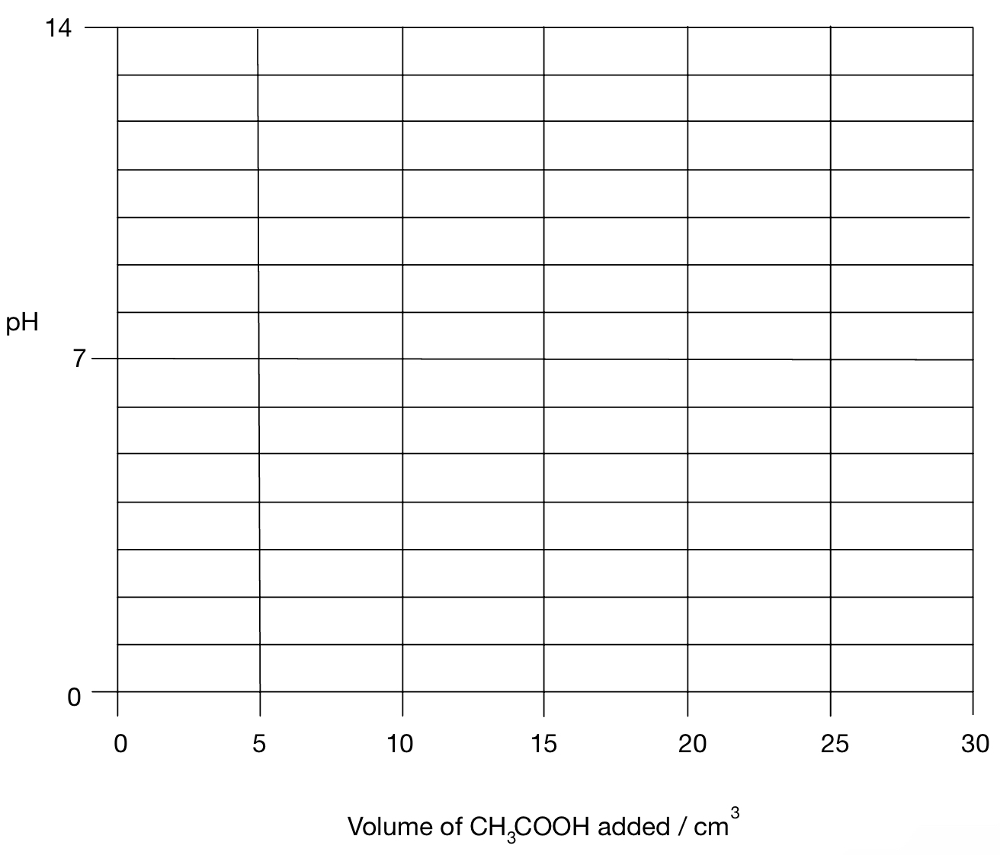

# Exam Questions — Brønsted–Lowry Theory of Acids & Bases
**7. Equilibria** · Cambridge (CIE) A-LEVEL chemistry (9701)
> Source: [https://www.savemyexams.com/a-level/chemistry/cie/25/topic-questions/](https://www.savemyexams.com/a-level/chemistry/cie/25/topic-questions/) · 17 questions across 2 sets

## Multiple Choice Questions (10 questions)

### Q1 — easy — 1 marks

**Q1** [1 mark]

Which statement describes a Brønsted–Lowry base?

### Q2 — easy — 1 marks

**Q2** [1 mark]

The graph shows the change in pH during a titration.

Which acid and base are used?

### Q3 — easy — 1 marks

**Q3** [1 mark]

According to the Brønsted–Lowry theory, which term describes ammonia?

### Q4 — medium — 1 marks

**Q4** [1 mark]

The table shows the concentrations and pH values of two compounds, **P** and **Q**, dissolved in water.

| solution | concentration / mol dm-3 | pH |
|---|---|---|
| **P** | 2.0 | 9.0 |
| **Q** | 2.0 | 6.0 |

Which statement is correct?

### Q5 — hard — 1 marks

**Q5** [1 mark]

Which statement about 0.01 mol dm-3 CH3COOH (aq) is **not** correct?

### Q6 — hard — 1 marks

**Q6** [1 mark]

Which two species act as Brønsted–Lowry acids in this reaction?

H2PO4- (aq) + CN- (aq) ⇌ HCN (aq) + HPO42- (aq)

### Q7 — medium — 1 marks

**Q7** [1 mark]

The following reaction occurs between concentrated sulfuric and nitric acids.

H2SO4 + HNO3 ⇌ H2NO3+ + HSO4-

Which two species act as Brønsted–Lowry bases in this reaction?

### Q8 — hard — 1 marks

**Q8** [1 mark]

An equilibrium is established in a mixture of concentrated sulfuric acid and concentrated nitric acid.

H2SO4 + HNO3 ⇌ HSO4- + H2NO3+

Which row gives the behaviour of each species in this equilibrium?

|   | **H****2****SO****4** | **HNO****3** | **HSO****4****–** | **H****2****NO****3****+** |
|---|---|---|---|---|
| **A** | acid | acid | base | base |
| **B** | base | acid | acid | base |
| **C** | acid | base | base | acid |
| **D** | acid | base | acid | base |

### Q9 — medium — 1 marks

**Q9** [1 mark]

The pH ranges of four indicators are shown.

| indicator | pH range for colour change |
|---|---|
| Bromothymol blue | 6.0 – 7.6 |
| Methyl orange | 3.2 – 4.4 |
| Phenolphthalein | 8.2 – 10.0 |
| Thymol blue | 1.2 – 2.8 |

Which indicator is suitable for a titration of aqueous ammonia with hydrochloric acid?

### Q10 — easy — 1 marks

**Q10** [1 mark]

Which two species act as Brønsted–Lowry acids in the following reaction?

H3PO4 (aq) + OH- (aq) ⇌ H2PO4- (aq) + H2O (l)

## Structured Questions (7 questions)

### Q1 — medium — 10 marks

**Q1** [3 marks]

i) State what is meant by a Brønsted–Lowry base.

[1]

ii) Explain what is meant by a weak acid.

[2]

**Q1** [3 marks]

A student titrated 0.10 mol dm-3 acid into a conical flask containing 25.0 cm3 of 0.10 mol dm-3 of a base, recording the pH with each addition of acid. The student repeated the procedure using different combinations of acids and bases.

**Fig. 5.1**

Identify the curve in Fig. 5.1 that represents the titration of:

i) Ammonia and ethanoic acid.

[1]

ii) Ammonia and nitric acid.

[1]

iii) Sodium hydroxide and propanoic acid.

[1]

**Q1** [2 marks]

**Extract:**

A student titrated 0.10 mol dm^-3^ acid into a conical flask containing 25.0 cm^3^ of 0.10 mol dm^-3^ of a base, recording the pH with each addition of addition of acid. The student repeated the procedure using different combinations of acids and bases.

Identify the curve in Fig. 5.1 that represents the titration of:

i) Ammonia and ethanoic acid.

ii) Ammonia and nitric acid.

iii) Sodium hydroxide and propanoic acid.

Curve Z represents ammonia and nitric acid.

Identify which indicator in Table 5.2 would be most suitable for curve Z. Explain your answer.

**Table 5.2**

| **Indicator** | **pH range** |
|---|---|
| Methyl orange | 3.1–4.4 |
| Phenolphthalein | 8.3–10.0 |
| Bromothymol blue | 6.0–7.6 |

**Q1** [2 marks]

Water is amphoteric and will react with nitric acid and ammonia.

i) Construct an equation to show how water reacts with ammonia.

[1]

ii) State what is meant by the term amphoteric.

[1]

### Q2 — easy — 7 marks

**Q2** [3 marks]

KOH (aq) is added from a burette to HCl (aq) in a beaker.

On Fig. 6.1, sketch the pH curve for this reaction.

**Fig. 6.1**

**Q2** [2 marks]

A titration was performed between ethanoic acid, CH3CO2H (aq), and sodium hydroxide, NaOH (aq).

**Table 6.1**

| **Indicator** | **pH range** |
|---|---|
| Pentamethoxy red | 1.2–3.2 |
| Naphthyl red | 3.7–5.0 |
| 4-nitrophenol | 5.6–7.0 |
| Cresol purple | 7.6–9.2 |

i) Construct an equation for the reaction between ethanoic acid and sodium hydroxide.

[1]

ii) Use the information in Table 6.1 to identify a suitable indicator for this titration.

[1]

**Q2** [2 marks]

Apart from using a pH probe or indicator, describe **one** chemical test that could be used to show that hydrochloric acid is a stronger acid than ethanoic acid of the same concentration. State the expected observation for each acid.

### Q3 — hard — 14 marks

**Q3** [3 marks]

A student carried out two acid-base titrations. The pH ranges of four indicators are given in Table 1.1.

**Table 1.1**

| **Indicator** | **pH range** |
|---|---|
| methyl red | 4.2–6.3 |
| bromothymol blue | 6.0–7.6 |
| bromocresol green | 3.8–5.4 |
| phenolphthalein | 8.2–10.0 |

In the first titration, 0.200 mol dm-3 aqueous ammonia is added from a burette to 10.0 cm3 of 0.200 mol dm-3 HCl (aq).

Sketch the pH curve for this reaction.

**Q3** [2 marks]

**Extract:**

A student carried out two acid-base titrations. The pH ranges of four indicators are given in Table 1.1.

**Table 1.1**

| **Indicator** | **pH range** |
| --- | :---: |
| methyl red | 4.2–6.3 |
| bromothymol blue | 6.0–7.6 |
| bromocresol green | 3.8–5.4 |
| phenolphthalein | 8.2–10.0 |

In the first titration, 0.200 mol dm^-3^ aqueous ammonia is added from a burette to 10.0 cm^3^ of 0.200 mol dm^-3^ HCl (aq).

Using Table 1.1, explain why methyl red is a suitable indicator for the first titration but phenolphthalein is not.

**Q3** [3 marks]

In the second titration, 0.100 mol dm-3 ethanoic acid is added from a burette to 25.0 cm3 of 0.200 mol dm-3 NaOH (aq).

Sketch the pH curve for this reaction.

**Q3** [2 marks]

**Extract:**

A student carried out two acid-base titrations. The pH ranges of four indicators are given in Table 1.1.

**Table 1.1**

| **Indicator** | **pH range** |
| --- | :---: |
| methyl red | 4.2–6.3 |
| bromothymol blue | 6.0–7.6 |
| bromocresol green | 3.8–5.4 |
| phenolphthalein | 8.2–10.0 |

In the second titration, 0.100 mol dm^-3^ ethanoic acid is added from a burette to 25.0 cm^3^ of 0.200 mol dm^-3^ NaOH (aq).

Using Table 1.1, explain why phenolphthalein is a suitable indicator for the second titration but methyl red is not.

**Q3** [4 marks]

**Extract:**

In the first titration, 0.200 mol dm^-3^ aqueous ammonia is added from a burette to 10.0 cm^3^ of 0.200 mol dm^-3^ HCl (aq).

In the second titration, 0.100 mol dm^-3^ ethanoic acid is added from a burette to 25.0 cm^3^ of 0.200 mol dm^-3^ NaOH (aq).

Explain why the equivalence point of the titration in part (a) is below pH 7, and why the equivalence point of the titration in part (c) is above pH 7.

### Q4 — easy — 4 marks

**Q4** [1 mark]

State what is meant by a Brønsted–Lowry acid.

**Q4** [1 mark]

Identify the two species that act as Brønsted–Lowry bases in the following reaction.

HSO4- (aq) + H3O+ (aq) ⇌ H2SO4 (aq) + H2O (l)

**Q4** [1 mark]

Identify the species that acts as a Brønsted–Lowry acid in the following reaction.

CO32- (aq) + H+ (aq) ⇌ HCO3- (aq)

**Q4** [1 mark]

Propanoic acid, CH3CH2CO2H, is a weak acid.

Construct an equation to show the dissociation of propanoic acid in water.

### Q5 — medium — 8 marks

**Q5** [2 marks]

Glycolic acid, C2H4O3, is an organic acid sometimes used to remove limescale, CaCO3, from electric kettles and coffee machines.

State and explain one difference that would be observed when samples of calcium carbonate react with the same concentration of sulfuric acid and glycolic acid.

**Q5** [2 marks]

A solution of hydrochloric acid has a pH of 1 and a solution of carbonic acid has a pH of 5. Calculate the ratio of hydrogen ion concentrations of hydrochloric acid to carbonic acid.

**Q5** [4 marks]

Apart from measuring the pH, describe two methods that could be used to distinguish between equimolar solutions of carbonic acid and hydrochloric acid. State the expected observation for each method.

### Q6 — medium — 7 marks

**Q6** [3 marks]

**A** and **B** are two solutions of the same concentration that have pH values of 3 and 6 respectively.

i) Identify the stronger acid. Calculate the concentration of hydrogen ions in each solution.

[2]

ii) Calculate the ratio of the hydrogen ion concentrations in **A** and **B**.

[1]

**Q6** [3 marks]

The variation of conductivity and concentration of a strong and weak monoprotic acid are shown in Fig. 2.1.

**Fig. 2.1**

Use the information in Fig. 2.1 to deduce which acid is strong and which is weak. Explain your reasoning.

**Q6** [1 mark]

**Extract:**

The variation of conductivity and concentration of a strong and weak monoprotic acid are shown in Fig. 2.1.

Acid 1 is the strong acid
Acid 2 is the weak acid

State how the volume of 0.2 mol dm-3 NaOH required to neutralise 20 cm3 of 0.1 mol dm-3 acid **1** compares to the volume required to neutralise the same volume of 0.1 mol dm-3 acid **2**.

### Q7 — hard — 7 marks

**Q7** [1 mark]

Malonic acid is a weak dicarboxylic acid with the formula C3H4O4. Draw the displayed formula of malonic acid.

**Q7** [2 marks]

**Extract:**

Malonic acid is a weak dicarboxylic acid with the formula C~3~H~4~O~4~.

Ethanoic acid and malonic acid are in aqueous solution at the same concentration. State and explain which acid has the higher pH.

**Q7** [1 mark]

**Extract:**

Ethanoic acid and malonic acid are in aqueous solution at the same concentration. State and explain which acid has the higher pH.

Ethanoic acid has the higher pH because malonic acid is diprotic and produces more H+ ions per mole than ethanoic acid.

Apart from measuring the pH, suggest one experiment that could be used to distinguish between equimolar solutions of malonic acid and ethanoic acid. State the expected observation.

**Q7** [3 marks]

30.0 cm3 of 0.075 mol dm-3 CH3COOH with a pH of 2.93 is added to 10.0 cm3 of 0.150 mol dm-3 KOH with a pH of 13.1.

On the following axes, sketch the pH curve for this addition.

