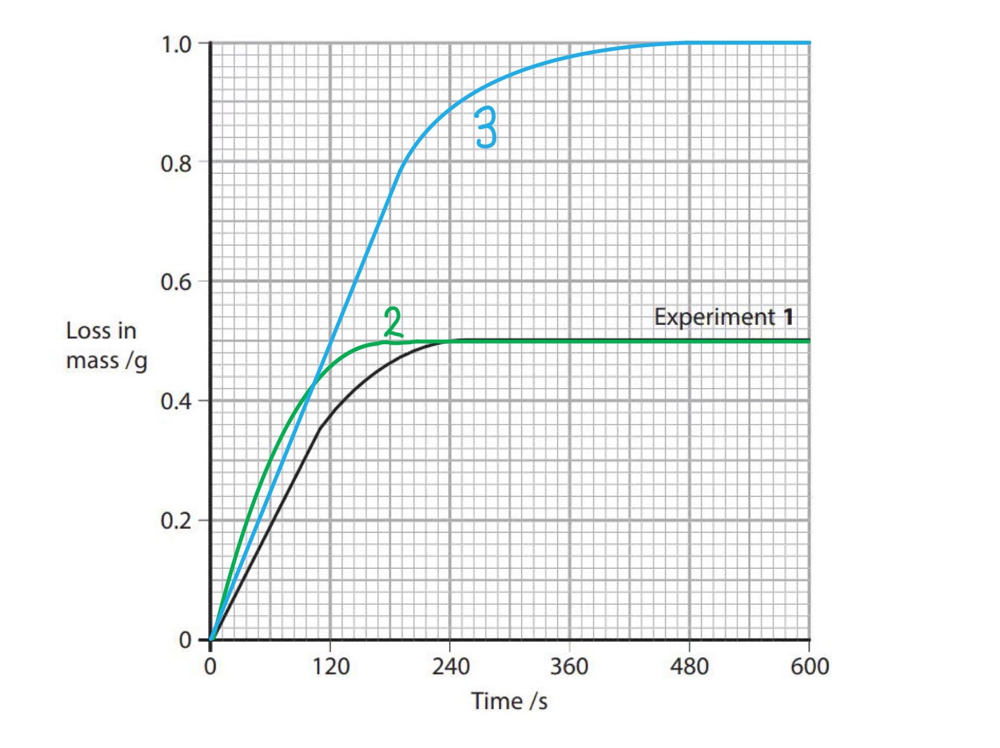
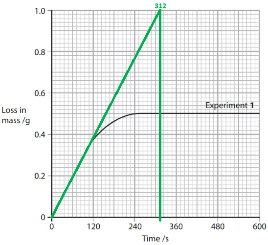
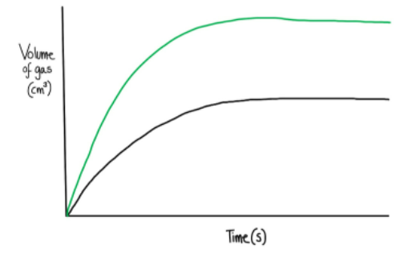

# Mark Schemes — Rate of Reaction
**8. Reaction Kinetics** · Cambridge (CIE) A-LEVEL chemistry (9701)

## Multiple Choice Questions (10 questions)

### Q1
**Final answer:** **The correct answer is B**

- Adding 100 cm3 of distilled water doubles the total volume, halving the concentration of H+ ions.
- The reacting particles are further apart and collide less frequently, so the frequency of collisions decreases.
- The proportion of effective collisions depends on the Maxwell-Boltzmann distribution.
- Since temperature is unchanged, the proportion of particles with sufficient energy to react remains constant.
- The activation energy is a fixed constant for a given reaction and is unaffected by adding water.

**A** is incorrect as adding water at constant temperature does not affect the energy distribution of particles. The proportion of effective collisions remains constant, not decreases.

**C** is incorrect as the activation energy does not increase when water is added; only a catalyst alters the activation energy.

**D** is incorrect as collision frequency does decrease when water is added, because the concentration of reacting particles is reduced.

### Q2
**Final answer:** **The correct answer is C**

- Increasing the pressure of a fixed mass of gas forces the same number of molecules into a smaller volume.
- The molecules are closer together and therefore collide more frequently.
- The increased collision frequency raises the rate of reaction.

**A** is incorrect as the activation energy is a fixed constant for a given reaction and is only lowered by a catalyst.

**B** is incorrect as average kinetic energy is directly proportional to absolute temperature. Because the temperature is constant, the average kinetic energy of the molecules does not change.

**D** is incorrect as the proportion of molecules with energy greater than or equal to the activation energy depends on the Maxwell-Boltzmann distribution, which is determined by temperature. At constant temperature, this proportion remains unchanged.

### Q3
**Final answer:** **The correct answer is D**

- Curve 2 has a shallower initial gradient (slower initial rate) but reaches a higher final plateau (greater total volume of oxygen).
- Adding 0.1 mol dm-3 H2O2 to the original 1.0 mol dm-3 solution dilutes the mixture, lowering the initial concentration and reducing the initial rate.

  - This produces the shallower gradient.
- Adding more H2O2 also increases the total moles present, so more oxygen is produced overall.

  - This produces the higher final plateau.

**A** is incorrect as raising the temperature increases the rate of reaction, giving a steeper initial gradient, not a shallower one. The total moles of H2O2 are unchanged, so the final plateau is the same as curve 1.

**B** is incorrect as adding more catalyst increases the rate of reaction, giving a steeper initial gradient. A catalyst does not change the total yield of oxygen, so the final plateau is the same as curve 1.

**C** is incorrect as adding water dilutes the H2O2, which does produce a shallower initial gradient. However, adding water does not change the total moles of H2O2 present, so the final plateau is the same as curve 1, not higher.

### Q4
**Final answer:** **The correct answer is B**

- The mass of vapour increases with temperature until it reaches a maximum of m at temperature T, after which it does not change.
- This plateau indicates that all of the solid has vaporised at temperature T.
- The entire sample is in the vapour state, so the initial mass of solid Y placed in the vessel must have been m.

**A** is incorrect as temperature T represents the point where the last solid has vaporised, not where liquid appears. As temperature rises beyond T, Y remains in the vapour state.

**C** is incorrect as above temperature T, the number of moles of gas (n) and the volume (V) are both constant, but the temperature (T) continues to rise. By the ideal gas equation, pV = nRT, the pressure is directly proportional to absolute temperature and therefore continues to increase.

**D** is incorrect as the experiment is carried out in a closed vessel. The volume of the vessel is fixed, so the gas cannot expand.

### Q5
**Final answer:** **The correct answer is A**

- The rate of reaction can be measured by monitoring the change in concentration of a reactant or product over time.
- The net ionic equation is:

H+ (aq) + OH- (aq) → H2O (l)

- Hydrogen ions are consumed as the reaction proceeds, so their concentration decreases measurably over time.
- This change can be monitored using a pH meter.

**B** and **C** are incorrect as Cl- and Na+ are spectator ions. They do not participate in the chemical reaction, so their concentrations do not change from start to finish. It is not possible to determine the rate of reaction by monitoring them.

**D** is incorrect as water is the solvent. Its concentration is approximately 55.5 mol dm-3, so the small amount produced during the reaction causes a negligible percentage change. This cannot be used to calculate the rate of reaction accurately.

### Q6
**Final answer:** **The correct answer is D**

- At higher temperature, the Maxwell-Boltzmann distribution shifts to higher energies.
- A greater proportion of molecules have energy greater than or equal to the activation energy, so a greater proportion of collisions are effective and the rate increases.

**A** and **B** are incorrect as the activation energy is a fixed constant for a given reaction pathway and does not change with temperature.

**C** is incorrect as the increase in collision frequency at higher temperature is relatively small. The main reason for the rate increase is the much larger increase in the proportion of molecules with energy greater than or equal to the activation energy.

### Q7
**Final answer:** **The correct answer is B**

- At higher temperature, molecules move faster, so they collide more frequently.

- A greater proportion of molecules have energy greater than or equal to the activation energy at higher temperature, so the proportion of effective collisions increases.

- The activation energy is a fixed property of the reaction pathway and is unaffected by temperature.

**A** is incorrect as the activation energy does not decrease when temperature increases; only a catalyst can lower the activation energy.

**C** is incorrect as the proportion of effective collisions increases with temperature, not remains constant.

**D** is incorrect as collision frequency increases with temperature due to molecules moving faster.

### Q8
**Final answer:** **The correct answer is D**

- Adding 100 cm3 of distilled water doubles the total volume of the solution, which halves the concentration of the H+ ions.

- Since there are fewer reacting particles per unit volume, they are further apart and collide with the solid calcium carbonate surface less frequently. This reduces the rate of reaction.

**A** is incorrect as the proportion of particles with energy greater than or equal to the activation energy depends on temperature, not concentration. At constant temperature, this proportion is unchanged.

**B** is incorrect as the effectiveness of a collision depends on the orientation and energy of the colliding particles, not on their concentration. Adding water does not alter the proportion of effective collisions.

**C** is incorrect as the activation energy is a fixed constant for a given reaction and is unaffected by adding water.

### Q9
**Final answer:** **The correct answer is D**

- A small increase in temperature causes a disproportionately large increase in the number of molecules with energy greater than or equal to the activation energy.

- This is because the Maxwell-Boltzmann distribution is exponential near the activation energy.

- A small rightward shift in the curve produces a large increase in the area under the curve beyond the activation energy threshold.

**A** and **B** are incorrect as although average kinetic energy and molecular velocity do increase with temperature, these increases are much smaller in magnitude than the increase in the number of molecules with energy greater than or equal to the activation energy.

**C** is incorrect as although collision frequency does increase with temperature, this increase is also much smaller in magnitude than the increase in the number of molecules with energy greater than or equal to the activation energy.

### Q10
**Final answer:** **The correct answer is A**

- Using 0.05 mol dm-3 Na2S2O3 instead of 0.02 mol dm-3 increases the concentration of thiosulfate ions.
- A higher concentration means more reacting particles per unit volume.
- The particles are closer together and collide more frequently, increasing the rate of reaction.

**B** is incorrect as concentration does not change the average energy of collisions. Only a change in temperature would increase the energy of the colliding particles.

**C** is incorrect as the activation energy is a fixed constant for a given reaction. Changing the concentration does not alter the activation energy; only a catalyst can do this.

**D** is incorrect as the proportion of particles with energy greater than or equal to the activation energy depends on temperature, not concentration. At constant temperature, this proportion is unchanged.

## Structured Questions (6 questions)

### Q1
> **[mark-scheme]**
> i) The relationship between the rate of reaction and the concentration of sodium thiosulfate:
> 
> - The rate increases as concentration of sodium thiosulfate increases
> **OR**
> The rate is proportional to concentration **[1 mark]**
> 
> ii) The variables are:
> 
> - Independent variable: concentration of sodium thiosulfate
> **AND**
> Dependent variable: time for cross to disappear **[1 mark]**

> **[exam-tip]**
> When asked to predict a relationship, don't just say "they are related." Be specific: "Rate increases as concentration increases." If you can, state whether it is directly proportional.
> 
> For the variables, remember:
> 
> **I**ndependent is what **I** change (Concentration).
> 
> **D**ependent is the **D**ata I collect (Time).
> 
> Rate is not an accepted answer for the dependent variable because it is calculated from time.
To investigate how the rate depends on sodium thiosulfate concentration, prepare several dilutions of the sodium thiosulfate solution and measure the time taken for a sulfur precipitate to obscure a cross.

**Preparing at least five different concentrations**

- Keep the total volume of sodium thiosulfate + water the same each time (e.g. 50.0 cm3)
- Use a volumetric pipette or burette to measure the sodium thiosulfate accurately, then add distilled water to make the total up to 50.0 cm3
- Example set of five mixtures (all total 50.0 cm3):

- 10.0 cm3 Na2S2O3 + 40.0 cm3 water
- 20.0 cm3 Na2S2O3 + 30.0 cm3 water
- 30.0 cm3 Na2S2O3 + 20.0 cm3 water
- 40.0 cm3 Na2S2O3 + 10.0 cm3 water
- 50.0 cm3 Na2S2O3 + 0.0 cm3 water

**How the reaction is carried out**

- Place a conical flask over a paper cross
- Add one sodium thiosulfate dilution to the flask
- Measure a fixed volume of 1.0 mol dm-3 HCl (same volume every time, so the acid is in excess)
- Add the acid to the flask, start the stopwatch immediately, swirl once to mix, then leave the flask on the cross

**Temperature control**

- Use a water bath to keep the reaction mixture at **30.0 °C**
- Check with a thermometer and allow solutions to reach **30.0 °C** before mixing

**How the rate is determined**

- Stop the stopwatch when the cross is no longer visible
- Record the time, *t*
- Compare rates using **1/*t*** (rate is proportional to 1/*t*)

**How reliability is ensured**

- Repeat each concentration at least three times
- Calculate a mean time (and then a mean 1/*t* if used)

**Safety precautions**

- Wear eye protection when handling acid
- Work in a well-ventilated area / fume cupboard
- Avoid inhaling sulfur dioxide

> **[mark-scheme]**
> - Preparation of different concentrations by mixing sodium thiosulfate solution with distilled water **[1 mark]**
> - Total volume of reaction mixture kept constant **[1 mark]**
> - Volume and/or concentration of hydrochloric acid kept constant and in excess **[1 mark]**
> - Temperature kept constant at 30.0 °C (e.g. water bath; solutions equilibrated before mixing) **[1 mark]**
> - Disappearing cross method described (flask over cross, timing until cross is obscured) **[1 mark]**
> - Repeats carried out and mean time calculated
> **OR**
> Results processed to rate using 1/*t* **[1 mark]**
> - Suitable precaution stated (e.g. work in a well-ventilated area / avoid inhaling SO2 / eye protection) **[1 mark]**

> **[exam-tip]**
> Students often lose credit by changing concentration without keeping the total volume of sodium thiosulfate plus water constant.
> 
> It is also easy to forget reliability. Stating repeats and a mean is usually enough, but adding that you will compare rates using 1/*t* makes the processing step explicit.
> 
> Using volumetric apparatus helps because small volume errors change the concentration and make the comparison unfair.
> 
> If a temperature is specified (like 30.0 °C), you must say how you will keep it constant (water bath + thermometer), otherwise it looks like you ignored the constraint.
> **[mark-scheme]**
> i) The quantities that should be plotted on the x-axis and y-axis are:
> 
> - x-axis: concentration of sodium thiosulfate
> **AND**
> y-axis: rate of reaction **OR** 1/*t* **[1 mark]**

ii) The line you would expect if the rate is directly proportional to the concentration of sodium thiosulfate is:

**[2 marks]**

> **[mark-scheme]**
> 1 mark for axes labelled correctly with appropriate quantities
> 
> 1 mark for straight line with positive gradient passing through or close to the origin

> **[mark-scheme]**
> iii) The graph supports the prediction made in (a)(i) because:
> 
> - The straight line relationship shows rate increases in direct proportion to concentration **[1 mark]**

> **[exam-tip]**
> For a straight line through the origin, you must plot rate, not time. Plotting time gives a curve because time decreases as concentration increases. Using 1/*t* makes the relationship clear and matches the prediction of direct proportionality.
> 
> For a sketch, numbers are not needed, but the shape and origin matter.
> **[mark-scheme]**
> **One** advantage of this alternative method is:
> 
> Any **one** from:
> 
> - There is a more objective endpoint than judging when a cross "disappears"
> - It is continuous data collection (volume vs time) rather than a single endpoint
> - It is possible to obtain an initial rate from the early gradient / a more detailed rate profile
> 
> **[1 mark]**
> 
> **One** disadvantage of this alternative method is:
> 
> Any **one** from:
> 
> - Sulfur dioxide is soluble in water so the measured volume is lower than the actual volume produced
> - It needs sealed apparatus (gas syringe) so leaks reduce the measured volume
> - There is a greater safety risk (handling toxic gas, pressure build-up)
> 
> **[1 mark]**

> **[exam-tip]**
> When evaluating gas collection methods involving SO2 or CO2, remember that these gases are **soluble in water**. This is a classic disadvantage because the volume collected will be less than the actual volume produced.
> 
> While "toxic gas" is a valid disadvantage, examiners usually prefer points that affect the accuracy or reliability of the data (like solubility or leaks) rather than general lab safety, unless the question specifically asks about hazards.

### Q2
The curves for Experiments **2** and **3** drawn on Fig. 3.1 are:

**[2 marks]**

> **[mark-scheme]**
> 1 mark for Experiment 2: a curve steeper than Experiment 1 that reaches the same final mass loss as Experiment 1 (approximately 0.5 g)
> 
> 1 mark for Experiment 3: a curve steeper than Experiment 1 that reaches double the final mass loss (approximately 1.0 g)
> 
> Curves must start at the origin

> **[exam-tip]**
> Compare pairs of experiments to identify what has changed:
> 
> Experiments 1 and 2:
> 
> - Only temperature changes (0.50 mol dm-3, 20°C → 60°C).
> - Higher temperature → faster rate (steeper curve).
> - Same amounts of CaCO3 and HCl → same mass loss.
> 
> Experiments 1 and 3:
> 
> - Only concentration changes (20°C, 0.50 → 1.00 mol dm-3).
> - Higher concentration → faster rate (steeper curve).
> - Doubling the concentration of HCl (the limiting reagent) doubles the moles available → double the mass of CO2 lost (approximately 1.0 g).
To determine the initial rate of reaction for Experiment **1:**

- Draw a tangent to the curve at t = 0:

- Calculate the gradient / initial rate:

initial rate = $\frac{change \text{in} \text{mass} \text{lost} ( \mathrm{g} )}{change \text{in} \text{time} ( \mathrm{s} )}$

initial rate = $\frac{1.0g}{312s}$

initial rate = **3.21 × 10****-3**** g s****-1**** **

**[3 marks]**

> **[mark-scheme]**
> 1 mark for tangent drawn to the curve at t = 0 AND tangent extends to at least 120 s
> 
> 1 mark for gradient calculation in the range 3.13 × 10-3 to 3.53 × 10-3 (e.g. gradient = 1.0 ÷ 312 = 3.21 × 10-3)
> 
> 1 mark for correct units: g s-1 or g / s

> **[exam-tip]**
> For the initial rate, draw the tangent at t = 0 because the straight line should touch the curve at the very start, where the gradient is steepest.
> 
> Extend the tangent as far as possible across the graph to minimise reading errors.
> 
> Note that each small square on the x-axis is worth 12 s. Read the axis scale carefully before calculating the gradient. The units mark (g s-1) is independent of the numerical value, so always state units even if uncertain about the calculation.
To calculate the average rate of reaction over the first 240 seconds of Experiment 1:

average rate = mass lost ÷ time

average rate = 0.5 ÷ 240

average rate = **0.0021 g s****-1** **[1 mark]**

> **[mark-scheme]**
> Allow 0.00208 or 0.002083 g s-1
> 
> Correct units (g s-1) required
> 
> Allow error carried forward from incorrect mass lost at 240 s read from Fig. 3.1

> **[exam-tip]**
> The average rate is calculated by dividing the total mass lost by the time taken. Read the mass lost at t = 240 s from Fig. 3.1, where the curve has plateaued, so the total mass lost is approximately 0.5 g.
> 
> Always include units in rate calculations. The units are: mass lost (g) ÷ time (s) = g s-1.
> **[mark-scheme]**
> The effect of using larger pieces of calcium carbonate on the rate of reaction is:
> 
> - The rate would decrease; **[1 mark]**
> - Larger pieces have a smaller (total) surface area, so fewer (effective) collisions occur between the solid and acid per unit time; **[1 mark]**

> **[exam-tip]**
> Surface area affects the rate because the reaction can only occur at the surface of the solid CaCO3, where it is in contact with the HCl (aq). Larger pieces have less surface area exposed per unit mass, so fewer collisions occur per second.
> 
> The total mass of calcium carbonate is unchanged (10.0 g), so the total amount of CO2 produced (and the final mass loss) would be the same. Only the rate changes, not the total amount of product.

### Q3
i) To calculate the mean rate of reaction over the first 15 seconds:

average rate = change in volume ÷ change in time

average rate = 50 ÷ 15

average rate = **3.3 cm****3**** s****-1** **[1 mark]**

> **[mark-scheme]**
> ii) To calculate the actual rate of reaction at t = 15 s:
> 
> - Tangent drawn to the curve at t = 15 s with coordinates recorded correctly **[1 mark]**
> - Gradient of tangent calculated: gradient = Δ*V* ÷ Δ*t* **[1 mark]**
> - Rate in the range 1.5–2.0 cm3 s-1 **[1 mark]**
> 
> iii) The actual rate at t = 15 s is lower than the mean rate because:
> 
> - The rate is fastest at the very start of the reaction and has already decreased by t = 15 s
> **OR**
> The gradient of the curve is shallower at t = 15 s than at t = 0 / the curve has already started to level off **[1 mark]**

> **[exam-tip]**
> The mean rate (part i) is calculated by dividing total volume produced by total time. It gives an average across the whole 15-second period. Since the rate is highest at t = 0 and decreases as reactants are consumed, the mean rate is higher than the actual rate at t = 15 s.
> 
> The actual rate at t = 15 s (part ii) is the gradient of the tangent drawn at that specific point. Extend the tangent as far as possible across the graph to minimise reading errors. Any rate in the range 1.5–2.0 cm3 s-1 is accepted.
> **[mark-scheme]**
> Using 25 cm3 of 0.2 mol dm-3 nitric acid instead of 50 cm3 of 0.1 mol dm-3:
> 
> - The initial rate of reaction would be higher / the initial gradient of the graph would be steeper; **[1 mark]**
> - The reaction would finish in less time; **[1 mark]**
> - The total / final volume of gas produced would remain the same (at 60 cm3); **[1 mark]**

> **[exam-tip]**
> Both solutions contain the same number of moles of nitric acid:
> 
> 25 cm3 x 0.2 mol dm-3 = 0.005 mol HNO3
> 
> 50 cm3 x 0.1 mol dm-3 = 0.005 mol HNO3
> 
> Since the magnesium is in excess, the acid is the limiting reagent. The same moles of acid produce the same total volume of hydrogen gas in both cases, so the final volume is unchanged.
> 
> The more concentrated acid (0.2 mol dm-3) has more particles per unit volume, leading to more frequent effective collisions and a faster initial rate.
> **[mark-scheme]**
> One change that would produce more hydrogen gas in total is:
> 
> Any **one** from:
> 
> - Increase the concentration of the acid without decreasing the volume
> - Increase the volume of the acid without decreasing the concentration
> - Use more moles of acid
> 
> **[1 mark]**
> 
> The reasoning is:
> 
> - Increasing the moles of the limiting reagent (acid) increases the moles / volume of hydrogen gas produced; **[1 mark]**

> **[exam-tip]**
> The magnesium is in excess, so the acid is the limiting reagent. The total volume of hydrogen produced is determined only by the moles of the limiting reagent. Changing the temperature, surface area of the magnesium, or adding a catalyst would affect the rate but not the total volume of gas.
> **[mark-scheme]**
> Reasons why it is often better to study a slower reaction are:
> 
> Any **two** from (1 mark for each point):
> 
> - Shorter reaction times give a larger (percentage) error in timing
> - More readings can be taken in the initial part of the reaction, reducing the chance of anomalies being missed
> - The initial rate can be compared between reactions without the reaction needing to go to completion
> 
> **[2 marks]**

> **[exam-tip]**
> For very fast reactions, the time interval is so short that even a small absolute error (e.g. ±0.5 s) represents a much larger percentage of the total time. This makes the calculated rate less accurate.
> 
> Slower reactions also allow more data points to be collected during the initial part of the reaction, making it easier to spot trends and anomalous results before the rate has changed significantly.

### Q4
> **[mark-scheme]**
> According to collision theory, the two conditions for an effective collision are:
> 
> - Sufficient energy
> **OR**
> Energy greater than or equal to the activation energy / *E* ≥ *E*a; **[1 mark]**
> - (To be in the) correct orientation; **[1 mark]**

> **[exam-tip]**
> For a chemical reaction to occur, the colliding particles must satisfy both conditions: correct orientation AND sufficient energy (*E* ≥ *E*a). A collision with the right orientation but insufficient energy will not result in a reaction, and vice versa.
> **[mark-scheme]**
> In terms of collisions, increasing the concentration increases the rate of reaction by:
> 
> - Increasing the frequency of (effective / successful) collisions per unit time
> **OR**
> Increasing the number of (effective / successful) collisions per unit time
> **OR**
> Having particles collide (effectively / successfully) more often **[1 mark]**

> **[exam-tip]**
> The key phrase is "frequency of effective collisions", not just "more collisions." CIE mark schemes require both the frequency (per unit time) and the effectiveness aspect. Writing "more collisions" without "per unit time" or "effective" is unlikely to score the mark.
> 
> If the question describes a decrease in concentration, write "less frequent effective collisions". The logic reverses but the required terminology stays the same.
> **[mark-scheme]**
> i) The role of the manganese dioxide in this reaction is:
> 
> - Catalyst
> **OR**
> To increase the rate of reaction **[1 mark]**

ii) To calculate the average rate of reaction for the first 100 seconds:

average rate = $\frac{\mathrm{change} \mathrm{in} \mathrm{volume}}{\mathrm{change} \mathrm{in} \mathrm{time}}$

average rate = 7.0 ÷ 100

average rate = **0.07 cm****3**** s****-1** **[1 mark]**

> **[mark-scheme]**
> Units required; answers without units are not accepted

> **[exam-tip]**
> The catalyst (manganese dioxide) is not consumed in the reaction. It speeds up the decomposition of hydrogen peroxide by providing an alternative reaction pathway of lower activation energy, so more particles have sufficient energy to react.
To find the rate of the reaction at t = 300 s:

- Read the coordinates of two points on the tangent at t = 300 s:

Volume at 200 s = 14.5 cm3

Volume at 400 s = 21.5 cm3

**[1 mark]**

- Calculate the change in volume:

change in volume = 21.5 − 14.5 = **7** cm3 **[1 mark]**

- Calculate the rate of reaction:

rate = $\frac{7}{200}$

rate = **0.035 cm****3**** s****-1** **[1 mark]**

> **[mark-scheme]**
> 1 mark for tangent coordinates: volume at 200 s = 14.5 cm3 **AND** volume at 400 s = 21.5 cm3
> 
> Other coordinate pairs read from the tangent are accepted if they lead to the correct gradient
> 
> Allow rates in the range 0.033–0.038 cm3 s-1 for the third mark
> 
> Correct units (cm3 s-1) required for the third mark

> **[exam-tip]**
> The rate at a specific time equals the gradient of the tangent to the curve at that point:
> 
> rate = $\frac{ΔV}{Δt}$
> 
> When reading off the tangent, choose two points that are far apart on the line to reduce the percentage error in your readings. Extend the tangent as far as possible across the graph.
> 
> Note that the tangent is drawn at t = 300 s and the coordinates are read from the tangent line itself, not from the curve.

### Q5
> **[mark-scheme]**
> i) An effective collision is:
> 
> - A collision that results in a reaction / products being formed **[1 mark]**
> 
> ii) Two factors that could cause an ineffective collision are:
> 
> - The (reactant) particles do not collide in the correct orientation; **[1 mark]**
> - The (reactant) particles do not have energy greater than or equal to the activation energy (*E*a); **[1 mark]**

> **[exam-tip]**
> An effective collision requires two conditions simultaneously: correct orientation AND sufficient energy (*E* ≥ *E*a). An ineffective collision fails one or both conditions.
> 
> Note that most collisions are ineffective as particles collide constantly, but only a small fraction have both the right orientation and sufficient energy at the same moment.
> **[mark-scheme]**
> Discussing the statement about temperature and rate:
> 
> - As temperature increases, there are more collisions (so the statement is partially correct) **[1 mark]**
> - The rate depends on the frequency of effective collisions, not just the total number of collisions **[1 mark]**
> - As temperature increases, the (average) kinetic energy / speed of the particles increases **[1 mark]**
> - This increases the frequency of collisions (per unit time) **[1 mark]**
> - A higher proportion of particles have energy ≥ *E*a, resulting in more frequent effective collisions **[1 mark]**

> **[exam-tip]**
> The statement in the question is correct as far as it goes because higher temperature does produce more collisions. The error is in the reasoning: more collisions alone do not fully explain the increase in rate.
> 
> The critical distinction is between total collisions and effective collisions. Rate depends on effective collisions (those with *E* ≥ *E*a in the correct orientation). A small temperature rise causes a disproportionately large proportion of molecules to gain sufficient energy, amplifying the effect on rate well beyond what the collision frequency increase alone would predict.
> **[mark-scheme]**
> The effect of increasing the pressure on the rate of reaction is:
> 
> - The rate increases **[1 mark]**
> - There are more molecules / particles per unit volume / the molecules are closer together, so the frequency of (effective) collisions (per unit time) increases **[1 mark]**

> **[exam-tip]**
> When explaining concentration or pressure effects on rate, always include "per unit volume" when describing the particle density as stating "more molecules" alone is not sufficient. The key chain is:
> 
> - more particles per unit volume
> - → more frequent collisions
> - → more frequent effective collisions
> - → faster rate.
> 
> Avoid writing "there are more molecules" without specifying "per unit volume" or "per dm3" as this is a common reason marks are lost in this type of question.
> **[mark-scheme]**
> A highly exothermic reaction is at greater risk of exploding than a less exothermic reaction because:
> 
> - When the reaction starts, the temperature of the reactant particles increases more (than in a less exothermic reaction) **[1 mark]**
> - Many more particles have energy greater than or equal to the activation energy (*E* ≥ *E*a), so the rate increases more rapidly **[1 mark]**

> **[exam-tip]**
> "Suggest" questions require you to apply your knowledge to an unfamiliar situation. Here, the chain of reasoning is:
> 
> - more exothermic
> - → more energy released
> - → greater temperature rise
> - → larger proportion of particles exceed *E*a
> - → rate increases more rapidly
> - → greater risk of a runaway reaction.
> 
> The key insight is that the temperature increase is self-reinforcing: as more particles react, more heat is released, which raises the temperature further. A positive feedback cycle that can lead to explosion.

### Q6
> **[mark-scheme]**
> i) The term 'heterogeneous catalyst' means:
> 
> - (A catalyst that is in) a different phase / state to the reactants; **[1 mark]**
> 
> ii) A catalyst has no effect on the yield of the products because:
> 
> - (A catalyst) increases the rate of both the forward and reverse reactions equally
> **OR**
> (A catalyst) does not shift the position of equilibrium; **[1 mark]**

> **[exam-tip]**
> Heterogeneous catalysts are very common in industry. The platinum-rhodium catalyst in car catalytic converters and the iron catalyst in the Haber process are both heterogeneous, as they are solid catalysts with gaseous reactants.
> 
> A catalyst lowers the activation energy by the same amount for both the forward and reverse reactions. The proportion of molecules with sufficient energy increases equally in both directions, so the position of equilibrium is unchanged and the yield is unaffected.
> **[mark-scheme]**
> i) The letter **R** represents:
> 
> - The rate of reaction is zero at this point
> **OR**
> The reaction is complete / has stopped / no more product is produced
> **OR**
> All the reactants have been used up / reacted **[1 mark]**

ii) The sketch of the curve for 0.5 g of **A** and 50 cm3 of 2.0 mol dm-3 of **B** is:

**[2 marks]**

> **[mark-scheme]**
> 1 mark for a curve steeper than the original that starts at the origin
> 
> 1 mark for the curve levelling off at double the height of the original curve

> **[exam-tip]**
> At point R, the gradient of the graph is zero because the rate of reaction is zero. At least one reactant has been fully consumed.
> 
> Doubling the concentration of B doubles the moles of B in the reaction mixture (since the volume is unchanged). B is the limiting reagent in the original reaction, so doubling its moles doubles the total volume of gas produced, i.e. the plateau is at double the original height.
> 
> The steeper initial gradient shows a faster rate because higher concentration of B means more particles per unit volume and more frequent effective collisions.
> **[mark-scheme]**
> The gradient of the curve decreases as the reaction progresses because:
> 
> - The concentration of reactants decreases
> **OR**
> The reactants are used up; **[1 mark]**
> - The frequency of effective collisions decreases
> **OR**
> The rate of reaction / rate of formation of gas decreases; **[1 mark]**

> **[exam-tip]**
> As the reaction proceeds, reactant particles are consumed. Fewer reactant particles means fewer particles per unit volume, so collisions between A and B become less frequent. Since effective collisions decrease in frequency, the rate falls and the graph gradient decreases.
> 
> When all reactant particles have been consumed, the gradient reaches zero (point R on the graph from part (b)).
> **[mark-scheme]**
> A small increase in temperature causes a large increase in the rate of reaction because:
> 
> - A much higher proportion / many more molecules have energy greater than or equal to the activation energy (*E* ≥ *E*a); **[1 mark]**
> - The frequency of effective collisions (per unit time) increases significantly; **[1 mark]**

> **[exam-tip]**
> CIE mark schemes require reference to the proportion of molecules with energy greater than or equal to the activation energy (*E* ≥ *E*a). Simply stating "particles have more energy" or "kinetic energy increases" is not sufficient for the first mark.
> 
> The Boltzmann distribution curve is asymmetric, so even a small temperature rise shifts the curve so that the area to the right of *E*a increases disproportionately. This is why a small temperature increase produces such a large effect on the rate of reaction.
