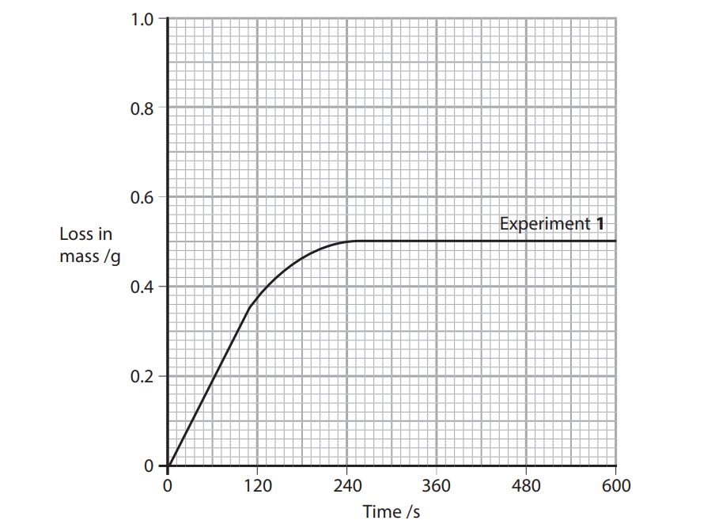
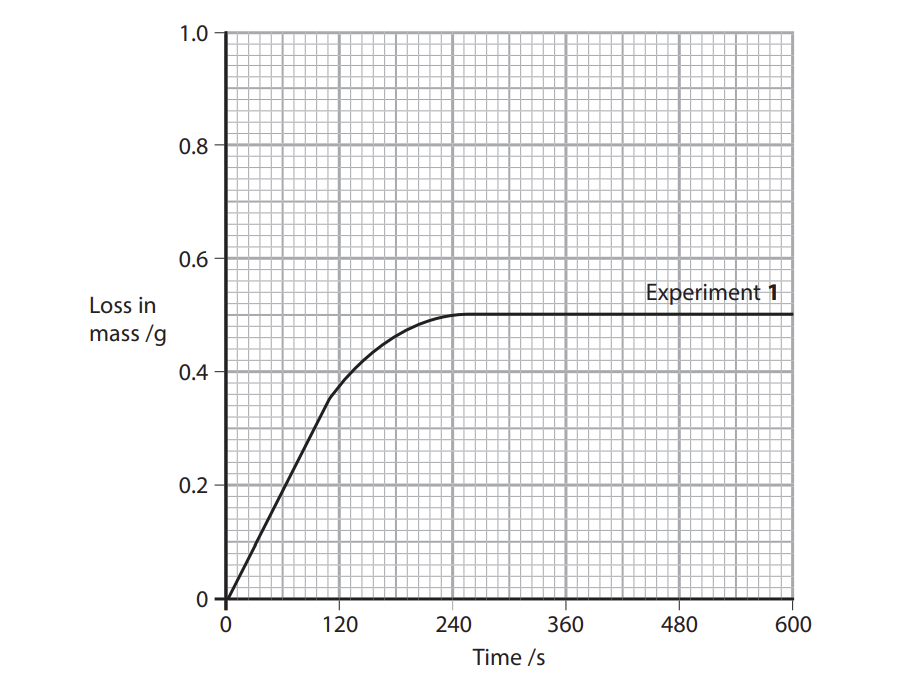
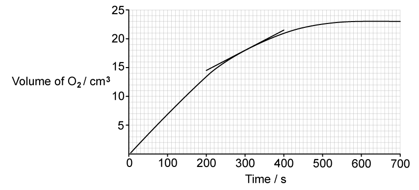

# Exam Questions — Rate of Reaction
**8. Reaction Kinetics** · Cambridge (CIE) A-LEVEL chemistry (9701)
> Source: [https://www.savemyexams.com/a-level/chemistry/cie/25/topic-questions/](https://www.savemyexams.com/a-level/chemistry/cie/25/topic-questions/) · 16 questions across 2 sets

## Multiple Choice Questions (10 questions)

### Q1 — medium — 1 marks

**Q1** [1 mark]

Two experiments are carried out to measure the rate of reaction between solid calcium carbonate and dilute hydrochloric acid.

**Experiment 1:** 1.5 g of CaCO3 (s) is added to 100 cm3 of 0.50 mol dm-3 HCl (aq).

**Experiment 2:** 1.5 g of CaCO3 (s) is added to a mixture of 100 cm3 of 0.50 mol dm-3 HCl (aq) and 100 cm3 of distilled water.

The initial rate of Experiment 1 is higher than the initial rate of Experiment 2.

Which row explains the difference in the initial rate when water is added?

|   | frequency of collisions between reacting particles | proportion of effective collisions | activation energy |
|---|---|---|---|
| **A** | decreases | decreases | remains constant |
| **B** | decreases | remains constant | remains constant |
| **C** | decreases | remains constant | increases |
| **D** | remains constant | decreases | increases |

### Q2 — easy — 1 marks

**Q2** [1 mark]

The pressure of a fixed mass of gaseous reactants is increased at constant temperature.

Which of the following is the reason for the resulting increase in the rate of reaction?

### Q3 — hard — 1 marks

**Q3** [1 mark]

Curve 1 shows the volume of oxygen produced over time during the decomposition of 100 cm3 of 1.0 mol dm-3 hydrogen peroxide in the presence of a manganese(IV) oxide catalyst.

Which change to the experiment produces curve 2?

### Q4 — hard — 1 marks

**Q4** [1 mark]

A quantity of solid *Y* was placed in a previously evacuated vessel, and the apparatus was then held at a series of different temperatures. At each temperature, the mass of *Y* in the vapour state was calculated from pressure measurements. The results are shown below.

What can be deduced from the diagram?

### Q5 — medium — 1 marks

**Q5** [1 mark]

The equation for a reaction is shown.

NaOH (aq) + HCl (aq) → NaCl (aq) + H2O (l)

Which species could be monitored over time to determine the rate of this reaction?

### Q6 — easy — 1 marks

**Q6** [1 mark]

Which of the following is the main reason for the increase in the rate of a reaction when the temperature increases?

### Q7 — easy — 1 marks

**Q7** [1 mark]

Hydrogen gas reacts with bromine gas.

Which row explains why the rate of reaction is higher at 500 K than at 400 K?

|   | collision frequency | proportion of effective collisions | activation energy |
|---|---|---|---|
| **A** | increases | increases | decreases |
| **B** | increases | increases | remains constant |
| **C** | increases | remains constant | decreases |
| **D** | remains constant | increases | remains constant |

### Q8 — medium — 1 marks

**Q8** [1 mark]

Two experiments are carried out to measure the rate of reaction between solid calcium carbonate and dilute hydrochloric acid.

**Experiment 1:** 1.5 g of CaCO3 (s) is added to 100 cm3 of 0.50 mol dm-3 HCl (aq).

**Experiment 2:** 1.5 g of CaCO3 (s) is added to a mixture of 100 cm3 of 0.50 mol dm-3 HCl (aq) and 100 cm3 of distilled water.

The initial rate of reaction in Experiment 1 is higher than the initial rate in Experiment 2.

Which statement explains this?

### Q9 — easy — 1 marks

**Q9** [1 mark]

The rate of a reaction roughly doubles when the temperature is increased from 40 °C to 50 °C.

Which statement explains this?

### Q10 — hard — 1 marks

**Q10** [1 mark]

When 1 cm3 of 0.1 mol dm-3 HCl (aq) is added to 10 cm3 of 0.02 mol dm-3 Na2S2O3 (aq), a pale yellow precipitate forms slowly.

When the experiment is repeated using 10 cm3 of 0.05 mol dm-3 Na2S2O3 (aq), the precipitate forms more quickly.

Which statement explains this observation?

## Structured Questions (6 questions)

### Q1 — medium — 15 marks

**Q1** [2 marks]

A student is asked to investigate how the rate of reaction between sodium thiosulfate and hydrochloric acid depends on the concentration of sodium thiosulfate.

The reaction produces a precipitate of sulfur.

Na2S2O3 (aq) + 2HCl (aq) → 2NaCl (aq) + SO2 (g) + S (s) + H2O (l)

The student is provided with:

- 0.10 mol dm-3 sodium thiosulfate solution
- 1.0 mol dm-3 hydrochloric acid
- distilled water
- standard laboratory apparatus

The reaction mixture must be maintained at 30.0 °C throughout the investigation.

i) Predict the relationship between the rate of reaction and the concentration of sodium thiosulfate.

[1]

ii) Identify the independent variable and the dependent variable in this investigation.

[1]

**Q1** [7 marks]

**Extract:**

A student is asked to investigate how the rate of reaction between sodium thiosulfate and hydrochloric acid depends on the concentration of sodium thiosulfate.

The reaction produces a precipitate of sulfur.

Na~2~S~2~O~3~ (aq) + 2HCl (aq) → 2NaCl (aq) + SO~2~ (g) + S (s) + H~2~O (l)

The student is provided with:

- 0.10 mol dm^-3^ sodium thiosulfate solution
- 1.0 mol dm^-3^ hydrochloric acid
- distilled water
- standard laboratory apparatus

The reaction mixture must be maintained at 30.0 °C throughout the investigation.

Describe a method the student could use to investigate this relationship.

Your method should include:

- how to prepare at least five solutions of sodium thiosulfate with different concentrations
- how the reaction is carried out
- how the rate of reaction is determined
- how reliability of results is ensured
- appropriate safety precautions

**Q1** [4 marks]

**Extract:**

i) Predict the relationship between the rate of reaction and the concentration of sodium thiosulfate.

The student processes the results and plots a graph.

i) State the quantities that should be plotted on the x-axis and y-axis.

[1]

ii) Sketch the line you would expect if the rate is directly proportional to the concentration of sodium thiosulfate.

Label both axes.

[2]

iii) Explain how the graph supports the prediction made in (a)(i).

[1]

**Q1** [2 marks]

**Extract:**

A student is asked to investigate how the rate of reaction between sodium thiosulfate and hydrochloric acid depends on the concentration of sodium thiosulfate.

The reaction produces a precipitate of sulfur.

Na~2~S~2~O~3~ (aq) + 2HCl (aq) → 2NaCl (aq) + SO~2~ (g) + S (s) + H~2~O (l)

Disappearing cross method described (flask over cross, timing until cross is obscured)

A second student performs the same investigation but measures the volume of sulfur dioxide gas produced over time instead of using the precipitation method.

State one advantage and one disadvantage of this alternative method compared with the disappearing cross method.

### Q2 — medium — 8 marks

**Q2** [2 marks]

A series of experiments was carried out to investigate the factors which affect the rate of reaction between calcium carbonate and dilute hydrochloric acid.

CaCO3 (s) + 2HCl (aq) → CaCl2 (aq) + H2O (l) + CO2 (g)

- 50.0 cm3 of hydrochloric acid was added to 10 g of small pieces of calcium carbonate (an excess) in a conical flask placed on an electronic balance.
- The loss in mass of the flask and its contents was recorded every 30 seconds for 10 minutes.
- The experiment was repeated using a different concentration of hydrochloric acid or a different temperature.
- The results are shown in Table 3.1

**Table 3.1**

| **Experiment** | **Concentration of hydrochloric acid / mol d****-3** | **Temperature / °C** |
|---|---|---|
| **1** | 0.50 | 20 |
| **2** | 0.50 | 60 |
| **3** | 1.00 | 20 |

The results of Experiment **1** are shown in Fig. 3.1.

**Fig. 3.1**

Draw curves on the graph in Fig 3.1 to show the results you would expect for Experiments **2** and **3**.

Label the curves **2** and **3**.

*Source: Oct 2021 9CHO/03 Q4A*

**Q2** [3 marks]

**Extract:**

A series of experiments was carried out to investigate the factors which affect the rate of reaction between calcium carbonate and dilute hydrochloric acid.

CaCO~3~ (s) + 2HCl (aq) → CaCl~2~ (aq) + H~2~O (l) + CO~2~ (g)

- 50.0 cm^3^ of hydrochloric acid was added to 10 g of small pieces of calcium carbonate (an excess) in a conical flask placed on an electronic balance.
- The loss in mass of the flask and its contents was recorded every 30 seconds for 10 minutes.
- The experiment was repeated using a different concentration of hydrochloric acid or a different temperature.
- The results are shown in Table 3.1

**Table 3.1**

| **Experiment** | **Concentration of hydrochloric acid / mol d**^**-3**^ | **Temperature / °C** |
| :---: | :---: | :---: |
| **1** | 0.50 | 20 |
| **2** | 0.50 | 60 |
| **3** | 1.00 | 20 |

Determine the initial rate of reaction for Experiment **1**.

You must show your working on the graph in Fig 3.2. Include units in your answer.

**Fig 3.2**

*Source: Oct 2021 9CHO/03 Q4B*

**Q2** [1 mark]

**Extract:**

A series of experiments was carried out to investigate the factors which affect the rate of reaction between calcium carbonate and dilute hydrochloric acid.

CaCO~3~ (s) + 2HCl (aq) → CaCl~2~ (aq) + H~2~O (l) + CO~2~ (g)

- 50.0 cm^3^ of hydrochloric acid was added to 10 g of small pieces of calcium carbonate (an excess) in a conical flask placed on an electronic balance.
- The loss in mass of the flask and its contents was recorded every 30 seconds for 10 minutes.
- The experiment was repeated using a different concentration of hydrochloric acid or a different temperature.
- The results are shown in Table 3.1

**Table 3.1**

| **Experiment** | **Concentration of hydrochloric acid / mol d**^**-3**^ | **Temperature / °C** |
| :---: | :---: | :---: |
| **1** | 0.50 | 20 |
| **2** | 0.50 | 60 |
| **3** | 1.00 | 20 |

The results of Experiment **1** are shown in Fig. 3.1.

Calculate the average rate of reaction over the first 240 seconds of Experiment 1.

**Q2** [2 marks]

**Extract:**

A series of experiments was carried out to investigate the factors which affect the rate of reaction between calcium carbonate and dilute hydrochloric acid.

CaCO~3~ (s) + 2HCl (aq) → CaCl~2~ (aq) + H~2~O (l) + CO~2~ (g)

- 50.0 cm^3^ of hydrochloric acid was added to 10 g of small pieces of calcium carbonate (an excess) in a conical flask placed on an electronic balance.
- The loss in mass of the flask and its contents was recorded every 30 seconds for 10 minutes.
- The experiment was repeated using a different concentration of hydrochloric acid or a different temperature.

The student repeated each experiment but used 10.0 g of larger sized pieces of calcium carbonate.

Suggest what effect this would have on the rate of reaction. Give your reasoning.

### Q3 — hard — 12 marks

**Q3** [5 marks]

0.5 g of magnesium reacts with 50 cm3 of 0.1 mol dm-3 nitric acid. Magnesium is in excess.

A graph monitoring the volume of hydrogen gas produced is shown below:

i) Calculate the average rate of reaction over the first 15 seconds of the reaction.

[1]

ii) Calculate the actual rate of reaction at 15 seconds.

[3]

iii) Explain the difference in values for rate.

[1]

**Q3** [3 marks]

**Extract:**

0.5 g of magnesium reacts with 50 cm^3^ of 0.1 mol dm^-3^ nitric acid. Magnesium is in excess.

A graph monitoring the volume of hydrogen gas produced is shown below:

Compare the expected rate and progress of the reaction if 25 cm3 of 0.2 mol dm-3 nitric acid was used instead of 50 cm3 of 0.1 mol dm-3 nitric acid.

**Q3** [2 marks]

**Extract:**

0.5 g of magnesium reacts with 50 cm^3^ of 0.1 mol dm^-3^ nitric acid. Magnesium is in excess.

Suggest one change to the reaction that could be made to produce more hydrogen gas in total and explain your choice.

**Q3** [2 marks]

Suggest why it is often better to study a slower reaction instead of a faster one.

### Q4 — easy — 8 marks

**Q4** [2 marks]

This question is about effective reactions and reaction rates.

According to collision theory, state **two **conditions that particles need for an effective collision to occur.

**Q4** [1 mark]

An increase in concentration means that there are more particles per unit volume.

In terms of collisions, explain how this increases the rate of reaction.

**Q4** [2 marks]

Aqueous hydrogen peroxide, H2O2, decomposes to form oxygen and water.

2H2O2 (aq) → 2H2O (l) + O2 (g)

A student investigates the decomposition of a hydrogen peroxide solution as outlined below.

- The student adds 25.00 cm3 of H2O2 (aq) to a conical flask.
- The student adds a small spatula measure of manganese dioxide, MnO2.
- They quickly connect the flask to a gas syringe.
- The student measures the volume of oxygen every 100 seconds.

i) State the role of the manganese dioxide in this reaction.

[1]

The student obtained the following results.

| **Time / s** | 0 | 100 | 200 | 300 | 400 | 500 | 600 | 700 |
|---|---|---|---|---|---|---|---|---|
| **Volume of O**~**2**~** / cm**^**3**^ | 0.0 | 7.0 | 13.5 | 18.0 | 21.0 | 22.5 | 23.0 | 23.0 |

ii) Calculate the average rate of reaction, in cm3 s-1, for the first 100 seconds of the reaction.

[1]

**Q4** [3 marks]

The student plotted a graph of volume of O2 against time.

Use the student's graph and tangent to find the rate of the reaction, in cm3 s–1, at t = 300 s.

Show your working.

### Q5 — medium — 12 marks

**Q5** [3 marks]

This question is about how different factors affect the rate of a chemical reaction.

A reaction between reactant molecules can only occur when collisions between the reactant molecules are effective.

i) Explain what is meant by the term effective collision.

[1]

ii) State **two** factors that could cause an ineffective collision.

[2]

**Q5** [5 marks]

A student made the following statement about factors that affect the rate of a chemical reaction.

'The rate of a reaction increases with temperature as there are more collisions'

Discuss why this statement is only true to an extent and what other factors need to be considered to fully explain how the rate of a reaction is affected by temperature.

**Q5** [2 marks]

Hydrogen and oxygen can react to form water in an exothermic reaction.

2H2 (g) + O2 (g) → 2H2O (g)

The rate of this reaction depends on the pressure as well as the temperature.

Describe and explain the effect of increasing the pressure on this reaction.

**Q5** [2 marks]

**Extract:**

Hydrogen and oxygen can react to form water in an exothermic reaction.

2H₂(g) + O₂(g) → 2H₂O(g)

If the rate of reaction increases suddenly, an explosion can occur.

A highly exothermic reaction, such as the reaction in **(c)**, is at more risk of exploding than a less exothermic reaction.

Suggest why.

### Q6 — medium — 9 marks

**Q6** [2 marks]

A platinum-rhodium catalyst is used in the reaction forming nitrogen(II) oxide from ammonia.

4NH3 (g) + 5O2 (g) ⇌ 4NO (g) + 6H2O (g)

i) State what is meant by the term **heterogeneous catalyst**.

[1]

ii) Explain why a catalyst has no effect on the yield of the products in the reaction.

[1]

**Q6** [3 marks]

A group of students were completing a practical, investigating the factors which affect the rate of the following chemical reaction.

**A (s) + B (aq) → C (g)**

The students collected the gas produced and plotted the graph shown in Fig. 1.1.

**Fig. 1.1**

i) State and explain what the letter **R** represents on the student's graph.

[1]

ii) In the original reaction above, the students used 0.5 g of **A** and 50 cm3 of 1.0 mol dm-3 of **B**. Sketch a curve on the graph in Fig 1.1 to show how the total volume of gas collected would change if the students still used 0.5 g of **A**, but used 50 cm3 of 2.0 mol dm-3 of **B**.

[2]

**Q6** [2 marks]

**Extract:**

A group of students were completing a practical, investigating the factors which affect the rate of the following chemical reaction.

A (s) + B (aq) → C (g)

The students collected the gas produced and plotted the graph shown in Fig. 1.1.

Fig. 1.1

i) State and explain what the letter R represents on the student's graph.

Explain why the gradient of the curve in part **(b) **decreases as the time of the reaction progresses.

**Q6** [2 marks]

Another way to increase the rate of reaction is to increase the temperature.

Explain why a small increase in temperature has a large effect on the initial rate of a chemical reaction.
