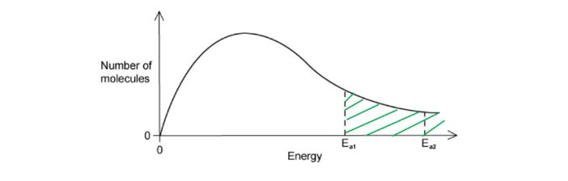
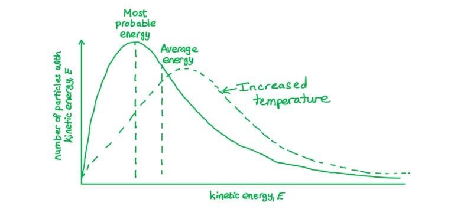
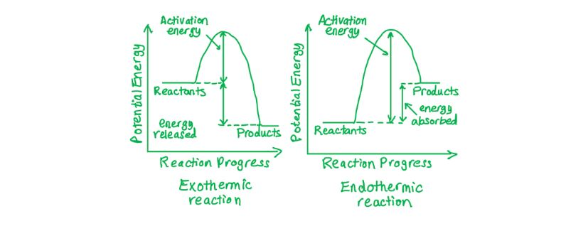
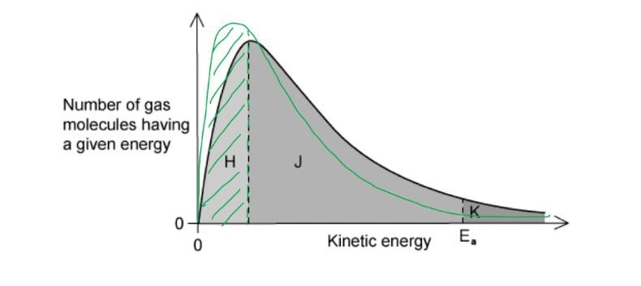
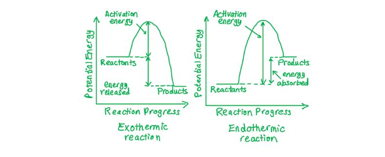
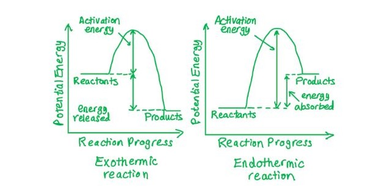
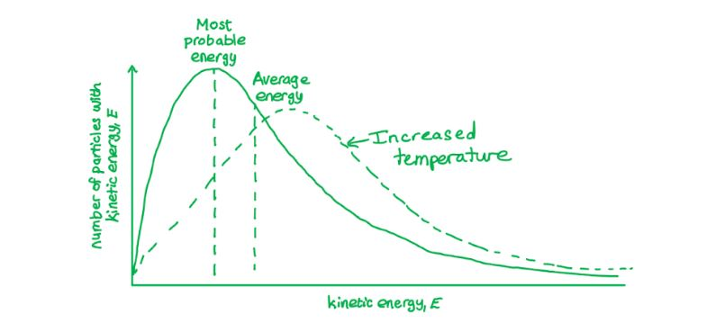
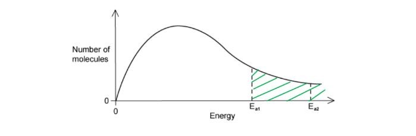
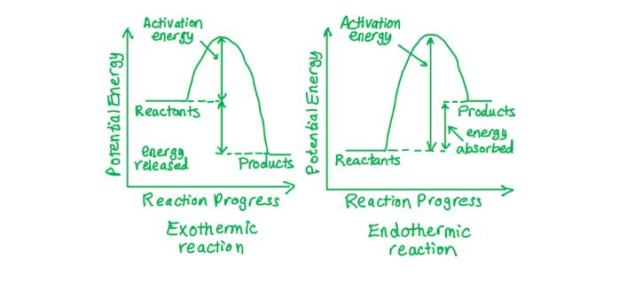

# Mark Schemes — Effect of Temperature on Reaction Rates & the Concept of Activation Energy
**8. Reaction Kinetics** · Cambridge (CIE) A-LEVEL chemistry (9701)

## Multiple Choice Questions (14 questions)

### Q1
**Final answer:** **The correct answer is C**

- When the temperature increases, molecules have a greater range of kinetic energies and the distribution broadens.

  - The peak shifts to the right (higher most probable energy) and becomes lower to maintain a constant total area.

- The total area under the curve remains constant because it represents the total number of molecules in the same sample, which does not change with temperature.

- The activation energy is a fixed property of the reaction and does not change with temperature.

  - The *E*a line stays in the same position on the graph.

**A** is incorrect as the total area under the curve does not increase when temperature increases. The same sample contains the same number of molecules, so the area remains constant. The peak does shift to the right, but the area claim is wrong.

**B** is incorrect as the activation energy is a property of the reaction, not the temperature. Increasing temperature does not change the value of *E*a or the position of its vertical line on the graph.

**D** is incorrect on both counts as the activation energy does not change with temperature, and the total area under the curve remains constant because the number of molecules in the sample is unchanged.

### Q2
**Final answer:** **The correct answer is A**

- A catalyst lowers the activation energy by providing an alternative reaction pathway.

  - On the Boltzmann distribution, the *E*a line moves to the left (lower energy).

- A catalyst does not change the number of molecules or their energy distribution.

  - The shape and peak height of the Boltzmann curve remain unchanged; only the position of the *E*a line changes.

**B** is incorrect as a catalyst does not affect the kinetic energy distribution of the molecules. The peak height at Q remains the same as only the position of *E*a changes.

**C** is incorrect as a catalyst lowers the activation energy, so the *E*a line moves to the left, not to the right. Moving *E*a to the right would mean fewer particles have sufficient energy, reducing the reaction rate.

**D** is incorrect on both counts as a catalyst does not lower the peak height, and *E*a moves to the left (lower energy), not to the right.

### Q3
**Final answer:** **The correct answer is B**

- A catalyst lowers the activation energy by providing an alternative reaction pathway.

  - In diagram 1, P is the lower activation energy line and therefore corresponds to the catalysed reaction; Q is the higher activation energy for the uncatalysed reaction.

- At higher temperatures, the Boltzmann distribution broadens and shifts to the right with a lower peak height, while the total area remains constant (same number of molecules).

  - In diagram 2, curve Y shows this profile.

**A** is incorrect as it pairs P (catalysed, correct) with X. Curve X does not show the broader, lower-peak profile expected at a higher temperature.

**C** is incorrect as it assigns Q to the catalysed reaction. A catalyst lowers activation energy, so the catalysed Ea corresponds to P (the left-hand, lower-energy line), not Q.

**D** is incorrect as it assigns Q to the catalysed reaction. Although Y correctly identifies the higher temperature curve, Q is the uncatalysed activation energy, not the catalysed one.

### Q4
**Final answer:** **The correct answer is D**

- When the temperature increases, molecules have greater average energy, so the distribution shifts to the right and becomes broader.

  - The peak moves to a higher energy value.

- Since the total area under the curve must remain constant (same mass of gas, same number of molecules), the peak height decreases as the curve broadens.

**A** is incorrect as the 500 K curve should shift to the right, not to the left. Higher temperature means higher average energy, moving the distribution towards higher values.

**B** is incorrect as a temperature increase causes the peak height to decrease, not increase. The distribution broadens, so the total area is maintained by a lower, wider peak.

**C** is incorrect as although the peak shifts to the right, a higher peak height violates the constant-area rule. As the distribution broadens at higher temperature, the peak must become lower.

### Q5
**Final answer:** **The correct answer is A**

- At the same temperature, all gases have the same average kinetic energy, given by KE = ½mv2.

- Since the average kinetic energy of **X** and **Y** is equal, there is an inverse relationship between molar mass and average molecular speed

  - Molecules with greater molar mass move more slowly on average.

- Gas **X** has a lower average molecular speed than gas **Y**, so **X** must have the larger molar mass.

**B** is incorrect as gas **X** has the lower average speed, not **Y**. Lower average speed at the same temperature indicates larger molar mass, so **X** (not **Y**) has the larger molar mass.

**C** is incorrect as the average kinetic energy of all gases at the same temperature is equal. Temperature determines average kinetic energy; it does not differ between **X** and **Y**.

**D** is incorrect for the same reason as **C**, that at the same temperature, the average kinetic energy of **X** and **Y** is identical, regardless of their different molar masses.

### Q6
**Final answer:** **The correct answer is D**

- The activation energy is the minimum energy required for a collision to be effective.

  - On an energy profile diagram, it is the energy difference between the reactants and the transition state.

- With E2 as the reactant energy level and E3 as the transition state energy, the activation energy for the forward reaction = E3 − E2.

**A** is incorrect as E1 − E2 does not span from the reactant energy level to the transition state and does not represent the activation energy for the forward reaction.

**B** is incorrect as E2 − E1 represents the enthalpy change Δ*H* of the forward reaction, not the activation energy.

**C** is incorrect as E2 − E3 gives a negative value because the transition state E3 is at higher energy than the reactants E2. Activation energy is always a positive quantity.

### Q7
**Final answer:** **The correct answer is C**

- When the temperature decreases, the Boltzmann distribution shifts to the left and the peak rises.

  - The total area under the curve remains constant as the number of molecules is unchanged.

- A greater proportion of molecules have lower energies (area H increases), while fewer molecules have intermediate and high energies (areas J and K decrease).

**A** is incorrect as it shows H decreasing and K increasing. A temperature decrease shifts the distribution to the left, so the low-energy region H grows and the high-energy region K shrinks.

**B** is incorrect as it shows H decreasing and J increasing. When temperature decreases, more molecules occupy lower energies (H increases) and fewer occupy intermediate energies (J decreases), so both assignments in B are reversed.

**D** is incorrect as it shows K increasing. The high-energy tail always decreases when temperature decreases because fewer molecules have sufficient energy to occupy region K.

### Q8
**Final answer:** **The correct answer is D**

- The forward reaction is exothermic (negative Δ*H*), so the reverse reaction is endothermic with a positive Δ*H*.
- For the reverse reaction, the starting energy is that of the products of the forward reaction, which lie lower than the reactants.
- The activation energy must span from this lower level up to the transition state, making it larger than the forward activation energy.

**A** is incorrect as the reverse of an exothermic reaction must be endothermic, giving a positive Δ*H*, not negative.

**B** is incorrect as the activation energy for the reverse reaction is larger than for the forward reaction, not smaller. The products of the exothermic forward reaction lie at lower energy, so more energy is needed to reach the transition state from the products.

**C** is incorrect as the Δ*H* for the reverse reaction is positive (endothermic), not negative.

### Q9
**Final answer:** **The correct answer is B**

- The activation energy is the minimum energy required for an effective collision between reactant molecules.

  - It is represented by the energy difference between the reactants and the transition state.

- In an endothermic reaction, the products are at higher energy than the reactants, and the transition state is at the highest point on the energy profile.

**A** is incorrect as this does not span from the reactant energy level to the transition state and therefore does not represent the activation energy for the forward reaction.

**C** is incorrect as this represents the activation energy for the reverse reaction. For an endothermic reaction, this is smaller than the forward activation energy.

**D** is incorrect as this represents the enthalpy change of the forward reaction, which is not the same as the activation energy.

### Q10
**Final answer:** **The correct answer is A**

- When the temperature increases, the Boltzmann distribution broadens.

  - The peak shifts to the right (higher energy) and its height decreases.

- Since the distribution is broader, fewer molecules possess the most probable energy value, even though the peak has moved to a higher energy.

**B** is incorrect as X shifts to the right when temperature increases, not to the left. A higher temperature shifts the distribution towards higher energies.

**C** is incorrect as the broadening of the distribution causes the peak height to decrease, meaning fewer molecules (not more) possess the most probable energy value. X does shift to the right, but the peak becomes lower.

**D** is incorrect as although X does shift to the right, the number of molecules at the most probable energy decreases, not increases. The distribution broadens so the peak height falls even as it shifts right.

### Q11
**Final answer:** **The correct answer is B**

- A catalyst lowers the activation energy by providing an alternative reaction pathway.

  - The catalysed *E*a is therefore at a lower energy value than the original uncatalysed *E*a
  - So, the line shifts to the left on the energy axis.

- With the *E*a line at position B (lower energy), a greater proportion of molecules have energy ≥ *E*a, increasing the rate of reaction.

**A** is incorrect as this is further to the right than position B, corresponding to a higher activation energy. A catalyst lowers the activation energy; the new *E*a must be to the left of the uncatalysed value.

**C** is incorrect as this is to the right of the original uncatalysed *E*a, which would mean the activation energy has increased. A catalyst always lowers activation energy by providing an alternative pathway.

**D** is incorrect as this is further to the right, corresponding to an even higher activation energy. A catalyst reduces *E*a, shifting the line to the left, not to the right.

### Q12
**Final answer:** **The correct answer is D**

- A catalyst lowers the activation energy by providing an alternative reaction pathway.

  - *E*a1 (the lower value) is therefore the activation energy for the catalysed reaction.
  - *E*a2 (the higher value) is for the uncatalysed reaction.

- The area under the Maxwell-Boltzmann curve to the right of a given *E*a represents the proportion of particles with energy ≥ *E*a.

- As *E*a1 < *E*a2, a greater proportion of particles have energy ≥ *E*a1, so the catalysed reaction has more effective collisions.

  - Fewer particles have energy ≥ *E*a2, so the uncatalysed reaction has fewer effective collisions.

**A** is incorrect as it assigns *E*a1 to the uncatalysed reaction. A catalyst lowers activation energy, so *E*a1 (the lower value) must correspond to the catalysed reaction.

**B** is incorrect as it states the catalysed reaction leads to fewer effective collisions. A lower *E*a increases the proportion of particles with sufficient energy, so effective collisions increase.

**C** is incorrect as it assigns the wrong collision frequency to each pathway — the uncatalysed reaction (higher *E*a2) has fewer effective collisions, not more.

### Q13
**Final answer:** **The correct answer is B**

- The reaction that proceeds most rapidly has the lowest activation energy.

- The reaction with the highest equilibrium yield is exothermic.

  - The forward reaction is thermodynamically favoured, with products at lower energy than reactants.

- **B** shows an exothermic reaction with the lowest activation energy of all four options, satisfying both criteria.

**A** is incorrect as although it shows an exothermic reaction (thermodynamically favoured for high yield), the activation energy is higher than in **B**, so the reaction would proceed more slowly than **B**.

**C** and **D** are incorrect as both show endothermic reactions. Endothermic reactions have products at higher energy than reactants, making the reverse reaction thermodynamically favoured and reducing the equilibrium yield of products.

### Q14
**Final answer:** **The correct answer is A**

- The activation energy, *E*a, is the minimum energy required for a collision to be effective.

  - It is a fixed property of a specific reaction pathway.

- A catalyst lowers the activation energy by providing an alternative reaction pathway.

**B** is incorrect as a change in concentration alters the frequency of collisions between reactants but does not change the value of the activation energy.

**C** is incorrect as a change in pressure alters the proximity of gaseous reactant molecules, affecting collision frequency, but does not change the activation energy.

**D** is incorrect as a change in temperature alters the proportion of particles with energy ≥ *E*a (by shifting the Boltzmann distribution), but the activation energy value itself remains unchanged.
