# Exam Questions — Effect of Temperature on Reaction Rates & the Concept of Activation Energy
**8. Reaction Kinetics** · Cambridge (CIE) A-LEVEL chemistry (9701)
> Source: [https://www.savemyexams.com/a-level/chemistry/cie/25/topic-questions/](https://www.savemyexams.com/a-level/chemistry/cie/25/topic-questions/) · 20 questions across 2 sets

## Multiple Choice Questions (14 questions)

### Q1 — medium — 1 marks

**Q1** [1 mark]

A graph shows the Boltzmann distribution of molecular energies at temperature *T*1 for a sample of gas. A vertical line represents the activation energy, *E*a. A second curve is added for the same sample at a higher temperature, *T*2.

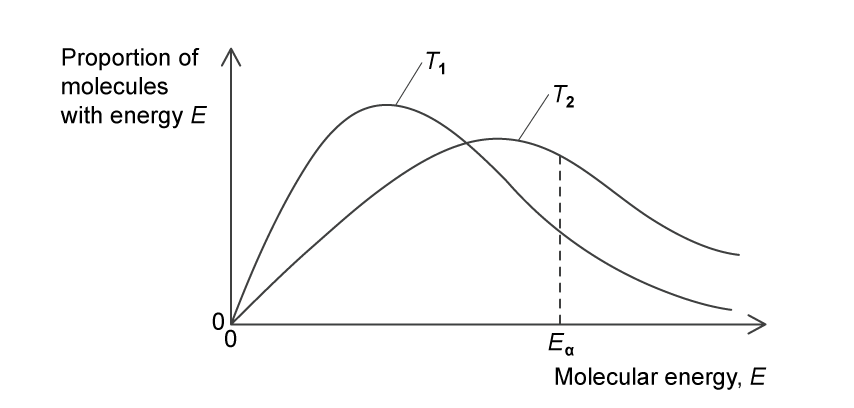

Which statement describes the *T*2 curve compared to *T*1?

### Q2 — medium — 1 marks

**Q2** [1 mark]

The diagram shows a Boltzmann distribution of molecular energies for a gaseous mixture. The distribution has a peak, labelled Q on the diagram.

Which row gives the changes when a catalyst is added to the mixture?

|   | Height of peak at Q | Position of *E*a |
|---|---|---|
| **A** | remains the same | moves to the left |
| **B** | decreases | moves to the left |
| **C** | remains the same | moves to the right |
| **D** | decreases | moves to the right |

### Q3 — hard — 1 marks

**Q3** [1 mark]

The following diagrams show Boltzmann distributions.

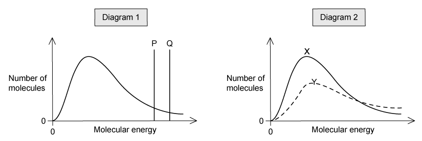

In diagram 1, one line, P or Q, corresponds to the activation energy in the presence of a catalyst and the other line corresponds to the activation energy of the same reaction in the absence of a catalyst.

In diagram 2, one curve, X or Y, corresponds to a higher temperature of the same sample of gas.

Which row identifies the presence of a catalyst and the higher temperature?

|   | Presence of catalyst | Higher temperature |
|---|---|---|
| **A** | P | X |
| **B** | P | Y |
| **C** | Q | X |
| **D** | Q | Y |

### Q4 — medium — 1 marks

**Q4** [1 mark]

The dotted-line curve on each graph below represents the corresponding distribution for a gas at 300 K.

Which solid-line curve represents the distribution of molecular energies in the same mass of gas at 500 K?

### Q5 — hard — 1 marks

**Q5** [1 mark]

1 dm3 of gas **X** and 1 dm3 of gas **Y** are kept at the same temperature and pressure.

The speed of the molecules is plotted against the fraction of molecules with that speed.

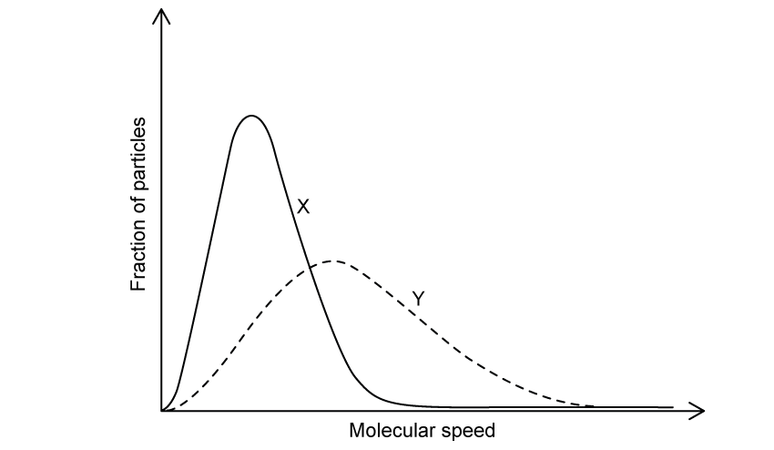

Which statement is correct?

### Q6 — medium — 1 marks

**Q6** [1 mark]

The energies of the reactants, the products and the transition state of a reaction are shown in the reaction pathway diagram.

Which expression represents the activation energy of the forward reaction?

### Q7 — hard — 1 marks

**Q7** [1 mark]

The diagram shows a Boltzmann distribution of molecular energies with three regions, H, J and K, labelled.

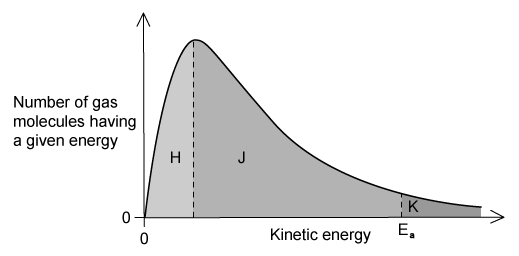

The temperature is decreased. Which row describes what happens to the size of the areas labelled H, J and K?

|   | **H** | **J** | **K** |
|---|---|---|---|
| **A** | Decreases | Decreases | Increases |
| **B** | Decreases | Increases | Decreases |
| **C** | Increases | Decreases | Decreases |
| **D** | Increases | Decreases | Increases |

### Q8 — easy — 1 marks

**Q8** [1 mark]

The diagram represents the reaction pathway for the following reaction:

Z (g) + Y (g) → X (g) + W (g)

Which row gives the properties of the reverse reaction, W (g) + X (g) → Y (g) + Z (g)?

|   | Activation energy | ΔH |
|---|---|---|
| **A** | smaller | negative |
| **B** | smaller | positive |
| **C** | larger | negative |
| **D** | larger | positive |

### Q9 — medium — 1 marks

**Q9** [1 mark]

The diagram shows a reaction pathway for an endothermic reaction.

Which arrow represents the activation energy for the forward reaction?

### Q10 — medium — 1 marks

**Q10** [1 mark]

The distribution of molecular energies in a sample of a gas at a given temperature is shown by the Boltzmann distribution graph.

The temperature is increased. Which statement describes the new position of X?

### Q11 — medium — 1 marks

**Q11** [1 mark]

The diagram represents, for a given temperature, the Boltzmann distribution of the kinetic energy of the molecules in a mixture of two gases that react slowly together without a catalyst.

The activation energy for the reaction, *E*a, is marked for the uncatalysed reaction.

Which position represents the activation energy for the catalysed reaction?

### Q12 — easy — 1 marks

**Q12** [1 mark]

The Maxwell-Boltzmann energy distribution curve below describes a mixture of two gases at a given temperature.

Of the two activation energy (*E*a) values shown, one is for a catalysed reaction, the other for an uncatalysed one.

Which row gives the catalysed and uncatalysed reactions and their relative numbers of effective collisions?

|   | *E*a1 | *E*a2 |   |   |
|---|---|---|---|---|
|   | reaction | effective collisions | reaction | effective collisions |
| **A** | uncatalysed | fewer | catalysed | more |
| **B** | catalysed | fewer | uncatalysed | more |
| **C** | uncatalysed | more | catalysed | fewer |
| **D** | catalysed | more | uncatalysed | fewer |

### Q13 — medium — 1 marks

**Q13** [1 mark]

Four gas-phase reactions with the same general equation are measured at the same temperature:

*X* (g) + *Y* (g) ⇌ *Z* (g)

Which reaction pathway diagram shows the reaction that would proceed most rapidly and with the highest equilibrium yield?

### Q14 — easy — 1 marks

**Q14** [1 mark]

Which factor affects the activation energy of a reaction?

## Structured Questions (6 questions)

### Q1 — medium — 11 marks

**Q1** [3 marks]

In any chemical reaction, the particles will all be moving in different directions, at different speeds and with different amounts of energy. Boltzmann distributions show the distribution of energy amongst particles in a chemical reaction.

Fig. 3.1 below shows the Boltzmann distribution in a sample of a gas at a fixed temperature, *T*1.

**Fig. 3.1**

i) Label the x and y axes of the graph.

[1]

ii) Sketch a distribution for a sample of the same gas at a higher temperature, *T*2.

[2]

**Q1** [2 marks]

**Extract:**

In any chemical reaction, the particles will all be moving in different directions, at different speeds and with different amounts of energy. Boltzmann distributions show the distribution of energy amongst particles in a chemical reaction.

State why a Boltzmann distribution curve always starts at the origin, and what the area under the curve represents.

**Q1** [6 marks]

**Extract:**

In any chemical reaction, the particles will all be moving in different directions, at different speeds and with different amounts of energy. Boltzmann distributions show the distribution of energy amongst particles in a chemical reaction.

Fig. 3.1 below shows the Boltzmann distribution in a sample of a gas at a fixed temperature, *T*~1~.

x (horizontal) axis: Energy / Molecular energy / Kinetic energy
y (vertical) axis: Number / proportion of molecules

A Boltzmann distribution curve always starts at the origin because there are no molecules with zero energy / all molecules have some energy.

The area under the curve represents the total number of molecules / particles in the sample.

Some changes were made individually to the reaction in part **(a)**.

Consider the Boltzmann distribution from Fig. 3.1. For each of the changes in parts (i), (ii) and (iii) below, state and explain the effect that the change would have on:

- The area under the curve
- The value at which the peak of the curve occurs (the most probable energy of the molecules)
- The proportion of molecules with energy greater than or equal to *E*a

i) The temperature of the original reaction is increased, but no other changes are made.

[2]

ii) The number of molecules in the original reaction mixture is increased, but no other changes are made.

[2]

iii) A catalyst is added to the original reaction mixture, but no other changes are made.

[2]

### Q2 — easy — 9 marks

**Q2** [2 marks]

A reversible reaction is shown.

A + B ⇌ C + D

The reaction pathway diagram for this reaction is shown in Fig. 1.1.

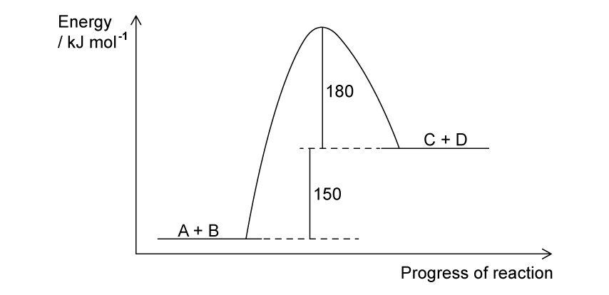

**Fig. 1.1**

Use Fig. 1.1 to deduce whether the forward reaction is exothermic or endothermic. Explain your answer.

**Q2** [2 marks]

Define the term activation energy, *E*a.

**Q2** [2 marks]

**Extract:**

A reversible reaction is shown.

A + B ⇌ C + D

The reaction pathway diagram for this reaction is shown in Fig. 1.1.

Fig. 1.1

Use Fig. 1.1 to determine the activation energy for the forward reaction and for the reverse reaction.

activation energy of the forward reaction = .............................. kJ mol-1

activation energy of the reverse reaction = .............................. kJ mol-1

**Q2** [3 marks]

Fig. 1.2 shows the reaction pathway diagram for the same reaction in the presence of a catalyst.

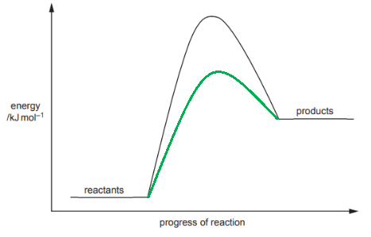

**Fig. 1.2**

Use Fig. 1.2 to explain how the addition of a catalyst increases the rate of reaction.

### Q3 — hard — 13 marks

**Q3** [4 marks]

A Boltzmann distribution curve is shown below in Fig 1.1

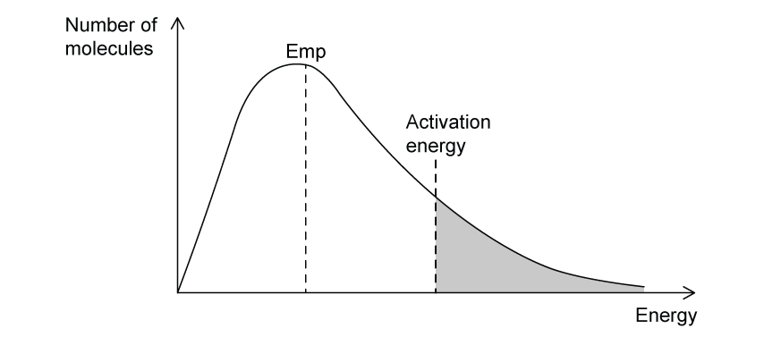

**Fig 1.1**

For the changes detailed in parts **(i)** and **(ii)**, state and explain the effect the change would have on:

- The area under the curve
- The value of the most probable energy of the molecules
- The proportion of molecules with energy greater than or equal to Ea

i) The temperature of the original reaction is increased, but no other changes are made.

[2]

ii) A catalyst is added to the original reaction mixture, but no other changes are made.

[2]

**Q3** [4 marks]

The Boltzmann distribution curves for a gas mixture at three different temperatures, 100 K, 300 K and 700 K, are shown in Fig 1.2.

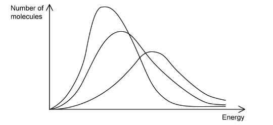

**Fig 1.2**

i) Label each curve in Fig 1.2 with the correct temperature values, 100 K, 300 K and 700 K.

[1]

ii) A student states that 'All reacting molecules have higher kinetic energy at 700 K than they do at 300 K'.

State whether you agree with the student. Use the Boltzmann distribution to explain your answer.

[3]

**Q3** [5 marks]

Hydrogen reacts with chlorine to form the hydrogen halide, hydrogen chloride, a colourless gas.

H2 (g) + Cl2 (g) → 2HCl (g)

i) Give **one** reason why most collisions between hydrogen and chlorine molecules do not lead to the formation of hydrogen chloride.

[1]

ii) Apart from changing the temperature, state and explain **two** ways of speeding up the formation of hydrogen chloride.

[4]

### Q4 — medium — 11 marks

**Q4** [3 marks]

Ammonia can be produced by the reaction of nitrogen and hydrogen in the presence of an iron catalyst.

N2 (g) + 3H2 (g) ⇌ 2NH3 (g)          Δ*H* = −92 kJ mol-1

The activation energy for the forward catalysed reaction, *E*a,cat, is +109 kJ mol-1.

Complete the reaction pathway diagram in Fig. 2.1 for the uncatalysed and the catalysed reaction between nitrogen and hydrogen.

You should label the following:

- products
- the enthalpy change of reaction, Δ*H*
- the activation energy of the forward uncatalysed reaction, *E*a
- the activation energy of the forward catalysed reaction, *E*a,cat

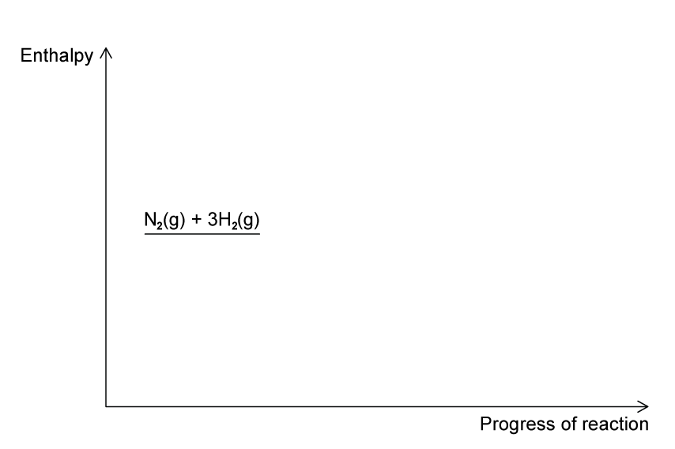

**Fig. 2.1**

**Q4** [2 marks]

**Extract:**

Ammonia can be produced by the reaction of nitrogen and hydrogen in the presence of an iron catalyst.

N~2~ (g) + 3H~2~ (g) ⇌ 2NH~3~ (g)          Δ*H* = −92 kJ mol^-1^

The activation energy for the forward catalysed reaction, *E*~a,cat~, is +109 kJ mol^-1^.

Calculate the activation energy of the catalysed decomposition of ammonia into nitrogen and hydrogen. Show your working.

activation energy = ......................................................... kJ mol-1

**Q4** [3 marks]

Catalysts, such as iron used in the production of ammonia, increase the rate of reaction.

Use the Boltzmann distribution to explain how an iron catalyst increases the rate of this reaction.

**Q4** [3 marks]

Platinum is used as a catalyst in catalytic converters, which are fitted to vehicle exhaust systems to remove nitrogen oxide from the exhaust gases.

2NO (g) + 2CO (g) → N2 (g) + 2CO2 (g)

i) State whether platinum acts as a homogeneous or heterogeneous catalyst in a catalytic converter.

[1]

ii) Deduce whether nitrogen is oxidised or reduced in this reaction. Explain your reasoning with reference to relevant oxidation numbers.

[2]

### Q5 — easy — 5 marks

**Q5** [2 marks]

This question is about Boltzmann distribution curves.

The Boltzmann distribution curve of molecular energies for a general reaction at a given temperature is shown in **Fig. 2.1**.

**Fig. 2.1**

State what will happen to the curve when the temperature of the reaction is decreased.

**Q5** [1 mark]

State how, if at all, the total area under a Boltzmann distribution curve changes with temperature.

**Q5** [1 mark]

**Extract:**

This question is about Boltzmann distribution curves.

The Boltzmann distribution curve of molecular energies for a general reaction at a given temperature is shown in **Fig. 2.1**.

{align=center} **Fig. 2.1**

State the effect of adding a catalyst on the activation energy, *E*a, of the reaction.

**Q5** [1 mark]

The Boltzmann distribution of energies for a gas is shown in Fig. 2.2.

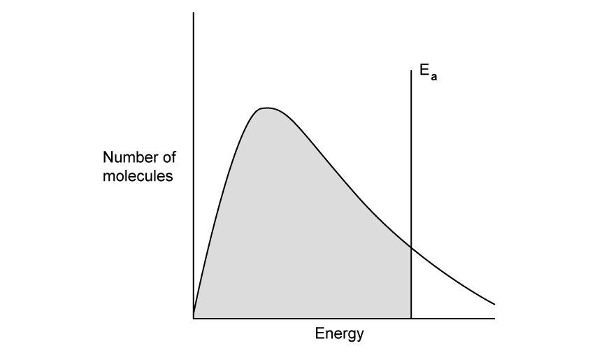

**Fig. 2.2**

State what the shaded area of Fig. 2.2 represents.

### Q6 — medium — 11 marks

**Q6** [3 marks]

Fig. 1.1 below shows, for a given temperature *T*, a Boltzmann distribution of the kinetic energy of the molecules of a mixture of two gases that will react together.

The activation energy for the reaction, *E*a, is marked.

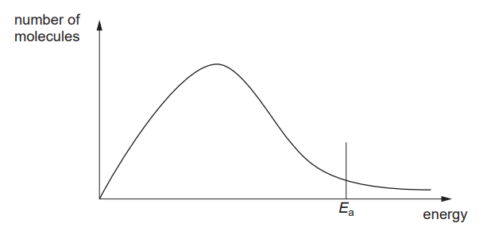

**Fig. 1.1**

On Fig. 1.1 above,

i) Sketch a new distribution curve, clearly labelled *T*2, for the same mixture of gases at a lower temperature, *T*2.

[2]

ii) State the effect of a decrease in temperature on the activation energy, *E*a.

[1]

**Q6** [2 marks]

Define the term *activation energy*, *E*a.

**Q6** [3 marks]

**Extract:**

Fig. 1.1 below shows, for a given temperature *T*, a Boltzmann distribution of the kinetic energy of the molecules of a mixture of two gases that will react together.

The activation energy for the reaction, *E*~a~, is marked.

i) On Fig. 1.1, draw and label the activation energy for the reaction in the presence of a catalyst, *E*a,cat.

[1]

ii) Use the Boltzmann distribution to explain how the addition of a catalyst results in reactions occurring at a faster rate.

[2]

**Q6** [3 marks]

Two reactions involving aqueous sodium hydroxide, NaOH (aq), are given below.

CH3CHBrCH3 + NaOH → CH3CH(OH)CH3 + NaBr     **Reaction 1**

H2SO4 + 2NaOH → Na2SO4 + 2H2O     **Reaction 2**

The reagents in Reaction 1 must be heated together for some time for the reaction to occur. Reaction 2 is almost instantaneous at room temperature.

Suggest why these reactions occur at different rates.
