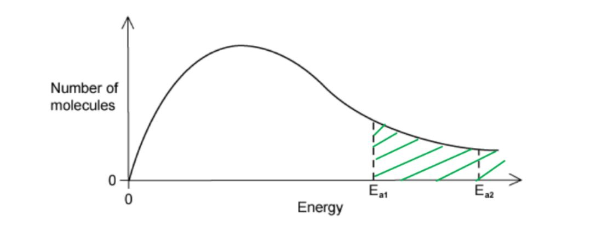

# Mark Schemes — Homogeneous & Heterogeneous Catalysts
**8. Reaction Kinetics** · Cambridge (CIE) A-LEVEL chemistry (9701)

## Multiple Choice Questions (9 questions)

### Q1
**Final answer:** **The correct answer is A because:**

- In experiment 2, the initial gradient is shallower than in experiment 1, indicating a slower initial rate.

  - A less effective catalyst raises the activation energy, reducing the proportion of molecules with energy greater than or equal to *E*a and therefore decreasing the rate.
- In experiment 2, the curve reaches a lower plateau, indicating a lower equilibrium yield of *T*.

  - A catalyst does not alter the equilibrium position; it only affects the rate at which equilibrium is reached.
  - The only way to lower the equilibrium yield of *T* at constant temperature and pressure is to begin with a decreased initial amount of reactant *R*.

**B** is incorrect as a less effective catalyst is consistent with the shallower gradient, but increasing the initial amount of reactant *R* would shift the equilibrium to produce more *T*, giving a higher plateau — not a lower one.

**C** is incorrect as a more effective catalyst would give a steeper initial gradient (faster rate), which contradicts the graph.

**D** is incorrect as both variables are wrong: a more effective catalyst gives a steeper initial gradient, and more reactant *R* gives a higher equilibrium yield.

### Q2
**Final answer:** **The correct answer is B**

- A catalyst does not increase the energy of the reacting molecules.
- The average kinetic energy of the molecules is determined exclusively by the temperature of the system, which is unchanged by the addition of a catalyst.

**A** is incorrect as a catalyst provides an alternative reaction pathway with a lower activation energy than the uncatalysed route. Statement A is therefore true.

**C** is incorrect as a catalyst works by providing an alternative reaction pathway. Statement C is therefore true.

**D** is incorrect as the Pd2+ (aq) ions are in the same physical state as the reaction mixture, making this an example of homogeneous catalysis. Since the catalyst participates directly in the reaction mechanism, increasing its concentration increases the frequency of productive interactions with the reactants, thereby increasing the rate. Statement D is therefore true.

### Q3
**Final answer:** **The correct answer is A**

- The Haber process uses finely divided iron as a catalyst.
- The reactants nitrogen and hydrogen are both gases, while the iron catalyst is a solid.
- Since the catalyst and reactants are in different physical states, this is an example of heterogeneous catalysis.

**C** is incorrect as iron is the correct catalyst identity, but the Haber process uses heterogeneous catalysis, not homogeneous. Homogeneous catalysis requires the catalyst to be in the same physical state as the reactants.

**B** and **D** are incorrect as vanadium(V) oxide is the catalyst for the Contact process (the industrial production of sulfuric acid), not the Haber process.

### Q4
**Final answer:** **The correct answer is D**

- A catalyst provides an alternative reaction pathway with a lower activation energy.
- This lowers the activation energy barrier for both the forward and reverse reactions equally, so the rate of both reactions increases.

**A** is incorrect as the average kinetic energy of the reacting particles is determined by the temperature of the system alone. A catalyst does not change the temperature and therefore has no effect on the average kinetic energy.

**B** is incorrect as a catalyst provides an alternative pathway with a lower activation energy but does not change the absolute energy levels of the reactants or products. The enthalpy change of the forward reaction is therefore unaffected.

**C** is incorrect as a catalyst is not consumed in the overall reaction. By definition, a catalyst is chemically unchanged at the end of the process, so its mass remains the same.

### Q5
**Final answer:** **The correct answer is C**

- A catalyst provides an alternative reaction pathway with a lower activation energy (*E*a).
- The height of peak Q is determined solely by the temperature and total number of molecules in the sample.

  - Adding a catalyst changes neither of these, so the height of peak Q remains the same.
- A lower *E*a corresponds to a position shifted to the left on the kinetic energy axis, as the activation energy has a smaller numerical value.

  - This is shown in the diagram below.

**A** is incorrect as the height of peak Q only decreases when the temperature is raised, which causes the distribution to flatten and broaden. A catalyst does not change the temperature.

**B** is incorrect as a lower activation energy corresponds to a line shifted to the left on the kinetic energy axis (a smaller numerical value), not to the right.

**D** is incorrect as the height of peak Q remains the same (temperature is unchanged), and a lower *E*a shifts the line to the left, not to the right.

### Q6
**Final answer:** **The correct answer is B**

- Cu+ and Cu2+ ions act as catalysts because they are consumed and then regenerated across reactions 2 and 3.

  - They do not appear in the overall net equation.
- Adding reactions 2 and 3, the copper ions cancel out.

  - The net equation is Cl + Ag → Cl– + Ag+, which is the reverse reaction of reaction 1.
  - The copper ions therefore catalyse the reverse reaction, which returns the glass to transparent.

**A** is incorrect as Ag+ ions are reduced in reaction 1. The oxidation number of silver decreases from +1 in Ag+ to 0 in Ag. A decrease in oxidation number corresponds to reduction, not oxidation.

**C** is incorrect as Cu+ ions are oxidised in reaction 2. The oxidation number of copper increases from +1 to +2, so Cu+ is acting as a reducing agent, not an oxidising agent.

**D** is incorrect as the reaction that absorbs light must produce elemental silver, since the concentration of silver atoms determines the darkness of the glass. This occurs in the forward direction of reaction 1, not reaction 2.

### Q7
**Final answer:** **The correct answer is D**

- A heterogeneous catalyst is in a different physical state from the reactants.

  - For example, the iron catalyst in the Haber process is a solid, while the reactants nitrogen and hydrogen are gases.
- The mechanism involves reactant molecules adsorbing onto active sites on the solid catalyst surface.
- This weakens bonds in the adsorbed molecules and lowers the activation energy of the reaction, increasing the rate.

**A** and **B** are incorrect as a catalyst in the same physical state as the reactants is a homogeneous catalyst, not a heterogeneous one.

**C** is incorrect as forming reactive intermediates is characteristic of homogeneous catalysis, where the catalyst reacts with a reactant to form an intermediate compound before being regenerated. This is not the mechanism by which a heterogeneous catalyst operates.

### Q8
**Final answer:** **The correct answer is D**

- A catalyst increases the rate of a chemical reaction by providing an alternative reaction pathway with a lower activation energy than the uncatalysed route.
- Since the activation energy barrier is lower, a greater proportion of the reacting particles have energy greater than or equal to *E*a
- This increases the frequency of effective collisions and therefore the rate of reaction.

**A** and **B** are incorrect as a catalyst provides a pathway with a lower activation energy, not a higher one. A higher activation energy barrier would reduce the proportion of effective collisions and decrease the rate of reaction.

**C** is incorrect as a lower activation energy increases the proportion of molecules that can react, which increases the rate of reaction, not decreases it.

### Q9
**Final answer:** **The correct answer is C**

- A catalyst provides an alternative reaction pathway with a lower activation energy (*E*a).
- On a Boltzmann distribution, the lower *E*a is represented by a vertical line shifted to the left on the kinetic energy axis.

  - This increases the area under the curve to the right of the *E*a line, meaning a greater proportion of molecules now have energy greater than or equal to the activation energy.
  - This leads to a higher frequency of effective collisions and an increased rate of reaction.

**A** is incorrect as the average kinetic energy of the reacting particles is determined by the temperature of the system alone. A catalyst does not alter the temperature and therefore has no effect on the average kinetic energy or the shape of the distribution curve.

**B** is incorrect as a catalyst does not increase the overall collision frequency between molecules. Collision frequency is increased by raising concentration or pressure. A catalyst only increases the proportion of collisions that are effective by lowering *E*a.

**D** is incorrect as a catalyst lowers *E*a equally for both the forward and reverse reactions. It increases the rate at which equilibrium is reached but does not alter the equilibrium position of the reaction.
