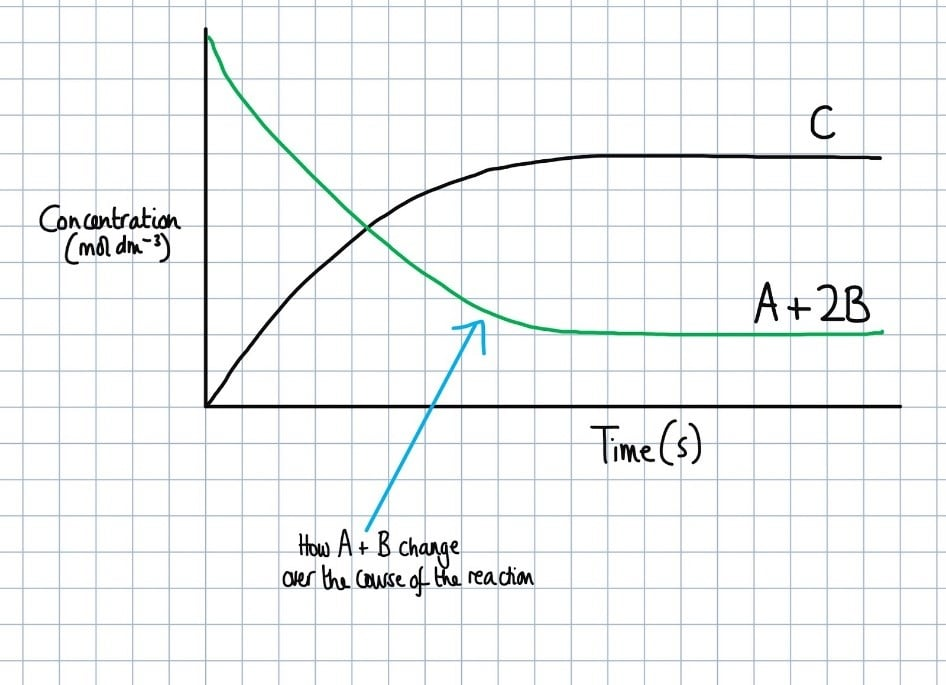
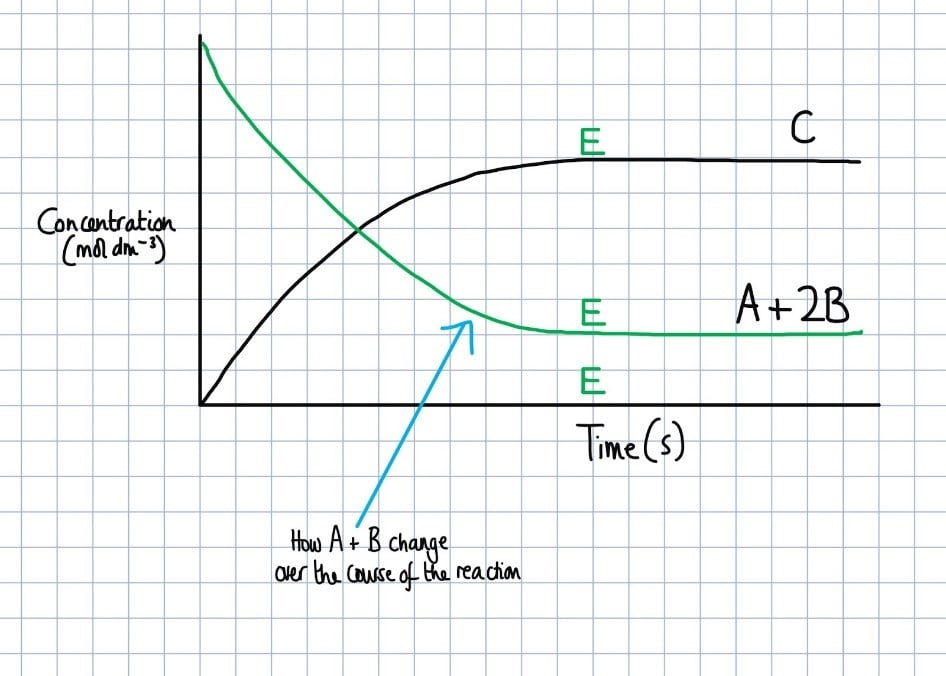
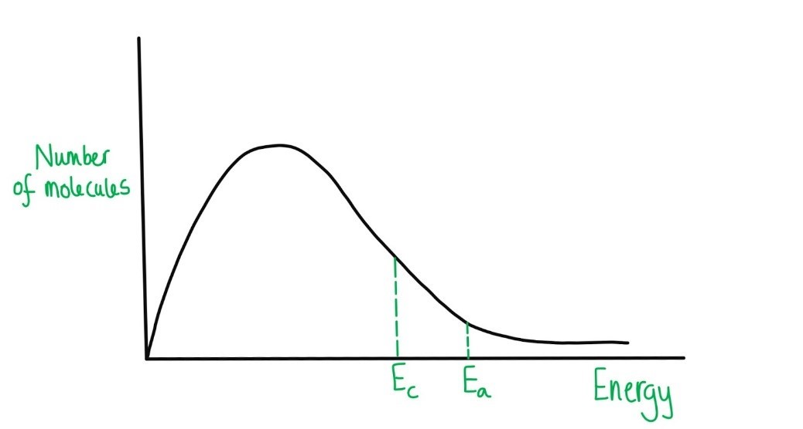
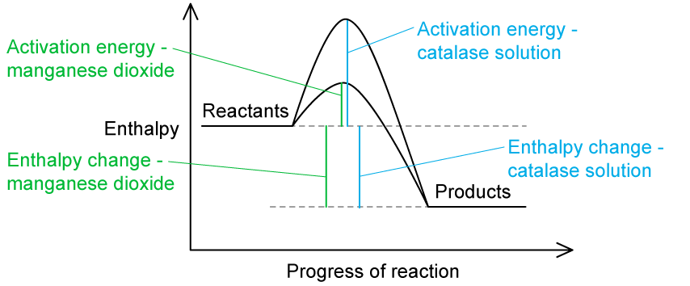
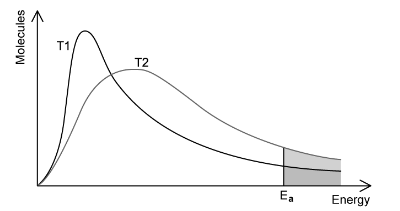
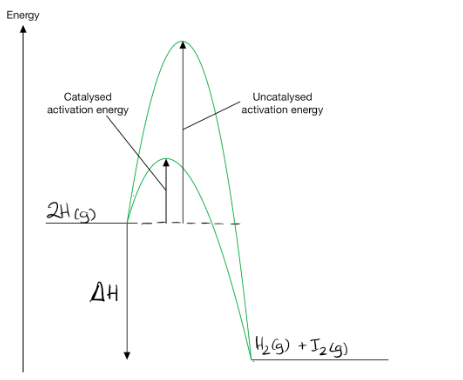

# Mark Schemes — Homogeneous & Heterogeneous Catalysts
**8. Reaction Kinetics** · Cambridge (CIE) A-LEVEL chemistry (9701)

## Multiple Choice Questions (9 questions)

### Q1
**Final answer:** **The correct answer is A because:**

- In experiment 2, the initial gradient is shallower than in experiment 1, indicating a slower initial rate.

  - A less effective catalyst raises the activation energy, reducing the proportion of molecules with energy greater than or equal to *E*a and therefore decreasing the rate.
- In experiment 2, the curve reaches a lower plateau, indicating a lower equilibrium yield of *T*.

  - A catalyst does not alter the equilibrium position; it only affects the rate at which equilibrium is reached.
  - The only way to lower the equilibrium yield of *T* at constant temperature and pressure is to begin with a decreased initial amount of reactant *R*.

**B** is incorrect as a less effective catalyst is consistent with the shallower gradient, but increasing the initial amount of reactant *R* would shift the equilibrium to produce more *T*, giving a higher plateau — not a lower one.

**C** is incorrect as a more effective catalyst would give a steeper initial gradient (faster rate), which contradicts the graph.

**D** is incorrect as both variables are wrong: a more effective catalyst gives a steeper initial gradient, and more reactant *R* gives a higher equilibrium yield.

### Q2
**Final answer:** **The correct answer is B**

- A catalyst does not increase the energy of the reacting molecules.
- The average kinetic energy of the molecules is determined exclusively by the temperature of the system, which is unchanged by the addition of a catalyst.

**A** is incorrect as a catalyst provides an alternative reaction pathway with a lower activation energy than the uncatalysed route. Statement A is therefore true.

**C** is incorrect as a catalyst works by providing an alternative reaction pathway. Statement C is therefore true.

**D** is incorrect as the Pd2+ (aq) ions are in the same physical state as the reaction mixture, making this an example of homogeneous catalysis. Since the catalyst participates directly in the reaction mechanism, increasing its concentration increases the frequency of productive interactions with the reactants, thereby increasing the rate. Statement D is therefore true.

### Q3
**Final answer:** **The correct answer is A**

- The Haber process uses finely divided iron as a catalyst.
- The reactants nitrogen and hydrogen are both gases, while the iron catalyst is a solid.
- Since the catalyst and reactants are in different physical states, this is an example of heterogeneous catalysis.

**C** is incorrect as iron is the correct catalyst identity, but the Haber process uses heterogeneous catalysis, not homogeneous. Homogeneous catalysis requires the catalyst to be in the same physical state as the reactants.

**B** and **D** are incorrect as vanadium(V) oxide is the catalyst for the Contact process (the industrial production of sulfuric acid), not the Haber process.

### Q4
**Final answer:** **The correct answer is D**

- A catalyst provides an alternative reaction pathway with a lower activation energy.
- This lowers the activation energy barrier for both the forward and reverse reactions equally, so the rate of both reactions increases.

**A** is incorrect as the average kinetic energy of the reacting particles is determined by the temperature of the system alone. A catalyst does not change the temperature and therefore has no effect on the average kinetic energy.

**B** is incorrect as a catalyst provides an alternative pathway with a lower activation energy but does not change the absolute energy levels of the reactants or products. The enthalpy change of the forward reaction is therefore unaffected.

**C** is incorrect as a catalyst is not consumed in the overall reaction. By definition, a catalyst is chemically unchanged at the end of the process, so its mass remains the same.

### Q5
**Final answer:** **The correct answer is C**

- A catalyst provides an alternative reaction pathway with a lower activation energy (*E*a).
- The height of peak Q is determined solely by the temperature and total number of molecules in the sample.

  - Adding a catalyst changes neither of these, so the height of peak Q remains the same.
- A lower *E*a corresponds to a position shifted to the left on the kinetic energy axis, as the activation energy has a smaller numerical value.

  - This is shown in the diagram below.

**A** is incorrect as the height of peak Q only decreases when the temperature is raised, which causes the distribution to flatten and broaden. A catalyst does not change the temperature.

**B** is incorrect as a lower activation energy corresponds to a line shifted to the left on the kinetic energy axis (a smaller numerical value), not to the right.

**D** is incorrect as the height of peak Q remains the same (temperature is unchanged), and a lower *E*a shifts the line to the left, not to the right.

### Q6
**Final answer:** **The correct answer is B**

- Cu+ and Cu2+ ions act as catalysts because they are consumed and then regenerated across reactions 2 and 3.

  - They do not appear in the overall net equation.
- Adding reactions 2 and 3, the copper ions cancel out.

  - The net equation is Cl + Ag → Cl– + Ag+, which is the reverse reaction of reaction 1.
  - The copper ions therefore catalyse the reverse reaction, which returns the glass to transparent.

**A** is incorrect as Ag+ ions are reduced in reaction 1. The oxidation number of silver decreases from +1 in Ag+ to 0 in Ag. A decrease in oxidation number corresponds to reduction, not oxidation.

**C** is incorrect as Cu+ ions are oxidised in reaction 2. The oxidation number of copper increases from +1 to +2, so Cu+ is acting as a reducing agent, not an oxidising agent.

**D** is incorrect as the reaction that absorbs light must produce elemental silver, since the concentration of silver atoms determines the darkness of the glass. This occurs in the forward direction of reaction 1, not reaction 2.

### Q7
**Final answer:** **The correct answer is D**

- A heterogeneous catalyst is in a different physical state from the reactants.

  - For example, the iron catalyst in the Haber process is a solid, while the reactants nitrogen and hydrogen are gases.
- The mechanism involves reactant molecules adsorbing onto active sites on the solid catalyst surface.
- This weakens bonds in the adsorbed molecules and lowers the activation energy of the reaction, increasing the rate.

**A** and **B** are incorrect as a catalyst in the same physical state as the reactants is a homogeneous catalyst, not a heterogeneous one.

**C** is incorrect as forming reactive intermediates is characteristic of homogeneous catalysis, where the catalyst reacts with a reactant to form an intermediate compound before being regenerated. This is not the mechanism by which a heterogeneous catalyst operates.

### Q8
**Final answer:** **The correct answer is D**

- A catalyst increases the rate of a chemical reaction by providing an alternative reaction pathway with a lower activation energy than the uncatalysed route.
- Since the activation energy barrier is lower, a greater proportion of the reacting particles have energy greater than or equal to *E*a
- This increases the frequency of effective collisions and therefore the rate of reaction.

**A** and **B** are incorrect as a catalyst provides a pathway with a lower activation energy, not a higher one. A higher activation energy barrier would reduce the proportion of effective collisions and decrease the rate of reaction.

**C** is incorrect as a lower activation energy increases the proportion of molecules that can react, which increases the rate of reaction, not decreases it.

### Q9
**Final answer:** **The correct answer is C**

- A catalyst provides an alternative reaction pathway with a lower activation energy (*E*a).
- On a Boltzmann distribution, the lower *E*a is represented by a vertical line shifted to the left on the kinetic energy axis.

  - This increases the area under the curve to the right of the *E*a line, meaning a greater proportion of molecules now have energy greater than or equal to the activation energy.
  - This leads to a higher frequency of effective collisions and an increased rate of reaction.

**A** is incorrect as the average kinetic energy of the reacting particles is determined by the temperature of the system alone. A catalyst does not alter the temperature and therefore has no effect on the average kinetic energy or the shape of the distribution curve.

**B** is incorrect as a catalyst does not increase the overall collision frequency between molecules. Collision frequency is increased by raising concentration or pressure. A catalyst only increases the proportion of collisions that are effective by lowering *E*a.

**D** is incorrect as a catalyst lowers *E*a equally for both the forward and reverse reactions. It increases the rate at which equilibrium is reached but does not alter the equilibrium position of the reaction.

## Structured Questions (4 questions)

### Q1
i) The completed graph showing the concentrations of **A** and **B** is:

**[2 marks]**

> **[mark-scheme]**
> 1 mark for curves of the same inverted shape as **C**, showing **A** and **B** reducing over time **AND** not reaching zero
> 
> 1 mark for the curves levelling off at the same point as the curve for **C**

ii) The point at which equilibrium is first established is:

**[1 mark]**

> **[mark-scheme]**
> ii) The equilibrium point:
> 
> 1 mark for **E** marked at any correct position on the graph, at the point where both concentration curves first become horizontal straight lines

> **[exam-tip]**
> For part (i), the concentrations of **A** and **B** decrease at the same rate as **C** increases, so the curves are an inverted version of the **C** curve. The lines should not reach zero, because the reaction is reversible; some **C** reacts to reform **A** and **B**, so a non-zero equilibrium concentration of **A** and **B** is maintained.
> 
> For part (ii), equilibrium is established when the concentrations of all species stop changing. Mark **E** at the point where all curves become flat horizontal lines.
> **[mark-scheme]**
> The effect of a catalyst on the rate of reaction and the equilibrium yield is:
> 
> - The rate of reaction increases / the reaction reaches equilibrium faster **[1 mark]**
> - A catalyst provides an alternative reaction pathway of lower activation energy **[1 mark]**
> - The equilibrium yield is unchanged, because the rates of the forward and reverse reactions increase equally (so the equilibrium position does not change) **[1 mark]**

> **[exam-tip]**
> A catalyst speeds up the reaction by providing an alternative reaction pathway of lower activation energy, increasing the rate of both the forward and reverse reactions equally. Equilibrium is therefore reached more quickly. However, the equilibrium position is unchanged, meaning the yield of products is the same as without a catalyst.
i) The completed Boltzmann distribution is:

**[3 marks]**

> **[mark-scheme]**
> 1 mark for both axes correctly labelled: y-axis (number of / proportion of) molecules; x-axis (kinetic) energy
> 
> 1 mark for a single correct Boltzmann distribution curve: starts at / near the origin and does not touch the x-axis at higher energies
> 
> 1 mark for *E*a correctly labelled to the right of the peak **AND** *E*a,cat correctly labelled to the left of *E*a

> **[mark-scheme]**
> ii) Using the Boltzmann distribution to explain how a catalyst increases the rate of reaction:
> 
> - Without a catalyst, only a small proportion of molecules have energy greater than or equal to the activation energy (*E*a) **[1 mark]**
> - Adding a catalyst lowers the activation energy (to *E*a,cat) **[1 mark]**
> - With a catalyst, a greater proportion of molecules have energy greater than or equal to *E*a,cat, so more collisions are successful and the rate increases **[1 mark]**

> **[exam-tip]**
> For part (i), since the temperature is constant, only one Boltzmann distribution curve is needed. The catalyst lowers the activation energy but does not change the distribution of molecular energies. Label *E*a to the right of the peak and *E*a,cat closer to the origin, to the left of *E*a.
> 
> For part (ii), the key idea is that a catalyst lowers the activation energy. This means a greater proportion of molecules in the same distribution have sufficient energy to react. More frequent successful collisions lead to a higher rate of reaction.

### Q2
The equation for the decomposition of hydrogen peroxide is:

2H2O2 (aq) → 2H2O (l) + O2 (g)

**OR**

H2O2 (aq) → H2O (l) + ½O2 (g)

**[2 marks]**

> **[mark-scheme]**
> 1 mark for correct species and correct balancing
> 
> 1 mark for all correct state symbols: (aq), (l), (g)

> **[exam-tip]**
> This is a standard decomposition reaction. The products are water and oxygen:
> 
> - Hydrogen peroxide solution is aqueous: H2O2 (aq)
> - Water is liquid at room temperature: H2O (l)
> - Oxygen is released as a gas: O2 (g)
> 
> A catalyst is often used in this reaction to increase the rate of decomposition.
> **[mark-scheme]**
> The type of catalysis for each catalyst is:
> 
> - Manganese dioxide: heterogeneous
> **AND**
> The catalyst is in a different state / phase to the reactants **[1 mark]**
> - Catalase solution: homogeneous
> **AND**
> The catalyst is in the same state / phase as the reactants **[1 mark]**

> **[exam-tip]**
> Homogeneous catalysts are in the same physical state as the reactants. Heterogeneous catalysts are in a different physical state from the reactants.
> 
> - Hydrogen peroxide solution is aqueous (aq)
> - Manganese dioxide is a solid (s), which is a different state from H2O2 (aq), making it a heterogeneous catalyst
> - Catalase is in solution (aq), the same state as H2O2 (aq), making it a homogeneous catalyst
The reaction pathway diagram for the reaction using each catalyst is:

**[3 marks]**

> **[mark-scheme]**
> 1 mark for a correct exothermic profile: both curves start at the same reactant level (H2O2) and end at the same lower product level (H2O + O2), each with a 'hump'
> 
> 1 mark for the curve for manganese dioxide drawn lower (smaller hump) than the curve for catalase solution
> 
> 1 mark for activation energy arrows (*E*a) **AND** enthalpy change arrows (Δ*H*) correctly labelled on the diagram

> **[exam-tip]**
> The reaction profile shows the same exothermic reaction taking place via two different catalysts:
> 
> - Both curves start and finish at the same energy levels (same reactants and products)
> - The enthalpy change Δ*H* is identical for both
> - Manganese dioxide is a more effective catalyst, lowering the activation energy more than catalase, so its curve has a smaller 'hump'
> 
> Make sure you label both the activation energy arrows (*E*a) from the reactant level to the peak of each curve, and both enthalpy change arrows (Δ*H*) from reactants to products.

### Q3
i) A labelled Boltzmann distribution for *T*1 and *T*2 is:

**[2 marks]**

> **[mark-scheme]**
> 1 mark for axes correctly labelled: y-axis (number of) molecules; x-axis (kinetic) energy
> 
> 1 mark for *T*2 correctly drawn: lower peak than *T*1, shifted to the right, crossing *T*1 once, with *T*2 above *T*1 at higher energies **AND** both curves start at or near the x-axis and neither goes below the x-axis

> **[mark-scheme]**
> ii) When temperature increases from *T*1 to *T*2:
> 
> - The proportion of molecules with energy greater than or equal to *E*a increases **[1 mark]**

> **[exam-tip]**
> For part (i), key features of Boltzmann distribution curves:
> 
> - Curves start at or near the origin (very few molecules have very low energy)
> - Curves do not touch the x-axis at high energies (there is no upper energy limit)
> - *T*2 is at a higher temperature, so it has a lower peak and a longer tail at higher energies
> 
> For part (ii), at higher temperature the Boltzmann distribution shifts to the right, meaning a greater area under the curve lies to the right of *E*a. A greater proportion of molecules therefore have energy greater than or equal to *E*a, leading to more frequent successful collisions and a higher rate of reaction.
i) The reaction profile for the decomposition of hydrogen iodide is:

**[2 marks]**

> **[mark-scheme]**
> 1 mark for a correct exothermic energy profile: reactants (2HI (g)) at a higher energy level than products (H2 (g) + I2 (g)), both curves starting from the reactant level and ending at the product level
> 
> 1 mark for the uncatalysed curve drawn higher (larger hump) than the catalysed curve

ii) The activation energy for the reverse reaction is calculated by adding |Δ*H*| to *E*a of the forward reaction:

- Calculate *E*a for the uncatalysed reverse reaction:

*E*a (reverse, uncatalysed) = 183 + 52

*E*a (reverse, uncatalysed) = **(+) 235 kJ mol****-1** **[1 mark]**

- Calculate *E*a for the catalysed reverse reaction:

*E*a (reverse, catalysed) = 105 + 52

*E*a (reverse, catalysed) = **(+) 157 kJ mol****-1** **[1 mark]**

> **[mark-scheme]**
> 1 mark for *E*a uncatalysed (reverse) = 235 kJ mol-1
> 
> 1 mark for *E*a catalysed (reverse) = 157 kJ mol-1

> **[mark-scheme]**
> iii) Increasing the concentration of hydrogen iodide gas increases the rate of reaction because:
> 
> - More molecules are present in the same volume / molecules are closer together **[1 mark]**
> - The frequency of successful collisions increases **[1 mark]**

> **[exam-tip]**
> For part (i), make sure the catalysed and uncatalysed curves do not merge before reaching the products; each should have a distinct, separate peak.
> 
> For part (ii), to find the activation energy of the reverse reaction, add the magnitude of Δ*H* to the forward *E*a. The forward reaction is exothermic (Δ*H* = −52 kJ mol-1), so the products are at a lower energy level than the reactants. Reversing the direction means starting from the products and climbing up to the transition state, so the reverse *E*a = forward *E*a + |Δ*H*|.
> 
> For part (iii), increasing the concentration places more molecules in the same volume, so collisions between reactant molecules are more frequent. More total collisions per unit time means more successful collisions (those with sufficient energy and the correct orientation), increasing the rate of reaction.
> **[mark-scheme]**
> i) Gold was used in powdered form because:
> 
> - (Powder form) increases the surface area (available for the reaction to occur on) **[1 mark]**

> **[mark-scheme]**
> ii) The difference between a homogeneous and heterogeneous catalyst is:
> 
> - A homogeneous catalyst is in the same physical state / phase as the reactants
> **AND**
> A heterogeneous catalyst is in a different physical state / phase from the reactants **[1 mark]**

> **[mark-scheme]**
> iii) When a catalyst is introduced, the area under the Boltzmann distribution curve:
> 
> - Stays the same / is unchanged **[1 mark]**

> **[exam-tip]**
> Heterogeneous catalysts often work in powdered form or as a honeycomb structure to maximise the available surface area. Reactant molecules are adsorbed onto the catalyst surface, react, and then the products are desorbed. Increasing the surface area allows more reactant molecules to interact with the catalyst at the same time.
> 
> The area under the Boltzmann distribution represents the total number of molecules. Since no molecules are added or removed when a catalyst is used, the area is unchanged. A catalyst lowers the activation energy but does not change the distribution of molecular energies.
> **[mark-scheme]**
> i) The balanced equation for the Contact process is:
> 
> - 2SO2 (g) + O2 (g) ⇌ 2SO3 (g) **[1 mark]**

> **[mark-scheme]**
> ii) The mode of action of the vanadium(V) oxide catalyst is:
> 
> - Reactant molecules (SO2 and/or O2) are adsorbed onto the surface of the catalyst **[1 mark]**
> - Product molecules (SO3) are desorbed from the surface of the catalyst **[1 mark]**

> **[exam-tip]**
> For part (i), all the information needed to construct the equation is in the question:
> 
> - Sulfur dioxide + oxygen → sulfur trioxide: SO2 + O2 → SO3
> - Balance by inspection: 2SO2 + O2 → 2SO3
> - The reaction is reversible: use ⇌
> - All species are gases (g)
> 
> For part (ii), heterogeneous catalysts work by adsorption and desorption. Reactant molecules (SO2 and O2) bind to the solid surface of the catalyst (adsorption). After the reaction takes place on the surface, the product molecules (SO3) leave the surface (desorption), freeing up the catalyst surface for further reactions.

### Q4
The equation for this reaction is:

4NH3 (g) + 5O2 (g) ⇌ 4NO (g) + 6H2O (g)

**[2 marks]**

> **[mark-scheme]**
> 1 mark for correct species and correct balancing
> 
> 1 mark for all correct state symbols: (g), (g), (g), (g)

> **[exam-tip]**
> All the information required to construct the equation is in the question:
> 
> - Gaseous ammonia: NH3 (g)
> - Reacts in air: + O2 (g)
> - Reversible reaction: ⇌
> - Forms nitrogen(II) oxide gas: NO (g)
> - Forms water vapour: H2O (g)
> 
> NH3 + O2 ⇌ NO + H2O
> 
> Then balance the equation.
> **[mark-scheme]**
> The type of catalysis is heterogeneous:
> 
> - Heterogeneous **[1 mark]**
> - The catalyst is in a different state / phase to the reactants
> **OR**
> The catalyst is solid **AND **the reactants are gaseous **[1 mark]**

> **[exam-tip]**
> From Part (a), the reactants (NH3 and O2) are gaseous. The platinum and rhodium catalysts are powder-coated onto a solid mesh, which means that they are solid. A heterogeneous catalyst is in a different phase to the reactants.
> **[mark-scheme]**
> The catalyst does not affect the yield because:
> 
> - It increases the rate of the forward and reverse reactions equally (so the equilibrium position is unchanged) **[1 mark]**

> **[exam-tip]**
> A catalyst speeds up the reaction so equilibrium is reached more quickly. However, because both the forward and reverse reaction rates are increased equally, the equilibrium position is unchanged — the same equilibrium yield of products is obtained.
