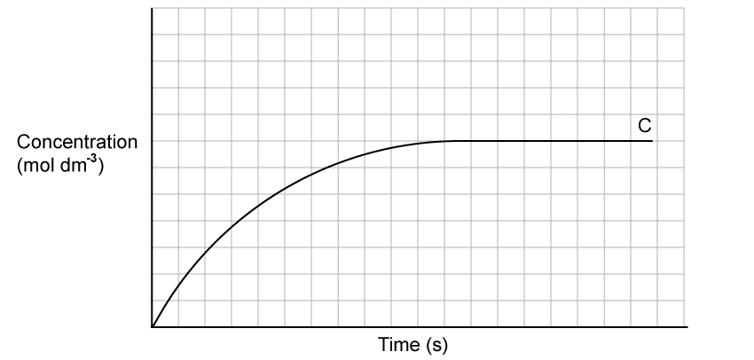
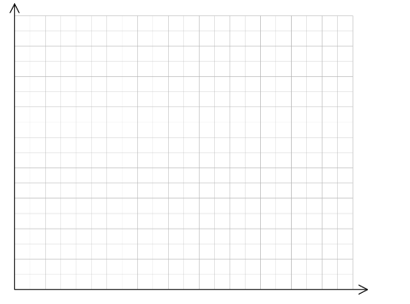

# Exam Questions — Homogeneous & Heterogeneous Catalysts
**8. Reaction Kinetics** · Cambridge (CIE) A-LEVEL chemistry (9701)
> Source: [https://www.savemyexams.com/a-level/chemistry/cie/25/topic-questions/](https://www.savemyexams.com/a-level/chemistry/cie/25/topic-questions/) · 13 questions across 2 sets

## Multiple Choice Questions (9 questions)

### Q1 — hard — 1 marks

**Q1** [1 mark]

The stoichiometry of a catalysed reaction is shown.

*R* (g) + *S* (g) ⇌ *T* (g) + *U* (g)

Two experiments were carried out in which the amount of product *T* was measured against time. The results are shown in the diagram.

Which row gives the changes to the conditions in experiment 1 that could produce the results for experiment 2?

|   | catalyst | initial amount of reactant *R* |
|---|---|---|
| **A** | less effective | decreased |
| **B** | less effective | increased |
| **C** | more effective | decreased |
| **D** | more effective | increased |

### Q2 — easy — 1 marks

**Q2** [1 mark]

The oxidation of butadiene, CH2=CHCH=CH2, using air or oxygen, produces the molecule crotonaldehyde, CH3CH=CHCHO.

One method of oxidation is to pass a mixture of butadiene and oxygen through a hot aqueous solution of palladium(II) ions, Pd2+ (aq), which catalyse the reaction.

Which statement about the action of the Pd2+ (aq) ions is **not** correct?

### Q3 — medium — 1 marks

**Q3** [1 mark]

Which row describes the catalyst used in the Haber process?

|   | type of catalysis | identity of catalyst |
|---|---|---|
| **A** | heterogeneous | iron |
| **B** | heterogeneous | vanadium(V) oxide |
| **C** | homogeneous | iron |
| **D** | homogeneous | vanadium(V) oxide |

### Q4 — easy — 1 marks

**Q4** [1 mark]

Which statement about the addition of a catalyst to a reversible reaction is correct?

### Q5 — medium — 1 marks

**Q5** [1 mark]

The diagram shows the Maxwell-Boltzmann distribution of molecular energies for a gaseous mixture. The peak is labelled Q, and the activation energy is marked as *E*a.

Which row describes the changes to the diagram when an effective catalyst is added?

|   | height of peak Q | position of *E*a |
|---|---|---|
| **A** | decreases | shifts to the left |
| **B** | decreases | shifts to the right |
| **C** | remains the same | shifts to the left |
| **D** | remains the same | shifts to the right |

### Q6 — hard — 1 marks

**Q6** [1 mark]

Photochromic glass is used for some glasses to enable them to work as sunglasses. The glass darkens when exposed to bright light and returns to transparent when the light is less bright. The darkness of the colour of the glass is related to the concentration of silver atoms.

The reactions involved are shown.

Reaction 1: Ag+ + Cl– ⇌ Ag + Cl

Reaction 2: Cu+ + Cl → Cu2+ + Cl–

Reaction 3: Cu2+ + Ag → Cu+ + Ag+

Which statement about these reactions is correct?

### Q7 — medium — 1 marks

**Q7** [1 mark]

Which row correctly describes the mechanism of a heterogeneous catalyst?

|   | phase of catalyst relative to reactants | way in which rate is increased |
|---|---|---|
| **A** | same phase | forms reactive intermediates |
| **B** | same phase | provides a surface for reactants to adsorb onto |
| **C** | different phase | forms reactive intermediates |
| **D** | different phase | provides a surface for reactants to adsorb onto |

### Q8 — easy — 1 marks

**Q8** [1 mark]

Which row describes the effect of adding a catalyst to a reaction?

|   | activation energy of the alternative pathway | rate of reaction |
|---|---|---|
| **A** | higher | decreases |
| **B** | higher | increases |
| **C** | lower | decreases |
| **D** | lower | increases |

### Q9 — hard — 1 marks

**Q9** [1 mark]

Which statement explains the effect of a catalyst using the Boltzmann distribution?

## Structured Questions (4 questions)

### Q1 — medium — 12 marks

**Q1** [3 marks]

Gaseous **A** and **B** were added together to produce **C** as shown.

**A (g) + 2B (g) ⇌ C (g)**

**Fig. 3.1** shows the production of **C** over time.

**Fig. 3.1**

i) On Fig. 3.1, sketch a line to show what happens to the concentrations of **A** and **B** during the progress of the reaction.

[2]

ii) On Fig. 3.1, label the point at which an equilibrium is first established.

[1]

**Q1** [3 marks]

**Extract:**

Gaseous **A** and **B** were added together to produce **C** as shown.

**A (g) + 2B (g) ⇌ C (g)**

State and explain the effect of a catalyst on the rate of reaction and the equilibrium yield of the reaction in **(a)**.

**Q1** [6 marks]

**Extract:**

Gaseous A and B were added together to produce C as shown.

A (g) + 2B (g) ⇌ C (g)

A catalyst was added to speed up the rate of reaction in part **(a)**.

i) Sketch a Boltzmann distribution on the axes in **Fig. 3.2** to show the distribution of molecular energies at a constant temperature with **and** without a catalyst.

Use *E*a to label the activation energy without a catalyst. Use *E*a,cat to label the activation energy with a catalyst.

[3]

**Fig. 3.2**

ii) Use the Boltzmann distribution to explain how the addition of a catalyst increases the rate of reaction.

[3]

### Q2 — medium — 7 marks

**Q2** [2 marks]

The decomposition of 3% hydrogen peroxide solution into water and oxygen is a very slow chemical reaction.

Construct an equation for this reaction. Include state symbols.

**Q2** [2 marks]

The decomposition of 3% hydrogen peroxide solution can be catalysed by different chemicals including solid manganese dioxide and catalase solution.

State whether each catalyst acts as a homogeneous or heterogeneous catalyst. Explain your answer.

**Q2** [3 marks]

For the exothermic decomposition of hydrogen peroxide, manganese dioxide gives a greater increase in the rate of reaction than catalase solution.

On Fig. 2.1:

- Sketch a reaction pathway diagram for the reaction using each catalyst.
- Label the diagram to show the enthalpy change, Δ*H*, and the activation energy, *E*a, for each reaction.

**Fig. 2.1**

### Q3 — hard — 15 marks

**Q3** [3 marks]

Reaction rates can be affected by a range of factors including changes in pressure and temperature.

**Fig 1.1**

On Fig 1.1:

i) Sketch one Boltzmann distribution labelled *T*1 and a second Boltzmann distribution at a higher temperature labelled *T*2.

[2]

ii) Use Fig 1.1 to state how the proportion of molecules with energy greater than or equal to the activation energy, *E*a, changes when temperature increases from *T*1 to *T*2.

[1]

**Q3** [6 marks]

Hydrogen iodide can be used in the manufacturing of pharmaceuticals and can be broken down back into its elements in standard form, iodine and hydrogen.

2HI (g) → H2 (g) + I2 (g)  Δ*H* = −52 kJ mol-1

The activation energy when uncatalysed is +183 kJ mol-1 and when catalysed with gold it is +105 kJ mol-1.

i) Sketch a reaction profile for the reaction, including the curves for the activation energies for both the catalysed and uncatalysed reactions.

[2]

ii) Calculate the activation energy for the *reverse reaction* in both the uncatalysed and catalysed reactions. Show your working.

[2]

iii) Explain why increasing the concentration of hydrogen iodide gas results in a faster reaction rate.

[2]

**Q3** [3 marks]

**Extract:**

Hydrogen iodide can be used in the manufacturing of pharmaceuticals and can be broken down back into its elements in standard form, iodine and hydrogen.

2HI (g) → H₂ (g) + I₂ (g)  Δ*H* = −52 kJ mol^-1^

The activation energy when uncatalysed is +183 kJ mol^-1^ and when catalysed with gold it is +105 kJ mol^-1^.

Catalysts are often used in industrial processes and can be used in a variety of forms.

i) Explain why it is likely that the solid gold catalyst was used in powder form to catalyse the reaction mentioned in part **(b)**.

[1]

ii) Gold is a heterogeneous catalyst used in the formation of hydrogen iodide. State the difference between a homogeneous and heterogeneous catalyst.

[1]

iii) State how, if at all, the area under the curve of a Boltzmann distribution changes as a catalyst is introduced, without changing the temperature or the total number of molecules.

[1]

**Q3** [3 marks]

The Contact process is an important industrial process, contributing to the production of sulfuric acid. In the Contact process, solid vanadium(V) oxide, a heterogeneous catalyst, is used to make sulfur trioxide from sulfur dioxide and oxygen. This process is reversible.

i) Construct a balanced symbol equation for this reaction. Include state symbols in your answer.

[1]

ii) Explain the mode of action of the vanadium(V) oxide catalyst in the Contact process.

[2]

### Q4 — medium — 5 marks

**Q4** [2 marks]

The first step in the production of nitric acid involves the reversible reaction of gaseous ammonia in air to form nitrogen(II) oxide gas and water vapour.

Construct an equation for this reaction. Include state symbols.

**Q4** [2 marks]

**Extract:**

The first step in the production of nitric acid involves the reversible reaction of gaseous ammonia in air to form nitrogen(II) oxide gas and water vapour.

4NH₃ (g) + 5O₂ (g) ⇌ 4NO (g) + 6H₂O (g)

For this reaction, a fine mesh is powder-coated with a mixture of platinum and rhodium catalysts.

State whether the catalyst acts as a homogeneous or heterogeneous catalyst in this reaction. Explain your answer.

**Q4** [1 mark]

**Extract:**

The first step in the production of nitric acid involves the reversible reaction of gaseous ammonia in air to form nitrogen(II) oxide gas and water vapour.

4NH₃ (g) + 5O₂ (g) ⇌ 4NO (g) + 6H₂O (g)

Explain why the catalyst does not affect the yield of the products in the reaction described in **(a)**.
